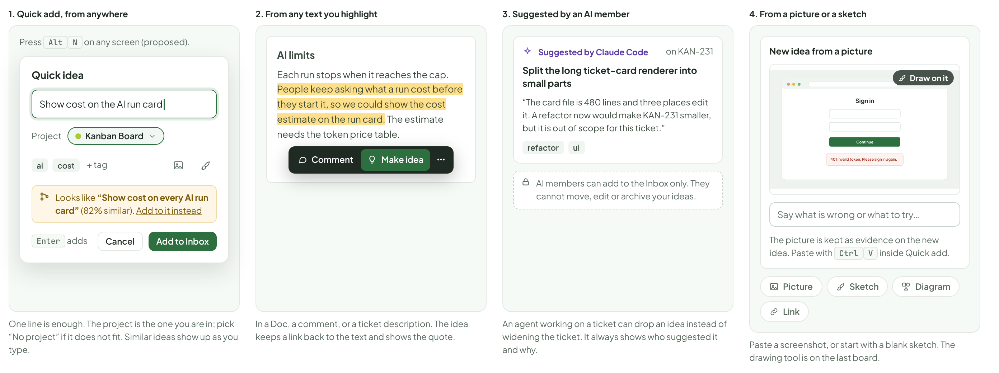
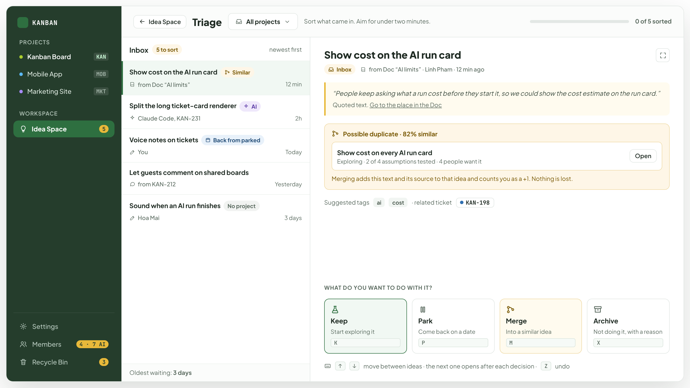
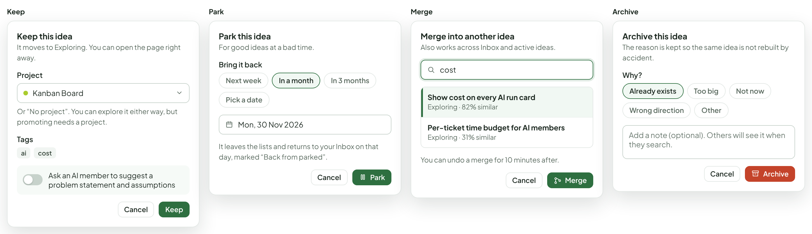
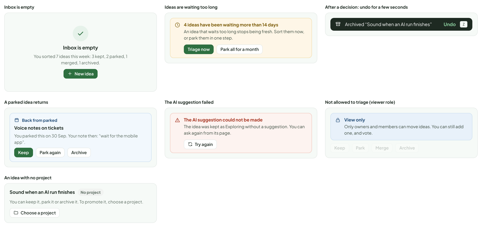
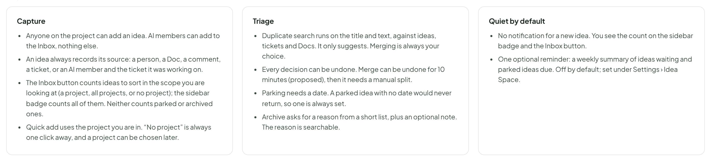

# Idea Space — capture & triage

> SCREEN — V1 PROPOSAL · source: [`IdeaCapture.dc.html`](../source/IdeaCapture.dc.html) · canvas `1793295530-5588` · sha256 `a229048f7914b1ffd3bf01e3e754a82690a1a0f80fbe462012074bbb09128095`

How ideas get in and how you sort them. Capture is one keystroke from anywhere, and ideas can come from text you highlight or from an AI member. Triage is a short pass: keep, park, merge, or archive.

Source: [IdeaCapture.dc.html](../source/IdeaCapture.dc.html) › header ("SCREEN — V1 PROPOSAL", "Idea Space — capture & triage" and the intro)

---

## A. Four ways in

Capture must cost almost nothing, or ideas stay in people’s heads. Every route ends in the same place: the Inbox, with a note of where it came from.

Source: [IdeaCapture.dc.html](../source/IdeaCapture.dc.html) › block "A. Four ways in"

- Text in the frames: "1. Quick add, from anywhere" · "Press AltN on any screen (proposed)." · "Quick idea" · "Show cost on the AI run card" · "Project" · "Kanban Board" · "ai" · "cost" · "+ tag" · "Looks like “Show cost on every AI run card” (82% similar). Add to it instead" · "Enter adds" · "Cancel" · "Add to Inbox" · "One line is enough. The project is the one you are in; pick “No project” if it does not fit. Similar ideas show up as you type." · "2. From any text you highlight" · "AI limits" · "Each run stops when it reaches the cap. People keep asking what a run cost before they start it, so we could show the cost estimate on the run card. The estimate needs the token price table." · "Comment" · "Make idea" · "In a Doc, a comment, or a ticket description. The idea keeps a link back to the text and shows the quote." · "3. Suggested by an AI member" · "Suggested by Claude Code" · "on KAN-231" · "Split the long ticket-card renderer into small parts" · "“The card file is 480 lines and three places edit it. A refactor now would make KAN-231 smaller, but it is out of scope for this ticket.”" · "refactor" · "ui" · "AI members can add to the Inbox only. They cannot move, edit or archive your ideas." · "An agent working on a ticket can drop an idea instead of widening the ticket. It always shows who suggested it and why." · "4. From a picture or a sketch" · "New idea from a picture" · "Sign in" · "Continue" · "401 Invalid token. Please sign in again." · "Draw on it" · "Say what is wrong or what to try…" · "The picture is kept as evidence on the new idea. Paste with CtrlV inside Quick add." · "Picture" · "Sketch" · "Diagram" · "Link" · "Paste a screenshot, or start with a blank sketch. The drawing tool is on the last board."

---

## B. The Inbox and triage

A short list on the left, one idea in focus on the right. You decide with one key and the next idea opens. Possible duplicates are found for you, from other ideas, tickets and Docs, and shown before you decide.

Source: [IdeaCapture.dc.html](../source/IdeaCapture.dc.html) › block "B. The Inbox and triage"

- Text in the frames: "KANBAN" · "PROJECTS" · "Kanban Board" · "KAN" · "Mobile App" · "MOB" · "Marketing Site" · "MKT" · "WORKSPACE" · "Idea Space" · "5" · "Settings" · "Members" · "4 · 7 AI" · "Recycle Bin" · "3" · "Triage" · "All projects" · "Sort what came in. Aim for under two minutes." · "0 of 5 sorted" · "Inbox" · "5 to sort" · "newest first" · "Show cost on the AI run card" · "Similar" · "from Doc “AI limits”" · "12 min" · "Split the long ticket-card renderer" · "AI" · "Claude Code, KAN-231" · "2h" · "Voice notes on tickets" · "Back from parked" · "You" · "Today" · "Let guests comment on shared boards" · "from KAN-212" · "Yesterday" · "Sound when an AI run finishes" · "No project" · "Hoa Mai" · "3 days" · "Oldest waiting: 3 days" · "from Doc “AI limits” · Linh Pham · 12 min ago" · "“People keep asking what a run cost before they start it, so we could show the cost estimate on the run card.”" · "Quoted text. Go to the place in the Doc" · "Possible duplicate · 82% similar" · "Show cost on every AI run card" · "Exploring · 2 of 4 assumptions tested · 4 people want it" · "Open" · "Merging adds this text and its source to that idea and counts you as a +1. Nothing is lost." · "Suggested tags" · "ai" · "cost" · "· related ticket" · "KAN-198" · "WHAT DO YOU WANT TO DO WITH IT?" · "Keep" · "Start exploring it" · "K" · "Park" · "Come back on a date" · "P" · "Merge" · "Into a similar idea" · "M" · "Archive" · "Not doing it, with a reason" · "X" · "↑" · "↓" · "move between ideas · the next one opens after each decision ·" · "Z" · "undo"

---

## C. The four decisions

Each one is a small dialog with the least it needs. None is permanent: archived ideas can be restored and parked ideas come back on their own.

Source: [IdeaCapture.dc.html](../source/IdeaCapture.dc.html) › block "C. The four decisions"

- Text in the frames: "Keep" · "Keep this idea" · "It moves to Exploring. You can open the page right away." · "Project" · "Kanban Board" · "Or “No project”. You can explore it either way, but promoting needs a project." · "Tags" · "ai" · "cost" · "Ask an AI member to suggest a problem statement and assumptions" · "Cancel" · "Park" · "Park this idea" · "For good ideas at a bad time." · "Bring it back" · "Next week" · "In a month" · "In 3 months" · "Pick a date" · "Mon, 30 Nov 2026" · "It leaves the lists and returns to your Inbox on that day, marked “Back from parked”." · "Merge" · "Merge into another idea" · "Also works across Inbox and active ideas." · "Show cost on every AI run card" · "Exploring · 82% similar" · "Per-ticket time budget for AI members" · "Exploring · 31% similar" · "You can undo a merge for 10 minutes after." · "Archive" · "Archive this idea" · "The reason is kept so the same idea is not rebuilt by accident." · "Why?" · "Already exists" · "Too big" · "Not now" · "Wrong direction" · "Other" · "Add a note (optional). Others will see it when they search."

---

## D. States

Source: [IdeaCapture.dc.html](../source/IdeaCapture.dc.html) › block "D. States"

- Text in the frames: "Inbox is empty" · "You sorted 7 ideas this week: 3 kept, 2 parked, 1 merged, 1 archived." · "New idea" · "Ideas are waiting too long" · "4 ideas have been waiting more than 14 days" · "An idea that waits too long stops being fresh. Sort them now, or park them in one step." · "Triage now" · "Park all for a month" · "After a decision: undo for a few seconds" · "Archived “Sound when an AI run finishes”" · "Undo" · "Z" · "A parked idea returns" · "Back from parked" · "Voice notes on tickets" · "You parked this on 30 Sep. Your note then: “wait for the mobile app”." · "Keep" · "Park again" · "Archive" · "The AI suggestion failed" · "The AI suggestion could not be made" · "The idea was kept as Exploring without a suggestion. You can ask again from its page." · "Try again" · "Not allowed to triage (viewer role)" · "View only" · "Only owners and members can move ideas. You can still add one, and vote." · "Park" · "Merge" · "An idea with no project" · "Sound when an AI run finishes" · "No project" · "You can keep it, park it or archive it. To promote it, choose a project." · "Choose a project"

---

## E. Rules

Proposed.

Source: [IdeaCapture.dc.html](../source/IdeaCapture.dc.html) › block "E. Rules"

- Text in the frames: "Capture" · "Anyone on the project can add an idea. AI members can add to the Inbox, nothing else." · "An idea always records its source: a person, a Doc, a comment, a ticket, or an AI member and the ticket it was working on." · "The Inbox button counts ideas to sort in the scope you are looking at (a project, all projects, or no project); the sidebar badge counts all of them. Neither counts parked or archived ones." · "Quick add uses the project you are in. “No project” is always one click away, and a project can be chosen later." · "Triage" · "Duplicate search runs on the title and text, against ideas, tickets and Docs. It only suggests. Merging is always your choice." · "Every decision can be undone. Merge can be undone for 10 minutes (proposed), then it needs a manual split." · "Parking needs a date. A parked idea with no date would never return, so one is always set." · "Archive asks for a reason from a short list, plus an optional note. The reason is searchable." · "Quiet by default" · "No notification for a new idea. You see the count on the sidebar badge and the Inbox button." · "One optional reminder: a weekly summary of ideas waiting and parked ideas due. Off by default; set under Settings › Idea Space."

### As shipped (3.11.0)

Built as designed: Quick add (`Alt+N`), Inbox triage with Keep, Park (needs a date), Merge (undo for 10 minutes) and Archive (needs a reason from a short list), Z to undo any move, and a duplicate search that runs on this computer (TF-IDF, no model). A Parked idea whose date has come returns to the Inbox once. See [`docs/specs/idea-space.md`](../../docs/specs/idea-space.md).
