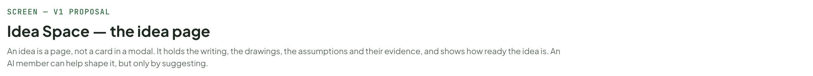
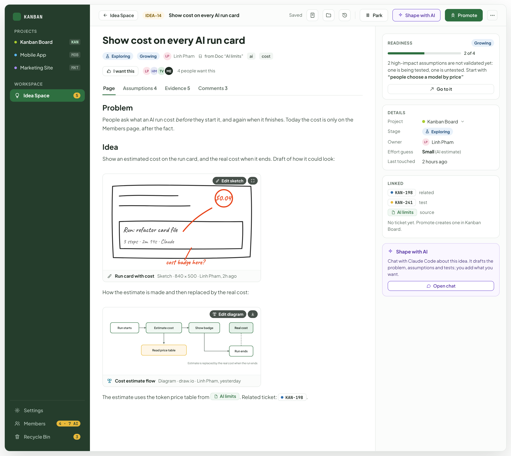
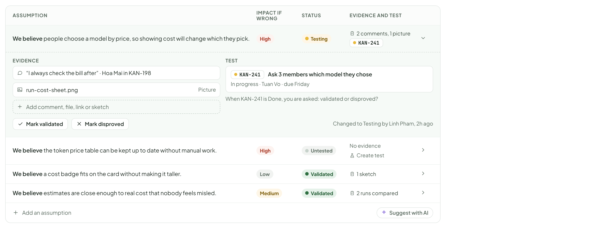
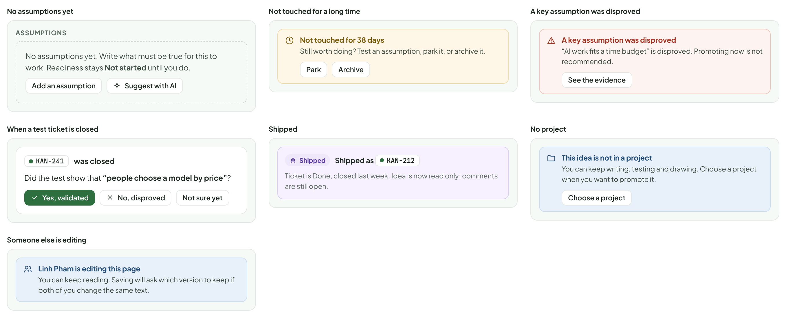
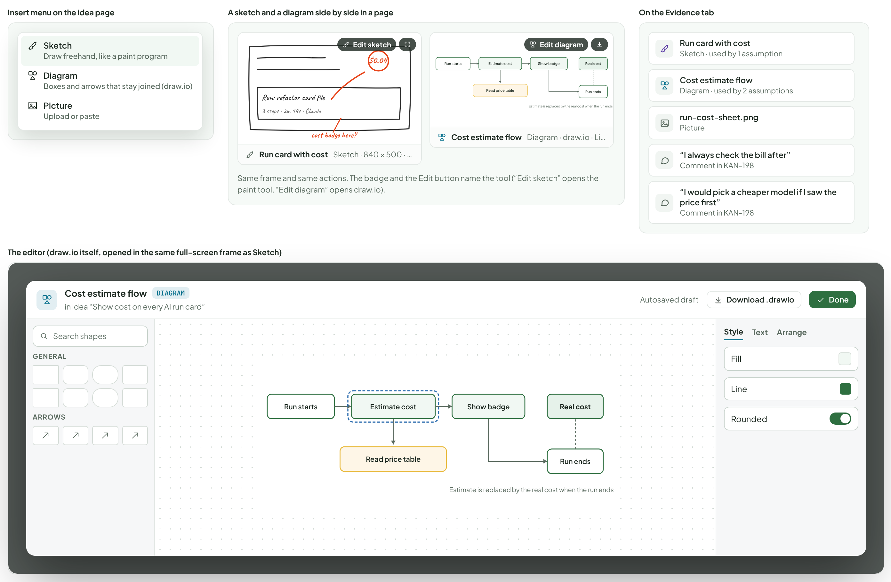
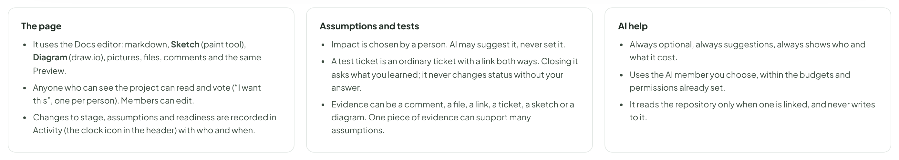

# Idea Space — the idea page

> SCREEN — V1 PROPOSAL · source: [`IdeaPage.dc.html`](../source/IdeaPage.dc.html) · canvas `1793295530-5588` · sha256 `cc36e79baf2fa1eae7f2e8c7047f518b3ae18397f6711c952b5718711d13dee1`

An idea is a page, not a card in a modal. It holds the writing, the drawings, the assumptions and their evidence, and shows how ready the idea is. An AI member can help shape it, but only by suggesting.

Source: [IdeaPage.dc.html](../source/IdeaPage.dc.html) › header ("SCREEN — V1 PROPOSAL", "Idea Space — the idea page" and the intro)

---

## A. The idea page

Each idea is a page, written like a Doc: text, pictures, sketches and diagrams (the same editor, comments and attachments). The right side keeps what you decide with: how ready it is, who wants it, what it is linked to.

Source: [IdeaPage.dc.html](../source/IdeaPage.dc.html) › block "A. The idea page"

- Text in the frames: "KANBAN" · "PROJECTS" · "Kanban Board" · "KAN" · "Mobile App" · "MOB" · "Marketing Site" · "MKT" · "WORKSPACE" · "Idea Space" · "5" · "Settings" · "Members" · "4 · 7 AI" · "Recycle Bin" · "3" · "IDEA-14" · "Show cost on every AI run card" · "Saved" · "Park" · "Shape with AI" · "Promote" · "Exploring" · "Growing" · "LP" · "Linh Pham" · "from Doc “AI limits”" · "ai" · "cost" · "I want this" · "HM" · "TV" · "ME" · "4 people want this" · "Page" · "Assumptions 4" · "Evidence 5" · "Comments 3" · "Problem" · "People ask what an AI run cost before they start it, and again when it finishes. Today the cost is only on the Members page, after the fact." · "Idea" · "Show an estimated cost on the run card, and the real cost when it ends. Draft of how it could look:" · "$0.04" · "Run: refactor card file" · "3 steps · 2m 14s · Claude" · "cost badge here?" · "Edit sketch" · "Run card with cost" · "Sketch · 840 × 500 · Linh Pham, 2h ago" · "How the estimate is made and then replaced by the real cost:" · "Run starts" · "Estimate cost" · "Show badge" · "Read price table" · "Run ends" · "Real cost" · "Estimate is replaced by the real cost when the run ends" · "Edit diagram" · "Cost estimate flow" · "Diagram · draw.io · Linh Pham, yesterday" · "The estimate uses the token price table from" · "AI limits. Related ticket:" · "KAN-198" · "." · "READINESS" · "2 of 4" · "2 high-impact assumptions are not validated yet: one is being tested, one is untested. Start with" · "“people choose a model by price”" · "Go to it" · "DETAILS" · "Project" · "Stage" · "Owner" · "Effort guess" · "Small (AI estimate)" · "Last touched" · "2 hours ago" · "LINKED" · "related" · "KAN-241" · "test" · "AI limits" · "source" · "No ticket yet. Promote creates one in Kanban Board." · "Chat with Claude Code about this idea. It drafts the problem, assumptions and tests; you add what you want." · "Open chat"

---

## B. Assumptions: what must be true

The Assumptions tab. This is where an idea becomes more than a wish. Each assumption says how bad it is if wrong, what proof exists, and how it is being tested. Open one to see the evidence and the test.

Source: [IdeaPage.dc.html](../source/IdeaPage.dc.html) › block "B. Assumptions: what must be true"

- Text in the frames: "ASSUMPTION" · "IMPACT IF WRONG" · "STATUS" · "EVIDENCE AND TEST" · "We believe people choose a model by price, so showing cost will change which they pick." · "High" · "Testing" · "2 comments, 1 picture" · "KAN-241" · "EVIDENCE" · "“I always check the bill after” · Hoa Mai in KAN-198" · "run-cost-sheet.png" · "Picture" · "Add comment, file, link or sketch" · "TEST" · "Ask 3 members which model they chose" · "In progress · Tuan Vo · due Friday" · "When KAN-241 is Done, you are asked: validated or disproved?" · "Mark validated" · "Mark disproved" · "Changed to Testing by Linh Pham, 2h ago" · "We believe the token price table can be kept up to date without manual work." · "Untested" · "No evidence" · "Create test" · "We believe a cost badge fits on the card without making it taller." · "Low" · "Validated" · "1 sketch" · "We believe estimates are close enough to real cost that nobody feels misled." · "Medium" · "2 runs compared" · "Add an assumption" · "Suggest with AI"

---

## C. Shape with AI: a chat on the idea

Optional. The button in the page header (and the card on the right) opens a chat docked beside the idea, like the chat on a ticket. You talk to an AI member about this idea: it can draft the problem, suggest assumptions and the cheapest test for each, guess the effort from the code, and look for similar ideas. Anything it proposes comes as a draft with an Add button; Add puts it on the page with a purple AI chip. It uses the same AI members, limits and cost display as the rest of the app.

Source: [IdeaPage.dc.html](../source/IdeaPage.dc.html) › block "C. Shape with AI: a chat on the idea"

![C. Shape with AI: a chat on the idea: Optional. The button in the page header (and the card on the right) opens a chat docked beside the idea, like the chat on a ticket. You talk to an AI member about this idea: it can draft the problem, suggest assumptions and the cheapest test for each, guess the effort from the code, and look for similar ideas. Anything it proposes comes as a draft with an Add button; Add puts it on the page with a purple AI chip. It uses the same AI members, limits and cost display as the rest of the app.](../images/idea-page/06-c-shape-with-ai-a-chat-on-the-idea.png)

- Text in the frames: "KANBAN" · "PROJECTS" · "Kanban Board" · "KAN" · "Mobile App" · "MOB" · "Marketing Site" · "MKT" · "WORKSPACE" · "Idea Space" · "5" · "Settings" · "Members" · "4 · 7 AI" · "Recycle Bin" · "3" · "IDEA-14" · "Show cost on every AI run card" · "Saved" · "Park" · "Shape with AI" · "Promote" · "Page" · "Assumptions 1" · "Evidence" · "Comments" · "ASSUMPTION" · "IMPACT IF WRONG" · "STATUS" · "EVIDENCE AND TEST" · "We believe people choose a model by price, so showing cost will change which they pick." · "Added from AI chat" · "High" · "Untested" · "Create test" · "An assumption added from the chat keeps a purple AI chip until you edit it. Then it is yours." · "Claude Code · local runner" · "Reading" · "This idea" · "3 comments" · "2 related Docs" · "repo kanban-board-mcp" · "Suggest assumptions for this idea" · "Three things have to be true for this to work. Add the ones you agree with:" · "Added" · "We believe the token price table can be kept up to date without manual work." · "Add" · "We believe estimates are close enough to real cost that nobody feels misled." · "Medium" · "Add the other 2" · "Edit" · "What is the cheapest test for the first one?" · "Ask 3 members which model they picked last week and why. It takes one afternoon and needs no code. If fewer than 2 say price mattered, the idea is weaker than it looks." · "Create test ticket" · "Post to comments" · "Draft the problem" · "Suggest assumptions" · "Cheapest test for each" · "Effort guess" · "Anything like this already?" · "Ask about this idea…" · "About $0.01 per answer · suggestions are drafts" · "Enter send" · "When the chat is empty: starting points" · "Shape this idea with Claude Code" · "It reads the idea, related Docs and tickets, and the repository (read only)." · "Draft the problem and the idea" · "Suggest assumptions and cheapest tests" · "Check what already exists" · "Guess the effort from the code" · "While it works: you see what it is doing" · "Guess the effort" · "Reading the code…" · "Read the idea and 3 comments" · "Found RunCard.tsx and runCost.ts" · "Counting what would change" · "Stop" · "18s · $0.01 so far" · "If it fails" · "Claude Code could not answer" · "The AI is not signed in. Nothing was changed." · "Open AI settings" · "Idea with no project" · "This idea is not in a project" · "Claude Code can still read the idea and workspace Docs, but there is no repository, so no effort guess. Choose a project for the full help." · "Choose a project"

---

## D. States

Source: [IdeaPage.dc.html](../source/IdeaPage.dc.html) › block "D. States"

- Text in the frames: "No assumptions yet" · "ASSUMPTIONS" · "No assumptions yet. Write what must be true for this to work. Readiness stays Not started until you do." · "Add an assumption" · "Suggest with AI" · "Not touched for a long time" · "Not touched for 38 days" · "Still worth doing? Test an assumption, park it, or archive it." · "Park" · "Archive" · "A key assumption was disproved" · "“AI work fits a time budget” is disproved. Promoting now is not recommended." · "See the evidence" · "When a test ticket is closed" · "KAN-241" · "was closed" · "Did the test show that “people choose a model by price”?" · "Yes, validated" · "No, disproved" · "Not sure yet" · "Shipped" · "Shipped as" · "KAN-212" · "Ticket is Done, closed last week. Idea is now read only; comments are still open." · "No project" · "This idea is not in a project" · "You can keep writing, testing and drawing. Choose a project when you want to promote it." · "Choose a project" · "Someone else is editing" · "Linh Pham is editing this page" · "You can keep reading. Saving will ask which version to keep if both of you change the same text."

---

## E. Diagrams in an idea (draw.io)

Diagrams work the same as everywhere else in the app (see the Diagrams board): the same Insert action, the same embed, the same editor, the same limits. In an idea they sit beside sketches, and both count as evidence.

Source: [IdeaPage.dc.html](../source/IdeaPage.dc.html) › block "E. Diagrams in an idea (draw.io)"

- Text in the frames: "Insert menu on the idea page" · "Sketch" · "Draw freehand, like a paint program" · "Diagram" · "Boxes and arrows that stay joined (draw.io)" · "Picture" · "Upload or paste" · "A sketch and a diagram side by side in a page" · "$0.04" · "Run: refactor card file" · "3 steps · 2m 14s · Claude" · "cost badge here?" · "Edit sketch" · "Run card with cost" · "Sketch · 840 × 500 · Linh Pham, 2h ago" · "Run starts" · "Estimate cost" · "Show badge" · "Read price table" · "Run ends" · "Real cost" · "Estimate is replaced by the real cost when the run ends" · "Edit diagram" · "Cost estimate flow" · "Diagram · draw.io · Linh Pham, yesterday" · "Same frame and same actions. The badge and the Edit button name the tool (“Edit sketch” opens the paint tool, “Edit diagram” opens draw.io)." · "On the Evidence tab" · "Sketch · used by 1 assumption" · "Diagram · used by 2 assumptions" · "run-cost-sheet.png" · "“I always check the bill after”" · "Comment in KAN-198" · "“I would pick a cheaper model if I saw the price first”" · "The editor (draw.io itself, opened in the same full-screen frame as Sketch)" · "DIAGRAM" · "in idea “Show cost on every AI run card”" · "Autosaved draft" · "Download .drawio" · "Done" · "Search shapes" · "GENERAL" · "ARROWS" · "Style" · "Text" · "Arrange" · "Fill" · "Line" · "Rounded"

---

## F. Rules

Proposed.

Source: [IdeaPage.dc.html](../source/IdeaPage.dc.html) › block "F. Rules"

- Text in the frames: "The page" · "It uses the Docs editor: markdown, Sketch (paint tool), Diagram (draw.io), pictures, files, comments and the same Preview." · "Anyone who can see the project can read and vote (“I want this”, one per person). Members can edit." · "Changes to stage, assumptions and readiness are recorded in Activity (the clock icon in the header) with who and when." · "Assumptions and tests" · "Impact is chosen by a person. AI may suggest it, never set it." · "A test ticket is an ordinary ticket with a link both ways. Closing it asks what you learned; it never changes status without your answer." · "Evidence can be a comment, a file, a link, a ticket, a sketch or a diagram. One piece of evidence can support many assumptions." · "AI help" · "Always optional, always suggestions, always shows who and what it cost." · "Uses the AI member you choose, within the budgets and permissions already set." · "It reads the repository only when one is linked, and never writes to it."
