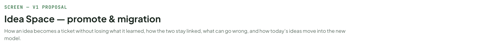
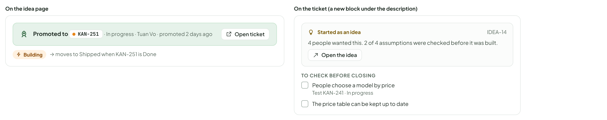
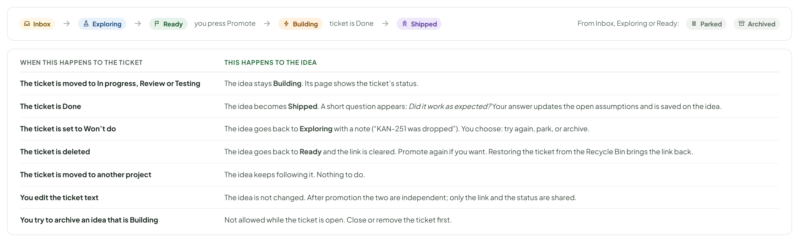
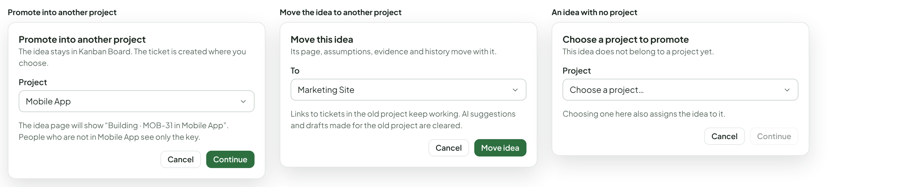
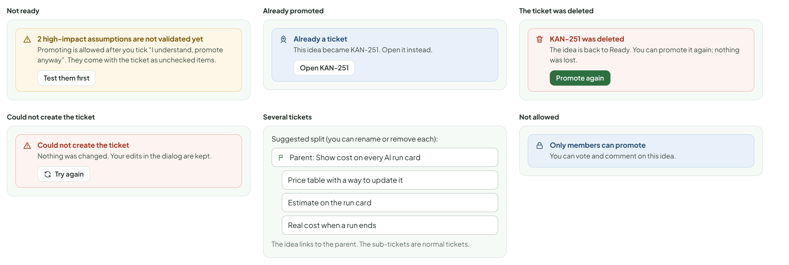
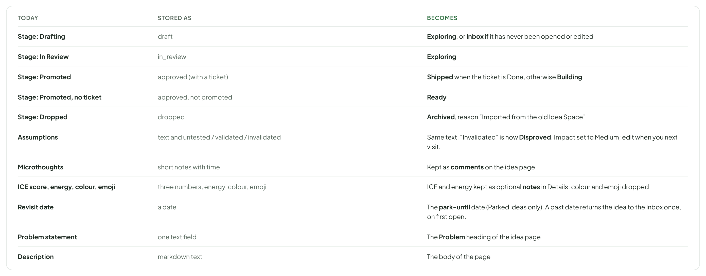
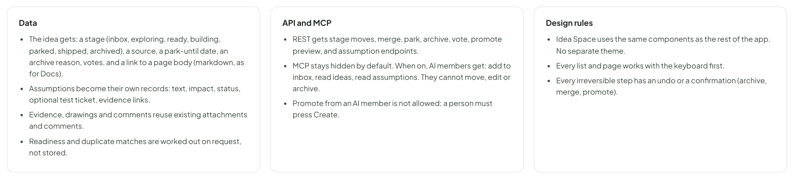

# Idea Space — promote & migration

> SCREEN — V1 PROPOSAL · source: [`IdeaPromote.dc.html`](../source/IdeaPromote.dc.html) · canvas `1793295530-5588` · sha256 `516bf6ecd4027abf32f79fe717ac3ea237f30d75e3bf687a7eaafbc2f1beeda1`

How an idea becomes a ticket without losing what it learned, how the two stay linked, what can go wrong, and how today’s ideas move into the new model.

Source: [IdeaPromote.dc.html](../source/IdeaPromote.dc.html) › header ("SCREEN — V1 PROPOSAL", "Idea Space — promote & migration" and the intro)

---

## A. Promote: a preview before anything is created

Today promote copies the problem statement and the tags, then forgets the rest. The new dialog builds the ticket from everything the idea learned, shows it, and lets you change it. Assumptions that are still open become a checklist the ticket owner can finish.

Source: [IdeaPromote.dc.html](../source/IdeaPromote.dc.html) › block "A. Promote: a preview before anything is created"

- Text in the frames: "Promote to ticket" · "Preview. Nothing is created until you press Create." · "Create as" · "One ticket" · "Ticket with sub-tickets" · "Project" · "Kanban Board  (the idea’s project)" · "Title" · "Show cost on every AI run card" · "Type" · "Feature" · "Priority" · "Medium" · "Column" · "Backlog" · "Description (built from the idea; you can edit it here)" · "Draft with AI" · "Problem" · "People ask what an AI run cost before they start it, and again when it finishes. Today the cost is only on the Members page, after the fact." · "Idea" · "Show an estimated cost on the run card, and the real cost when it ends." · "Already confirmed" · "✓ A cost badge fits on the card without making it taller." · "✓ Estimates are close enough to real cost." · "Still to check" · "☐ People choose a model by price (test KAN-241)" · "☐ The price table can be kept up to date" · "From idea IDEA-14 · 4 people want this" · "WHAT COMES WITH IT" · "Problem and idea text" · "→ Description" · "Open assumptions" · "→ Checklist, each with its test ticket" · "Validated assumptions" · "→ An “Already confirmed” list" · "Evidence: files, links, pictures" · "→ Attachments and links" · "Sketches and diagrams" · "→ Attached, still editable" · "Demand" · "→ A note: “4 people want this”" · "Workspace folder" · "→ Moved to the ticket (you can copy or leave it)" · "Research log and activity" · "→ Stay on the idea; the ticket links to them" · "Disproved assumptions" · "→ Not copied. Kept on the idea." · "Not fully tested" · "2 high-impact assumptions are not validated yet (1 testing, 1 untested). You can promote anyway; they are carried over as checklist items." · "I understand, promote anyway" · "Tick this to turn on Create ticket." · "The idea stays where it is. It links to the ticket and follows its status, even when the ticket is in another project." · "Creates a ticket in Kanban Board · Backlog" · "Cancel" · "Create ticket"

---

## B. After promoting: the idea and the ticket stay connected

The idea does not become a dead end. It shows the real ticket and its status. The ticket shows where it came from and what was still unproven, so the work starts with the right questions.

Source: [IdeaPromote.dc.html](../source/IdeaPromote.dc.html) › block "B. After promoting: the idea and the ticket stay connected"

- Text in the frames: "On the idea page" · "Promoted to" · "KAN-251" · "· In progress · Tuan Vo · promoted 2 days ago" · "Open ticket" · "Building" · "→ moves to Shipped when KAN-251 is Done" · "On the ticket (a new block under the description)" · "Started as an idea" · "IDEA-14" · "4 people wanted this. 2 of 4 assumptions were checked before it was built." · "Open the idea" · "TO CHECK BEFORE CLOSING" · "People choose a model by price" · "Test KAN-241 · In progress" · "The price table can be kept up to date"

---

## C. On the main board: the same ticket, with a small mark

A promoted idea becomes an ordinary ticket. It uses the same card, the same list row and the same detail page as any other ticket, so nothing else about the board changes. Only a small lightbulb next to the key tells you where it came from, and one filter finds them.

Source: [IdeaPromote.dc.html](../source/IdeaPromote.dc.html) › block "C. On the main board: the same ticket, with a small mark"

- Text in the frames: "Kanban Board" · "Filters" · "Type" · "Assignee" · "From an idea" · "3" · "Backlog" · "2" · "Task" · "KAN-248" · "Retry failed AI runs once" · "AI" · "LP" · "2 pt" · "1/3" · "KAN-244" · "Rename the Members tab" · "UI" · "HM" · "1 pt" · "In progress" · "Feature" · "KAN-251" · "Show cost on every AI run card" · "COST" · "TV" · "3 pt" · "0/2" · "KAN-239" · "Dark mode for Docs" · "DOCS" · "5 pt" · "1/2" · "KAN-236" · "Fix scroll jump on drop" · "URGENT" · "Hover the lightbulb" · "Started as an idea" · "4 people wanted this · 2 of 4 assumptions checked" · "Open the idea" · "The card is the normal ticket card. Only one small lightbulb is added next to the key." · "The list view uses the same mark" · "KEY" · "TITLE" · "STATUS" · "WHO" · "What is added to the ticket world" · "A lightbulb next to the key on cards, list rows and the timeline. Hover shows a small card with a link back." · "A filter chip From an idea in the board filters." · "A block Started as an idea on the ticket page (next section)." · "The open assumptions become a checklist that shows on the card as 0/2, like any checklist." · "Nothing else: no new column, no new type, no new colours."

---

## D. The ticket page: what the idea learned comes along

The ticket opens on the same detail page as any ticket. The description is built from the idea. The right side gets three blocks: where it came from, what is still unproven (as a checklist), and the idea’s pictures and diagrams as attachments.

Source: [IdeaPromote.dc.html](../source/IdeaPromote.dc.html) › block "D. The ticket page: what the idea learned comes along"

- Text in the frames: "KAN-251" · "Feature" · "In progress" · "Medium" · "Show cost on every AI run card" · "Problem" · "People ask what an AI run cost before they start it, and again when it finishes. Today the cost is only on the Members page, after the fact." · "Idea" · "Show an estimated cost on the run card, and the real cost when it ends." · "Already confirmed" · "✓ A cost badge fits on the card without making it taller." · "✓ Estimates are close enough to real cost." · "Started as an idea" · "IDEA-14" · "4 people wanted this · 2 of 4 assumptions checked first" · "Open the idea" · "Idea log (4)" · "Idea activity" · "To check before closing" · "0 of 2" · "People choose a model by price" · "Test KAN-241 · In progress" · "The price table can be kept up to date" · "No test yet · Create a test ticket" · "Attachments from the idea" · "Run card with cost" · "Sketch" · "Cost estimate flow" · "Diagram" · "run-cost-sheet.png" · "Picture"

---

## E. The whole life of an idea

From the first note to a shipped feature, and what the idea does when its ticket goes a different way.

Source: [IdeaPromote.dc.html](../source/IdeaPromote.dc.html) › block "E. The whole life of an idea"

- Text in the frames: "Inbox" · "Exploring" · "Ready" · "you press Promote" · "Building" · "ticket is Done" · "Shipped" · "From Inbox, Exploring or Ready:" · "Parked" · "Archived" · "WHEN THIS HAPPENS TO THE TICKET" · "THIS HAPPENS TO THE IDEA" · "The ticket is moved to In progress, Review or Testing" · "The idea stays Building. Its page shows the ticket’s status." · "The ticket is Done" · "The idea becomes Shipped. A short question appears: Did it work as expected? Your answer updates the open assumptions and is saved on the idea." · "The ticket is set to Won’t do" · "The idea goes back to Exploring with a note (“KAN-251 was dropped”). You choose: try again, park, or archive." · "The ticket is deleted" · "The idea goes back to Ready and the link is cleared. Promote again if you want. Restoring the ticket from the Recycle Bin brings the link back." · "The ticket is moved to another project" · "The idea keeps following it. Nothing to do." · "You edit the ticket text" · "The idea is not changed. After promotion the two are independent; only the link and the status are shared." · "You try to archive an idea that is Building" · "Not allowed while the ticket is open. Close or remove the ticket first."

---

## F. Projects: promote elsewhere, move, or assign

Most ideas are promoted in their own project. These cover the other cases.

Source: [IdeaPromote.dc.html](../source/IdeaPromote.dc.html) › block "F. Projects: promote elsewhere, move, or assign"

- Text in the frames: "Promote into another project" · "The idea stays in Kanban Board. The ticket is created where you choose." · "Project" · "Mobile App" · "The idea page will show “Building · MOB-31 in Mobile App”. People who are not in Mobile App see only the key." · "Cancel" · "Continue" · "Move the idea to another project" · "Move this idea" · "Its page, assumptions, evidence and history move with it." · "To" · "Marketing Site" · "Links to tickets in the old project keep working. AI suggestions and drafts made for the old project are cleared." · "Move idea" · "An idea with no project" · "Choose a project to promote" · "This idea does not belong to a project yet." · "Choose a project…" · "Choosing one here also assigns the idea to it."

---

## G. States

Source: [IdeaPromote.dc.html](../source/IdeaPromote.dc.html) › block "G. States"

- Text in the frames: "Not ready" · "2 high-impact assumptions are not validated yet" · "Promoting is allowed after you tick “I understand, promote anyway”. They come with the ticket as unchecked items." · "Test them first" · "Already promoted" · "Already a ticket" · "This idea became KAN-251. Open it instead." · "Open KAN-251" · "The ticket was deleted" · "KAN-251 was deleted" · "The idea is back to Ready. You can promote it again; nothing was lost." · "Promote again" · "Could not create the ticket" · "Nothing was changed. Your edits in the dialog are kept." · "Try again" · "Several tickets" · "Suggested split (you can rename or remove each):" · "Parent: Show cost on every AI run card" · "Price table with a way to update it" · "Estimate on the run card" · "Real cost when a run ends" · "The idea links to the parent. The sub-tickets are normal tickets." · "Not allowed" · "Only members can promote" · "You can vote and comment on this idea."

---

## H. What happens to existing ideas

No idea is lost. On first start after the update, current ideas are converted once, and a backup is kept before the change.

Source: [IdeaPromote.dc.html](../source/IdeaPromote.dc.html) › block "H. What happens to existing ideas"

- Text in the frames: "TODAY" · "STORED AS" · "BECOMES" · "Stage: Drafting" · "draft" · "Exploring, or Inbox if it has never been opened or edited" · "Stage: In Review" · "in_review" · "Exploring" · "Stage: Promoted" · "approved (with a ticket)" · "Shipped when the ticket is Done, otherwise Building" · "Stage: Promoted, no ticket" · "approved, not promoted" · "Ready" · "Stage: Dropped" · "dropped" · "Archived, reason “Imported from the old Idea Space”" · "Assumptions" · "text and untested / validated / invalidated" · "Same text. “Invalidated” is now Disproved. Impact set to Medium; edit when you next visit." · "Microthoughts" · "short notes with time" · "Kept as comments on the idea page" · "ICE score, energy, colour, emoji" · "three numbers, energy, colour, emoji" · "ICE and energy kept as optional notes in Details; colour and emoji dropped" · "Revisit date" · "a date" · "The park-until date (Parked ideas only). A past date returns the idea to the Inbox once, on first open." · "Problem statement" · "one text field" · "The Problem heading of the idea page" · "Description" · "markdown text" · "The body of the page"

---

## I. What this means for the product (for planning)

A summary for whoever builds it. The ticket plan lives in the issue tracker.

Source: [IdeaPromote.dc.html](../source/IdeaPromote.dc.html) › block "I. What this means for the product (for planning)"

- Text in the frames: "Data" · "The idea gets: a stage (inbox, exploring, ready, building, parked, shipped, archived), a source, a park-until date, an archive reason, votes, and a link to a page body (markdown, as for Docs)." · "Assumptions become their own records: text, impact, status, optional test ticket, evidence links." · "Evidence, drawings and comments reuse existing attachments and comments." · "Readiness and duplicate matches are worked out on request, not stored." · "API and MCP" · "REST gets stage moves, merge, park, archive, vote, promote preview, and assumption endpoints." · "MCP stays hidden by default. When on, AI members get: add to inbox, read ideas, read assumptions. They cannot move, edit or archive." · "Promote from an AI member is not allowed; a person must press Create." · "Design rules" · "Idea Space uses the same components as the rest of the app. No separate theme." · "Every list and page works with the keyboard first." · "Every irreversible step has an undo or a confirmation (archive, merge, promote)."
