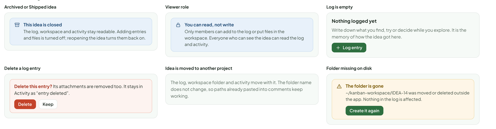
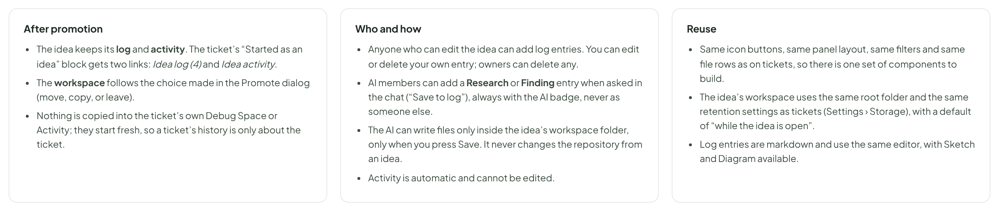

# Idea Space — research log, workspace & activity

> SCREEN — V1 PROPOSAL · source: [`IdeaWork.dc.html`](../source/IdeaWork.dc.html) · canvas `1793295530-5588` · sha256 `3a2cc6a0a16ff1c2b8cf416d829b56ab56c30d56a9b73236565f7a916a8f8be2`

Three tools from the ticket brought to ideas: a history of changes (Activity), a scratch folder on disk (Workspace), and a timeline of what was learned (a Research log in the spirit of Debug Space). Same icons, same layout, adapted to what an idea needs.

Source: [IdeaWork.dc.html](../source/IdeaWork.dc.html) › header ("SCREEN — V1 PROPOSAL", "Idea Space — research log, workspace & activity" and the intro)

---

## A. Three tools from the ticket, adapted for ideas

Tickets already have a history (Activity), a scratch folder (Workspace) and a work log (Debug Space), each opened from its own icon in the header. Ideas get the same three, in the same place and look, so people who know the ticket already know the idea. What changes is what they hold.

Source: [IdeaWork.dc.html](../source/IdeaWork.dc.html) › block "A. Three tools from the ticket, adapted for ideas"

- Text in the frames: "ON A TICKET" · "HOW IT WORKS THERE" · "ON AN IDEA" · "Activity" · "Read-only list of field changes on a ticket, grouped by day, with filters and a text diff." · "Activity on an idea: stage moves, assumption changes, evidence, text edits, merges, promotion. Now with who did it, including AI." · "Workspace" · "A scratch folder on disk at {root}/KAN-145/ for logs, fixtures and AI output." · "A folder {root}/IDEA-14/ for research notes, mock-ups, spike code and exported data. It moves to the ticket when the idea is promoted." · "Worklog / Debug Space" · "A timeline of what was found, tried and decided while debugging, with kinds (Root cause, Blocked…)." · "Research log: a timeline with kinds for exploring an idea (Research, Interview, Experiment, Finding, Decision). A finding becomes evidence for an assumption in one click." · "In the idea page header: three icons next to the AI and Promote buttons (hover shows a short summary)" · "Idea Space" · "IDEA-14" · "Show cost on every AI run card" · "Shape with AI" · "Promote" · "Research log — 4 entries · 1 finding"

---

## B. Research log: the story of exploring an idea

Replaces nothing; it is the idea’s version of the ticket’s Debug Space. A timeline of what was learned, tried and decided, with a kind on each entry, files, pinning, and links. Evidence (the tab) is the proof for one assumption; the log is the order things happened in. A finding can become evidence with one click.

Source: [IdeaWork.dc.html](../source/IdeaWork.dc.html) › block "B. Research log: the story of exploring an idea"

- Text in the frames: "Idea Space" · "IDEA-14" · "Show cost on every AI run card" · "Shape with AI" · "Promote" · "Page" · "Assumptions 4" · "Evidence 5" · "Comments 3" · "Research log" · "4 entries · IDEA-14" · "Log entry" · "All" · "4" · "Finding" · "1" · "Experiment" · "Research" · "Decision" · "Newest first" · "Pinned finding · 5 of 8 members checked the cost after the run and would have chosen differently. Hoa Mai · 3h ago" · "Interview" · "Note" · "Write what you found, tried or decided… (markdown)" · "Attach" · "Link to assumption" · "AI" · "Cancel" · "Add to log" · "HM" · "Hoa Mai" · "Researcher · 3h ago" · "In last week’s runs, 5 of 8 members checked the cost after the run and said they would have picked a cheaper model if they had seen it before. Raw answers are attached." · "interview-notes.md" · "Supports: people choose a model by price" · "Use as evidence" · "TV" · "Tuan Vo" · "yesterday" · "Added the badge to a local copy of the run card for 3 people for one day. Screenshot attached; no one mentioned a taller card." · "badge-on-card.png" · "Test ticket KAN-241" · "Claude Code" · "2 days ago" · "Looked at how two other tools show run cost. Both show it only after the run ends. The price table is a public page on the provider’s site." · "provider price page" · "workspace/research/prior-art.md" · "LP" · "Linh Pham" · "Owner · 4 days ago" · "Keep it small: show the estimate on the card, real cost at the end. No history chart in the first version."

---

## C. Workspace: a scratch folder for the idea

Same panel as on a ticket: a plain folder on this computer, listed, with a retention setting and an Open folder button. It is where research notes, mock-ups and small spikes live without touching the repository. When the idea is promoted, the folder can follow it to the ticket.

Source: [IdeaWork.dc.html](../source/IdeaWork.dc.html) › block "C. Workspace: a scratch folder for the idea"

- Text in the frames: "Idea Space" · "IDEA-14" · "Show cost on every AI run card" · "Shape with AI" · "Promote" · "Page" · "Assumptions 4" · "Evidence 5" · "Comments 3" · "~/kanban-workspace/IDEA-14" · "Keeps while the idea is open" · "Open folder" · "3 folders · 4 files · 229 KB" · "Refresh" · "NAME" · "SIZE" · "CHANGED" · "research/" · "2 files" · "2 days ago" · "prior-art.md" · "by Claude Code" · "3 KB" · "interview-notes.md" · "5 KB" · "3h ago" · "mockups/" · "1 file" · "yesterday" · "badge-on-card.png" · "212 KB" · "spike/" · "4 hours ago" · "cost-estimate.test.ts" · "9 KB" · "A plain folder on this computer. Anything put there by hand, by a script, or saved from the AI chat shows up on refresh. This panel only lists it; nothing is stored in the database." · "When the idea is promoted: what happens to the folder" · "This idea has a workspace with 4 files. What should happen to it?" · "Move it to the ticket" · "The folder becomes ~/kanban-workspace/KAN-251. Files are not copied twice." · "Copy it to the ticket" · "The idea keeps its own folder too." · "Leave it with the idea" · "The ticket gets an empty workspace." · "Retention (the chip in the panel)" · "Keep while the idea is open" · "Then 30 days after it is archived" · "Auto-delete after 30 days" · "Keep forever" · "Save an AI answer into the folder" · "Here is a short write-up of how the two other tools show run cost, with links." · "Save to workspace" · "Save to log" · "Post to comments" · "Saves as research/prior-art.md. It can only write inside this idea’s folder." · "Not set up" · "Workspace is not set up yet" · "Turn it on in Settings and choose a folder. Every idea and ticket then gets its own subfolder." · "Open Settings" · "Empty" · "~/kanban-workspace/IDEA-22" · "Empty. The folder exists; nothing has been put in it yet." · "Answers in the AI chat have a Save to workspace button."

---

## D. Activity: who changed what, and when

The same read-only list as on a ticket: one row per change, grouped by day, with filters and an expandable text diff. Ideas are a new model, so every change records who made it from the start (a person or an AI member); on tickets that is still a to-do. Nothing here can be edited or deleted.

Source: [IdeaWork.dc.html](../source/IdeaWork.dc.html) › block "D. Activity: who changed what, and when"

- Text in the frames: "Idea Space" · "IDEA-14" · "Show cost on every AI run card" · "Shape with AI" · "Promote" · "Page" · "Assumptions 4" · "Evidence 5" · "Comments 3" · "Activity" · "14 changes · IDEA-14" · "All" · "14" · "Stage" · "3" · "Assumptions" · "5" · "Evidence" · "2" · "Page text" · "By AI" · "1" · "Project and links" · "TODAY · 3 CHANGES" · "Assumption" · "People choose a model by price" · "Untested" · "Testing" · "LP" · "2h ago" · "Test ticket" · "Linked" · "KAN-241" · "3h ago" · "Added 2 from AI chat:" · "“the price table can be kept up to date…”" · "4h ago" · "YESTERDAY · 3 CHANGES" · "Readiness" · "Not started" · "Growing" · "first assumption tested" · "5:42 PM" · "edited" · "+2" · "−1" · "Hide changes" · "The cost is only on the Members page." · "The cost is only on the Members page, after the fact." · "3:10 PM" · "Merged" · "IDEA-19 “Cost in the Members page” merged into this idea" · "HM" · "11:04 AM" · "OCT 24 · 3 CHANGES" · "Project" · "No project" · "Kanban Board" · "9:15 AM" · "Inbox" · "Exploring" · "via Keep" · "Created" · "From Doc “AI limits”, as a quick idea" · "9:14 AM" · "Show 5 earlier changes" · "Empty" · "No activity yet" · "Moves between stages, assumption changes, evidence and edits will show up here." · "Loading"

---

## E. States and edge cases

Source: [IdeaWork.dc.html](../source/IdeaWork.dc.html) › block "E. States and edge cases"

- Text in the frames: "Archived or Shipped idea" · "This idea is closed" · "The log, workspace and activity stay readable. Adding entries and files is turned off; reopening the idea turns them back on." · "Viewer role" · "You can read, not write" · "Only members can add to the log or put files in the workspace. Everyone who can see the idea can read the log and activity." · "Log is empty" · "Nothing logged yet" · "Write down what you find, try or decide while you explore. It is the memory of how the idea got here." · "Log entry" · "Delete a log entry" · "Delete this entry? Its attachments are removed too. It stays in Activity as “entry deleted”." · "Delete" · "Keep" · "Idea is moved to another project" · "The log, workspace folder and activity move with it. The folder name does not change, so paths already pasted into comments keep working." · "Folder missing on disk" · "The folder is gone" · "~/kanban-workspace/IDEA-14 was moved or deleted outside the app. Nothing in the log is affected." · "Create it again"

---

## F. Rules

Proposed.

Source: [IdeaWork.dc.html](../source/IdeaWork.dc.html) › block "F. Rules"

- Text in the frames: "After promotion" · "The idea keeps its log and activity. The ticket’s “Started as an idea” block gets two links: Idea log (4) and Idea activity." · "The workspace follows the choice made in the Promote dialog (move, copy, or leave)." · "Nothing is copied into the ticket’s own Debug Space or Activity; they start fresh, so a ticket’s history is only about the ticket." · "Who and how" · "Anyone who can edit the idea can add log entries. You can edit or delete your own entry; owners can delete any." · "AI members can add a Research or Finding entry when asked in the chat (“Save to log”), always with the AI badge, never as someone else." · "The AI can write files only inside the idea’s workspace folder, only when you press Save. It never changes the repository from an idea." · "Activity is automatic and cannot be edited." · "Reuse" · "Same icon buttons, same panel layout, same filters and same file rows as on tickets, so there is one set of components to build." · "The idea’s workspace uses the same root folder and the same retention settings as tickets (Settings › Storage), with a default of “while the idea is open”." · "Log entries are markdown and use the same editor, with Sketch and Diagram available."

### As shipped (3.11.0)

Built as designed: the research log (six kinds, pin, "Use as evidence"), the workspace folder of the idea (`IDEA-n`; retention "while open, then 30 days", "30 days" or "forever"; moved, copied or left when the idea is promoted) and the activity trail with authors and short before/after for page edits. See [`docs/specs/idea-space.md`](../../docs/specs/idea-space.md).
