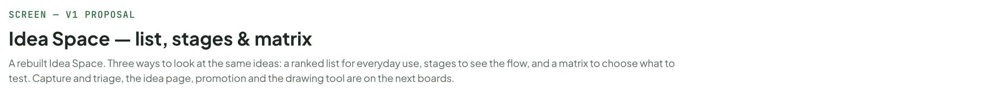
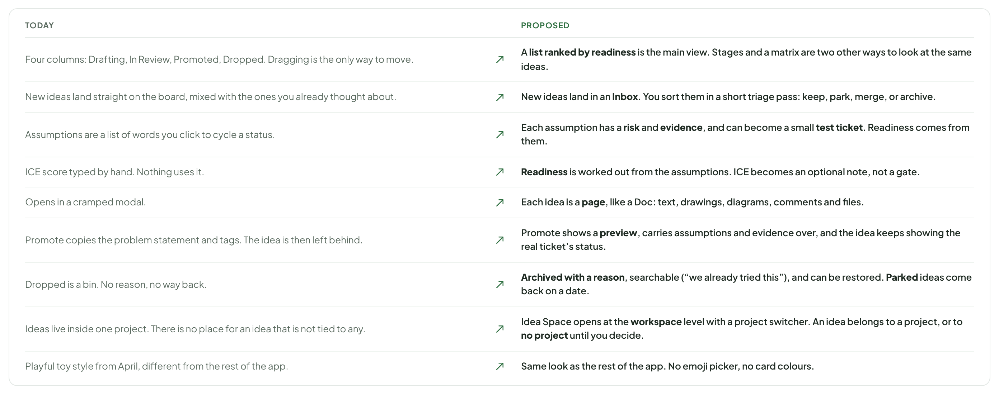
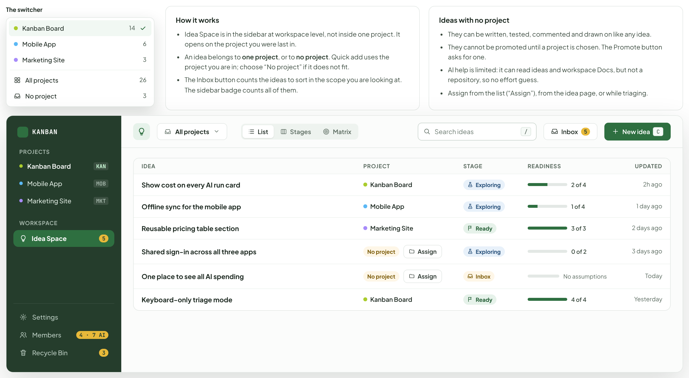
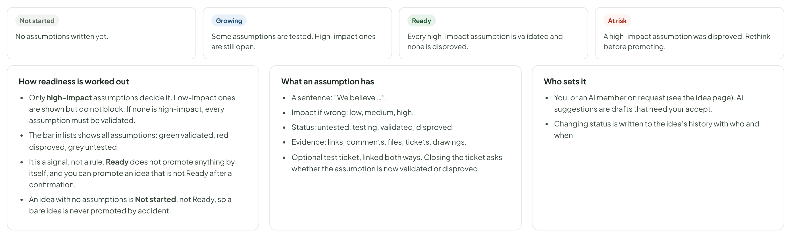

# Idea Space — list, stages & matrix

> SCREEN — V1 PROPOSAL · source: [`IdeaSpaceViews.dc.html`](../source/IdeaSpaceViews.dc.html) · canvas `1793295530-5588` · sha256 `ac9aaed74959e5dfbb48bbae16a3be4b24e7ee0983c4a17ddeb7c0942c58a673`

A rebuilt Idea Space. Three ways to look at the same ideas: a ranked list for everyday use, stages to see the flow, and a matrix to choose what to test. Capture and triage, the idea page, promotion and the drawing tool are on the next boards.

Source: [IdeaSpaceViews.dc.html](../source/IdeaSpaceViews.dc.html) › header ("SCREEN — V1 PROPOSAL", "Idea Space — list, stages & matrix" and the intro)

---

## A. What changes

Idea Space keeps its purpose: a safe place for rough ideas that can become tickets. What changes is how ideas get in, how you decide which to pursue, and how they leave.

Source: [IdeaSpaceViews.dc.html](../source/IdeaSpaceViews.dc.html) › block "A. What changes"

- Text in the frames: "TODAY" · "PROPOSED" · "Four columns: Drafting, In Review, Promoted, Dropped. Dragging is the only way to move." · "A list ranked by readiness is the main view. Stages and a matrix are two other ways to look at the same ideas." · "New ideas land straight on the board, mixed with the ones you already thought about." · "New ideas land in an Inbox. You sort them in a short triage pass: keep, park, merge, or archive." · "Assumptions are a list of words you click to cycle a status." · "Each assumption has a risk and evidence, and can become a small test ticket. Readiness comes from them." · "ICE score typed by hand. Nothing uses it." · "Readiness is worked out from the assumptions. ICE becomes an optional note, not a gate." · "Opens in a cramped modal." · "Each idea is a page, like a Doc: text, drawings, diagrams, comments and files." · "Promote copies the problem statement and tags. The idea is then left behind." · "Promote shows a preview, carries assumptions and evidence over, and the idea keeps showing the real ticket’s status." · "Dropped is a bin. No reason, no way back." · "Archived with a reason, searchable (“we already tried this”), and can be restored. Parked ideas come back on a date." · "Ideas live inside one project. There is no place for an idea that is not tied to any." · "Idea Space opens at the workspace level with a project switcher. An idea belongs to a project, or to no project until you decide." · "Playful toy style from April, different from the rest of the app." · "Same look as the rest of the app. No emoji picker, no card colours."

---

## B. List (the default view)

The place you open every day. Ranked by readiness so the ideas closest to being ready are on top. A row shows what you need to decide: where it is, how much of it has been tested, who wants it, and whether it already became a ticket. Warnings appear on the row, not hidden inside the idea.

Source: [IdeaSpaceViews.dc.html](../source/IdeaSpaceViews.dc.html) › block "B. List (the default view)"

- Text in the frames: "KANBAN" · "PROJECTS" · "Kanban Board" · "KAN" · "Mobile App" · "MOB" · "Marketing Site" · "MKT" · "WORKSPACE" · "Idea Space" · "5" · "Settings" · "Members" · "4 · 7 AI" · "Recycle Bin" · "3" · "List" · "Stages" · "Matrix" · "Search ideas" · "/" · "Inbox" · "4" · "New idea" · "C" · "Active" · "14" · "Exploring" · "6" · "Ready" · "Building" · "2" · "Parked" · "Shipped" · "Archived" · "9" · "Source" · "All" · "Tag" · "Sort" · "Readiness" · "IDEA" · "STAGE" · "READINESS (ASSUMPTIONS)" · "DEMAND" · "TICKET" · "UPDATED" · "Keyboard-only triage mode" · "ux" · "Linh Pham" · "4 of 4" · "LP" · "HM" · "TV" · "+3" · "—" · "Yesterday" · "Import tickets from Linear" · "import" · "from a comment in KAN-87" · "3 of 3" · "+1" · "KAN-238" · "3 days ago" · "Show cost on every AI run card" · "ai" · "cost" · "from Doc “AI limits”" · "2 of 4" · "2h ago" · "Weekly digest of stale tickets" · "Stale 38 days" · "notify" · "Board assistant" · "1 of 3" · "ME" · "38 days ago" · "Per-ticket time budget for AI members" · "At risk" · "Tuan Vo" · "1 week ago" · "Offline-first sync with CRDTs" · "Back 1 Dec" · "platform" · "You" · "0 of 5" · "3 weeks ago" · "Validated" · "Disproved" · "Still untested" · "14 active ideas · the 4 in the Inbox are not counted"

---

## C. Projects: one, all, or none

Ideas belong to a project, but you often think across projects. The switcher at the top picks what you see. All projects is for looking and triaging; No project collects ideas that are not tied to any project yet.

Source: [IdeaSpaceViews.dc.html](../source/IdeaSpaceViews.dc.html) › block "C. Projects: one, all, or none"

- Text in the frames: "The switcher" · "Kanban Board" · "14" · "Mobile App" · "6" · "Marketing Site" · "3" · "All projects" · "26" · "No project" · "How it works" · "Idea Space is in the sidebar at workspace level, not inside one project. It opens on the project you were last in." · "An idea belongs to one project, or to no project. Quick add uses the project you are in; choose “No project” if it does not fit." · "The Inbox button counts the ideas to sort in the scope you are looking at. The sidebar badge counts all of them." · "Ideas with no project" · "They can be written, tested, commented and drawn on like any idea." · "They cannot be promoted until a project is chosen. The Promote button asks for one." · "AI help is limited: it can read ideas and workspace Docs, but not a repository, so no effort guess." · "Assign from the list (“Assign”), from the idea page, or while triaging." · "KANBAN" · "PROJECTS" · "KAN" · "MOB" · "MKT" · "WORKSPACE" · "Idea Space" · "5" · "Settings" · "Members" · "4 · 7 AI" · "Recycle Bin" · "List" · "Stages" · "Matrix" · "Search ideas" · "/" · "Inbox" · "New idea" · "C" · "IDEA" · "PROJECT" · "STAGE" · "READINESS" · "UPDATED" · "Show cost on every AI run card" · "Exploring" · "2 of 4" · "2h ago" · "Offline sync for the mobile app" · "1 of 4" · "1 day ago" · "Reusable pricing table section" · "Ready" · "3 of 3" · "2 days ago" · "Shared sign-in across all three apps" · "Assign" · "0 of 2" · "3 days ago" · "One place to see all AI spending" · "No assumptions" · "Today" · "Keyboard-only triage mode" · "4 of 4" · "Yesterday"

---

## D. Stages

The same ideas as columns. Stages follow what has been learned, not who touched it last. An idea moves to Ready when it has enough tested assumptions, to Building when you promote it, and to Shipped by itself when its ticket is Done. Archived ideas are behind the Archived filter. Dragging is still allowed, but a move that skips the checks asks first.

Source: [IdeaSpaceViews.dc.html](../source/IdeaSpaceViews.dc.html) › block "D. Stages"

- Text in the frames: "Kanban Board" · "List" · "Stages" · "Matrix" · "Search ideas" · "/" · "Inbox" · "4" · "New idea" · "C" · "Exploring" · "6" · "Show cost on every AI run card" · "ai" · "cost" · "2 of 4" · "Weekly digest of stale tickets" · "Stale 38 days" · "notify" · "1 of 3" · "2" · "Per-ticket time budget for AI members" · "At risk" · "3" · "Ready" · "Everything that matters has been tested." · "Keyboard-only triage mode" · "ux" · "4 of 4" · "Promote" · "Building" · "Promoted. Follows the ticket." · "Import tickets from Linear" · "import" · "3 of 3" · "KAN-238" · "Dark mode for Docs" · "docs" · "2 of 2" · "KAN-239" · "Parked" · "Offline-first sync with CRDTs" · "platform" · "0 of 5" · "1" · "Back 1 Dec" · "Bulk edit on mobile" · "mobile" · "No assumptions" · "Back in 2 weeks" · "Shipped" · "Public read-only board link" · "sharing" · "5" · "KAN-212" · "Export board as CSV" · "export" · "KAN-190"

---

## E. Matrix: which assumption to test next

Each dot is one assumption from any open idea. Top-left is where the risk is: it matters a lot and nobody has checked it. Colour shows the idea. This replaces the typed ICE score as the way to choose what to look at.

Source: [IdeaSpaceViews.dc.html](../source/IdeaSpaceViews.dc.html) › block "E. Matrix: which assumption to test next"

- Text in the frames: "Kanban Board" · "List" · "Stages" · "Matrix" · "Search ideas" · "/" · "All open ideas" · "Inbox" · "4" · "New idea" · "C" · "TEST THESE FIRST" · "WELL SUPPORTED" · "LOW STAKES, LOW PROOF" · "FINE" · "Readers open a weekly digest" · "Cost helps people pick a model" · "Users want custom emojis" · "Triage keys are learned fast" · "Linear export is complete" · "AI work fits a time budget (disproved)" · "CRDT merge is affordable" · "Link is read-only safe" · "IMPACT IF WRONG → higher" · "EVIDENCE → stronger" · "SELECTED ASSUMPTION" · "Idea: Show cost on every AI run card" · "Impact if wrong" · "High" · "Evidence" · "2 comments, 1 picture" · "Status" · "Testing" · "Test:" · "KAN-241" · "Ask 3 members which model they chose" · "In progress · Tuan Vo" · "Open the idea" · "Mark validated"

---

## F. Readiness

A small, honest signal replacing the typed score.

Source: [IdeaSpaceViews.dc.html](../source/IdeaSpaceViews.dc.html) › block "F. Readiness"

- Text in the frames: "Not started" · "No assumptions written yet." · "Growing" · "Some assumptions are tested. High-impact ones are still open." · "Ready" · "Every high-impact assumption is validated and none is disproved." · "At risk" · "A high-impact assumption was disproved. Rethink before promoting." · "How readiness is worked out" · "Only high-impact assumptions decide it. Low-impact ones are shown but do not block. If none is high-impact, every assumption must be validated." · "The bar in lists shows all assumptions: green validated, red disproved, grey untested." · "It is a signal, not a rule. Ready does not promote anything by itself, and you can promote an idea that is not Ready after a confirmation." · "An idea with no assumptions is Not started, not Ready, so a bare idea is never promoted by accident." · "What an assumption has" · "A sentence: “We believe …”." · "Impact if wrong: low, medium, high." · "Status: untested, testing, validated, disproved." · "Evidence: links, comments, files, tickets, drawings." · "Optional test ticket, linked both ways. Closing the ticket asks whether the assumption is now validated or disproved." · "Who sets it" · "You, or an AI member on request (see the idea page). AI suggestions are drafts that need your accept." · "Changing status is written to the idea’s history with who and when."
