# Notifications — one place for what needs you and what happened

> SCREEN — V1 PROPOSAL · source: [`Notifications.dc.html`](../source/Notifications.dc.html) · canvas `1793534201-93f9` · sha256 `f2a3a230d43bc1fffff492a507cd1e6500f45bb91c065d7b1c10d3a628ef007e`

> Based on `main`, and on the app as it is today: one toast component with no limit, and six features that each notify on their own. Desktop and web. All names, tickets and text in the mock-ups are illustrative. Open points are in section N.

Today every part of the app toasts in its own way and nothing is kept. This board proposes one notification centre: a bell and a panel, an all-projects page, two kinds of notification (needs you, for information), grouping, notifications that close themselves when the work is done elsewhere, a quieter use of toasts, the desktop behaviour, following and muting, the settings page, and a card that sums up the day.

Source: [Notifications.dc.html](../source/Notifications.dc.html) › header ("SCREEN — V1 PROPOSAL", "Notifications — one place for what needs you and what happened" and the intro)

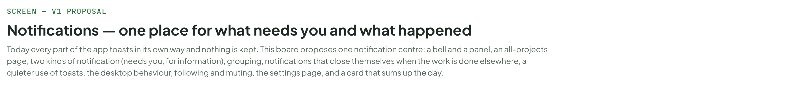

---

## A. The decisions, in one table

What the rest of the board follows. Open points are in section N.

Source: [Notifications.dc.html](../source/Notifications.dc.html) › block "A. The decisions, in one table"

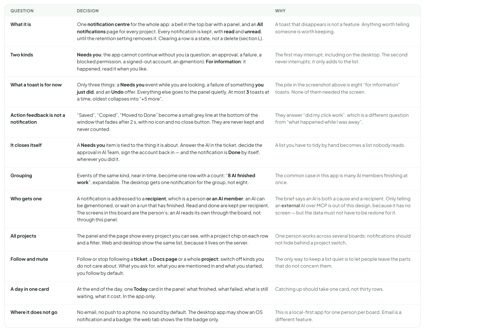

- Text in the frames: "QUESTION" · "DECISION" · "WHY" · "What it is" · "One notification centre for the whole app: a bell in the top bar with a panel, and an All notifications page for every project. Every notification is kept, with read and unread, until the retention setting removes it. Clearing a row is a state, not a delete (section L)." · "A toast that disappears is not a feature. Anything worth telling someone is worth keeping." · "Two kinds" · "Needs you: the app cannot continue without you (a question, an approval, a failure, a blocked permission, a signed-out account, an @mention). For information: it happened, read it when you like." · "The first may interrupt, including on the desktop. The second never interrupts; it only adds to the list." · "What a toast is for now" · "Only three things: a Needs you event while you are looking, a failure of something you just did, and an Undo offer. Everything else goes to the panel quietly. At most 3 toasts at a time, oldest collapses into “+5 more”." · "The pile in the screenshot above is eight “for information” toasts. None of them needed the screen." · "Action feedback is not a notification" · "“Saved”, “Copied”, “Moved to Done” become a small grey line at the bottom of the window that fades after 2 s, with no icon and no close button. They are never kept and never counted." · "They answer “did my click work”, which is a different question from “what happened while I was away”." · "It closes itself" · "A Needs you item is tied to the thing it is about. Answer the AI in the ticket, decide the approval in AI Team, sign the account back in — and the notification is Done by itself, wherever you did it." · "A list you have to tidy by hand becomes a list nobody reads." · "Grouping" · "Events of the same kind, near in time, become one row with a count: “8 AI finished work”, expandable. The desktop gets one notification for the group, not eight." · "The common case in this app is many AI members finishing at once." · "Who gets one" · "A notification is addressed to a recipient, which is a person or an AI member: an AI can be @mentioned, or wait on a run that has finished. Read and done are kept per recipient. The screens in this board are the person’s; an AI reads its own through the board, not through this panel." · "The brief says an AI is both a cause and a recipient. Only telling an external AI over MCP is out of this design, because it has no screen — but the data must not have to be redone for it." · "All projects" · "The panel and the page show every project you can see, with a project chip on each row and a filter. Web and desktop show the same list, because it lives on the server." · "One person works across several boards; notifications should not hide behind a project switch." · "Follow and mute" · "Follow or stop following a ticket, a Docs page or a whole project; switch off kinds you do not care about. What you ask for, what you are mentioned in and what you started, you follow by default." · "The only way to keep a list quiet is to let people leave the parts that do not concern them." · "A day in one card" · "At the end of the day, one Today card in the panel: what finished, what failed, what is still waiting, what it cost. In the app only." · "Catching up should take one card, not thirty rows." · "Where it does not go" · "No email, no push to a phone, no sound by default. The desktop app may show an OS notification and a badge; the web tab shows the title badge only." · "This is a local-first app for one person per board. Email is a different feature."

---

## B. What is wrong today, and what replaces it

Left: what the app does now, drawn from its own code — one toast provider with no limit, and five features that each notify in their own way. Right: what this design puts in its place.

Source: [Notifications.dc.html](../source/Notifications.dc.html) › block "B. What is wrong today, and what replaces it"

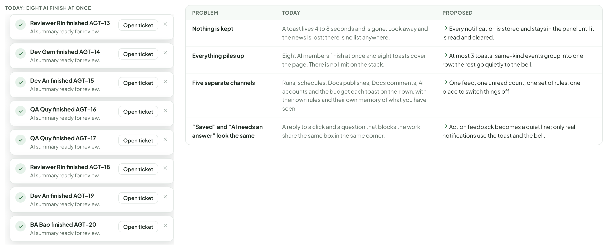

- Text in the frames: "TODAY: EIGHT AI FINISH AT ONCE" · "Reviewer Rin finished AGT-13" · "AI summary ready for review." · "Open ticket" · "Dev Gem finished AGT-14" · "Dev An finished AGT-15" · "QA Quy finished AGT-16" · "QA Quy finished AGT-17" · "Reviewer Rin finished AGT-18" · "Dev An finished AGT-19" · "BA Bao finished AGT-20" · "PROBLEM" · "TODAY" · "PROPOSED" · "Almost nothing is kept" · "A toast lives 4 to 8 seconds and is gone. Only AI safety events are stored at all, and even those are not shown as a list." · "Every notification is stored, in one list, until the retention setting removes it." · "Everything piles up" · "Eight AI members finish at once and eight toasts cover the page. There is no limit on the stack." · "At most 3 toasts; same-kind events group into one row; the rest go quietly to the bell." · "Six separate notifiers" · "Runs, schedules, Docs publishes, Docs comments, AI accounts and AI safety each watch their own data and toast on their own, with their own rules and their own memory of what you have seen. Only the last one is stored; its quiet events are held until 09:00 the next morning." · "One feed, one unread count, one set of rules, one place to switch things off." · "“Saved” and “AI needs an answer” look the same" · "A reply to a click and a question that blocks the work share the same box in the same corner." · "Action feedback becomes a quiet line; only real notifications use the toast and the bell."

---

## C. The bell and the panel

Source: [Notifications.dc.html](../source/Notifications.dc.html) › block "C. The bell and the panel"

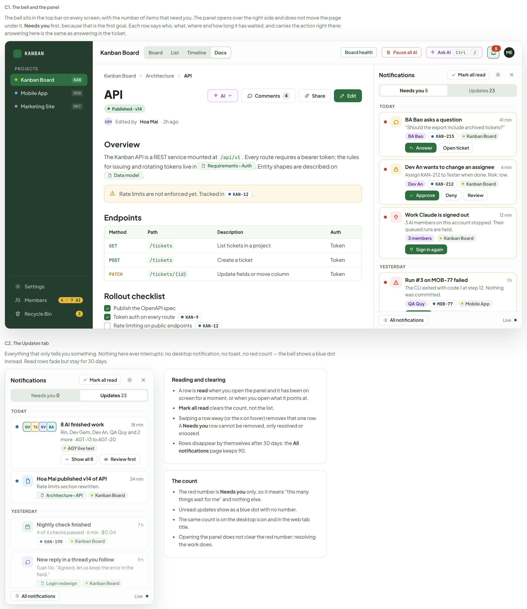

- Text in the frames: "C1. The bell and the panel" · "The bell sits in the top bar on every screen, with the number of items that need you. The panel opens over the right side and does not move the page under it. Needs you first, because that is the first goal. Each row says who, what, where and how long it has waited, and carries the action right there: answering here is the same as answering in the ticket." · "KANBAN" · "PROJECTS" · "Kanban Board" · "KAN" · "Mobile App" · "MOB" · "Marketing Site" · "MKT" · "Settings" · "Members" · "4 · 7 AI" · "Recycle Bin" · "3" · "Board" · "List" · "Timeline" · "Docs" · "Board health" · "Pause all AI" · "Ask AI" · "Ctrl" · "J" · "5" · "ME" · "Architecture" · "API" · "Published · v14" · "HM" · "Edited by" · "Hoa Mai" · "· 2h ago" · "AI" · "Comments" · "4" · "Share" · "Edit" · "Overview" · "The Kanban API is a REST service mounted at /api/v1. Every route requires a bearer token; the rules for issuing and rotating tokens live in" · "Requirements › Auth. Entity shapes are described on" · "Data model." · "Rate limits are not enforced yet. Tracked in" · "KAN-12" · "." · "Endpoints" · "Method	Path	Description	Auth" · "GET	/tickets	List tickets in a project	Token" · "POST	/tickets	Create a ticket	Token" · "PATCH	/tickets/{id}	Update fields or move column	Token" · "Rollout checklist" · "Publish the OpenAPI spec" · "Token auth on every route" · "KAN-9" · "Rate limiting on public endpoints" · "Webhook retries" · "KAN-31" · "Notifications" · "Mark all read" · "Needs you 5" · "Updates 23" · "TODAY" · "BA Bao asks a question" · "41 min" · "“Should the export include archived tickets?”" · "BA Bao" · "KAN-215" · "Answer" · "Open ticket" · "Dev An wants to change an assignee" · "6 min" · "Assign KAN-212 to Tester when done. Risk: low." · "Dev An" · "KAN-212" · "Approve" · "Deny" · "Review" · "Work Claude is signed out" · "12 min" · "3 AI members on this account stopped. Their queued runs are held." · "3 members" · "Sign in again" · "YESTERDAY" · "Run #3 on MOB-77 failed" · "1 h" · "The CLI exited with code 1 at step 12. Nothing was committed." · "QA Quy" · "MOB-77" · "Retry" · "Open run log" · "Reviewer Rin mentioned you" · "2 h" · "“@You the second criterion needs a decision before I carry on.”" · "Reviewer Rin" · "KAN-208" · "Reply" · "All notifications" · "Live" · "C2. The Updates tab" · "Everything that only tells you something. Nothing here ever interrupts: no desktop notification, no toast, no red count — the bell shows a blue dot instead. Read rows fade but stay for 30 days." · "Needs you 0" · "DV" · "TS" · "RV" · "BA" · "8 AI finished work" · "18 min" · "Rin, Dev Gem, Dev An, QA Quy and 2 more · AGT-13 to AGT-20" · "AGY live test" · "Show all 8" · "Review first" · "Hoa Mai published v14 of API" · "34 min" · "Rate limits section rewritten." · "Architecture › API" · "Nightly check finished" · "7 h" · "4 of 4 checks passed · 6 min · $0.04" · "KAN-190" · "New reply in a thread you follow" · "9 h" · "Tuan Vo: “Agreed, let us keep the error in the field.”" · "Login redesign" · "PM’s run was restarted" · "10 h" · "KAN-216 reached 2.05 GB, over the 2 GB limit. Restart 1 of 2." · "KAN-216" · "Reading and clearing" · "A row is read when you open the panel and it has been on screen for a moment, or when you open what it points at." · "Mark all read clears the count, not the list." · "The x on hover clears a row: it leaves the panel and stays on the All notifications page under Cleared." · "A Needs you row is not cleared that way. It is resolved (by doing the work, or by Dismiss where the event offers one), or snoozed." · "The panel shows the last 30 days; the page shows everything still kept. One setting decides when a notification is deleted for good (section L)." · "The count" · "The red number is Needs you only, so it means “this many things wait for me” and nothing else." · "Unread updates show as a blue dot with no number." · "The same count is on the desktop icon and in the web tab title." · "Opening the panel does not clear the red number: resolving the work does."

---

## D. A notification

Source: [Notifications.dc.html](../source/Notifications.dc.html) › block "D. A notification"

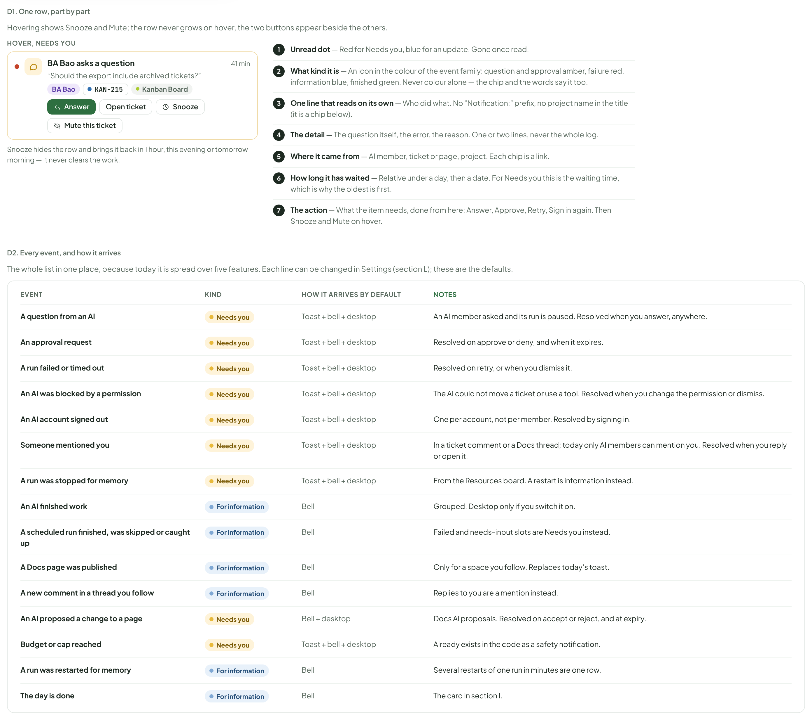

- Text in the frames: "D1. One row, part by part" · "Hovering shows Snooze and Mute; the row never grows on hover, the two buttons appear beside the others." · "HOVER, NEEDS YOU" · "BA Bao asks a question" · "41 min" · "“Should the export include archived tickets?”" · "BA Bao" · "KAN-215" · "Kanban Board" · "Answer" · "Open ticket" · "Snooze" · "Mute this ticket" · "Snooze hides the row and brings it back in 1 hour, this evening or tomorrow morning — it never clears the work." · "1" · "Unread dot — Red for Needs you, blue for an update. Gone once read." · "2" · "What kind it is — An icon in the colour of the event family: question and approval amber, failure red, information blue, finished green. Never colour alone — the chip and the words say it too." · "3" · "One line that reads on its own — Who did what. No “Notification:” prefix, no project name in the title (it is a chip below)." · "4" · "The detail — The question itself, the error, the reason. One or two lines, never the whole log." · "5" · "Where it came from — AI member, ticket or page, project. Each chip is a link." · "6" · "How long it has waited — Relative under a day, then a date. For Needs you this is the waiting time, which is why the oldest is first." · "7" · "The action — What the item needs, done from here: Answer, Approve, Retry, Sign in again. Then Snooze and Mute on hover." · "D2. Every event, and how it arrives" · "The whole list in one place, because today it is spread over five features. Each line can be changed in Settings (section L); these are the defaults." · "EVENT" · "KIND" · "HOW IT ARRIVES BY DEFAULT" · "NOTES" · "A question from an AI" · "Needs you" · "Toast + bell + desktop" · "An AI member asked and its run is paused. Resolved when you answer, anywhere." · "An approval request" · "Resolved on approve or deny, and when it expires." · "A run failed or timed out" · "Resolved on retry, or when you dismiss it." · "An AI was blocked by a permission" · "The AI could not move a ticket or use a tool. Resolved when you change the permission or dismiss." · "An AI account signed out" · "One per account, not per member. Resolved by signing in." · "Someone mentioned you" · "In a ticket comment or a Docs thread; today only AI members can mention you. Opening it marks it read; replying or Dismiss marks it done." · "A run was stopped for memory" · "From the Resources board. A restart is information instead." · "An AI finished work" · "For information" · "Bell" · "Grouped. Desktop only if you switch it on." · "A scheduled run finished, was skipped or caught up" · "Failed and needs-input slots are Needs you instead." · "A Docs page was published" · "Only for a space you follow. Replaces today’s toast." · "A new comment in a thread you follow" · "Replies to you are a mention instead." · "An AI proposed a change to a page" · "Bell + desktop" · "Docs AI proposals. Resolved on accept or reject, and at expiry." · "Budget or cap reached" · "Already exists in the code as a safety notification." · "A run was restarted for memory" · "Several restarts of one run in minutes are one row." · "The day is done" · "The card in section I."

---

## E. Many events at once

The case from the screenshot: eight AI members finish within a few minutes. One row, one line each inside it, one desktop notification.

Source: [Notifications.dc.html](../source/Notifications.dc.html) › block "E. Many events at once"

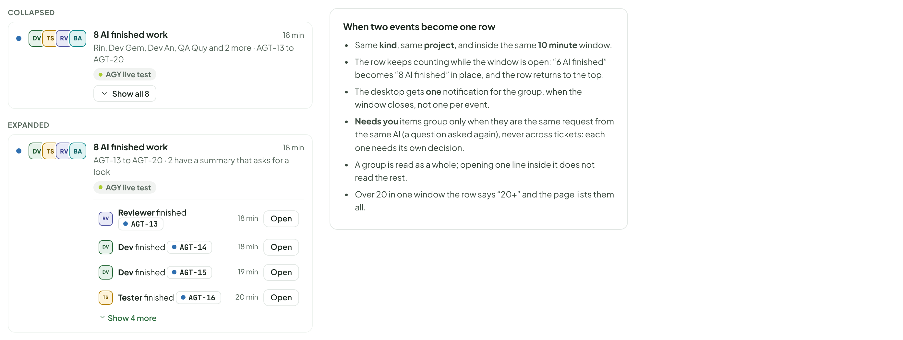

- Text in the frames: "COLLAPSED" · "DV" · "TS" · "RV" · "BA" · "8 AI finished work" · "18 min" · "Rin, Dev Gem, Dev An, QA Quy and 2 more · AGT-13 to AGT-20" · "AGY live test" · "Show all 8" · "EXPANDED" · "AGT-13 to AGT-20 · 2 have a summary that asks for a look" · "Reviewer finished" · "AGT-13" · "Open" · "Dev finished" · "AGT-14" · "AGT-15" · "19 min" · "Tester finished" · "AGT-16" · "20 min" · "Show 4 more" · "When two events become one row" · "Same kind, same project, and inside the same 10 minute window." · "The row keeps counting while the window is open: “6 AI finished” becomes “8 AI finished” in place, and the row returns to the top." · "The desktop gets one notification for the group, when the window closes, not one per event." · "Needs you items group only when they are the same request from the same AI (a question asked again), never across tickets: each one needs its own decision." · "A group is read as a whole; opening one line inside it does not read the rest." · "Over 20 in one window the row says “20+” and the page lists them all."

---

## F. A notification that closes itself

Source: [Notifications.dc.html](../source/Notifications.dc.html) › block "F. A notification that closes itself"

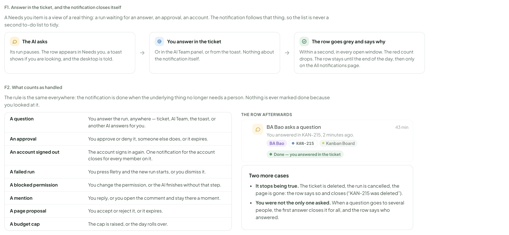

- Text in the frames: "F1. Answer in the ticket, and the notification closes itself" · "A Needs you item is a view of a real thing: a run waiting for an answer, an approval, an account. The notification follows that thing, so the list is never a second to-do list to tidy." · "The AI asks" · "Its run pauses. The row appears in Needs you, a toast shows if you are looking, and the desktop is told." · "You answer in the ticket" · "Or in the AI Team panel, or from the toast. Nothing about the notification itself." · "The row goes grey and says why" · "Within a second, in every open window. The red count drops. The row stays until the end of the day, then only on the All notifications page." · "F2. What counts as handled" · "The rule is the same everywhere: the notification is done when the underlying thing no longer needs a person. Looking at it only marks it read — reading and resolving are two different things." · "A question" · "You answer the run, anywhere — ticket, AI Team, the toast, or another AI answers for you." · "An approval" · "You approve or deny it, someone else does, or it expires." · "An account signed out" · "The account signs in again. One notification for the account closes for every member on it." · "A failed run" · "You press Retry and the new run starts, or you dismiss it." · "A blocked permission" · "You change the permission, or the AI finishes without that step." · "A mention" · "You reply, or you dismiss it. Opening the comment only marks it read: an AI that asked for a decision is still blocked until you answer." · "A page proposal" · "You accept or reject it, or it expires." · "A budget cap" · "The cap is raised, or the day rolls over." · "THE ROW AFTERWARDS" · "BA Bao asks a question" · "43 min" · "You answered in KAN-215, 2 minutes ago." · "BA Bao" · "KAN-215" · "Kanban Board" · "Done — you answered in the ticket" · "Two more cases" · "It stops being true. The ticket is deleted, the run is cancelled, the page is gone: the row says so and closes (“KAN-215 was deleted”)." · "You were not the only one asked. When a question goes to several recipients, the first answer closes it for all, and the row says who answered." · "Dismiss resolves. Where an event offers Dismiss (a failed run, a blocked permission, a missing target), pressing it is a resolution like any other: the row goes grey with the reason “Dismissed by you” and the red count drops. Nothing is quietly deleted."

---

## G. Toasts, after this change

A toast is for the moment; the bell is for the record. Keeping only three reasons for a toast is what stops the pile in section B. The toast component itself does not change, only who may use it and how many fit.

Source: [Notifications.dc.html](../source/Notifications.dc.html) › block "G. Toasts, after this change"

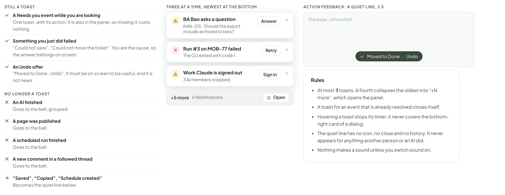

- Text in the frames: "STILL A TOAST" · "A Needs you event while you are looking" · "One toast, with its action. It is also in the panel, so missing it costs nothing." · "Something you just did failed" · "“Could not save”, “Could not move the ticket”. You are the cause, so the answer belongs on screen." · "An Undo offer" · "“Moved to Done · Undo”. It must be on screen to be useful, and it is not news." · "NO LONGER A TOAST" · "An AI finished" · "Goes to the bell, grouped." · "A page was published" · "Goes to the bell." · "A scheduled run finished" · "A new comment in a followed thread" · "“Saved”, “Copied”, “Schedule created”" · "Becomes the quiet line below." · "THREE AT A TIME, NEWEST AT THE BOTTOM" · "BA Bao asks a question" · "KAN-215 · Should the export include archived tickets?" · "Answer" · "Run #3 on MOB-77 failed" · "The CLI exited with code 1." · "Retry" · "Work Claude is signed out" · "3 AI members stopped." · "Sign in" · "+5 more" · "in Notifications" · "Open" · "ACTION FEEDBACK: A QUIET LINE, 2 S" · "Moved to Done" · "·" · "Undo" · "the page, untouched" · "Rules" · "At most 3 toasts. A fourth collapses the oldest into “+N more”, which opens the panel." · "A toast for an event that is already resolved closes itself." · "Hovering a toast stops its timer; it never covers the bottom-right card of a dialog." · "The quiet line has no icon, no close and no history. It never appears for anything another person or an AI did." · "Nothing makes a sound unless you switch sound on."

---

## H. All notifications

The bell panel is for now; this page is for everything. Same rows, every project, with search, filters and days. Reached from the panel footer, from Shift N, and from the sidebar when there is something waiting. It keeps 90 days.

Source: [Notifications.dc.html](../source/Notifications.dc.html) › block "H. All notifications"

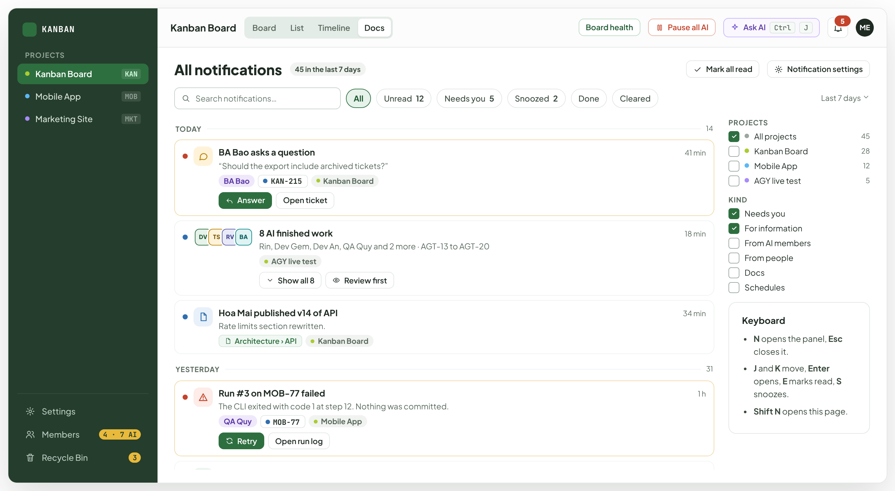

- Text in the frames: "KANBAN" · "PROJECTS" · "Kanban Board" · "KAN" · "Mobile App" · "MOB" · "Marketing Site" · "MKT" · "Settings" · "Members" · "4 · 7 AI" · "Recycle Bin" · "3" · "Board" · "List" · "Timeline" · "Docs" · "Board health" · "Pause all AI" · "Ask AI" · "Ctrl" · "J" · "5" · "ME" · "All notifications" · "45 in the last 7 days" · "Mark all read" · "Notification settings" · "Search notifications…" · "All" · "Unread" · "12" · "Needs you" · "Snoozed" · "2" · "Done" · "Cleared" · "Last 7 days" · "TODAY" · "14" · "BA Bao asks a question" · "41 min" · "“Should the export include archived tickets?”" · "BA Bao" · "KAN-215" · "Answer" · "Open ticket" · "DV" · "TS" · "RV" · "BA" · "8 AI finished work" · "18 min" · "Rin, Dev Gem, Dev An, QA Quy and 2 more · AGT-13 to AGT-20" · "AGY live test" · "Show all 8" · "Review first" · "Hoa Mai published v14 of API" · "34 min" · "Rate limits section rewritten." · "Architecture › API" · "YESTERDAY" · "31" · "Run #3 on MOB-77 failed" · "1 h" · "The CLI exited with code 1 at step 12. Nothing was committed." · "QA Quy" · "MOB-77" · "Retry" · "Open run log" · "Nightly check finished" · "7 h" · "4 of 4 checks passed · 6 min · $0.04" · "KAN-190" · "New reply in a thread you follow" · "9 h" · "Tuan Vo: “Agreed, let us keep the error in the field.”" · "Login redesign" · "All projects" · "45" · "28" · "KIND" · "For information" · "From AI members" · "From people" · "Schedules" · "Keyboard" · "N opens the panel, Esc closes it." · "J and K move, Enter opens, E marks read, S snoozes." · "Shift N opens this page."

---

## I. The day in one card

Source: [Notifications.dc.html](../source/Notifications.dc.html) › block "I. The day in one card"

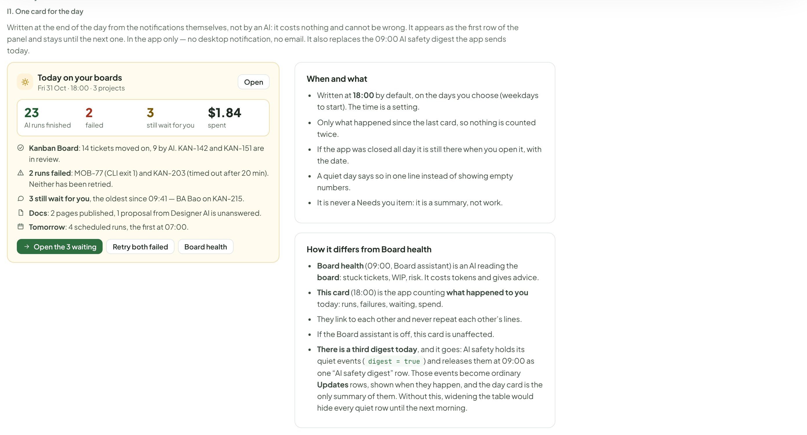

- Text in the frames: "I1. One card for the day" · "Written at the end of the day from the notifications themselves, not by an AI: it costs nothing and cannot be wrong. It appears as the first row of the panel and stays until the next one. In the app only — no desktop notification, no email. It also replaces the 09:00 AI safety digest the app sends today." · "Today on your boards" · "Fri 31 Oct · 18:00 · 3 projects" · "Open" · "23" · "AI runs finished" · "2" · "failed" · "3" · "still wait for you" · "$1.84" · "spent" · "Kanban Board: 14 tickets moved on, 9 by AI. KAN-142 and KAN-151 are in review." · "2 runs failed: MOB-77 (CLI exit 1) and KAN-203 (timed out after 20 min). Neither has been retried." · "3 still wait for you, the oldest since 09:41 — BA Bao on KAN-215." · "Docs: 2 pages published, 1 proposal from Designer AI is unanswered." · "Tomorrow: 4 scheduled runs, the first at 07:00." · "Open the 3 waiting" · "Retry both failed" · "Board health" · "When and what" · "Written at 18:00 by default, on the days you choose (weekdays to start). The time is a setting." · "Only what happened since the last card, so nothing is counted twice." · "If the app was closed all day it is still there when you open it, with the date." · "A quiet day says so in one line instead of showing empty numbers." · "It is never a Needs you item: it is a summary, not work." · "How it differs from Board health" · "Board health (09:00, Board assistant) is an AI reading the board: stuck tickets, WIP, risk. It costs tokens and gives advice." · "This card (18:00) is the app counting what happened to you today: runs, failures, waiting, spend." · "They link to each other and never repeat each other’s lines." · "If the Board assistant is off, this card is unaffected." · "There is a third digest today, and it goes: AI safety holds its quiet events (digest = true) and releases them at 09:00 as one “AI safety digest” row. Those events become ordinary Updates rows, shown when they happen, and the day card is the only summary of them. Without this, widening the table would hide every quiet row until the next morning."

---

## J. The desktop app and the web tab

Source: [Notifications.dc.html](../source/Notifications.dc.html) › block "J. The desktop app and the web tab"

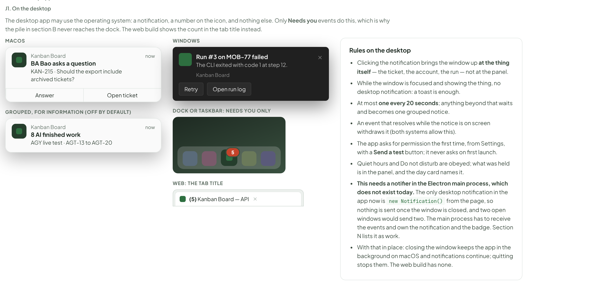

- Text in the frames: "J1. On the desktop" · "The desktop app may use the operating system: a notification, a number on the icon, and nothing else. Only Needs you events do this, which is why the pile in section B never reaches the dock. The web build shows the count in the tab title instead." · "MACOS" · "Kanban Board" · "BA Bao asks a question" · "KAN-215 · Should the export include archived tickets?" · "now" · "Answer" · "Open ticket" · "GROUPED, FOR INFORMATION (OFF BY DEFAULT)" · "8 AI finished work" · "AGY live test · AGT-13 to AGT-20" · "WINDOWS" · "Run #3 on MOB-77 failed" · "The CLI exited with code 1 at step 12." · "Retry" · "Open run log" · "DOCK OR TASKBAR: NEEDS YOU ONLY" · "5" · "WEB: THE TAB TITLE" · "(5) Kanban Board — API" · "Rules on the desktop" · "Clicking the notification brings the window up at the thing itself — the ticket, the account, the run — not at the panel." · "While the window is focused and showing the thing, no desktop notification: a toast is enough." · "At most one every 20 seconds; anything beyond that waits and becomes one grouped notice." · "An event that resolves while the notice is on screen withdraws it (both systems allow this)." · "The app asks for permission the first time, from Settings, with a Send a test button; it never asks on first launch." · "Quiet hours and Do not disturb are obeyed; what was held is in the panel, and the day card names it." · "This needs a notifier in the Electron main process, which does not exist today. The only desktop notification in the app now is new Notification() from the page, so nothing is sent once the window is closed, and two open windows would send two. The main process has to receive the events and own the notification and the badge. Section N lists it as work." · "With that in place: closing the window keeps the app in the background on macOS and notifications continue; quitting stops them. The web build has none."

---

## K. Following and muting

The list stays short because you can leave any part of it. Muting never hides a Needs you item that is addressed to you: an AI asking you a question on a muted ticket still reaches you, because nothing else will move it.

Source: [Notifications.dc.html](../source/Notifications.dc.html) › block "K. Following and muting"

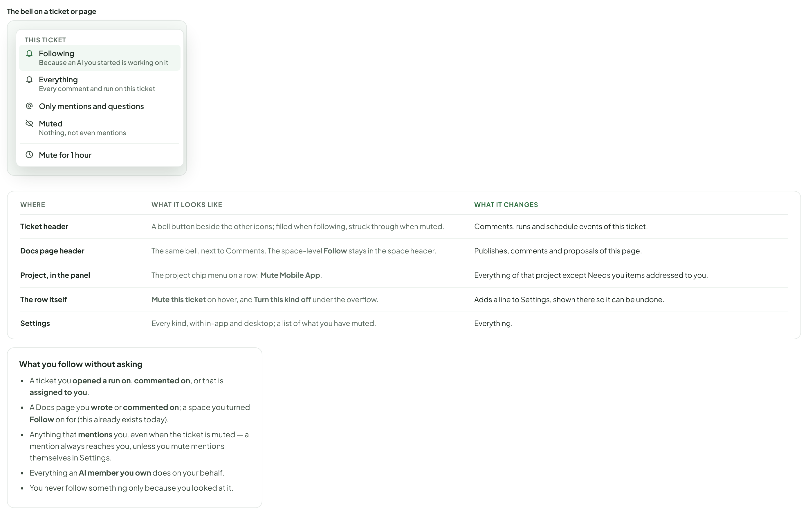

- Text in the frames: "The bell on a ticket or page" · "THIS TICKET" · "Following" · "Because an AI you started is working on it" · "Everything" · "Every comment and run on this ticket" · "Only mentions and questions" · "Muted" · "Nothing, not even mentions" · "Mute for 1 hour" · "WHERE" · "WHAT IT LOOKS LIKE" · "WHAT IT CHANGES" · "Ticket header" · "A bell button beside the other icons; filled when following, struck through when muted." · "Comments, runs and schedule events of this ticket." · "Docs page header" · "The same bell, next to Comments. The space-level Follow stays in the space header." · "Publishes, comments and proposals of this page." · "Project, in the panel" · "The project chip menu on a row: Mute Mobile App." · "Everything of that project except Needs you items addressed to you." · "The row itself" · "Mute this ticket on hover, and Turn this kind off under the overflow." · "Adds a line to Settings, shown there so it can be undone." · "Settings" · "Every kind, with in-app and desktop; a list of what you have muted." · "Everything." · "What you follow without asking" · "A ticket you opened a run on, commented on, or that is assigned to you." · "A Docs page you wrote or commented on; a space you turned Follow on for (this already exists today)." · "Anything that mentions you, even when the ticket is muted — a mention always reaches you, unless you mute mentions themselves in Settings." · "Everything an AI member you own does on your behalf." · "You never follow something only because you looked at it."

---

## L. Settings › Notifications

A new page under App settings, because the list crosses projects. Per-project exceptions live in the Muted list, not in a second copy of the table. Today these switches exist per project, in AiProjectSettings.notify, and only for the eight AI safety events; moving them to one app-wide table with per-project mutes is part of the work in section N.

Source: [Notifications.dc.html](../source/Notifications.dc.html) › block "L. Settings › Notifications"

- Text in the frames: "EVENT" · "IN APP" · "DESKTOP" · "NEEDS YOU — MAY INTERRUPT" · "A question from an AI" · "An approval request" · "A run failed or timed out" · "An AI was blocked by a permission" · "An AI account signed out" · "Someone mentioned you" · "A run was stopped for memory" · "From Resources" · "Budget or cap reached" · "Exists today" · "A page proposal from an AI" · "FOR INFORMATION — NEVER INTERRUPTS" · "An AI finished work" · "Grouped" · "A scheduled run finished or was skipped" · "A page was published" · "Spaces you follow" · "A new comment in a thread you follow" · "A run was restarted for memory" · "The day in one card" · "18:00" · "In app stays on for everything that needs you. The switch is shown locked: an AI waiting on an answer with no row and no count would wait for ever. Only its desktop notification can be switched off." · "Desktop notifications" · "Allowed for this computer. Send a test" · "Quiet hours" · "Nothing interrupts between these times; the panel still fills." · "22:00 – 08:00" · "Follow the system Do not disturb" · "When your computer is quiet, so is this app." · "Sound" · "Off. When on, only Needs you events make a sound." · "The day card" · "Weekdays at 18:00." · "Keep notifications for" · "Then they are deleted. The audit log keeps its own record." · "90 days" · "What a switch off actually does" · "In app off: no row in the panel and nothing in the count. The event is still recorded and still appears on the All notifications page and in the day card." · "Desktop off: no notification from the operating system. Nothing else changes." · "Both off: it still happened, and you can still find it. This is a change from today: safety.notify() records nothing when both are off, so the event is lost for good." · "Muting a ticket, page or project works the same way: quiet, not erased." · "The one thing that is never quiet is a Needs you item addressed to you: its In app switch is locked on, and muting a ticket or a project cannot hide it either. Nothing else would move it." · "Muted (3)" · "KAN-190 — muted on 28 Oct · Unmute" · "Mobile App, everything but mentions · Unmute" · "A page was published, in Marketing Site · Unmute" · "Everything you mute from a row or a ticket shows here, so nothing stays off by accident."

---

## M. States and problems

Source: [Notifications.dc.html](../source/Notifications.dc.html) › block "M. States and problems"

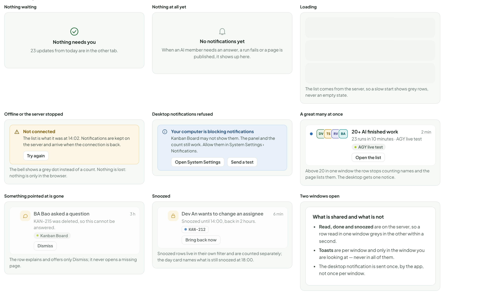

- Text in the frames: "Nothing waiting" · "Nothing needs you" · "23 updates from today are in the other tab." · "Nothing at all yet" · "No notifications yet" · "When an AI member needs an answer, a run fails or a page is published, it shows up here." · "Loading" · "The list comes from the server, so a slow start shows grey rows, never an empty state." · "Offline or the server stopped" · "Not connected" · "The list is what it was at 14:02. Notifications are kept on the server and arrive when the connection is back." · "Try again" · "The bell shows a grey dot instead of a count. Nothing is lost: nothing is only in the browser." · "Desktop notifications refused" · "Your computer is blocking notifications" · "Kanban Board may not show them. The panel and the count still work. Allow them in System Settings › Notifications." · "Open System Settings" · "Send a test" · "A great many at once" · "DV" · "TS" · "RV" · "BA" · "20+ AI finished work" · "2 min" · "23 runs in 10 minutes · AGY live test" · "AGY live test" · "Open the list" · "Above 20 in one window the row stops counting names and the page lists them. The desktop gets one notice." · "Something pointed at is gone" · "BA Bao asked a question" · "3 h" · "KAN-215 was deleted, so this cannot be answered." · "Kanban Board" · "Dismiss" · "The row explains and offers only Dismiss; it never opens a missing page." · "Snoozed" · "Dev An wants to change an assignee" · "6 min" · "Snoozed until 14:00, back in 2 hours." · "KAN-212" · "Bring back now" · "Snoozed rows live in their own filter and are counted separately; the day card names what is still snoozed at 18:00." · "Two windows open" · "What is shared and what is not" · "Read, done and snoozed are on the server, so a row read in one window greys in the other within a second." · "Toasts are per window and only in the window you are looking at — never in all of them." · "The desktop notification is sent once, by the app, not once per window."

---

## N. Where the data comes from, what is decided and what is left

Most of this exists in some form: a notification table, an event stream, a follow table, an inbox and six feature-specific hooks. The new piece is an event log underneath them: one append-only record with increasing ids that the panel, the desktop app and (later) an external AI waiting on the board all read.

Source: [Notifications.dc.html](../source/Notifications.dc.html) › block "N. Where the data comes from, what is decided and what is left"

- Text in the frames: "PIECE" · "HOLDS" · "WHERE IT COMES FROM" · "Event log" · "one append-only row per thing that happened: project, kind, what it points at, who caused it, the facts, and an increasing id" · "this is the new piece. The schedules feed already works this way (integer ids, a client that resumes from the last one it saw). It is the source for everything below, and for the planned MCP wait tool and kanban wait command, so an external AI can resume from where it stopped instead of looping on sleep." · "Notification" · "one per recipient per event: read, done and why, snoozed until, group id. A recipient is a person or an AI member." · "built from the log, not written beside it. AiNotification is the closest thing today (title, body, ref_kind, ref_id, member_id, people, urgent, inapp, desktop, digest) but it is one row for everyone, with a people list and a role check in visible_notifications." · "What writes to the log" · "a run changes state, an approval is asked or decided, a page is published, a comment is posted, a schedule slot ends, an account signs out, a cap is reached, memory restarts or stops a run" · "today six UI hooks each watch their own data and toast: runs, schedules, Docs publishes, Docs comments, AI accounts and AI safety. They move to the server, so a closed window misses nothing." · "Delivery to open windows" · "the panel, the count, the toasts" · "the shared SSE stream at /events carries one more message: “the log moved to id N”. The window asks for what it has not seen, so a dropped message costs nothing. /events is in memory in one process, which is why the log, not the stream, is the source." · "Delivery to the desktop" · "the OS notification and the number on the icon" · "new work in the Electron main process: it follows the log itself and owns both. Today the only desktop notification is new Notification() from the page, so nothing arrives with the window closed and two windows would send two." · "Follow and mute" · "per ticket, page, project and event kind, per recipient" · "DocsFollow already stores who follows a project’s Docs space, and the browser keeps the toggle. That becomes one case of this table." · "The day card" · "counts and lines for one day, per recipient" · "read from the log for that day. Nothing is asked of an AI, so it costs nothing and cannot invent." · "Decided before building (issue #253)" · "The name “Needs you” is kept for both the panel tab and the AI Team section. The same items appear in both, and resolving in either closes both." · "Each recipient sees their own rows. So that nothing an owner or admin sees today is lost, they are made recipients of every AI safety event." · "The log is kept as long as the notifications, under the one retention setting (90 days). A feed or wait cursor older than the oldest kept event is answered, not ignored: cursor_too_old: true with the current head id, meaning “start from now”." · "The day card is written on weekdays at 18:00, and the time is a setting." · "Settings › Notifications is its own page under App settings." · "What the build still has to decide" · "The log comes first. The panel, the desktop app and the planned wait tool all read one log. Building the panel on a notification table alone would mean adding the log underneath it later." · "Recipients include AI members in the data from the start, with read and done per recipient, even though no screen shows an AI’s list in v1. Telling an external AI over MCP is the wait tool’s job, not this design’s." · "A notifier in the Electron main process is new work, not an existing capability: the OS notification, the dock or taskbar number, the click that opens the right thing, and one notification per machine rather than per window." · "Six notifiers move in the first slice, not five: runs, schedules, Docs publishes, Docs comments, AI accounts and useAiSafetyNotifications. Leaving the last one out means every approval and budget event arrives twice, old toast and new row." · "The 09:00 AI safety digest goes. Its quiet events become ordinary Updates rows and the 18:00 day card is the only summary. Otherwise widening the table hides every quiet row until the next morning, and the person has three summaries." · "The switches move from per project to app-wide (AiProjectSettings.notify holds them today, for eight events only), with per-project mutes as the exception, and In app locked on for everything that needs you." · "Off means quiet, not unrecorded. Today safety.notify() writes nothing when in-app and desktop are both off. This design keeps the row so the page and the day card stay complete; that is a change to make deliberately." · "Retention is one setting and it is the only thing that deletes: the panel showing 30 days is a view, clearing a row is a state, and the audit log is unaffected." · "Board health (09:00) stays separate and keeps its own digest; it reads the board, this card counts what happened to you." · "Sound is off and is not designed beyond one switch." · "Mentions by people are designed for, but today only AI members can mention the single human on a board." · "Desktop notification actions (Answer, Retry) assume Electron buttons on macOS and Windows. Where the system does not show them, clicking the body opens the thing."
