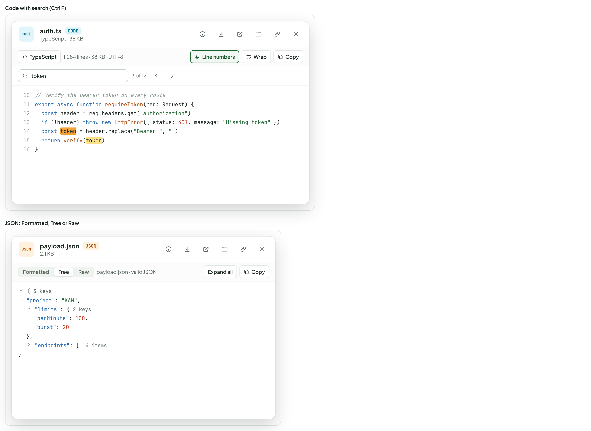
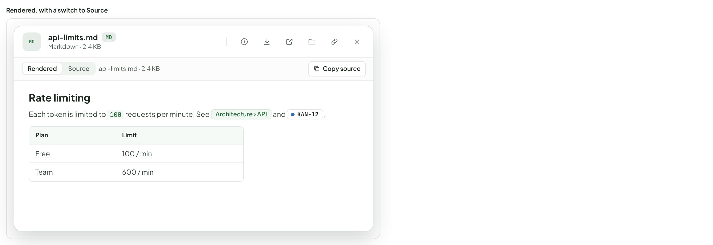
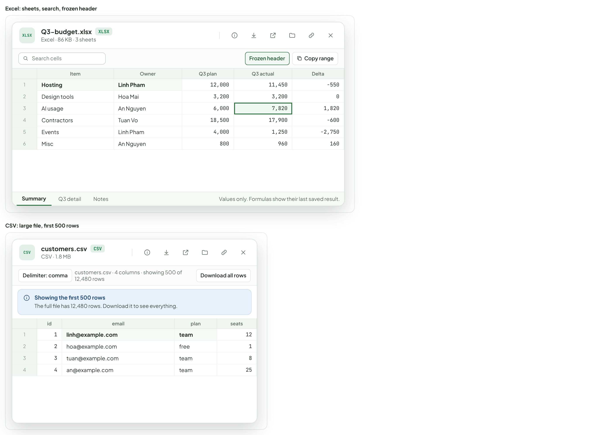
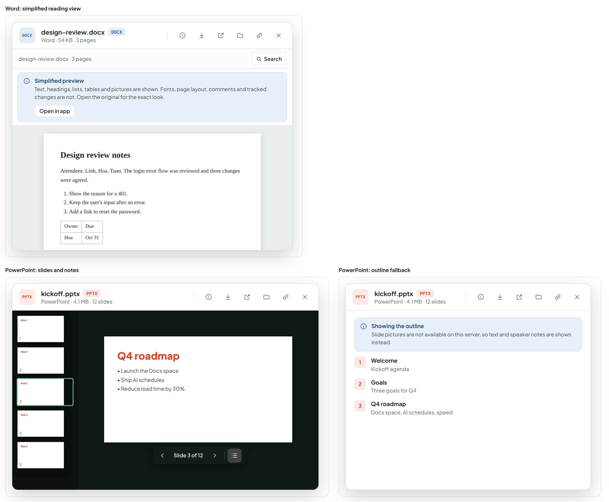
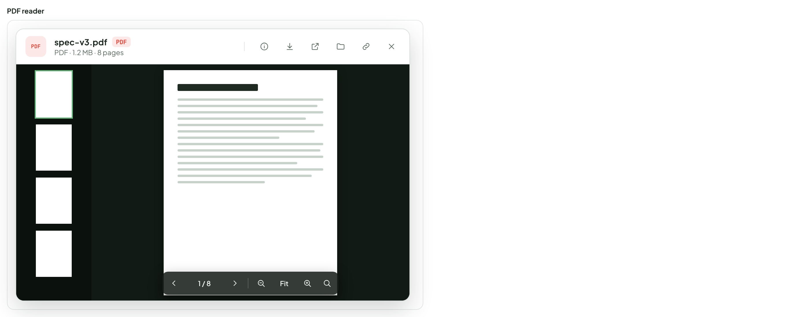
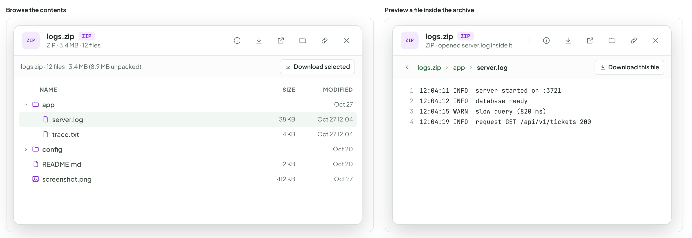
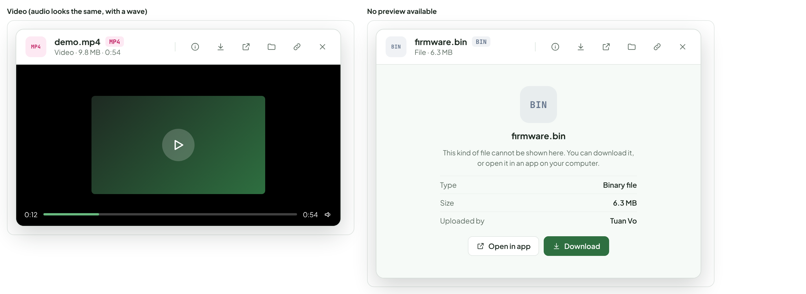
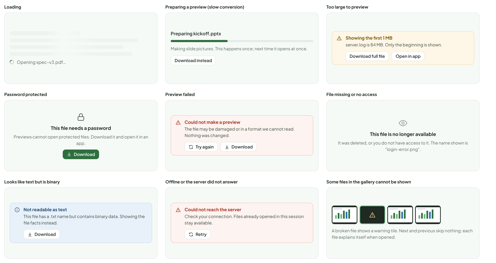
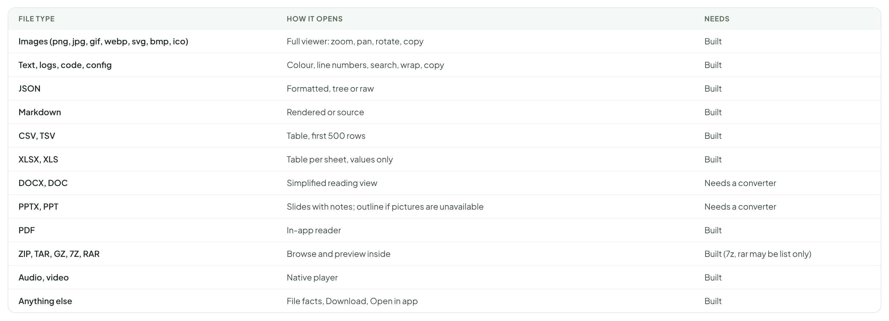

# Preview — file types & states

> COMPONENT — V1 PROPOSAL · source: [`PreviewTypes.dc.html`](../source/PreviewTypes.dc.html) · canvas `1793234038-d594` · sha256 `62703846e700d21dfd904be8d18ebe9e9d78b42298d9501b4f6fb5b49570b7b3`

How each kind of file opens inside the viewer from the previous board. Same header and actions everywhere; only the reader changes.

Source: [PreviewTypes.dc.html](../source/PreviewTypes.dc.html) › header ("COMPONENT — V1 PROPOSAL", "Preview — file types & states" and the intro)

---

## F. Text, logs, code and JSON

Readable, not just shown. Code and config files get colour and line numbers; every text file gets search, wrap and copy. Long files show the first part with a clear note.

Source: [PreviewTypes.dc.html](../source/PreviewTypes.dc.html) › block "F. Text, logs, code and JSON"

- Text in the frames: "Code with search (Ctrl F)" · "CODE" · "auth.ts" · "TypeScript · 38 KB" · "TypeScript" · "1,284 lines · 38 KB · UTF-8" · "Line numbers" · "Wrap" · "Copy" · "token" · "3 of 12" · "10" · "// Verify the bearer token on every route" · "11" · "export async function requireToken(req: Request) {" · "12" · "const header = req.headers.get("authorization")" · "13" · "if (!header) throw new HttpError({ status: 401, message: "Missing token" })" · "14" · "const token = header.replace("Bearer ", "")" · "15" · "return verify(token)" · "16" · "}" · "JSON: Formatted, Tree or Raw" · "JSON" · "payload.json" · "2.1 KB" · "Formatted" · "Tree" · "Raw" · "payload.json · valid JSON" · "Expand all" · "{ 3 keys" · ""project": "KAN"," · ""limits": { 2 keys" · ""perMinute": 100," · ""burst": 20" · "}," · ""endpoints": [ 14 items"

---

## G. Markdown files

A .md file opens rendered, the same way as in Docs, with a switch to see the source. Page and ticket references become chips; relative images and links work.

Source: [PreviewTypes.dc.html](../source/PreviewTypes.dc.html) › block "G. Markdown files"

- Text in the frames: "Rendered, with a switch to Source" · "MD" · "api-limits.md" · "Markdown · 2.4 KB" · "Rendered" · "Source" · "api-limits.md · 2.4 KB" · "Copy source" · "Rate limiting" · "Each token is limited to 100 requests per minute. See Architecture › API and" · "KAN-12" · "." · "Plan	Limit" · "Free	100 / min" · "Team	600 / min"

---

## H. Spreadsheets and CSV

Opens as a table, not a download. Excel shows one sheet at a time with tabs; CSV and TSV detect the delimiter. Only the first part of very large sheets is shown, with a note. No formulas are run.

Source: [PreviewTypes.dc.html](../source/PreviewTypes.dc.html) › block "H. Spreadsheets and CSV"

- Text in the frames: "Excel: sheets, search, frozen header" · "XLSX" · "Q3-budget.xlsx" · "Excel · 86 KB · 3 sheets" · "Search cells" · "Frozen header" · "Copy range" · "Item	Owner	Q3 plan	Q3 actual	Delta" · "1	Hosting	Linh Pham	12,000	11,450	-550" · "2	Design tools	Hoa Mai	3,200	3,200	0" · "3	AI usage	An Nguyen	6,000	7,820	1,820" · "4	Contractors	Tuan Vo	18,500	17,900	-600" · "5	Events	Linh Pham	4,000	1,250	-2,750" · "6	Misc	An Nguyen	800	960	160" · "Summary" · "Q3 detail" · "Notes" · "Values only. Formulas show their last saved result." · "CSV: large file, first 500 rows" · "CSV" · "customers.csv" · "CSV · 1.8 MB" · "Delimiter: comma" · "customers.csv · 4 columns · showing 500 of 12,480 rows" · "Download all rows" · "Showing the first 500 rows" · "The full file has 12,480 rows. Download it to see everything." · "id	email	plan	seats" · "1	1	linh@example.com	team	12" · "2	2	hoa@example.com	free	1" · "3	3	tuan@example.com	team	8" · "4	4	an@example.com	team	25"

---

## I. Word and PowerPoint

Word opens as a simplified reading view. PowerPoint opens as slides with a rail of thumbnails and speaker notes; when slide pictures cannot be made, it falls back to a text outline. Both are read only and never run macros.

Source: [PreviewTypes.dc.html](../source/PreviewTypes.dc.html) › block "I. Word and PowerPoint"

- Text in the frames: "Word: simplified reading view" · "DOCX" · "design-review.docx" · "Word · 54 KB · 3 pages" · "design-review.docx · 3 pages" · "Search" · "Simplified preview" · "Text, headings, lists, tables and pictures are shown. Fonts, page layout, comments and tracked changes are not. Open the original for the exact look." · "Open in app" · "Design review notes" · "Attendees: Linh, Hoa, Tuan. The login error flow was reviewed and three changes were agreed." · "Show the reason for a 401." · "Keep the user's input after an error." · "Add a link to reset the password." · "Owner	Due" · "Hoa	Oct 31" · "PowerPoint: slides and notes" · "PPTX" · "kickoff.pptx" · "PowerPoint · 4.1 MB · 12 slides" · "Slide 1" · "1" · "Slide 2" · "2" · "Slide 3" · "3" · "Slide 4" · "4" · "Slide 5" · "5" · "Q4 roadmap" · "• Launch the Docs space" · "• Ship AI schedules" · "• Reduce load time by 30%" · "Slide 3 of 12" · "PowerPoint: outline fallback" · "Showing the outline" · "Slide pictures are not available on this server, so text and speaker notes are shown instead." · "Welcome" · "Kickoff agenda" · "Goals" · "Three goals for Q4" · "Docs space, AI schedules, speed"

---

## J. PDF

Shown in the app with page thumbnails, zoom, page jump and search, instead of the browser’s built-in frame (which differs between browsers and the desktop app).

Source: [PreviewTypes.dc.html](../source/PreviewTypes.dc.html) › block "J. PDF"

- Text in the frames: "PDF reader" · "PDF" · "spec-v3.pdf" · "PDF · 1.2 MB · 8 pages" · "1 / 8" · "Fit"

---

## K. Archives (zip, tar, gz, 7z)

Opens as a file list you can browse. Click a file inside to preview it right there, with a breadcrumb back. Nothing is unpacked to disk and nothing inside is run.

Source: [PreviewTypes.dc.html](../source/PreviewTypes.dc.html) › block "K. Archives (zip, tar, gz, 7z)"

- Text in the frames: "Browse the contents" · "ZIP" · "logs.zip" · "ZIP · 3.4 MB · 12 files" · "logs.zip · 12 files · 3.4 MB (8.9 MB unpacked)" · "Download selected" · "NAME" · "SIZE" · "MODIFIED" · "app" · "Oct 27" · "server.log" · "38 KB" · "Oct 27 12:04" · "trace.txt" · "4 KB" · "config" · "Oct 20" · "README.md" · "2 KB" · "screenshot.png" · "412 KB" · "Preview a file inside the archive" · "ZIP · opened server.log inside it" · "Download this file" · "1" · "12:04:11 INFO  server started on :3721" · "2" · "12:04:12 INFO  database ready" · "3" · "12:04:15 WARN  slow query (820 ms)" · "4" · "12:04:19 INFO  request GET /api/v1/tickets 200"

---

## L. Audio, video and files without a preview

Audio and video use a normal player. A file with no reader shows its facts and the two actions that matter, never a blank window.

Source: [PreviewTypes.dc.html](../source/PreviewTypes.dc.html) › block "L. Audio, video and files without a preview"

- Text in the frames: "Video (audio looks the same, with a wave)" · "MP4" · "demo.mp4" · "Video · 9.8 MB · 0:54" · "0:12" · "0:54" · "No preview available" · "BIN" · "firmware.bin" · "File · 6.3 MB" · "This kind of file cannot be shown here. You can download it, or open it in an app on your computer." · "Type" · "Binary file" · "Size" · "6.3 MB" · "Uploaded by" · "Tuan Vo" · "Open in app" · "Download"

---

## M. States and problems

Every failure keeps the page usable and always leaves Download as a way out.

Source: [PreviewTypes.dc.html](../source/PreviewTypes.dc.html) › block "M. States and problems"

- Text in the frames: "Loading" · "Opening spec-v3.pdf…" · "Preparing a preview (slow conversion)" · "Preparing kickoff.pptx" · "Making slide pictures. This happens once; next time it opens at once." · "Download instead" · "Too large to preview" · "Showing the first 1 MB" · "server.log is 84 MB. Only the beginning is shown." · "Download full file" · "Open in app" · "Password protected" · "This file needs a password" · "Previews cannot open protected files. Download it and open it in an app." · "Download" · "Preview failed" · "Could not make a preview" · "The file may be damaged or in a format we cannot read. Nothing was changed." · "Try again" · "File missing or no access" · "This file is no longer available" · "It was deleted, or you do not have access to it. The name shown is “login-error.png”." · "Looks like text but is binary" · "Not readable as text" · "This file has a .txt name but contains binary data. Showing the file facts instead." · "Offline or the server did not answer" · "Could not reach the server" · "Check your connection. Files already opened in this session stay available." · "Retry" · "Some files in the gallery cannot be shown" · "Tickets closed per week" · "A broken file shows a warning tile. Next and previous skip nothing; each file explains itself when opened."

---

## N. Summary: what opens how

The last column marks what needs more than the browser. Word and PowerPoint need a converter on the server or in the desktop app; everything else can run in the app itself.

Source: [PreviewTypes.dc.html](../source/PreviewTypes.dc.html) › block "N. Summary: what opens how"

- Text in the frames: "FILE TYPE" · "HOW IT OPENS" · "NEEDS" · "Images (png, jpg, gif, webp, svg, bmp, ico)" · "Full viewer: zoom, pan, rotate, copy" · "Built" · "Text, logs, code, config" · "Colour, line numbers, search, wrap, copy" · "JSON" · "Formatted, tree or raw" · "Markdown" · "Rendered or source" · "CSV, TSV" · "Table, first 500 rows" · "XLSX, XLS" · "Table per sheet, values only" · "DOCX, DOC" · "Simplified reading view" · "Needs a converter" · "PPTX, PPT" · "Slides with notes; outline if pictures are unavailable" · "PDF" · "In-app reader" · "ZIP, TAR, GZ, 7Z, RAR" · "Browse and preview inside" · "Built (7z, rar may be list only)" · "Audio, video" · "Native player" · "Anything else" · "File facts, Download, Open in app"
