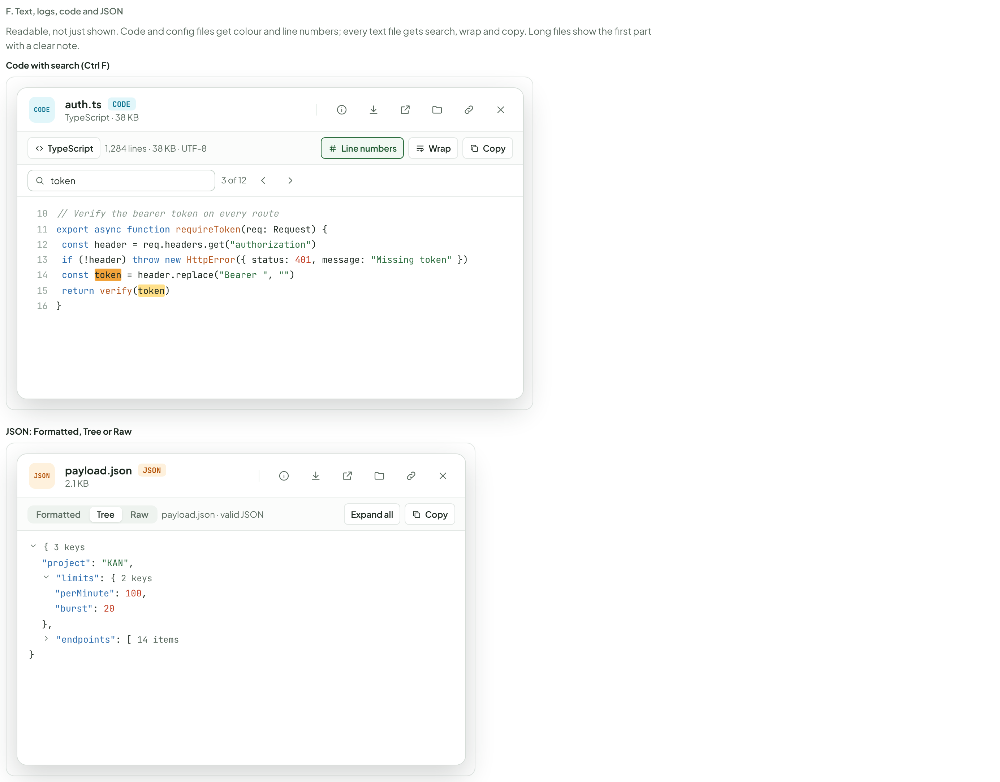
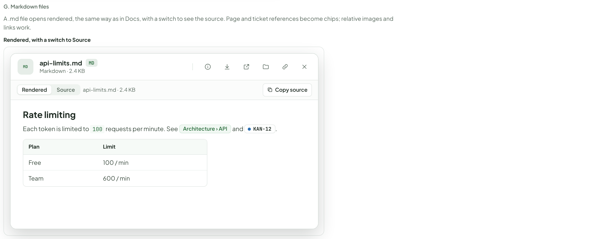
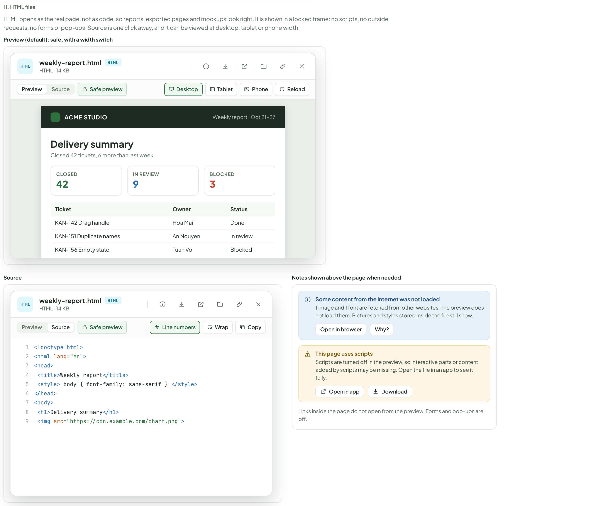
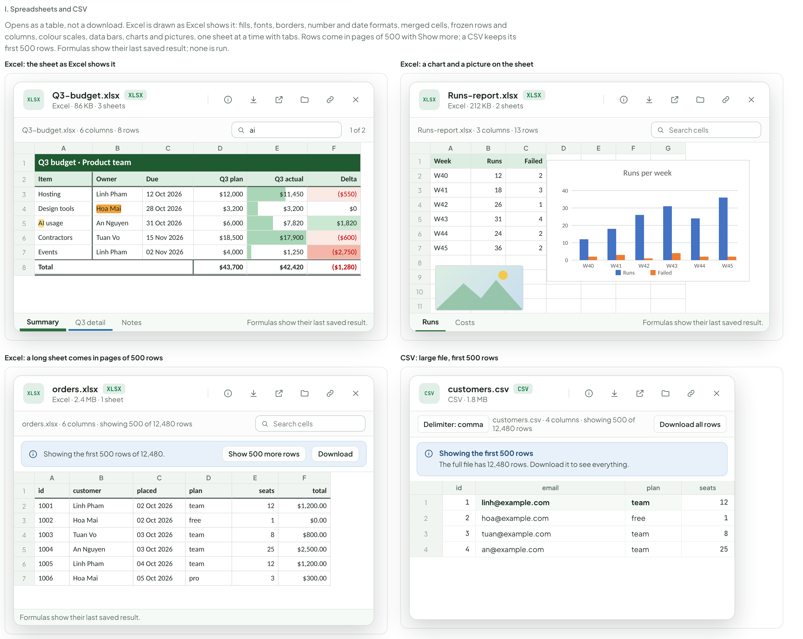
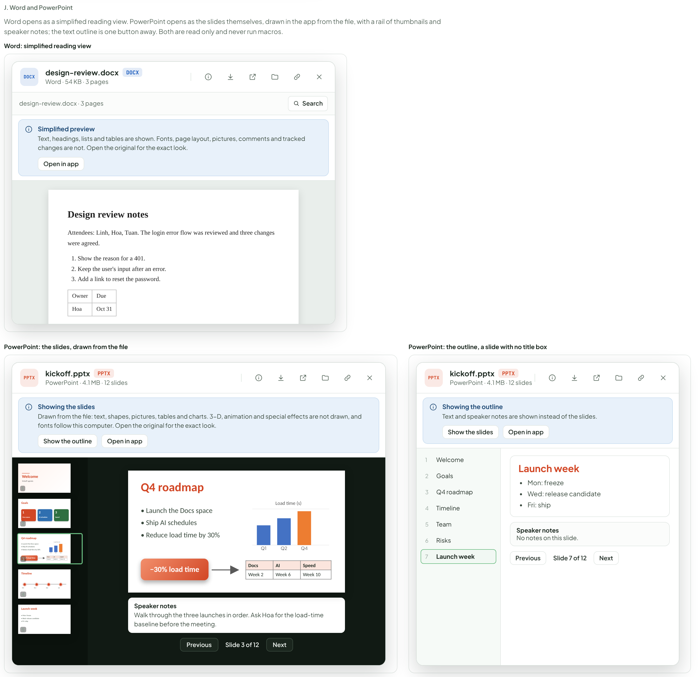
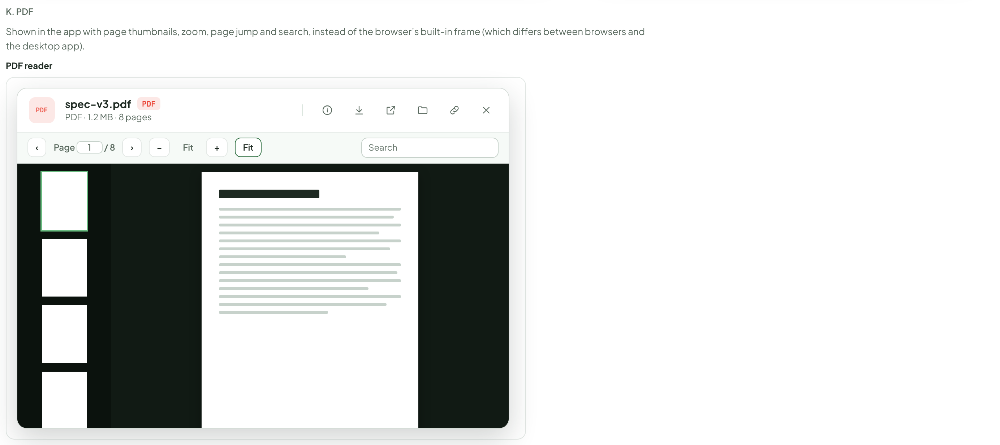
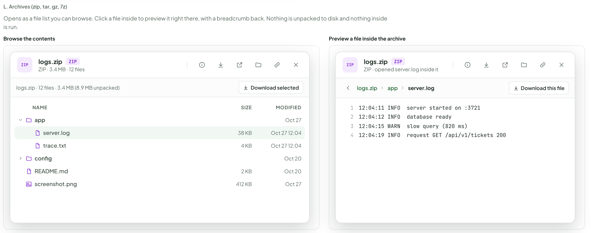
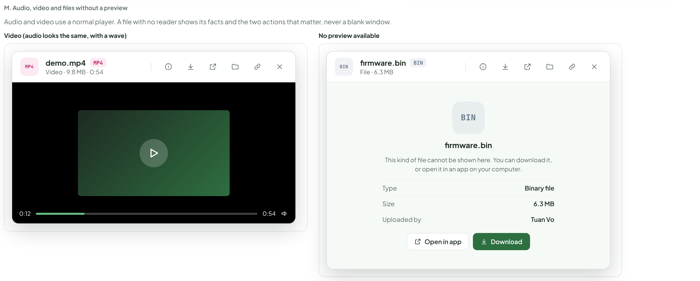
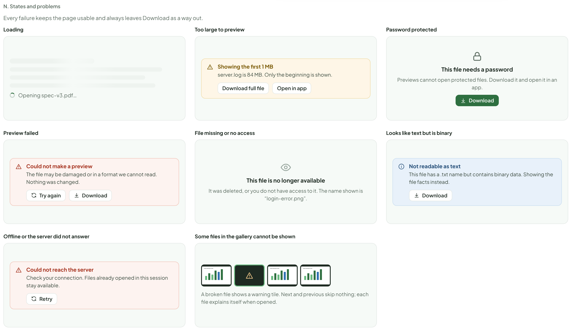
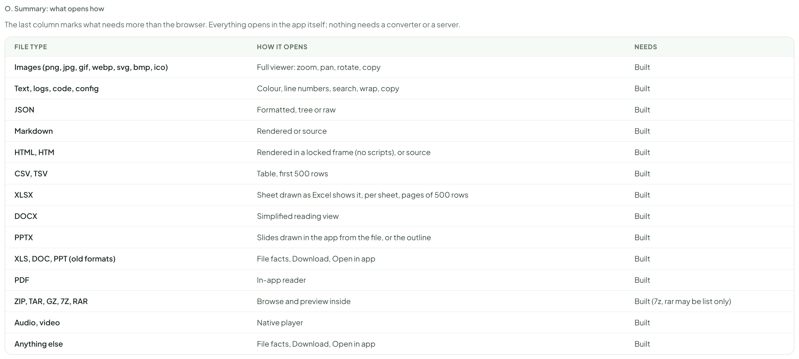

# Preview — file types & states

> Redrawn for AI v2 · source: [`PreviewTypes.dc.html`](../source/PreviewTypes.dc.html) · canvas `1794099567-d725` · sha256 `bf6b7cb7340da41583075af0dca575bc06d8ae9cf80eee9d417decc87d08c2eb`

> Words, states and conditions follow the code of branch `claude/ai-team-architecture-7a1efc`; the layout is designed here and is not the layout of the current screens. Names, ids, costs and times in the mock-ups are sample data. **Check the code before building from this: the file named in each part is the truth, not the picture.**

## COMPONENT — V1 PROPOSAL

- Text in this part: "COMPONENT — V1 PROPOSAL" · "Preview — file types & states" · "How each kind of file opens inside the viewer from the previous board. Same header and actions everywhere; only the reader changes."

---

## F. Text, logs, code and JSON

- Text in this part: "F. Text, logs, code and JSON" · "Readable, not just shown. Code and config files get colour and line numbers; every text file gets search, wrap and copy. Long files show the first part with a clear note." · "Code with search (Ctrl F)" · "CODE" · "auth.ts" · "TypeScript · 38 KB" · "TypeScript" · "1,284 lines · 38 KB · UTF-8" · "Line numbers" · "Wrap" · "Copy" · "token" · "3 of 12" · "10" · "// Verify the bearer token on every route" · "11" · "export async function requireToken(req: Request) {" · "12" · "const header = req.headers.get("authorization")" · "13" · "if (!header) throw new HttpError({ status: 401, message: "Missing token" })" · "14" · "const token = header.replace("Bearer ", "")" · "15" · "return verify(token)" · "16" · "}" · "JSON: Formatted, Tree or Raw" · "JSON" · "payload.json" · "2.1 KB" · "Formatted" · "Tree" · "Raw" · "payload.json · valid JSON" · "Expand all" · "{ 3 keys" · ""project": "KAN"," · ""limits": { 2 keys" · ""perMinute": 100," · ""burst": 20" · "}," · ""endpoints": [ 14 items"

---

## G. Markdown files

- Text in this part: "G. Markdown files" · "A .md file opens rendered, the same way as in Docs, with a switch to see the source. Page and ticket references become chips; relative images and links work." · "Rendered, with a switch to Source" · "MD" · "api-limits.md" · "Markdown · 2.4 KB" · "Rendered" · "Source" · "api-limits.md · 2.4 KB" · "Copy source" · "Rate limiting" · "Each token is limited to 100 requests per minute. See Architecture › API and" · "KAN-12" · "." · "Plan	Limit" · "Free	100 / min" · "Team	600 / min"

---

## H. HTML files

- Text in this part: "H. HTML files" · "HTML opens as the real page, not as code, so reports, exported pages and mockups look right. It is shown in a locked frame: no scripts, no outside requests, no forms or pop-ups. Source is one click away, and it can be viewed at desktop, tablet or phone width." · "Preview (default): safe, with a width switch" · "HTML" · "weekly-report.html" · "HTML · 14 KB" · "Preview" · "Source" · "Safe preview" · "Desktop" · "Tablet" · "Phone" · "Reload" · "ACME STUDIO" · "Weekly report · Oct 21–27" · "Delivery summary" · "Closed 42 tickets, 6 more than last week." · "CLOSED" · "42" · "IN REVIEW" · "9" · "BLOCKED" · "3" · "Ticket	Owner	Status" · "KAN-142 Drag handle	Hoa Mai	Done" · "KAN-151 Duplicate names	An Nguyen	In review" · "KAN-156 Empty state	Tuan Vo	Blocked" · "Line numbers" · "Wrap" · "Copy" · "1" · "<!doctype html>" · "2" · "<html lang="en">" · "<head>" · "4" · "<title>Weekly report</title>" · "5" · "" · "6" · "</head>" · "7" · "<body>" · "8" · "<h1>Delivery summary</h1>" · "" · "Notes shown above the page when needed" · "Some content from the internet was not loaded" · "1 image and 1 font are fetched from other websites. The preview does not load them. Pictures and styles stored inside the file still show." · "Open in browser" · "Why?" · "This page uses scripts" · "Scripts are turned off in the preview, so interactive parts or content added by scripts may be missing. Open the file in an app to see it fully." · "Open in app" · "Download" · "Links inside the page do not open from the preview. Forms and pop-ups are off."

---

## I. Spreadsheets and CSV

- Text in this part: "I. Spreadsheets and CSV" · "Opens as a table, not a download. Excel is drawn as Excel shows it: fills, fonts, borders, number and date formats, merged cells, frozen rows and columns, colour scales, data bars, charts and pictures, one sheet at a time with tabs. Rows come in pages of 500 with Show more; a CSV keeps its first 500 rows. Formulas show their last saved result; none is run." · "Excel: the sheet as Excel shows it" · "XLSX" · "Q3-budget.xlsx" · "Excel · 86 KB · 3 sheets" · "Q3-budget.xlsx · 6 columns · 8 rows" · "ai" · "1 of 2" · "A	B	C	D	E	F" · "1	Q3 budget · Product team" · "2	Item	Owner	Due	Q3 plan	Q3 actual	Delta" · "3	Hosting	Linh Pham	12 Oct 2026	$12,000	$11,450	($550)" · "4	Design tools	Hoa Mai	28 Oct 2026	$3,200	$3,200	$0" · "5	AI usage	An Nguyen	31 Oct 2026	$6,000	$7,820	$1,820" · "6	Contractors	Tuan Vo	15 Nov 2026	$18,500	$17,900	($600)" · "7	Events	Linh Pham	02 Nov 2026	$4,000	$1,250	($2,750)" · "8	Total	$43,700	$42,420	($1,280)" · "Summary" · "Q3 detail" · "Notes" · "Formulas show their last saved result." · "Excel: a chart and a picture on the sheet" · "Runs-report.xlsx" · "Excel · 212 KB · 2 sheets" · "Runs-report.xlsx · 3 columns · 13 rows" · "Search cells" · "A	B	C	D	E	F	G" · "1	Week	Runs	Failed" · "2	W40	12	2" · "3	W41	18	3" · "4	W42	26	1" · "5	W43	31	4" · "6	W44	24	2" · "7	W45	36	2" · "8" · "9" · "10" · "11" · "12" · "13" · "Runs per week" · "0" · "20" · "30" · "40" · "W40" · "W41" · "W42" · "W43" · "W44" · "W45" · "Runs" · "Failed" · "Costs" · "Excel: a long sheet comes in pages of 500 rows" · "orders.xlsx" · "Excel · 2.4 MB · 1 sheet" · "orders.xlsx · 6 columns · showing 500 of 12,480 rows" · "Showing the first 500 rows of 12,480." · "Show 500 more rows" · "Download" · "1	id	customer	placed	plan	seats	total" · "2	1001	Linh Pham	02 Oct 2026	team	12	$1,200.00" · "3	1002	Hoa Mai	02 Oct 2026	free	1	$0.00" · "4	1003	Tuan Vo	03 Oct 2026	team	8	$800.00" · "5	1004	An Nguyen	03 Oct 2026	team	25	$2,500.00" · "6	1005	Linh Pham	04 Oct 2026	team	12	$1,200.00" · "7	1006	Hoa Mai	05 Oct 2026	pro	3	$300.00" · "CSV: large file, first 500 rows" · "CSV" · "customers.csv" · "CSV · 1.8 MB" · "Delimiter: comma" · "customers.csv · 4 columns · showing 500 of 12,480 rows" · "Download all rows" · "Showing the first 500 rows" · "The full file has 12,480 rows. Download it to see everything." · "id	email	plan	seats" · "1	1	linh@example.com	team	12" · "2	2	hoa@example.com	free	1" · "3	3	tuan@example.com	team	8" · "4	4	an@example.com	team	25"

---

## J. Word and PowerPoint

- Text in this part: "J. Word and PowerPoint" · "Word opens as a simplified reading view. PowerPoint opens as the slides themselves, drawn in the app from the file, with a rail of thumbnails and speaker notes; the text outline is one button away. Both are read only and never run macros." · "Word: simplified reading view" · "DOCX" · "design-review.docx" · "Word · 54 KB · 3 pages" · "design-review.docx · 3 pages" · "Search" · "Simplified preview" · "Text, headings, lists and tables are shown. Fonts, page layout, pictures, comments and tracked changes are not. Open the original for the exact look." · "Open in app" · "Design review notes" · "Attendees: Linh, Hoa, Tuan. The login error flow was reviewed and three changes were agreed." · "Show the reason for a 401." · "Keep the user's input after an error." · "Add a link to reset the password." · "Owner	Due" · "Hoa	Oct 31" · "PowerPoint: the slides, drawn from the file" · "PPTX" · "kickoff.pptx" · "PowerPoint · 4.1 MB · 12 slides" · "Showing the slides" · "Drawn from the file: text, shapes, pictures, tables and charts. 3-D, animation and special effects are not drawn, and fonts follow this computer. Open the original for the exact look." · "Show the outline" · "Welcome" · "Kickoff agenda" · "1" · "Goals" · "Docs space" · "2" · "AI schedules" · "3" · "Speed" · "Q4 roadmap" · "• Launch the Docs space" · "• Ship AI schedules" · "• Reduce load time by 30%" · "Q1" · "Q2" · "Q4" · "Load time (s)" · "−30% load time" · "Docs	AI	Speed" · "Week 2	Week 6	Week 10" · "Timeline" · "Oct" · "Nov" · "Dec" · "Jan" · "4" · "Launch week" · "• Mon: freeze" · "• Wed: release candidate" · "• Fri: ship" · "5" · "Speaker notes" · "Walk through the three launches in order. Ask Hoa for the load-time baseline before the meeting." · "Previous" · "Slide 3 of 12" · "Next" · "PowerPoint: the outline, a slide with no title box" · "Showing the outline" · "Text and speaker notes are shown instead of the slides." · "Show the slides" · "Team" · "6" · "Risks" · "7" · "Mon: freeze" · "Wed: release candidate" · "Fri: ship" · "No notes on this slide." · "Slide 7 of 12"

---

## K. PDF

- Text in this part: "K. PDF" · "Shown in the app with page thumbnails, zoom, page jump and search, instead of the browser’s built-in frame (which differs between browsers and the desktop app)." · "PDF reader" · "PDF" · "spec-v3.pdf" · "PDF · 1.2 MB · 8 pages" · "‹" · "Page 1 / 8" · "›" · "−" · "Fit" · "+" · "Search"

---

## L. Archives (zip, tar, gz, 7z)

- Text in this part: "L. Archives (zip, tar, gz, 7z)" · "Opens as a file list you can browse. Click a file inside to preview it right there, with a breadcrumb back. Nothing is unpacked to disk and nothing inside is run." · "Browse the contents" · "ZIP" · "logs.zip" · "ZIP · 3.4 MB · 12 files" · "logs.zip · 12 files · 3.4 MB (8.9 MB unpacked)" · "Download selected" · "NAME" · "SIZE" · "MODIFIED" · "app" · "Oct 27" · "server.log" · "38 KB" · "Oct 27 12:04" · "trace.txt" · "4 KB" · "config" · "Oct 20" · "README.md" · "2 KB" · "screenshot.png" · "412 KB" · "Preview a file inside the archive" · "ZIP · opened server.log inside it" · "Download this file" · "1" · "12:04:11 INFO  server started on :3721" · "2" · "12:04:12 INFO  database ready" · "3" · "12:04:15 WARN  slow query (820 ms)" · "4" · "12:04:19 INFO  request GET /api/v1/tickets 200"

---

## M. Audio, video and files without a preview

- Text in this part: "M. Audio, video and files without a preview" · "Audio and video use a normal player. A file with no reader shows its facts and the two actions that matter, never a blank window." · "Video (audio looks the same, with a wave)" · "MP4" · "demo.mp4" · "Video · 9.8 MB · 0:54" · "0:12" · "0:54" · "No preview available" · "BIN" · "firmware.bin" · "File · 6.3 MB" · "This kind of file cannot be shown here. You can download it, or open it in an app on your computer." · "Type" · "Binary file" · "Size" · "6.3 MB" · "Uploaded by" · "Tuan Vo" · "Open in app" · "Download"

---

## N. States and problems

- Text in this part: "N. States and problems" · "Every failure keeps the page usable and always leaves Download as a way out." · "Loading" · "Opening spec-v3.pdf…" · "Too large to preview" · "Showing the first 1 MB" · "server.log is 84 MB. Only the beginning is shown." · "Download full file" · "Open in app" · "Password protected" · "This file needs a password" · "Previews cannot open protected files. Download it and open it in an app." · "Download" · "Preview failed" · "Could not make a preview" · "The file may be damaged or in a format we cannot read. Nothing was changed." · "Try again" · "File missing or no access" · "This file is no longer available" · "It was deleted, or you do not have access to it. The name shown is “login-error.png”." · "Looks like text but is binary" · "Not readable as text" · "This file has a .txt name but contains binary data. Showing the file facts instead." · "Offline or the server did not answer" · "Could not reach the server" · "Check your connection. Files already opened in this session stay available." · "Retry" · "Some files in the gallery cannot be shown" · "Tickets closed per week" · "A broken file shows a warning tile. Next and previous skip nothing; each file explains itself when opened."

---

## O. Summary: what opens how

- Text in this part: "O. Summary: what opens how" · "The last column marks what needs more than the browser. Everything opens in the app itself; nothing needs a converter or a server." · "FILE TYPE" · "HOW IT OPENS" · "NEEDS" · "Images (png, jpg, gif, webp, svg, bmp, ico)" · "Full viewer: zoom, pan, rotate, copy" · "Built" · "Text, logs, code, config" · "Colour, line numbers, search, wrap, copy" · "JSON" · "Formatted, tree or raw" · "Markdown" · "Rendered or source" · "HTML, HTM" · "Rendered in a locked frame (no scripts), or source" · "CSV, TSV" · "Table, first 500 rows" · "XLSX" · "Sheet drawn as Excel shows it, per sheet, pages of 500 rows" · "DOCX" · "Simplified reading view" · "PPTX" · "Slides drawn in the app from the file, or the outline" · "XLS, DOC, PPT (old formats)" · "File facts, Download, Open in app" · "PDF" · "In-app reader" · "ZIP, TAR, GZ, 7Z, RAR" · "Browse and preview inside" · "Built (7z, rar may be list only)" · "Audio, video" · "Native player" · "Anything else"

---

Rows, differences from the code and open points for this group are in [idea-ai-help.md](idea-ai-help.md).
