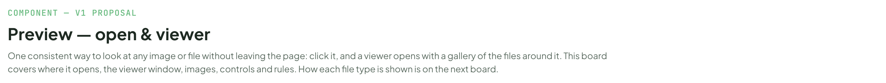
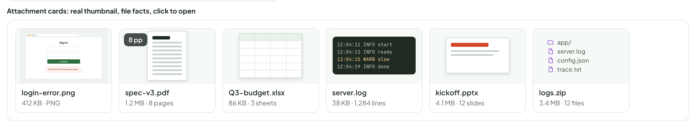
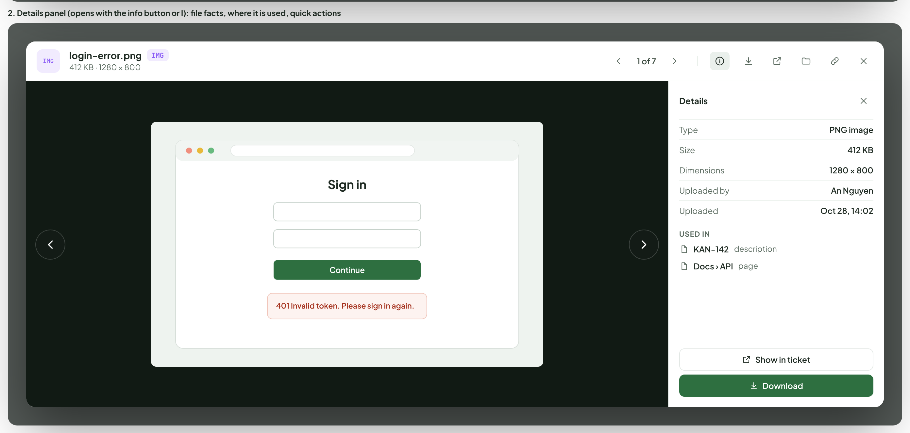
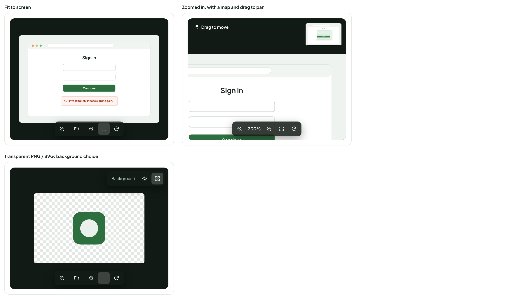
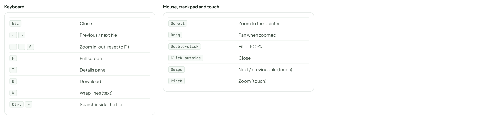
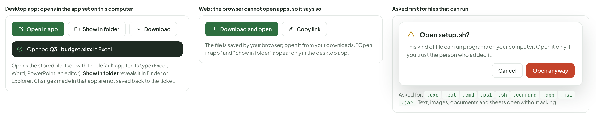
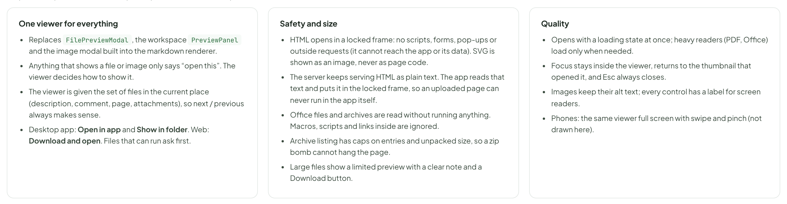

# Preview — open & viewer

> COMPONENT — V1 PROPOSAL · source: [`PreviewViewer.dc.html`](../source/PreviewViewer.dc.html) · canvas `1793259570-1d4c` · sha256 `ef2a2c3afe3d9fab8ba7c252906b810bbb338c89fcfafeaf62f6ce06ee2ad568`

One consistent way to look at any image or file without leaving the page: click it, and a viewer opens with a gallery of the files around it. This board covers where it opens, the viewer window, images, controls and rules. How each file type is shown is on the next board.

Source: [PreviewViewer.dc.html](../source/PreviewViewer.dc.html) › header ("COMPONENT — V1 PROPOSAL", "Preview — open & viewer" and the intro)

---

## A. Where a preview opens

Source: [PreviewViewer.dc.html](../source/PreviewViewer.dc.html) › block "A. Where a preview opens"

- Text in the frames: "Attachment cards: real thumbnail, file facts, click to open" · "Sign in" · "Continue" · "401 Invalid token. Please sign in again." · "login-error.png" · "412 KB · PNG" · "8 pp" · "spec-v3.pdf" · "1.2 MB · 8 pages" · "Q3-budget.xlsx" · "86 KB · 3 sheets" · "12:04:11 INFO start" · "12:04:12 INFO ready" · "12:04:15 WARN slow" · "12:04:19 INFO done" · "server.log" · "38 KB · 1,284 lines" · "kickoff.pptx" · "4.1 MB · 12 slides" · "app/" · "config.json" · "trace.txt" · "logs.zip" · "3.4 MB · 12 files"

---

## B. The viewer

Source: [PreviewViewer.dc.html](../source/PreviewViewer.dc.html) › block "B. The viewer"

- Text in the frames: "2. Details panel (opens with the info button or I): file facts, where it is used, quick actions" · "IMG" · "login-error.png" · "412 KB · 1280 × 800" · "1 of 7" · "Sign in" · "Continue" · "401 Invalid token. Please sign in again." · "Details" · "Type" · "PNG image" · "Size" · "412 KB" · "Dimensions" · "1280 × 800" · "Uploaded by" · "An Nguyen" · "Uploaded" · "Oct 28, 14:02" · "USED IN" · "KAN-142" · "description" · "Docs › API" · "page" · "Show in ticket" · "Download"

---

## C. Image viewer

Fit to screen by default. Scroll or pinch to zoom, drag to pan, double-click to jump between Fit and 100%. A small map shows where you are when zoomed in. Transparent images can be shown on a checkerboard.

Source: [PreviewViewer.dc.html](../source/PreviewViewer.dc.html) › block "C. Image viewer"

- Text in the frames: "Fit to screen" · "Sign in" · "Continue" · "401 Invalid token. Please sign in again." · "Fit" · "Zoomed in, with a map and drag to pan" · "Drag to move" · "200%" · "Transparent PNG / SVG: background choice" · "Background"

---

## D. Controls

The same shortcuts work in every file type; keys that do not apply to the current file do nothing.

Source: [PreviewViewer.dc.html](../source/PreviewViewer.dc.html) › block "D. Controls"

- Text in the frames: "Keyboard" · "Esc" · "Close" · "←" · "→" · "Previous / next file" · "+" · "−" · "0" · "Zoom in, out, reset to Fit" · "F" · "Full screen" · "I" · "Details panel" · "D" · "Download" · "W" · "Wrap lines (text)" · "Ctrl" · "Search inside the file" · "Mouse, trackpad and touch" · "Scroll" · "Zoom to the pointer" · "Drag" · "Pan when zoomed" · "Double-click" · "Fit or 100%" · "Click outside" · "Swipe" · "Next / previous file (touch)" · "Pinch" · "Zoom (touch)"

---

## E. Open in the default app

Desktop app only. Open in app, Show in folder and Download sit together in the header; the same actions appear on the card for files with no preview.

Source: [PreviewViewer.dc.html](../source/PreviewViewer.dc.html) › block "E. Open in the default app"

- Text in the frames: "Desktop app: opens in the app set on this computer" · "Open in app" · "Show in folder" · "Download" · "Opened Q3-budget.xlsx in Excel" · "Opens the stored file itself with the default app for its type (Excel, Word, PowerPoint, an editor). Show in folder reveals it in Finder or Explorer. Changes made in that app are not saved back to the ticket." · "Web: the browser cannot open apps, so it says so" · "Download and open" · "Copy link" · "The file is saved by your browser; open it from your downloads. “Open in app” and “Show in folder” appear only in the desktop app." · "Asked first for files that can run" · "Open setup.sh?" · "This kind of file can run programs on your computer. Open it only if you trust the person who added it." · "Cancel" · "Open anyway" · "Asked for: .exe .bat .cmd .ps1 .sh .command .app .msi .jar. Text, images, documents and sheets open without asking."

---

## F. Rules

Proposed. Replaces the current separate previews with one component.

Source: [PreviewViewer.dc.html](../source/PreviewViewer.dc.html) › block "F. Rules"

- Text in the frames: "One viewer for everything" · "Replaces FilePreviewModal, the workspace PreviewPanel and the image modal built into the markdown renderer." · "Anything that shows a file or image only says “open this”. The viewer decides how to show it." · "The viewer is given the set of files in the current place (description, comment, page, attachments), so next / previous always makes sense." · "Desktop app: Open in app and Show in folder. Web: Download and open. Files that can run ask first." · "Safety and size" · "HTML opens in a locked frame: no scripts, forms, pop-ups or outside requests (it cannot reach the app or its data). SVG is shown as an image, never as page code." · "The server keeps serving HTML as plain text. The app reads that text and puts it in the locked frame, so an uploaded page can never run in the app itself." · "Office files and archives are read without running anything. Macros, scripts and links inside are ignored." · "Archive listing has caps on entries and unpacked size, so a zip bomb cannot hang the page." · "Large files show a limited preview with a clear note and a Download button." · "Quality" · "Opens with a loading state at once; heavy readers (PDF, Office) load only when needed." · "Focus stays inside the viewer, returns to the thumbnail that opened it, and Esc always closes." · "Images keep their alt text; every control has a label for screen readers." · "Phones: the same viewer full screen with swipe and pinch (not drawn here)."
