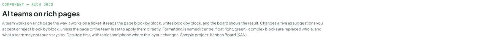
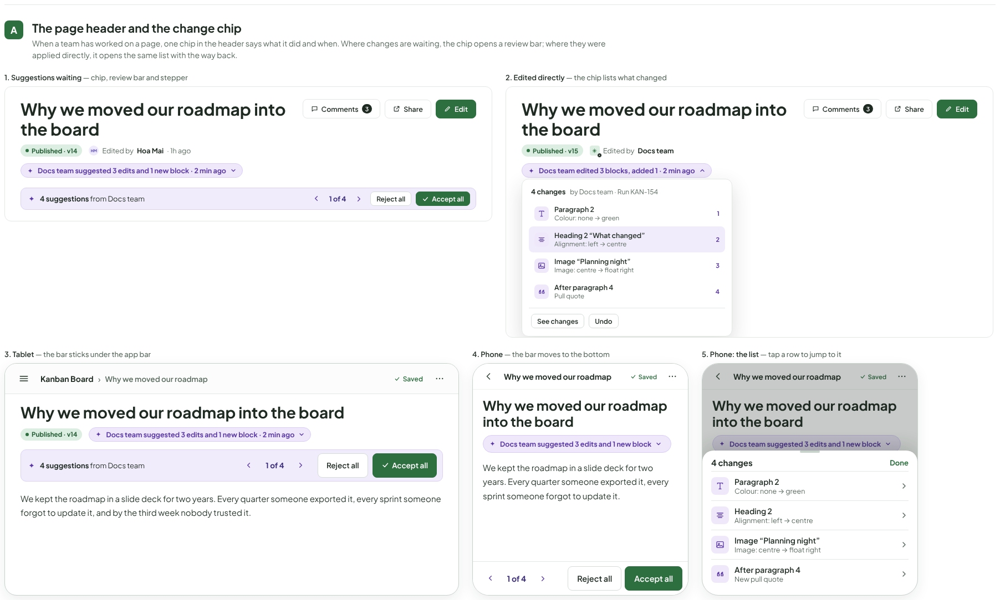
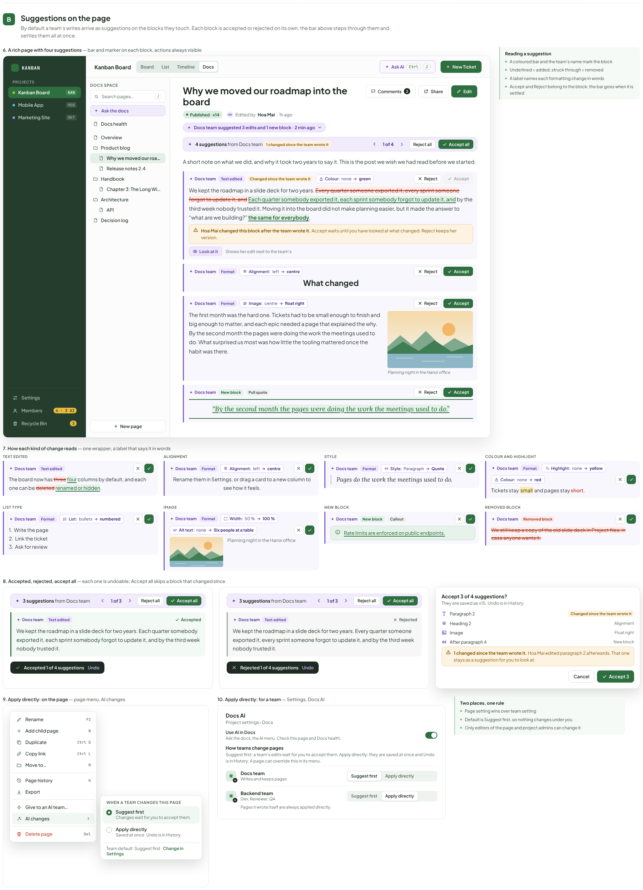
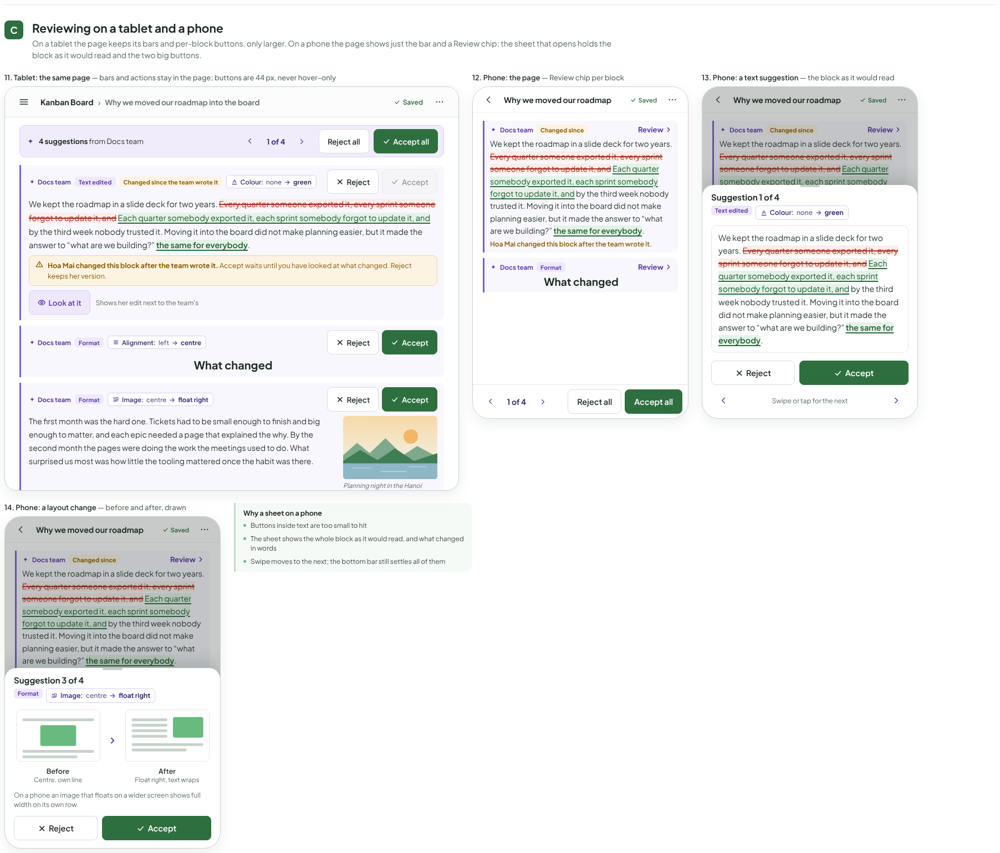
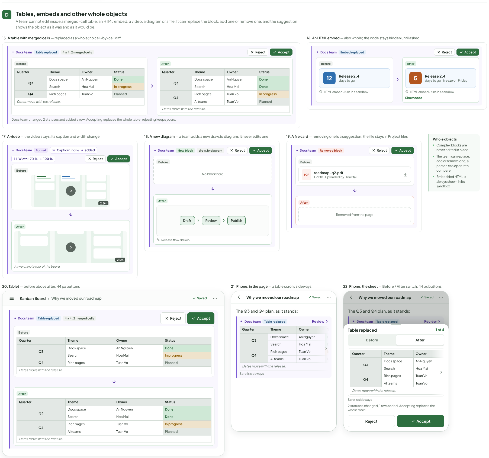
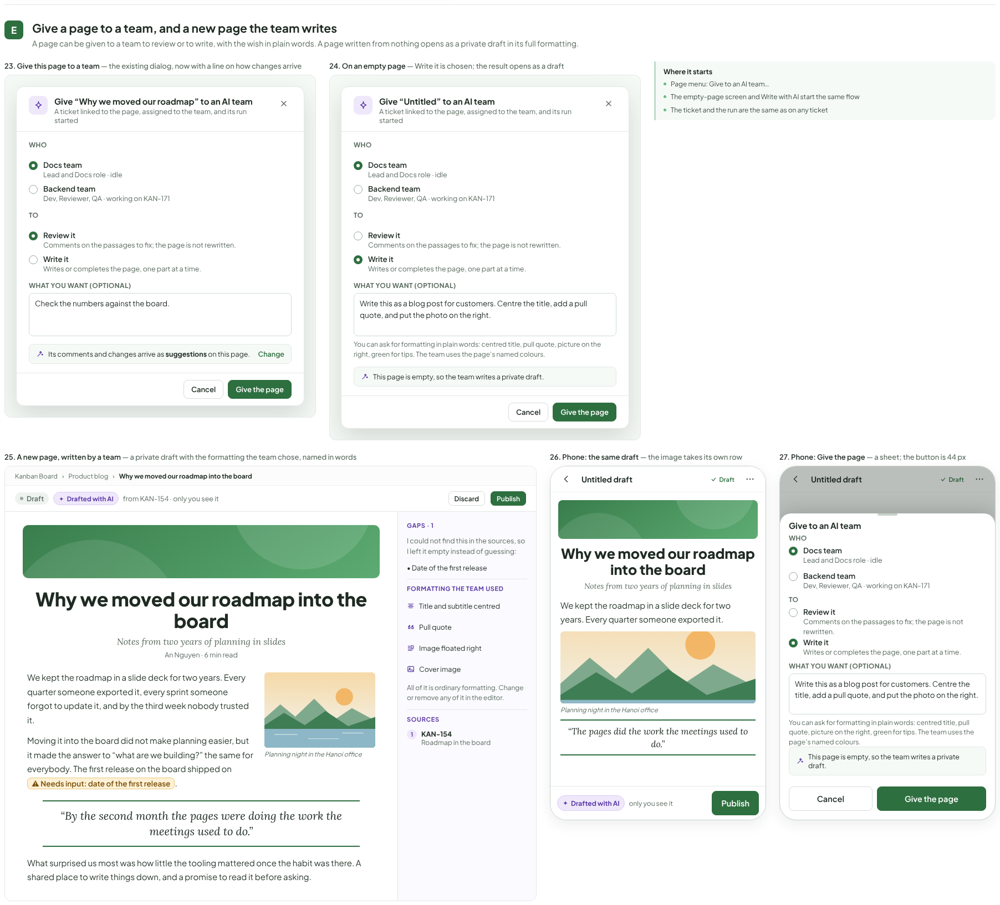
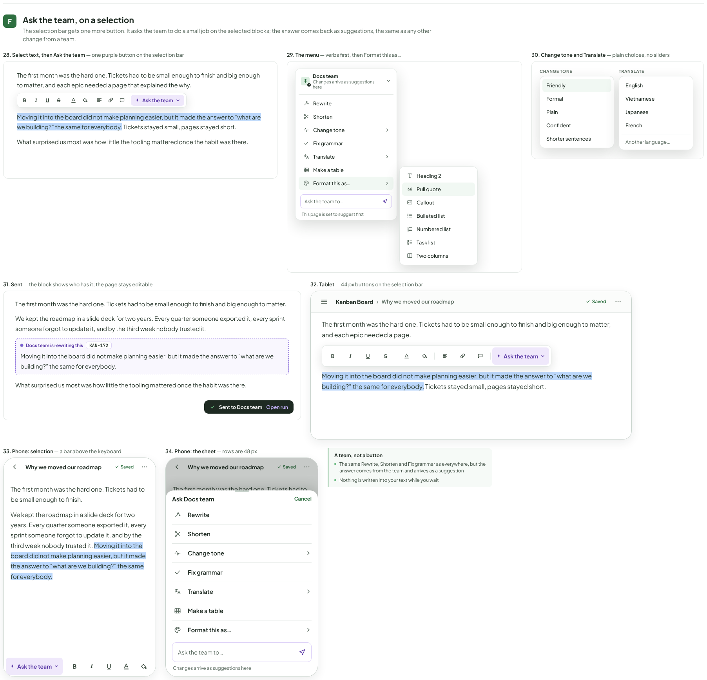
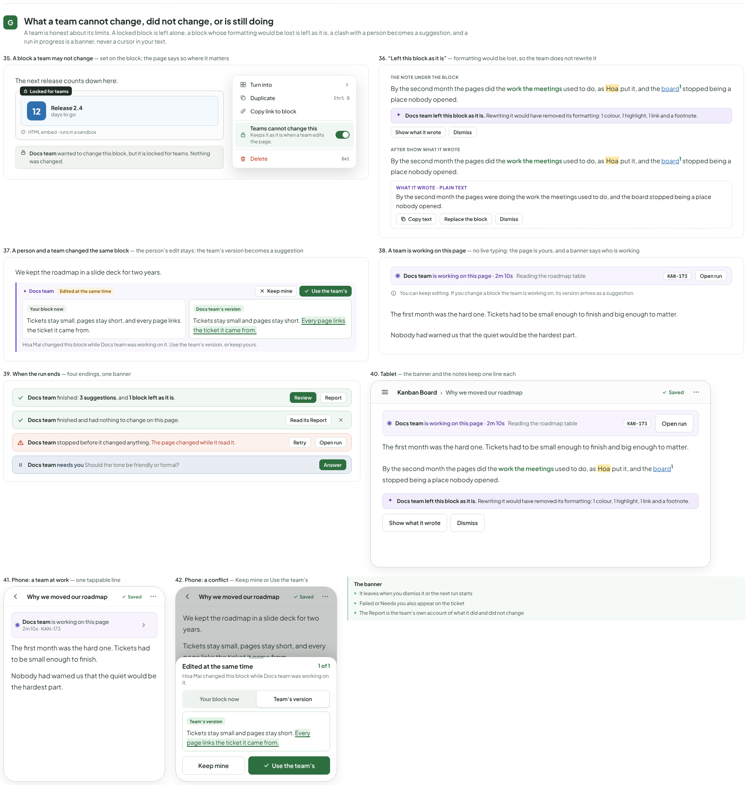
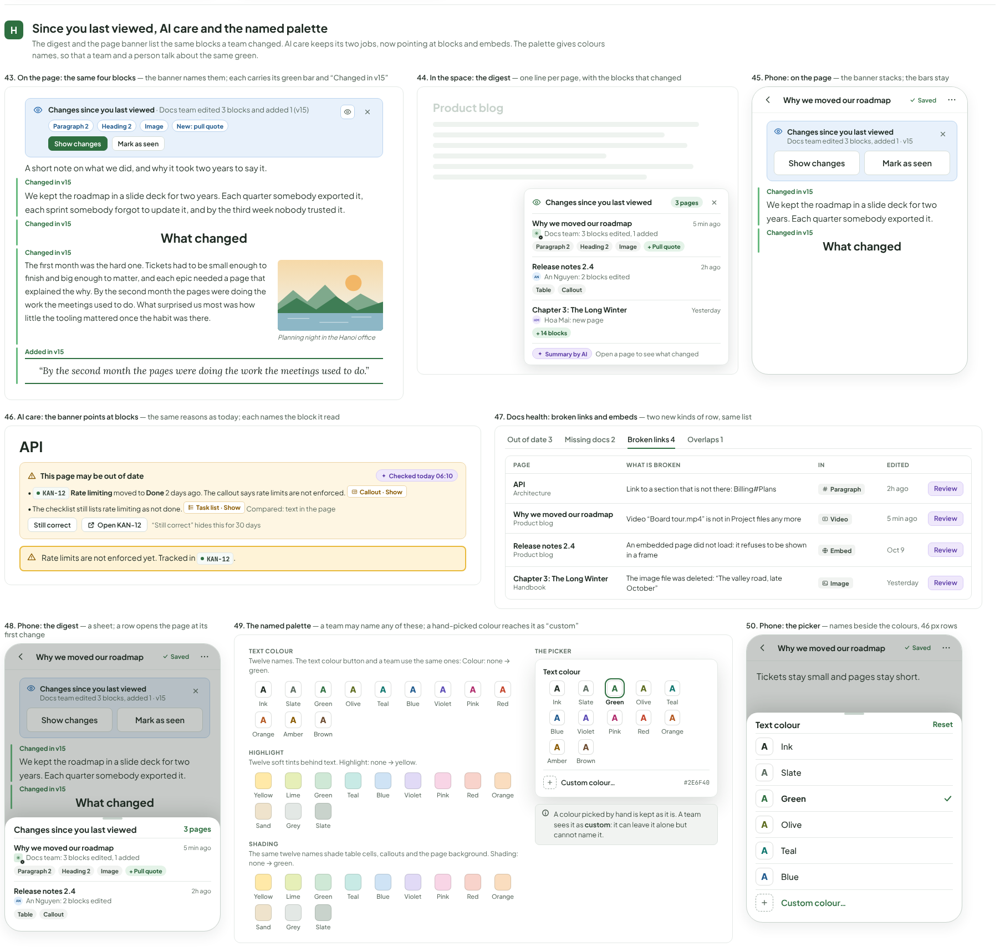
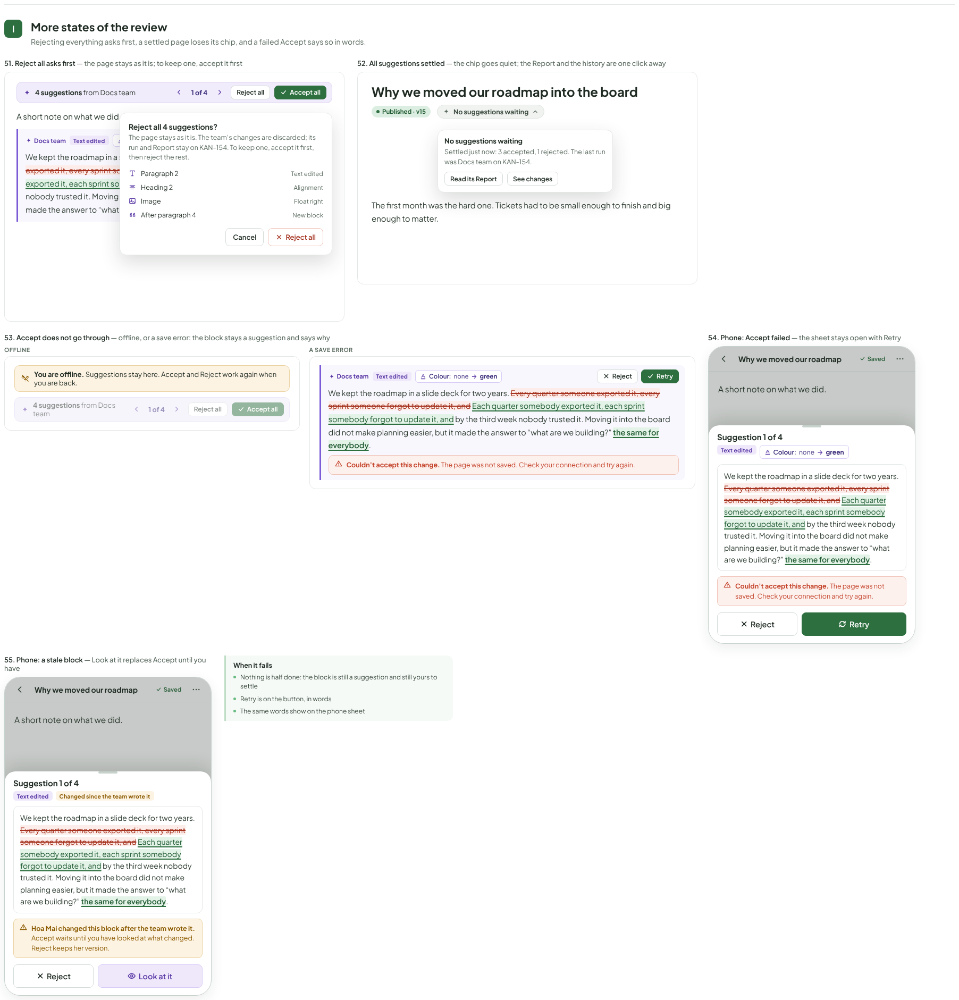

# Rich Docs — AI teams on rich pages

> New screen (Rich Docs) · source: [`RichDocsAi.dc.html`](../source/RichDocsAi.dc.html) · canvas `1794927884-e6a0` · sha256 `93d7d01f121f5a420c508c147f42c6f377bf2f439ef4520a187563ec558b9e56`

> A new board that lives next to the older Docs boards (it does not replace them). Where a screen already exists in the code, the words follow the code (`ui/src/components/docs/`); the rich-format parts (colours, float images, merged cells, embeds, suggestions, export, public links) are a design proposal and need the code changes listed at the end. Names, ids, costs and times in the mock-ups are sample data. Frames are numbered on the canvas; desktop is 1360 wide, tablet 820, phone 390.

## COMPONENT — RICH DOCS

- Text in this part: "COMPONENT — RICH DOCS" · "AI teams on rich pages" · "A team works on a rich page the way it works on a ticket: it reads the page block by block, writes block by block, and the board shows the result. Changes arrive as suggestions you accept or reject block by block, unless the page or the team is set to apply them directly. Formatting is named (centre, float right, green), complex blocks are replaced whole, and what a team may not touch says so. Desktop first, with tablet and phone where the layout changes. Sample project: Kanban Board (KAN)."

---

## The page header and the change chip

- Text in this part: "A" · "The page header and the change chip" · "When a team has worked on a page, one chip in the header says what it did and when. Where changes are waiting, the chip opens a review bar; where they were applied directly, it opens the same list with the way back." · "1. Suggestions waiting — chip, review bar and stepper" · "Why we moved our roadmap into the board" · "Published · v14" · "HM" · "Edited by" · "Hoa Mai" · "· 1h ago" · "Docs team suggested 3 edits and 1 new block · 2 min ago" · "Comments" · "3" · "Share" · "Edit" · "4 suggestions from Docs team" · "1 of 4" · "Reject all" · "Accept all" · "2. Edited directly — the chip lists what changed" · "Published · v15" · "Docs team" · "Docs team edited 3 blocks, added 1 · 2 min ago" · "4 changes" · "by Docs team · Run KAN-154" · "Paragraph 2" · "Colour: none → green" · "1" · "Heading 2 “What changed”" · "Alignment: left → centre" · "2" · "Image “Planning night”" · "Image: centre → float right" · "After paragraph 4" · "Pull quote" · "4" · "See changes" · "Undo" · "3. Tablet — the bar sticks under the app bar" · "Kanban Board" · "›" · "Why we moved our roadmap" · "Saved" · "We kept the roadmap in a slide deck for two years. Every quarter someone exported it, every sprint someone forgot to update it, and by the third week nobody trusted it." · "4. Phone — the bar moves to the bottom" · "Docs team suggested 3 edits and 1 new block" · "We kept the roadmap in a slide deck for two years. Every quarter someone exported it, every sprint someone forgot to update it." · "5. Phone: the list — tap a row to jump to it" · "Done" · "Heading 2" · "New pull quote"

---

## Suggestions on the page

- Text in this part: "B" · "Suggestions on the page" · "By default a team’s writes arrive as suggestions on the blocks they touch. Each block is accepted or rejected on its own; the bar above steps through them and settles them all at once." · "6. A rich page with four suggestions — bar and marker on each block, actions always visible" · "KANBAN" · "PROJECTS" · "Kanban Board" · "KAN" · "Mobile App" · "MOB" · "Marketing Site" · "MKT" · "Settings" · "Members" · "4 · 3 AI" · "Recycle Bin" · "3" · "Board" · "List" · "Timeline" · "Docs" · "Ask AI" · "Ctrl" · "J" · "New Ticket" · "DOCS SPACE" · "Search pages…" · "/" · "Ask the docs" · "Docs health" · "Overview" · "Product blog" · "Why we moved our roadmap" · "Release notes 2.4" · "Handbook" · "Chapter 3: The Long Winter" · "Architecture" · "API" · "Decision log" · "New page" · "Why we moved our roadmap into the board" · "Published · v14" · "HM" · "Edited by" · "Hoa Mai" · "· 1h ago" · "Docs team suggested 3 edits and 1 new block · 2 min ago" · "Comments" · "Share" · "Edit" · "4 suggestions from Docs team 1 changed since the team wrote it" · "1 of 4" · "Reject all" · "Accept all" · "A short note on what we did, and why it took two years to say it. This is the post we wish we had read before we started." · "Docs team" · "Text edited" · "Changed since the team wrote it" · "Colour:" · "none" · "→" · "green" · "Reject" · "Accept" · "We kept the roadmap in a slide deck for two years. Every quarter someone exported it, every sprint someone forgot to update it, and Each quarter somebody exported it, each sprint somebody forgot to update it, and by the third week nobody trusted it. Moving it into the board did not make planning easier, but it made the answer to “what are we building?” the same for everybody." · "Hoa Mai changed this block after the team wrote it. Accept waits until you have looked at what changed. Reject keeps her version." · "Look at it" · "Shows her edit next to the team's" · "Format" · "Alignment:" · "left" · "centre" · "What changed" · "Image:" · "float right" · "Planning night in the Hanoi office" · "The first month was the hard one. Tickets had to be small enough to finish and big enough to matter, and each epic needed a page that explained the why. By the second month the pages were doing the work the meetings used to do. What surprised us most was how little the tooling mattered once the habit was there." · "New block" · "Pull quote" · "“By the second month the pages were doing the work the meetings used to do.”" · "Reading a suggestion" · "A coloured bar and the team’s name mark the block" · "Underlined = added, struck through = removed" · "A label names each formatting change in words" · "Accept and Reject belong to the block; the bar goes when it is settled" · "7. How each kind of change reads — one wrapper, a label that says it in words" · "TEXT EDITED" · "The board now has three four columns by default, and each one can be deleted renamed or hidden." · "ALIGNMENT" · "Rename them in Settings, or drag a card to a new column to see how it feels." · "STYLE" · "Style:" · "Paragraph" · "Quote" · "Pages do the work the meetings used to do." · "COLOUR AND HIGHLIGHT" · "Highlight:" · "yellow" · "red" · "Tickets stay small and pages stay short." · "LIST TYPE" · "List:" · "bullets" · "numbered" · "1.  Write the page" · "2.  Link the ticket" · "3.  Ask for review" · "IMAGE" · "Width:" · "50 %"

---

## Reviewing on a tablet and a phone

- Text in this part: "C" · "Reviewing on a tablet and a phone" · "On a tablet the page keeps its bars and per-block buttons, only larger. On a phone the page shows just the bar and a Review chip; the sheet that opens holds the block as it would read and the two big buttons." · "11. Tablet: the same page — bars and actions stay in the page; buttons are 44 px, never hover-only" · "Kanban Board" · "›" · "Why we moved our roadmap into the board" · "Saved" · "4 suggestions from Docs team" · "1 of 4" · "Reject all" · "Accept all" · "Docs team" · "Text edited" · "Changed since the team wrote it" · "Colour:" · "none" · "→" · "green" · "Reject" · "Accept" · "We kept the roadmap in a slide deck for two years. Every quarter someone exported it, every sprint someone forgot to update it, and Each quarter somebody exported it, each sprint somebody forgot to update it, and by the third week nobody trusted it. Moving it into the board did not make planning easier, but it made the answer to “what are we building?” the same for everybody." · "Hoa Mai changed this block after the team wrote it. Accept waits until you have looked at what changed. Reject keeps her version." · "Look at it" · "Shows her edit next to the team's" · "Format" · "Alignment:" · "left" · "centre" · "What changed" · "Image:" · "float right" · "Planning night in the Hanoi office" · "The first month was the hard one. Tickets had to be small enough to finish and big enough to matter, and each epic needed a page that explained the why. By the second month the pages were doing the work the meetings used to do. What surprised us most was how little the tooling mattered once the habit was there." · "12. Phone: the page — Review chip per block" · "Why we moved our roadmap" · "Changed since" · "Review" · "Hoa Mai changed this block after the team wrote it." · "13. Phone: a text suggestion — the block as it would read" · "Suggestion 1 of 4" · "Swipe or tap for the next" · "14. Phone: a layout change — before and after, drawn" · "Suggestion 3 of 4" · "Before" · "Centre, own line" · "After" · "Float right, text wraps" · "On a phone an image that floats on a wider screen shows full width on its own row." · "Why a sheet on a phone" · "Buttons inside text are too small to hit" · "The sheet shows the whole block as it would read, and what changed in words" · "Swipe moves to the next; the bottom bar still settles all of them"

---

## Tables, embeds and other whole objects

- Text in this part: "D" · "Tables, embeds and other whole objects" · "A team cannot edit inside a merged-cell table, an HTML embed, a video, a diagram or a file. It can replace the block, add one or remove one, and the suggestion shows the object as it was and as it would be." · "15. A table with merged cells — replaced as a whole; no cell-by-cell diff" · "Docs team" · "Table replaced" · "4 × 4, 2 merged cells" · "Reject" · "Accept" · "Before" · "Quarter	Theme	Owner	Status" · "Q3	Docs space	An Nguyen	Done" · "Search	Hoa Mai	In progress" · "Q4	Rich pages	Tuan Vo	Planned" · "Dates move with the release." · "After" · "Search	Hoa Mai	Done" · "Q4	Rich pages	Tuan Vo	In progress" · "AI teams	Tuan Vo	Planned" · "Docs team changed 2 statuses and added a row. Accepting replaces the whole table; rejecting keeps yours." · "16. An HTML embed — also whole; the code stays hidden until asked" · "Embed replaced" · "12" · "Release 2.4" · "days to go" · "HTML embed · runs in a sandbox" · "5" · "days to go · freeze on Friday" · "Show code" · "17. A video — the video stays; its caption and width change" · "Format" · "Caption:" · "none" · "→" · "added" · "Width:" · "70 %" · "100 %" · "2:04" · "A two-minute tour of the board" · "18. A new diagram — a team adds a new draw.io diagram; it never edits one" · "New block" · "draw.io diagram" · "No block here" · "Draft" · "Review" · "Publish" · "Release flow.drawio" · "19. A file card — removing one is a suggestion; the file stays in Project files" · "Removed block" · "PDF" · "roadmap-q2.pdf" · "1.2 MB · Uploaded by Hoa Mai" · "Removed from the page" · "Whole objects" · "Complex blocks are never edited in place" · "The team can replace, add or remove one; a person can open it to compare" · "Embedded HTML is always shown in its sandbox" · "20. Tablet — before above after, 44 px buttons" · "Kanban Board" · "›" · "Why we moved our roadmap" · "Saved" · "21. Phone: in the page — a table scrolls sideways" · "The Q3 and Q4 plan, as it stands:" · "Scrolls sideways" · "22. Phone: the sheet — Before / After switch, 44 px buttons" · "1 of 4" · "2 statuses changed, 1 row added. Accepting replaces the whole table."

---

## Give a page to a team, and a new page the team writes

- Text in this part: "E" · "Give a page to a team, and a new page the team writes" · "A page can be given to a team to review or to write, with the wish in plain words. A page written from nothing opens as a private draft in its full formatting." · "23. Give this page to a team — the existing dialog, now with a line on how changes arrive" · "Give “Why we moved our roadmap” to an AI team" · "A ticket linked to the page, assigned to the team, and its run started" · "WHO" · "Docs team" · "Lead and Docs role · idle" · "Backend team" · "Dev, Reviewer, QA · working on KAN-171" · "TO" · "Review it" · "Comments on the passages to fix; the page is not rewritten." · "Write it" · "Writes or completes the page, one part at a time." · "WHAT YOU WANT (OPTIONAL)" · "Check the numbers against the board." · "Its comments and changes arrive as suggestions on this page." · "Change" · "Cancel" · "Give the page" · "24. On an empty page — Write it is chosen; the result opens as a draft" · "Give “Untitled” to an AI team" · "Write this as a blog post for customers. Centre the title, add a pull quote, and put the photo on the right." · "You can ask for formatting in plain words: centred title, pull quote, picture on the right, green for tips. The team uses the page’s named colours." · "This page is empty, so the team writes a private draft." · "Where it starts" · "Page menu: Give to an AI team…" · "The empty-page screen and Write with AI start the same flow" · "The ticket and the run are the same as on any ticket" · "25. A new page, written by a team — a private draft with the formatting the team chose, named in words" · "Kanban Board" · "›" · "Product blog" · "Why we moved our roadmap into the board" · "Draft" · "Drafted with AI" · "from KAN-154 · only you see it" · "Discard" · "Publish" · "Notes from two years of planning in slides" · "An Nguyen · 6 min read" · "Planning night in the Hanoi office" · "We kept the roadmap in a slide deck for two years. Every quarter someone exported it, every sprint someone forgot to update it, and by the third week nobody trusted it." · "Moving it into the board did not make planning easier, but it made the answer to “what are we building?” the same for everybody. The first release on the board shipped on ⚠ Needs input: date of the first release." · "“By the second month the pages were doing the work the meetings used to do.”" · "What surprised us most was how little the tooling mattered once the habit was there. A shared place to write things down, and a promise to read it before asking." · "GAPS · 1" · "I could not find this in the sources, so I left it empty instead of guessing:" · "• Date of the first release" · "FORMATTING THE TEAM USED" · "Title and subtitle centred" · "Pull quote" · "Image floated right" · "Cover image" · "All of it is ordinary formatting. Change or remove any of it in the editor." · "SOURCES" · "1" · "KAN-154" · "Roadmap in the board" · "26. Phone: the same draft — the image takes its own row" · "Untitled draft" · "We kept the roadmap in a slide deck for two years. Every quarter someone exported it." · "“The pages did the work the meetings used to do.”" · "only you see it" · "27. Phone: Give the page — a sheet; the button is 44 px" · "Give to an AI team"

---

## Ask the team, on a selection

- Text in this part: "F" · "Ask the team, on a selection" · "The selection bar gets one more button. It asks the team to do a small job on the selected blocks; the answer comes back as suggestions, the same as any other change from a team." · "28. Select text, then Ask the team — one purple button on the selection bar" · "The first month was the hard one. Tickets had to be small enough to finish and big enough to matter, and each epic needed a page that explained the why." · "B" · "I" · "U" · "S" · "Ask the team" · "Moving it into the board did not make planning easier, but it made the answer to “what are we building?” the same for everybody. Tickets stayed small, pages stayed short." · "What surprised us most was how little the tooling mattered once the habit was there." · "29. The menu — verbs first, then Format this as…" · "Docs team" · "Changes arrive as suggestions here" · "Rewrite" · "Shorten" · "Change tone" · "Fix grammar" · "Translate" · "Make a table" · "Format this as…" · "Ask the team to…" · "This page is set to suggest first" · "Heading 2" · "Pull quote" · "Callout" · "Bulleted list" · "Numbered list" · "Task list" · "Two columns" · "30. Change tone and Translate — plain choices, no sliders" · "CHANGE TONE" · "Friendly" · "Formal" · "Plain" · "Confident" · "Shorter sentences" · "TRANSLATE" · "English" · "Vietnamese" · "Japanese" · "French" · "Another language…" · "31. Sent — the block shows who has it; the page stays editable" · "The first month was the hard one. Tickets had to be small enough to finish and big enough to matter." · "We kept the roadmap in a slide deck for two years. Every quarter someone exported it, every sprint someone forgot to update it, and by the third week nobody trusted it." · "Docs team is rewriting this" · "KAN-172" · "Moving it into the board did not make planning easier, but it made the answer to “what are we building?” the same for everybody." · "Sent to Docs team" · "Open run" · "32. Tablet — 44 px buttons on the selection bar" · "Kanban Board" · "›" · "Why we moved our roadmap" · "Saved" · "The first month was the hard one. Tickets had to be small enough to finish and big enough to matter, and each epic needed a page." · "33. Phone: selection — a bar above the keyboard" · "The first month was the hard one. Tickets had to be small enough to finish." · "We kept the roadmap in a slide deck for two years. Every quarter someone exported it, every sprint someone forgot to update it, and by the third week nobody trusted it. Moving it into the board did not make planning easier, but it made the answer to “what are we building?” the same for everybody." · "34. Phone: the sheet — rows are 48 px" · "Ask Docs team" · "Cancel" · "A team, not a button" · "The same Rewrite, Shorten and Fix grammar as everywhere, but the answer comes from the team and arrives as a suggestion" · "Nothing is written into your text while you wait"

---

## What a team cannot change, did not change, or is still doing

- Text in this part: "G" · "What a team cannot change, did not change, or is still doing" · "A team is honest about its limits. A locked block is left alone, a block whose formatting would be lost is left as it is, a clash with a person becomes a suggestion, and a run in progress is a banner, never a cursor in your text." · "35. A block a team may not change — set on the block; the page says so where it matters" · "The next release counts down here:" · "Locked for teams" · "12" · "Release 2.4" · "days to go" · "HTML embed · runs in a sandbox" · "Docs team wanted to change this block, but it is locked for teams. Nothing was changed." · "Turn into" · "Duplicate" · "Ctrl D" · "Copy link to block" · "Teams cannot change this" · "Keeps it as it is when a team edits the page." · "Delete" · "Del" · "36. “Left this block as it is” — formatting would be lost, so the team does not rewrite it" · "THE NOTE UNDER THE BLOCK" · "By the second month the pages did the work the meetings used to do, as Hoa put it, and the board1 stopped being a place nobody opened." · "Docs team left this block as it is. Rewriting it would have removed its formatting: 1 colour, 1 highlight, 1 link and a footnote." · "Show what it wrote" · "Dismiss" · "AFTER SHOW WHAT IT WROTE" · "WHAT IT WROTE · PLAIN TEXT" · "By the second month the pages were doing the work the meetings used to do, and the board stopped being a place nobody opened." · "Copy text" · "Replace the block" · "37. A person and a team changed the same block — the person’s edit stays; the team’s version becomes a suggestion" · "We kept the roadmap in a slide deck for two years." · "Docs team" · "Edited at the same time" · "Keep mine" · "Use the team’s" · "Your block now" · "Tickets stay small, pages stay short, and every page links the ticket it came from." · "Docs team’s version" · "Tickets stay small and pages stay short. Every page links the ticket it came from." · "Hoa Mai changed this block while Docs team was working on it. Use the team’s version, or keep yours." · "38. A team is working on this page — no live typing: the page is yours, and a banner says who is working" · "Docs team is working on this page · 2m 10s Reading the roadmap table" · "KAN-173" · "Open run" · "You can keep editing. If you change a block the team is working on, its version arrives as a suggestion." · "The first month was the hard one. Tickets had to be small enough to finish and big enough to matter." · "Nobody had warned us that the quiet would be the hardest part." · "39. When the run ends — four endings, one banner" · "Docs team finished: 3 suggestions, and 1 block left as it is." · "Review" · "Report" · "Docs team finished and had nothing to change on this page." · "Read its Report" · "Docs team stopped before it changed anything. The page changed while it read it." · "Retry" · "Docs team needs you Should the tone be friendly or formal?" · "Answer" · "40. Tablet — the banner and the notes keep one line each" · "Kanban Board" · "›" · "Why we moved our roadmap" · "Saved" · "41. Phone: a team at work — one tappable line" · "Docs team is working on this page" · "2m 10s · KAN-173" · "The first month was the hard one. Tickets had to be small enough to finish." · "42. Phone: a conflict — Keep mine or Use the team’s" · "1 of 1" · "Hoa Mai changed this block while Docs team was working on it." · "Team’s version" · "The banner" · "It leaves when you dismiss it or the next run starts" · "Failed or Needs you also appear on the ticket" · "The Report is the team’s own account of what it did and did not change"

---

## Since you last viewed, AI care and the named palette

- Text in this part: "H" · "Since you last viewed, AI care and the named palette" · "The digest and the page banner list the same blocks a team changed. AI care keeps its two jobs, now pointing at blocks and embeds. The palette gives colours names, so that a team and a person talk about the same green." · "43. On the page: the same four blocks — the banner names them; each carries its green bar and “Changed in v15”" · "Changes since you last viewed · Docs team edited 3 blocks and added 1 (v15)" · "Paragraph 2" · "Heading 2" · "Image" · "New: pull quote" · "Show changes" · "Mark as seen" · "A short note on what we did, and why it took two years to say it." · "Changed in v15" · "We kept the roadmap in a slide deck for two years. Each quarter somebody exported it, each sprint somebody forgot to update it, and by the third week nobody trusted it." · "What changed" · "Planning night in the Hanoi office" · "The first month was the hard one. Tickets had to be small enough to finish and big enough to matter, and each epic needed a page that explained the why. By the second month the pages were doing the work the meetings used to do. What surprised us most was how little the tooling mattered once the habit was there." · "Added in v15" · "“By the second month the pages were doing the work the meetings used to do.”" · "44. In the space: the digest — one line per page, with the blocks that changed" · "Product blog" · "Changes since you last viewed" · "3 pages" · "Why we moved our roadmap" · "5 min ago" · "Docs team: 3 blocks edited, 1 added" · "+ Pull quote" · "Release notes 2.4" · "2h ago" · "AN" · "An Nguyen: 2 blocks edited" · "Table" · "Callout" · "Chapter 3: The Long Winter" · "Yesterday" · "HM" · "Hoa Mai: new page" · "+ 14 blocks" · "Summary by AI" · "Open a page to see what changed" · "45. Phone: on the page — the banner stacks; the bars stay" · "Saved" · "Docs team edited 3 blocks, added 1 · v15" · "We kept the roadmap in a slide deck for two years. Each quarter somebody exported it." · "46. AI care: the banner points at blocks — the same reasons as today; each names the block it read" · "API" · "This page may be out of date" · "Checked today 06:10" · "•" · "KAN-12 Rate limiting moved to Done 2 days ago. The callout says rate limits are not enforced." · "Callout · Show" · "• The checklist still lists rate limiting as not done." · "Task list · Show Compared: text in the page" · "Still correct" · "Open KAN-12" · "“Still correct” hides this for 30 days" · "Rate limits are not enforced yet. Tracked in" · "KAN-12." · "47. Docs health: broken links and embeds — two new kinds of row, same list" · "Out of date 3" · "Missing docs 2" · "Broken links 4" · "Overlaps 1" · "PAGE" · "WHAT IS BROKEN" · "IN" · "EDITED" · "Architecture" · "Link to a section that is not there: Billing#Plans" · "Paragraph" · "Review" · "Video “Board tour.mp4” is not in Project files any more" · "Video" · "An embedded page did not load: it refuses to be shown in a frame" · "Embed" · "Oct 9" · "Handbook" · "The image file was deleted: “The valley road, late October”" · "48. Phone: the digest — a sheet; a row opens the page at its first change" · "49. The named palette — a team may name any of these; a hand-picked colour reaches it as “custom”" · "TEXT COLOUR" · "Twelve names. The text colour button and a team use the same ones: Colour: none → green." · "A" · "Ink" · "Slate" · "Green" · "Olive" · "Teal" · "Blue" · "Violet" · "Pink" · "Red" · "Orange" · "Amber" · "Brown" · "HIGHLIGHT" · "Twelve soft tints behind text. Highlight: none → yellow." · "Yellow" · "Lime" · "Sand" · "Grey" · "SHADING" · "The same twelve names shade table cells, callouts and the page background. Shading: none → green." · "THE PICKER" · "Text colour" · "Custom colour…" · "#2E6F40" · "A colour picked by hand is kept as it is. A team sees it as custom: it can leave it alone but cannot name it." · "50. Phone: the picker — names beside the colours, 46 px rows" · "Tickets stay small and pages stay short."

---

## More states of the review

- Text in this part: "I" · "More states of the review" · "Rejecting everything asks first, a settled page loses its chip, and a failed Accept says so in words." · "51. Reject all asks first — the page stays as it is; to keep one, accept it first" · "4 suggestions from Docs team" · "1 of 4" · "Reject all" · "Accept all" · "Reject all 4 suggestions?" · "The page stays as it is. The team’s changes are discarded; its run and Report stay on KAN-154. To keep one, accept it first, then reject the rest." · "Paragraph 2" · "Text edited" · "Heading 2" · "Alignment" · "Image" · "Float right" · "After paragraph 4" · "New block" · "Cancel" · "A short note on what we did, and why it took two years to say it." · "Docs team" · "Colour:" · "none" · "→" · "green" · "We kept the roadmap in a slide deck for two years. Every quarter someone exported it, every sprint someone forgot to update it, and Each quarter somebody exported it, each sprint somebody forgot to update it, and by the third week nobody trusted it. Moving it into the board did not make planning easier, but it made the answer to “what are we building?” the same for everybody." · "52. All suggestions settled — the chip goes quiet; the Report and the history are one click away" · "Why we moved our roadmap into the board" · "Published · v15" · "No suggestions waiting" · "Settled just now: 3 accepted, 1 rejected. The last run was Docs team on KAN-154." · "Read its Report" · "See changes" · "The first month was the hard one. Tickets had to be small enough to finish and big enough to matter." · "53. Accept does not go through — offline, or a save error: the block stays a suggestion and says why" · "OFFLINE" · "You are offline. Suggestions stay here. Accept and Reject work again when you are back." · "A SAVE ERROR" · "Reject" · "Retry" · "Couldn’t accept this change. The page was not saved. Check your connection and try again." · "54. Phone: Accept failed — the sheet stays open with Retry" · "Why we moved our roadmap" · "Saved" · "A short note on what we did." · "Suggestion 1 of 4" · "55. Phone: a stale block — Look at it replaces Accept until you have" · "Changed since the team wrote it" · "Hoa Mai changed this block after the team wrote it. Accept waits until you have looked at what changed. Reject keeps her version." · "Look at it" · "When it fails" · "Nothing is half done: the block is still a suggestion and still yours to settle" · "Retry is on the button, in words" · "The same words show on the phone sheet"

---

## Frames, code that must change, and decisions for the owner

Folder `scratchpad/c/rd4_ai/`. Both boards are 1900 wide.

## RichDocsAi.dc.html (finalH 16010, 55 frames)
- A. Header chip: 1 Suggestions waiting, 2 Edited directly, 3 Tablet, 4 Phone, 5 Phone: the list.
- B. Suggestions: 6 A rich page with four suggestions (one stale), 7 How each kind of change reads, 8 Accepted, rejected, accept all, 9 Apply directly: on the page, 10 Apply directly: for a team.
- C. Tablet and phone: 11 Tablet, 12 Phone: the page, 13 Phone: a text suggestion, 14 Phone: a layout change.
- D. Whole objects: 15 Table, 16 HTML embed, 17 Video, 18 New diagram, 19 File card, 20 Tablet, 21 Phone: in the page, 22 Phone: the sheet.
- E. Give a page, new page: 23 Give this page to a team, 24 On an empty page, 25 A new page, written by a team, 26 Phone: the same draft, 27 Phone: Give the page.
- F. Ask the team: 28 Select text, 29 The menu, 30 Change tone and Translate, 31 Sent, 32 Tablet, 33 Phone: selection, 34 Phone: the sheet.
- G. Limits and run states: 35 Locked block, 36 "Left this block as it is", 37 Person and team on the same block, 38 A team is working, 39 When the run ends, 40 Tablet, 41 Phone: a team at work, 42 Phone: a conflict.
- H. Since viewed, care, palette: 43 On the page: the same four blocks, 44 In the space: the digest, 45 Phone: on the page, 46 AI care: banner points at blocks, 47 Docs health: broken links and embeds, 48 Phone: the digest, 49 The named palette, 50 Phone: the picker.
- I. More states of the review: 51 Reject all asks first, 52 All suggestions settled, 53 Accept does not go through, 54 Phone: Accept failed, 55 Phone: a stale block.

## RichDocsHistory.dc.html (finalH 14441, 27 frames)
- A. Version history: 1 The history drawer, 2 One version row in its variants, 3 The first version of a converted page, 4 Viewing an old version, 5 Phone: the list, 6 Tablet.
- B. Compare (v11 to v15): 7 Inline, 8 Side by side, 9 How each kind of change reads, 10 Compare any two versions, 11 Compare states, 12 Tablet, 13 Phone.
- C. Restore and copy: 14 Restore asks first, 15 Copy as a new page, 16 After you press the button, 17 Phone.
- D. Comments: 18 Text, image, table and embed, 19 Marks in the margin, 20 Starting a comment on each kind of block, 21 A comment keeps its place through edits, 22 Thread states, 23 Mention a team in a thread, 24 Tablet, 25 Phone: the page, 26 Phone: the list, 27 Phone: a thread.

## Code must change
- Rich format with a stable id on every block.
- Block-level suggestion layer: per-block Accept and Reject, a review bar with a stepper, and Accept all and Reject all with confirmation.
- Stale-block rule: Accept stays disabled until the reviewer chooses "Look at it" ("Changed since the team wrote it"); Accept all skips stale blocks.
- Apply-directly setting at page level (page menu) and team level (Settings); the page wins over the team.
- Block lock "Teams cannot change this".
- "Left this block as it is" notice.
- Conflict handling: a person's edit wins and the team's version becomes a suggestion ("Keep mine / Use the team's").
- Page banner for a team at work, with a failed or needs-you ending.
- Accept failure states (offline and save error, with Retry).
- Settled chip, "No suggestions waiting".
- "Ask the team" selection bar. It replaces "AI", "Ask AI…", "Send to AI", "Fix spelling" and "Improve". Its tone and translate lists drop the code's languages.
- Shared named palette: 12 text colours and 12 highlights, shading uses the same names, a hand-picked colour is "custom" to teams.
- Docs health gains embed and image rows; its columns are now PAGE / WHAT IS BROKEN / IN / EDITED.
- History shows rendered block diffs instead of markdown, with a per-row block count, "Copy as new page" and a "Converted from Markdown" version.
- Comments anchored to a block id plus a quote, including images, tables and embeds, with "quote edited" and "block deleted" states.
- The since-viewed banner names blocks instead of sections.
- Min target is 44 px on tablet and phone.

## Decisions for the owner
- Suggest first is the default.
- A team never edits inside a draw.io diagram, sketch or HTML embed. It replaces, adds or removes whole blocks. It may add a new diagram. Removing a file card keeps the file.
- "Left this block as it is": the board warns about lost formatting, which sits beside the server-side merge that should keep it. Please confirm.
- Old Markdown versions stay readable; the conversion is one extra version authored by "Kanban Board".
- A restore creates a new version. Comments on blocks the old version lacks become orphaned, never deleted.
- The 12 shading hex values were not copied from the Editor board (they reuse the highlight values); confirm.
- Drop cap is not drawn as something a team can write.
- Skipped: the recycle bin and deleted-page states, since they do not change with the rich format.
- Not drawn: dark theme.
