# Rich Docs — blocks & properties

> New screen (Rich Docs) · canvas `1794931846-a41d` · the board is split into 3 boards on the canvas because a browser cannot paint one board taller than about 8000 px; frame numbers run on across the parts. Sources: [`RichDocsBlocks1.dc.html`](../source/RichDocsBlocks1.dc.html) (sha256 `b287a840ce7f…`, full value in `MANIFEST.json`), [`RichDocsBlocks2.dc.html`](../source/RichDocsBlocks2.dc.html) (sha256 `774ad0376c47…`, full value in `MANIFEST.json`), [`RichDocsBlocks3.dc.html`](../source/RichDocsBlocks3.dc.html) (sha256 `cd2b835fd6f6…`, full value in `MANIFEST.json`)

> A new board that lives next to the older Docs boards (it does not replace them). Where a screen already exists in the code, the words follow the code (`ui/src/components/docs/`); the rich-format parts (colours, float images, merged cells, embeds, suggestions, export, public links, highlights) are a design proposal and need the code changes listed at the end. Names, ids, costs and times in the mock-ups are sample data. Frames are numbered on the canvas; desktop is 1360 wide, tablet 820, phone 390.

## COMPONENT — RICH DOCS

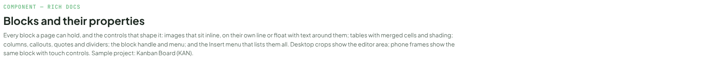

- Text in this part: "COMPONENT — RICH DOCS" · "Blocks and their properties" · "Every block a page can hold, and the controls that shape it: images that sit inline, on their own line or float with text around them; tables with merged cells and shading; columns, callouts, quotes and dividers; the block handle and menu; and the Insert menu that lists them all. Desktop crops show the editor area; phone frames show the same block with touch controls. Sample project: Kanban Board (KAN)."

---

## Images: where they sit

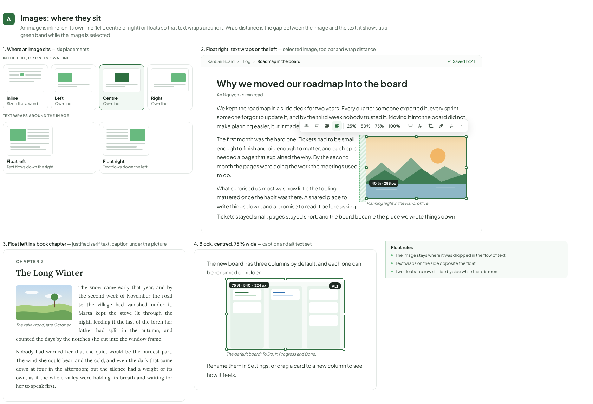

- Text in this part: "A" · "Images: where they sit" · "An image is inline, on its own line (left, centre or right) or floats so that text wraps around it. Wrap distance is the gap between the image and the text; it shows as a green band while the image is selected." · "1. Where an image sits — six placements" · "IN THE TEXT, OR ON ITS OWN LINE" · "Inline" · "Sized like a word" · "Left" · "Own line" · "Centre" · "Right" · "TEXT WRAPS AROUND THE IMAGE" · "Float left" · "Text flows down the right" · "Float right" · "Text flows down the left" · "2. Float right: text wraps on the left — selected image, toolbar and wrap distance" · "Kanban Board" · "›" · "Blog" · "Roadmap in the board" · "Saved 12:41" · "Why we moved our roadmap into the board" · "An Nguyen · 6 min read" · "We kept the roadmap in a slide deck for two years. Every quarter someone exported it, every sprint someone forgot to update it, and by the third week nobody trusted it. Moving it into the board did not make planning easier, but it made the answer to “what are we building?” the same for everybody." · "20 px" · "40 % · 288 px" · "25%" · "50%" · "75%" · "100%" · "Planning night in the Hanoi office" · "The first month was the hard one. Tickets had to be small enough to finish and big enough to matter, and each epic needed a page that explained the why. By the second month the pages were doing the work the meetings used to do." · "What surprised us most was how little the tooling mattered once the habit was there. A shared place to write things down, and a promise to read it before asking." · "Tickets stayed small, pages stayed short, and the board became the place we wrote things down." · "3. Float left in a book chapter — justified serif text, caption under the picture" · "CHAPTER 3" · "The Long Winter" · "The valley road, late October." · "The snow came early that year, and by the second week of November the road to the village had vanished under it. Marta kept the stove lit through the night, feeding it the last of the birch her father had split in the autumn, and counted the days by the notches she cut into the window frame." · "Nobody had warned her that the quiet would be the hardest part. The wind she could bear, and the cold, and even the dark that came down at four in the afternoon; but the silence had a weight of its own, as if the whole valley were holding its breath and waiting for her to speak first." · "4. Block, centred, 75 % wide — caption and alt text set" · "The new board has three columns by default, and each one can be renamed or hidden." · "75 % · 540 × 324 px" · "ALT" · "The default board: To Do, In Progress and Done." · "Rename them in Settings, or drag a card to a new column to see how it feels." · "Float rules" · "The image stays where it was dropped in the flow of text" · "Text wraps on the side opposite the float" · "Two floats in a row sit side by side while there is room"

---

## Images: toolbar and properties

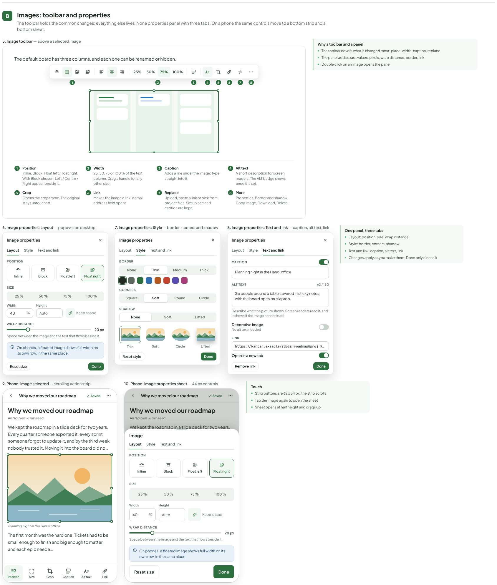

- Text in this part: "B" · "Images: toolbar and properties" · "The toolbar holds the common changes; everything else lives in one properties panel with three tabs. On a phone the same controls move to a bottom strip and a bottom sheet." · "5. Image toolbar — above a selected image" · "The default board has three columns, and each one can be renamed or hidden." · "1" · "25%" · "50%" · "75%" · "100%" · "2" · "3" · "4" · "5" · "6" · "7" · "8" · "Position" · "Inline, Block, Float left, Float right. With Block chosen, Left / Centre / Right appear beside it." · "Width" · "25, 50, 75 or 100 % of the text column. Drag a handle for any other size." · "Caption" · "Adds a line under the image; type straight into it." · "Alt text" · "A short description for screen readers. The ALT badge shows once it is set." · "Crop" · "Opens the crop frame. The original stays untouched." · "Link" · "Makes the image a link; a small address field opens." · "Replace" · "Upload, paste a link or pick from project files. Size, place and caption are kept." · "More" · "Properties, Border and shadow, Copy image, Download, Delete." · "Why a toolbar and a panel" · "The toolbar covers what is changed most: place, width, caption, replace" · "The panel adds exact values: pixels, wrap distance, border, link" · "Double click on an image opens the panel" · "6. Image properties: Layout — popover on desktop" · "Image properties" · "Layout" · "Style" · "Text and link" · "POSITION" · "Inline" · "Block" · "Float left" · "Float right" · "SIZE" · "25 %" · "50 %" · "75 %" · "100 %" · "40" · "%" · "Height" · "Auto" · "Keep shape" · "WRAP DISTANCE" · "20 px" · "Space between the image and the text that flows beside it." · "On phones, a floated image shows full width on its own row, in the same place." · "Reset size" · "Done" · "7. Image properties: Style — border, corners and shadow" · "BORDER" · "None" · "Thin" · "Medium" · "Thick" · "CORNERS" · "Square" · "Soft" · "Round" · "Circle" · "SHADOW" · "Lifted" · "Reset style" · "8. Image properties: Text and link — caption, alt text, link" · "CAPTION" · "Planning night in the Hanoi office" · "ALT TEXT" · "62 / 150" · "Six people around a table covered in sticky notes, with the board open on a laptop." · "Describe what the picture shows. Screen readers read it, and it shows if the image cannot load." · "Decorative image" · "No alt text needed" · "LINK" · "https://kanban.example/?docs=roadmap&proj=KAN" · "Open in a new tab" · "Remove link" · "One panel, three tabs" · "Layout: position, size, wrap distance" · "Style: border, corners, shadow" · "Text and link: caption, alt text, link" · "Changes apply as you make them; Done only closes it" · "9. Phone: image selected — scrolling action strip" · "Why we moved our roadmap" · "Saved" · "An Nguyen · 6 min read" · "We kept the roadmap in a slide deck for two years. Every quarter someone exported it, every sprint someone forgot to update it, and by the third week nobody trusted it. Moving it into the board did no…" · "The first month was the hard one. Tickets had to be small enough to finish and big enough to matter, and each epic neede…" · "Size" · "10. Phone: image properties sheet — 44 px controls" · "Image" · "Touch" · "Strip buttons are 62 x 54 px; the strip scrolls" · "Tap the image again to open the sheet" · "Sheet opens at half height and drags up"

---

## Images: resize, crop and style

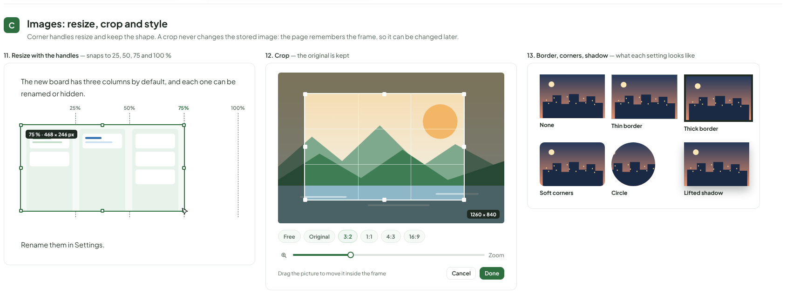

- Text in this part: "C" · "Images: resize, crop and style" · "Corner handles resize and keep the shape. A crop never changes the stored image: the page remembers the frame, so it can be changed later." · "11. Resize with the handles — snaps to 25, 50, 75 and 100 %" · "The new board has three columns by default, and each one can be renamed or hidden." · "25%" · "50%" · "75%" · "100%" · "75 % · 468 × 246 px" · "Rename them in Settings." · "12. Crop — the original is kept" · "1260 × 840" · "Free" · "Original" · "3:2" · "1:1" · "4:3" · "16:9" · "Zoom" · "Drag the picture to move it inside the frame" · "Cancel" · "Done" · "13. Border, corners, shadow — what each setting looks like" · "None" · "Thin border" · "Thick border" · "Soft corners" · "Circle" · "Lifted shadow"

---

## Images: adding them and what can go wrong

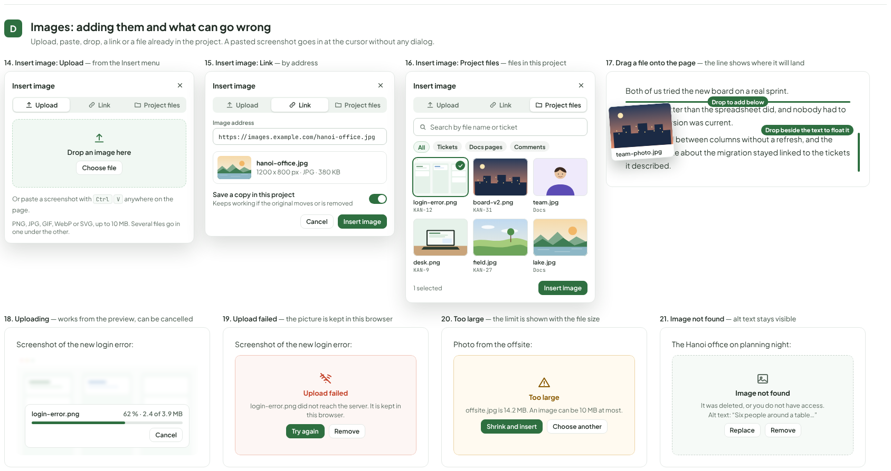

- Text in this part: "D" · "Images: adding them and what can go wrong" · "Upload, paste, drop, a link or a file already in the project. A pasted screenshot goes in at the cursor without any dialog." · "14. Insert image: Upload — from the Insert menu" · "Insert image" · "Upload" · "Link" · "Project files" · "Drop an image here" · "Choose file" · "Or paste a screenshot with Ctrl V anywhere on the page." · "PNG, JPG, GIF, WebP or SVG, up to 10 MB. Several files go in one under the other." · "15. Insert image: Link — by address" · "Image address" · "https://images.example.com/hanoi-office.jpg" · "hanoi-office.jpg" · "1200 x 800 px · JPG · 380 KB" · "Save a copy in this project" · "Keeps working if the original moves or is removed" · "Cancel" · "16. Insert image: Project files — files in this project" · "Search by file name or ticket" · "All" · "Tickets" · "Docs pages" · "Comments" · "login-error.png" · "KAN-12" · "board-v2.png" · "KAN-31" · "team.jpg" · "Docs" · "desk.png" · "KAN-9" · "field.jpg" · "KAN-27" · "lake.jpg" · "1 selected" · "17. Drag a file onto the page — the line shows where it will land" · "Both of us tried the new board on a real sprint." · "Drop to add below" · "It held up better than the spreadsheet did, and nobody had to ask which version was current." · "Drop beside the text to float it" · "Cards moved between columns without a refresh, and the page we wrote about the migration stayed linked to the tickets it described." · "team-photo.jpg" · "18. Uploading — works from the preview, can be cancelled" · "Screenshot of the new login error:" · "62 % · 2.4 of 3.9 MB" · "19. Upload failed — the picture is kept in this browser" · "Upload failed" · "login-error.png did not reach the server. It is kept in this browser." · "Try again" · "Remove" · "20. Too large — the limit is shown with the file size" · "Photo from the offsite:" · "Too large" · "offsite.jpg is 14.2 MB. An image can be 10 MB at most." · "Shrink and insert" · "Choose another" · "21. Image not found — alt text stays visible" · "The Hanoi office on planning night:" · "Image not found" · "It was deleted, or you do not have access." · "Alt text: “Six people around a table…”" · "Replace"

---

## Images: how a float behaves on tablet and phone

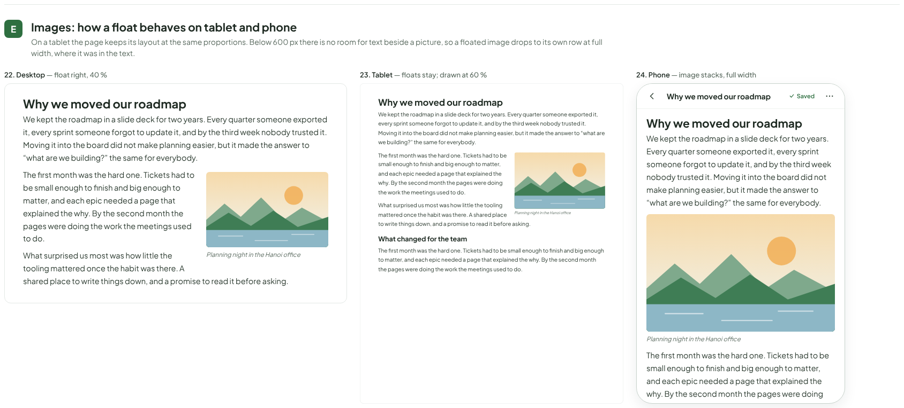

- Text in this part: "E" · "Images: how a float behaves on tablet and phone" · "On a tablet the page keeps its layout at the same proportions. Below 600 px there is no room for text beside a picture, so a floated image drops to its own row at full width, where it was in the text." · "22. Desktop — float right, 40 %" · "Why we moved our roadmap" · "We kept the roadmap in a slide deck for two years. Every quarter someone exported it, every sprint someone forgot to update it, and by the third week nobody trusted it. Moving it into the board did not make planning easier, but it made the answer to “what are we building?” the same for everybody." · "Planning night in the Hanoi office" · "The first month was the hard one. Tickets had to be small enough to finish and big enough to matter, and each epic needed a page that explained the why. By the second month the pages were doing the work the meetings used to do." · "What surprised us most was how little the tooling mattered once the habit was there. A shared place to write things down, and a promise to read it before asking." · "23. Tablet — floats stay; drawn at 60 %" · "What changed for the team" · "24. Phone — image stacks, full width" · "Saved"

---

## Tables

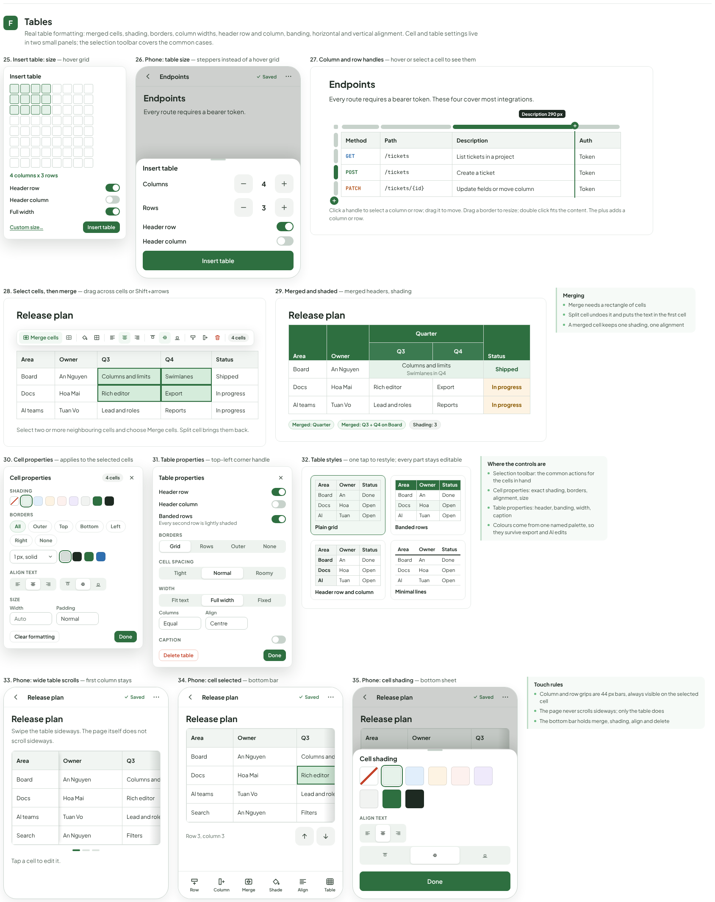

- Text in this part: "F" · "Tables" · "Real table formatting: merged cells, shading, borders, column widths, header row and column, banding, horizontal and vertical alignment. Cell and table settings live in two small panels; the selection toolbar covers the common cases." · "25. Insert table: size — hover grid" · "Insert table" · "4 columns x 3 rows" · "Header row" · "Header column" · "Full width" · "Custom size…" · "26. Phone: table size — steppers instead of a hover grid" · "Endpoints" · "Saved" · "Every route requires a bearer token." · "Columns" · "4" · "Rows" · "3" · "27. Column and row handles — hover or select a cell to see them" · "Every route requires a bearer token. These four cover most integrations." · "Method	Path	Description	Auth" · "GET	/tickets	List tickets in a project	Token" · "POST	/tickets	Create a ticket	Token" · "PATCH	/tickets/{id}	Update fields or move column	Token" · "Description 290 px" · "Click a handle to select a column or row; drag it to move. Drag a border to resize; double click fits the content. The plus adds a column or row." · "28. Select cells, then merge — drag across cells or Shift+arrows" · "Release plan" · "Merge cells" · "4 cells" · "Area	Owner	Q3	Q4	Status" · "Board	An Nguyen	Columns and limits	Swimlanes	Shipped" · "Docs	Hoa Mai	Rich editor	Export	In progress" · "AI teams	Tuan Vo	Lead and roles	Reports	In progress" · "Select two or more neighbouring cells and choose Merge cells. Split cell brings them back." · "29. Merged and shaded — merged headers, shading" · "Area	Owner	Quarter	Status" · "Q3	Q4" · "Board	An Nguyen	Columns and limits" · "Swimlanes in Q4	Shipped" · "Merged: Quarter" · "Merged: Q3 + Q4 on Board" · "Shading: 3" · "Merging" · "Merge needs a rectangle of cells" · "Split cell undoes it and puts the text in the first cell" · "A merged cell keeps one shading, one alignment" · "30. Cell properties — applies to the selected cells" · "Cell properties" · "SHADING" · "BORDERS" · "All" · "Outer" · "Top" · "Bottom" · "Left" · "Right" · "None" · "1 px, solid" · "ALIGN TEXT" · "SIZE" · "Width" · "Auto" · "Padding" · "Normal" · "Clear formatting" · "Done" · "31. Table properties — top-left corner handle" · "Table properties" · "Banded rows" · "Every second row is lightly shaded" · "Grid" · "CELL SPACING" · "Tight" · "Roomy" · "WIDTH" · "Fit text" · "Fixed" · "Equal" · "Align" · "Centre" · "CAPTION" · "Delete table" · "32. Table styles — one tap to restyle; every part stays editable" · "Area	Owner	Status" · "Board	An	Done" · "Docs	Hoa	Open" · "AI	Tuan	Open" · "Plain grid" · "Header row and column" · "Minimal lines" · "Where the controls are" · "Selection toolbar: the common actions for the cells in hand" · "Cell properties: exact shading, borders, alignment, size" · "Table properties: header, banding, width, caption" · "Colours come from one named palette, so they survive export and AI edits" · "33. Phone: wide table scrolls — first column stays" · "Swipe the table sideways. The page itself does not scroll sideways." · "Search	An Nguyen	Filters	Saved views	Planned" · "Area" · "Board" · "Docs" · "AI teams" · "Search" · "Tap a cell to edit it." · "34. Phone: cell selected — bottom bar" · "Row 3, column 3" · "Row" · "Column" · "Merge"

---

## Columns

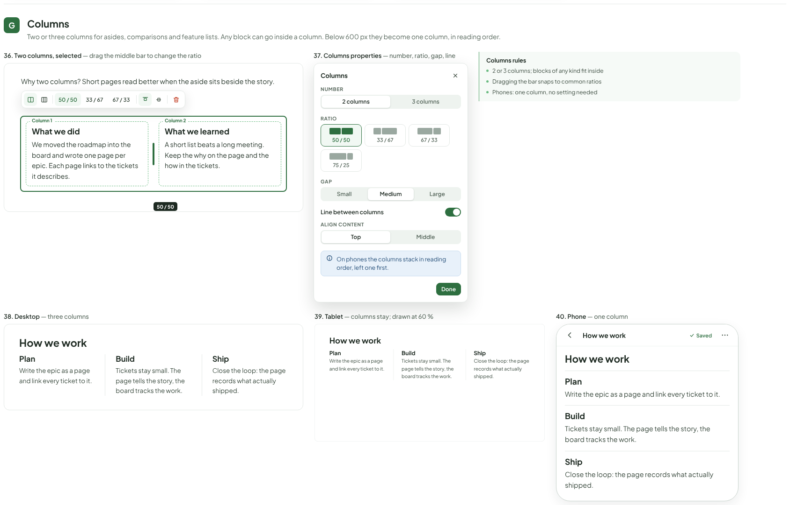

- Text in this part: "G" · "Columns" · "Two or three columns for asides, comparisons and feature lists. Any block can go inside a column. Below 600 px they become one column, in reading order." · "36. Two columns, selected — drag the middle bar to change the ratio" · "Why two columns? Short pages read better when the aside sits beside the story." · "50 / 50" · "33 / 67" · "67 / 33" · "Column 1" · "What we did" · "We moved the roadmap into the board and wrote one page per epic. Each page links to the tickets it describes." · "Column 2" · "What we learned" · "A short list beats a long meeting. Keep the why on the page and the how in the tickets." · "37. Columns properties — number, ratio, gap, line" · "NUMBER" · "2 columns" · "3 columns" · "RATIO" · "75 / 25" · "GAP" · "Small" · "Medium" · "Large" · "Line between columns" · "ALIGN CONTENT" · "Top" · "Middle" · "On phones the columns stack in reading order, left one first." · "Done" · "Columns rules" · "2 or 3 columns; blocks of any kind fit inside" · "Dragging the bar snaps to common ratios" · "Phones: one column, no setting needed" · "38. Desktop — three columns" · "How we work" · "Plan" · "Write the epic as a page and link every ticket to it." · "Build" · "Tickets stay small. The page tells the story, the board tracks the work." · "Ship" · "Close the loop: the page records what actually shipped." · "39. Tablet — columns stay; drawn at 60 %" · "40. Phone — one column" · "Saved"

---

## Callouts, quotes, dividers and scene breaks

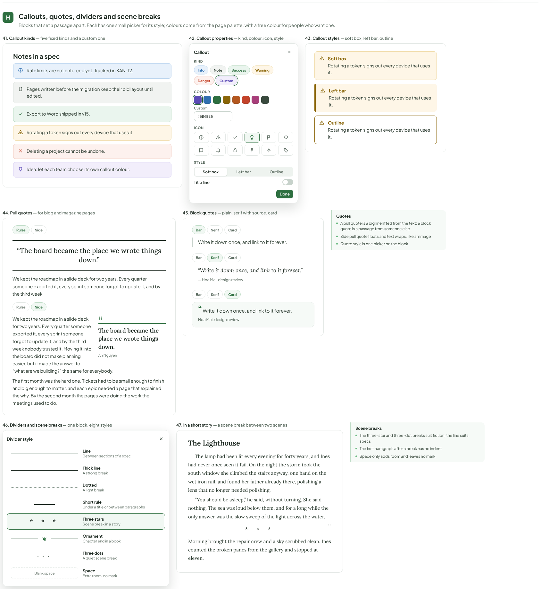

- Text in this part: "H" · "Callouts, quotes, dividers and scene breaks" · "Blocks that set a passage apart. Each has one small picker for its style; colours come from the page palette, with a free colour for people who want one." · "41. Callout kinds — five fixed kinds and a custom one" · "Notes in a spec" · "Rate limits are not enforced yet. Tracked in KAN-12." · "Pages written before the migration keep their old layout until edited." · "Export to Word shipped in v15." · "Rotating a token signs out every device that uses it." · "Deleting a project cannot be undone." · "Idea: let each team choose its own callout colour." · "42. Callout properties — kind, colour, icon, style" · "Callout" · "KIND" · "Info" · "Note" · "Success" · "Warning" · "Danger" · "Custom" · "COLOUR" · "#5B4BB5" · "ICON" · "STYLE" · "Soft box" · "Left bar" · "Outline" · "Title line" · "Done" · "43. Callout styles — soft box, left bar, outline" · "44. Pull quotes — for blog and magazine pages" · "Rules" · "Side" · "“The board became the place we wrote things down.”" · "We kept the roadmap in a slide deck for two years. Every quarter someone exported it, every sprint someone forgot to update it, and by the third week" · "“" · "The board became the place we wrote things down." · "An Nguyen" · "We kept the roadmap in a slide deck for two years. Every quarter someone exported it, every sprint someone forgot to update it, and by the third week nobody trusted it. Moving it into the board did not make planning easier, but it made the answer to “what are we building?” the same for everybody." · "The first month was the hard one. Tickets had to be small enough to finish and big enough to matter, and each epic needed a page that explained the why. By the second month the pages were doing the work the meetings used to do." · "45. Block quotes — plain, serif with source, card" · "Bar" · "Serif" · "Card" · "Write it down once, and link to it forever." · "“Write it down once, and link to it forever.”" · "— Hoa Mai, design review" · "“ Write it down once, and link to it forever." · "Hoa Mai, design review" · "Quotes" · "A pull quote is a big line lifted from the text; a block quote is a passage from someone else" · "Side pull quote floats and text wraps, like an image" · "Quote style is one picker on the block" · "46. Dividers and scene breaks — one block, eight styles" · "Divider style" · "Line" · "Between sections of a spec" · "Thick line" · "A strong break" · "Dotted" · "A light break" · "Short rule" · "Under a title or between paragraphs" · "* * *" · "Three stars" · "Scene break in a story" · "❦" · "Ornament" · "Chapter end in a book" · "···" · "Three dots" · "A quiet scene break" · "Blank space" · "Space" · "Extra room, no mark" · "47. In a short story — a scene break between two scenes" · "The Lighthouse" · "The lamp had been lit every evening for forty years, and Ines had never once seen it fail. On the night the storm took the south window she climbed the stairs anyway, one hand on the wet iron rail, and found her father already there, polishing a lens that no longer needed polishing." · "“You should be asleep,” he said, without turning. She said nothing. The sea was loud below them, and for a long while the only answer was the slow sweep of the light across the water." · "Morning brought the repair crew and a sky scrubbed clean. Ines counted the broken panes from the gallery and stopped at eleven." · "Scene breaks" · "The three-star and three-dot breaks suit fiction; the line suits specs" · "The first paragraph after a break has no indent" · "Space only adds room and leaves no mark"

---

## Lists

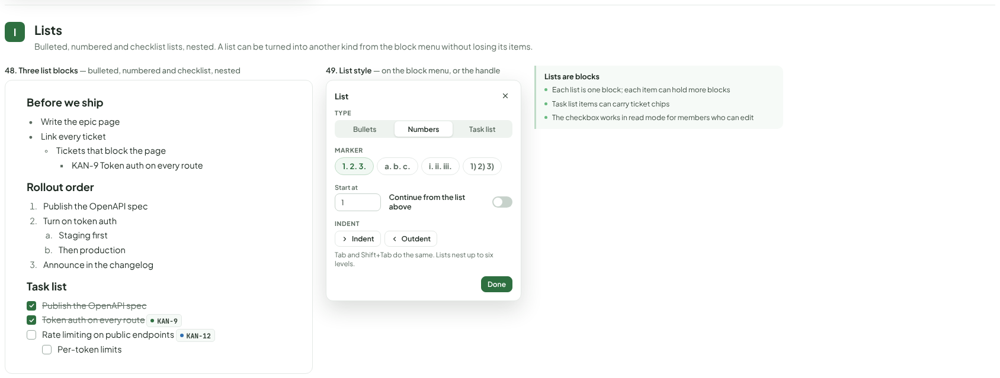

- Text in this part: "I" · "Lists" · "Bulleted, numbered and checklist lists, nested. A list can be turned into another kind from the block menu without losing its items." · "48. Three list blocks — bulleted, numbered and checklist, nested" · "Before we ship" · "•" · "Write the epic page" · "Link every ticket" · "◦" · "Tickets that block the page" · "▪" · "KAN-9 Token auth on every route" · "Rollout order" · "1." · "Publish the OpenAPI spec" · "2." · "Turn on token auth" · "a." · "Staging first" · "b." · "Then production" · "3." · "Announce in the changelog" · "Task list" · "Token auth on every route" · "KAN-9" · "Rate limiting on public endpoints" · "KAN-12" · "Per-token limits" · "49. List style — on the block menu, or the handle" · "List" · "TYPE" · "Bullets" · "Numbers" · "MARKER" · "1. 2. 3." · "a. b. c." · "i. ii. iii." · "1) 2) 3)" · "Start at" · "1" · "Continue from the list above" · "INDENT" · "Indent" · "Outdent" · "Tab and Shift+Tab do the same. Lists nest up to six levels." · "Done" · "Lists are blocks" · "Each list is one block; each item can hold more blocks" · "Task list items can carry ticket chips" · "The checkbox works in read mode for members who can edit"

---

## The block handle, menu and selecting blocks

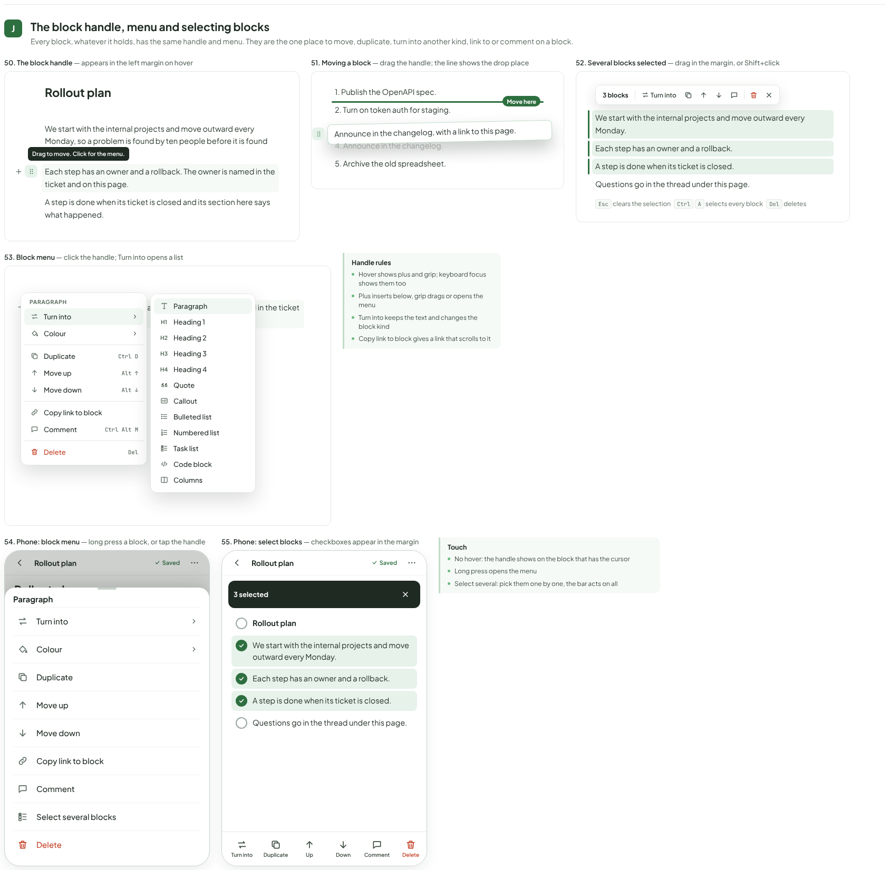

- Text in this part: "J" · "The block handle, menu and selecting blocks" · "Every block, whatever it holds, has the same handle and menu. They are the one place to move, duplicate, turn into another kind, link to or comment on a block." · "50. The block handle — appears in the left margin on hover" · "Rollout plan" · "We start with the internal projects and move outward every Monday, so a problem is found by ten people before it is found by a hundred." · "Drag to move. Click for the menu." · "Each step has an owner and a rollback. The owner is named in the ticket and on this page." · "A step is done when its ticket is closed and its section here says what happened." · "51. Moving a block — drag the handle; the line shows the drop place" · "1. Publish the OpenAPI spec." · "Move here" · "2. Turn on token auth for staging." · "3. Turn on token auth for production." · "Announce in the changelog, with a link to this page." · "4. Announce in the changelog." · "5. Archive the old spreadsheet." · "52. Several blocks selected — drag in the margin, or Shift+click" · "3 blocks" · "Turn into" · "We start with the internal projects and move outward every Monday." · "Each step has an owner and a rollback." · "A step is done when its ticket is closed." · "Questions go in the thread under this page." · "Esc clears the selection   Ctrl A selects every block   Del deletes" · "53. Block menu — click the handle; Turn into opens a list" · "PARAGRAPH" · "Colour" · "Duplicate" · "Ctrl D" · "Move up" · "Alt ↑" · "Move down" · "Alt ↓" · "Copy link to block" · "Comment" · "Ctrl Alt M" · "Delete" · "Del" · "Paragraph" · "H1" · "Heading 1" · "H2" · "Heading 2" · "H3" · "Heading 3" · "H4" · "Heading 4" · "Quote" · "Callout" · "Bulleted list" · "Numbered list" · "Task list" · "Code block" · "Columns" · "Handle rules" · "Hover shows plus and grip; keyboard focus shows them too" · "Plus inserts below, grip drags or opens the menu" · "Turn into keeps the text and changes the block kind" · "Copy link to block gives a link that scrolls to it" · "54. Phone: block menu — long press a block, or tap the handle" · "Saved" · "Each step has an owner and a rollback. The owner is named in the ticket." · "Select several blocks" · "55. Phone: select blocks — checkboxes appear in the margin" · "3 selected" · "Up" · "Down" · "Touch" · "No hover: the handle shows on the block that has the cursor" · "Long press opens the menu" · "Select several: pick them one by one, the bar acts on all"

---

## Insert: the full catalog

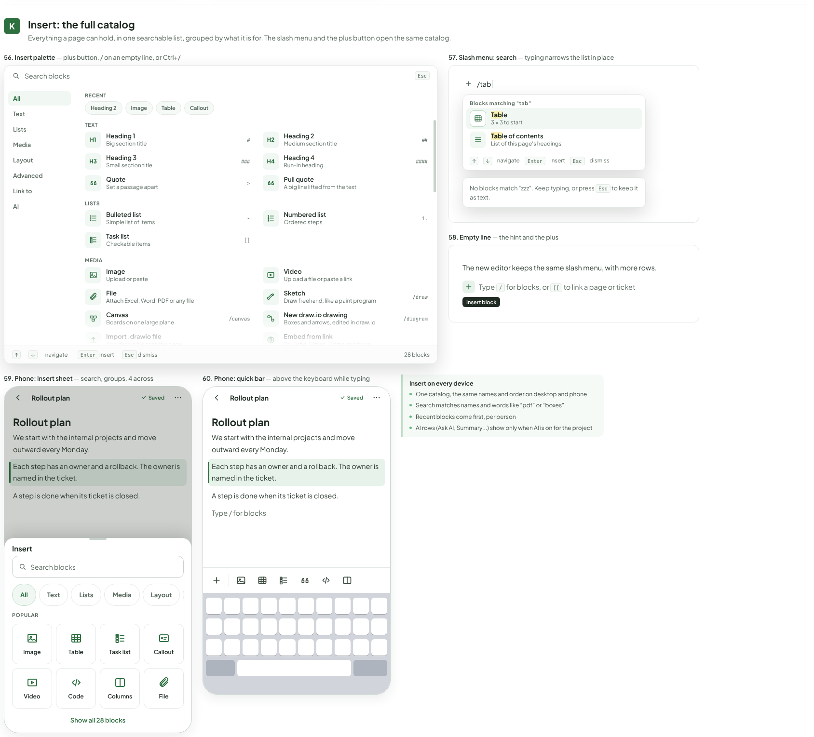

- Text in this part: "K" · "Insert: the full catalog" · "Everything a page can hold, in one searchable list, grouped by what it is for. The slash menu and the plus button open the same catalog." · "56. Insert palette — plus button, / on an empty line, or Ctrl+/" · "Search blocks" · "Esc" · "All" · "Text" · "Lists" · "Media" · "Layout" · "Advanced" · "Link to" · "AI" · "RECENT" · "Heading 2" · "Image" · "Table" · "Callout" · "TEXT" · "H1" · "Heading 1" · "Big section title" · "#" · "H2" · "Medium section title" · "##" · "H3" · "Heading 3" · "Small section title" · "###" · "H4" · "Heading 4" · "Run-in heading" · "####" · "Quote" · "Set a passage apart" · ">" · "Pull quote" · "A big line lifted from the text" · "LISTS" · "Bulleted list" · "Simple list of items" · "-" · "Numbered list" · "Ordered steps" · "1." · "Task list" · "Checkable items" · "[]" · "MEDIA" · "Upload or paste" · "Video" · "Upload a file or paste a link" · "File" · "Attach Excel, Word, PDF or any file" · "Sketch" · "Draw freehand, like a paint program" · "/draw" · "Canvas" · "Boards on one large plane" · "/canvas" · "New draw.io drawing" · "Boxes and arrows, edited in draw.io" · "/diagram" · "Import .drawio file" · "Also drop a file onto the page" · "Embed from link" · "YouTube, Vimeo, Figma and more" · "LAYOUT" · "Columns" · "Two or three side by side" · "Divider" · "Line, dots or a scene break" · "---" · "Info, warning, success or custom" · ":::info" · "3 × 3 to start" · "ADVANCED" · "Code block" · "Monospace with language" · "```" · "HTML" · "Runs in a sandbox" · "Formula" · "LaTeX, inline or on its own line" · "$$" · "Table of contents" · "List of this page's headings" · "Ask AI..." · "Write, continue, summarise or translate" · "/ai" · "LINK TO" · "Ticket card" · "Embed a ticket as KAN-12" · "KAN-" · "Page link" · "Link a page or section" · "[[" · "↑" · "↓" · "navigate" · "Enter insert" · "Esc dismiss" · "28 blocks" · "57. Slash menu: search — typing narrows the list in place" · "/tab" · "Blocks matching "tab"" · "Enter" · "insert"

---

## Tablet, and more states

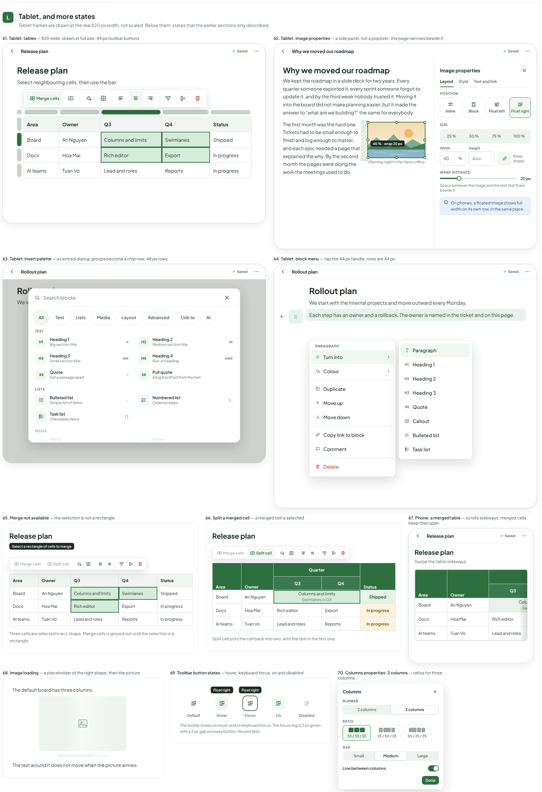

- Text in this part: "L" · "Tablet, and more states" · "Tablet frames are drawn at the real 820 px width, not scaled. Below them: states that the earlier sections only described." · "61. Tablet: tables — 820 wide, drawn at full size; 44 px toolbar buttons" · "Release plan" · "Saved" · "Select neighbouring cells, then use the bar." · "Merge cells" · "Area	Owner	Q3	Q4	Status" · "Board	An Nguyen	Columns and limits	Swimlanes	Shipped" · "Docs	Hoa Mai	Rich editor	Export	In progress" · "AI teams	Tuan Vo	Lead and roles	Reports	In progress" · "62. Tablet: image properties — a side panel, not a popover; the page narrows beside it" · "Why we moved our roadmap" · "We kept the roadmap in a slide deck for two years. Every quarter someone exported it, every sprint someone forgot to update it, and by the third week nobody trusted it. Moving it into the board did not make planning easier, but it made the answer to “what are we building?” the same for everybody." · "40 % · wrap 20 px" · "Planning night in the Hanoi office" · "The first month was the hard one. Tickets had to be small enough to finish and big enough to matter, and each epic needed a page that explained the why. By the second month the pages were doing the work the meetings used to do." · "Image properties" · "Layout" · "Style" · "Text and link" · "POSITION" · "Inline" · "Block" · "Float left" · "Float right" · "SIZE" · "25 %" · "50 %" · "75 %" · "100 %" · "Width" · "40" · "%" · "Height" · "Auto" · "Keep shape" · "WRAP DISTANCE" · "20 px" · "Space between the image and the text that flows beside it." · "On phones, a floated image shows full width on its own row, in the same place." · "63. Tablet: Insert palette — a centred dialog; groups become a chip row; 48 px rows" · "Rollout plan" · "We start with the internal projects and move outward every Monday." · "Search blocks" · "All" · "Text" · "Lists" · "Media" · "Advanced" · "Link to" · "AI" · "TEXT" · "H1" · "Heading 1" · "Big section title" · "#" · "H2" · "Heading 2" · "Medium section title" · "##" · "H3" · "Heading 3" · "Small section title" · "###" · "H4" · "Heading 4" · "Run-in heading" · "####" · "Quote" · "Set a passage apart" · ">" · "Pull quote" · "A big line lifted from the text" · "LISTS" · "Bulleted list" · "Simple list of items" · "-" · "Numbered list" · "Ordered steps" · "1." · "Task list" · "Checkable items" · "[]" · "MEDIA" · "Image" · "Upload or paste" · "Video" · "Upload a file or paste a link" · "File" · "Attach Excel, Word, PDF or any file" · "Sketch" · "Draw freehand, like a paint program" · "/draw" · "Canvas" · "Boards on one large plane" · "/canvas" · "New draw.io drawing" · "Boxes and arrows, edited in draw.io" · "/diagram" · "Import .drawio file" · "Also drop a file onto the page" · "Embed from link" · "YouTube, Vimeo, Figma and more" · "64. Tablet: block menu — tap the 44 px handle; rows are 44 px" · "Each step has an owner and a rollback. The owner is named in the ticket and on this page." · "PARAGRAPH" · "Turn into" · "Colour"

---

## Frames, code that must change, and decisions for the owner

Both boards 1760 wide. RichDocsBlocks finalH 14600 (60 frames, A-K), RichDocsEmbeds finalH 14817 (69 frames, A-I). Frame lists in frames_blocks.txt / frames_embeds.txt.

Blocks: A Images (1-4) placements, float right with wrap band, float left in a book chapter, centred block with alt badge; B (5-10) toolbar anatomy, Layout/Style/Text and link tabs of properties popover, phone strip and sheet; C (11-13) resize with snapping, crop, border/corners/shadow; D (14-21) Upload/Link/Board files, drag-drop, uploading, failed, too large, not found; E (22-24) float on desktop, tablet, phone; F Tables (25-35) size picker and phone steppers, handles, select and merge, merged and shaded, cell properties, table properties, styles, phone scroll, cell bar, shading sheet; G Columns (36-40); H (41-47) callouts, properties, pull quotes, block quotes, dividers, scene break; I Lists (48,49); J (50-55) block handle, moving, several selected, block menu, phone menu/select; K Insert (56-60) palette of 34 blocks, slash search, empty line, phone sheet, phone quick bar.

Embeds: A HTML (1-11) preview, code, sandbox rules, blocked script, scripts off, size, view source, cannot load, too large, two phones; B Video (12-19); C draw.io (20-30) insert, in page, opening, editor, save with version note, versions, shared use, six states, print, two phones; D Code (31-37); E Files (38-48) cards, PDF/Word/spreadsheet preview, menu, rename/replace, uploading, too large, blocked type, virus, phone; F Sketch and canvas (49-53); G References (54-58); H Embed from a link (59-66); I Formulas (67-69).

## Code must change
Today's code has none of: float or wrap, image align and crop, caption, alt and link attributes, merged cells, cell shading and borders, columns, pull quote, divider styles, custom callouts, block handle and menu, video, HTML embed, code filename/theme/diff/line numbers, file preview, safe-listed link embed. New: rich JSON schema, sandboxed iframe, virus scan service, project setting for scripts in HTML embeds, chip/card choice for references. Drawn but not in code: diagram version note, "used on 2 pages" warning, image/video/file upload limit. Slash menu becomes a catalog with a rail. Existing strings kept (draw.io, sketch, canvas, slash items, "Not found").

## Not drawn / owner OK needed
No footnotes (not in code); math drawn as it exists. No AI marks, no export UI, no paper-page edges.
Decisions to confirm: limits image 10 MB, video 200 MB, file 100 MB, HTML 512 KB; sandbox blocks network requests from scripts; embedded YouTube loads only after Play; the safe list of sites; pasted images copied into the project; uploads virus-scanned; programs and scripts refused; tablet keeps floats and columns; phones stack floats and columns below 600 px; a diagram can be shared by several pages with "Edit for all pages" or "Make a copy".
Not checked: real fonts offline (Lora linked from Google Fonts for book/story samples); no touch behaviour beyond drawn layouts.

---
## Final update after review (supersedes the numbers above)
Both boards 1784 wide. RichDocsBlocks finalH 17145, 70 frames (new Blocks L 61-70: tablet tables, image properties, Insert palette, block menu; merge disabled, split cell, merged table on phone, image skeleton, hover/focus states, 3-column properties). RichDocsEmbeds finalH 16158, 74 frames (new J 70-74: tablet HTML and draw.io editors, project setting for scripts in HTML embeds, "HTML is cleaned when saved" feedback, Scanning state). The Insert catalog has 28 blocks. Terms: "Project files" tab, "frame" for canvas pieces. Sketch / canvas toolbars use the code strings. Code must change, added: the Insert rail, project setting "scripts in HTML embeds" (Ask before running; 7 sites on the safe list, project admins decide), "Delete crossed-out lines" feedback.
