# Rich Docs — editing text

> New screen (Rich Docs) · canvas `1794931846-a41d` · the board is split into 3 boards on the canvas because a browser cannot paint one board taller than about 8000 px; frame numbers run on across the parts. Sources: [`RichDocsEditor1.dc.html`](../source/RichDocsEditor1.dc.html) (sha256 `eb37e5f8e7fb…`, full value in `MANIFEST.json`), [`RichDocsEditor2.dc.html`](../source/RichDocsEditor2.dc.html) (sha256 `edac00a48281…`, full value in `MANIFEST.json`), [`RichDocsEditor3.dc.html`](../source/RichDocsEditor3.dc.html) (sha256 `56718106d3da…`, full value in `MANIFEST.json`)

> A new board that lives next to the older Docs boards (it does not replace them). Where a screen already exists in the code, the words follow the code (`ui/src/components/docs/`); the rich-format parts (colours, float images, merged cells, embeds, suggestions, export, public links, highlights) are a design proposal and need the code changes listed at the end. Names, ids, costs and times in the mock-ups are sample data. Frames are numbered on the canvas; desktop is 1360 wide, tablet 820, phone 390.

## SCREEN — RICH DOCS

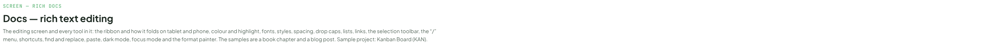

- Text in this part: "SCREEN — RICH DOCS" · "Docs — rich text editing" · "The editing screen and every tool in it: the ribbon and how it folds on tablet and phone, colour and highlight, fonts, styles, spacing, drop caps, lists, links, the selection toolbar, the “/” menu, shortcuts, find and replace, paste, dark mode, focus mode and the format painter. The samples are a book chapter and a blog post. Sample project: Kanban Board (KAN)."

---

## The editing screen

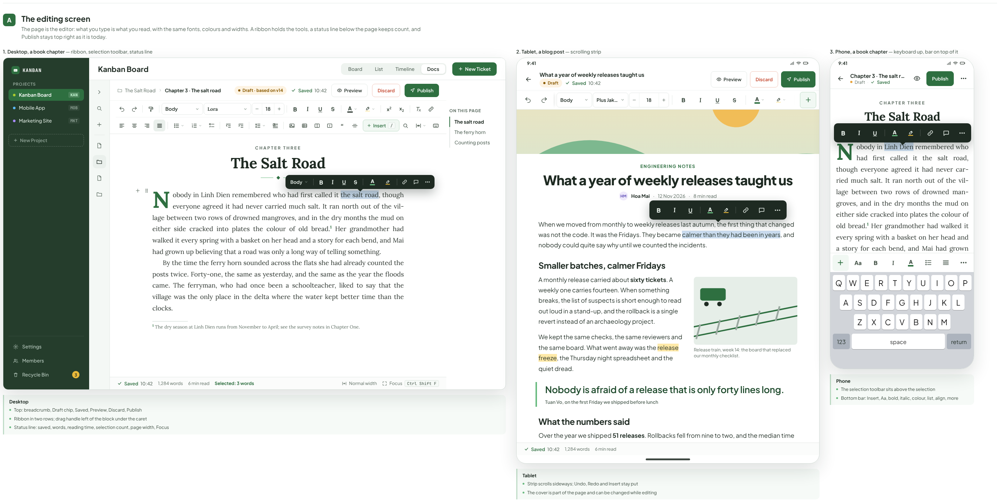

- Text in this part: "A" · "The editing screen" · "The page is the editor: what you type is what you read, with the same fonts, colours and widths. A ribbon holds the tools, a status line below the page keeps count, and Publish stays top right as it is today." · "1. Desktop, a book chapter — ribbon, selection toolbar, status line" · "KANBAN" · "PROJECTS" · "Kanban Board" · "KAN" · "Mobile App" · "MOB" · "Marketing Site" · "MKT" · "New Project" · "Settings" · "Members" · "Recycle Bin" · "3" · "Board" · "List" · "Timeline" · "Docs" · "New Ticket" · "The Salt Road" · "Chapter 3 · The salt road" · "Draft · based on v14" · "Saved" · "10:42" · "Preview" · "Discard" · "Publish" · "Body" · "Lora" · "18" · "B" · "I" · "U" · "S" · "x2" · "1" · "2" · "“" · "Insert" · "/" · "CHAPTER THREE" · "N" · "obody in Linh Dien remembered who had first called it the salt road, though everyone agreed it had never carried much salt. It ran north out of the village between two rows of drowned mangroves, and in the dry months the mud on either side cracked into plates the colour of old bread.1 Her grandmother had walked it every spring with a basket on her head and a story for each bend, and Mai had grown up believing that a road was only a long way of telling something." · "By the time the ferry horn sounded across the flats she had already counted the posts twice. Forty-one, the same as yesterday, and the same as the year the floods came. The ferryman, who had once been a schoolteacher, liked to say that the village was the only place in the delta where the water kept better time than the clocks." · "1 The dry season at Linh Dien runs from November to April; see the survey notes in Chapter One." · "1,284 words" · "6 min read" · "Selected: 3 words" · "Normal width" · "Focus" · "Ctrl Shift F" · "ON THIS PAGE" · "The salt road" · "The ferry horn" · "Counting posts" · "Desktop" · "Top: breadcrumb, Draft chip, Saved, Preview, Discard, Publish" · "Ribbon in two rows; drag handle left of the block under the caret" · "Status line: saved, words, reading time, selection count, page width, Focus" · "2. Tablet, a blog post — scrolling strip" · "9:41" · "What a year of weekly releases taught us" · "Draft" · "Plus Jakarta Sans" · "ENGINEERING NOTES" · "HM" · "Hoa Mai" · "·" · "12 Nov 2026" · "8 min read" · "When we moved from monthly to weekly releases last autumn, the first thing that changed was not the code. It was the Fridays. They became calmer than they had been in years, and nobody could quite say why until we counted the incidents." · "Smaller batches, calmer Fridays" · "Release train, week 14: the board that replaced our monthly checklist." · "A monthly release carried about sixty tickets. A weekly one carries fourteen. When something breaks, the list of suspects is short enough to read out loud in a stand-up, and the rollback is a single revert instead of an archaeology project." · "We kept the same checks, the same reviewers and the same board. What went away was the release freeze, the Thursday night spreadsheet and the quiet dread." · "Nobody is afraid of a release that is only forty lines long." · "Tuan Vo, on the first Friday we shipped before lunch" · "What the numbers said" · "Over the year we shipped 51 releases. Rollbacks fell from nine to two, and the median time from merge to production dropped to under four hours." · "Tablet" · "Strip scrolls sideways; Undo, Redo and Insert stay put" · "The cover is part of the page and can be changed while editing" · "3. Phone, a book chapter — keyboard up, bar on top of it" · "Aa" · "Q" · "W" · "E" · "R" · "T" · "Y" · "O" · "P" · "D" · "F" · "G" · "H" · "J" · "K" · "L" · "Z" · "X" · "C" · "V" · "M" · "123" · "space" · "return"

---

## The ribbon: groups, states and how it folds

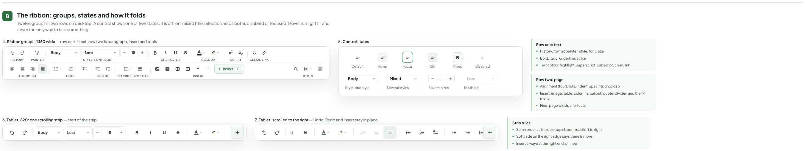

- Text in this part: "B" · "The ribbon: groups, states and how it folds" · "Twelve groups in two rows on desktop. A control shows one of five states: it is off, on, mixed (the selection holds both), disabled or focused. Hover is a light fill and never the only way to find something." · "4. Ribbon groups, 1360 wide — row one is text, row two is paragraph, insert and tools" · "HISTORY" · "PAINTER" · "Body" · "Lora" · "18" · "STYLE, FONT, SIZE" · "I" · "U" · "S" · "CHARACTER" · "A" · "COLOUR" · "x2" · "SCRIPT" · "CLEAR, LINK" · "ALIGNMENT" · "1" · "2" · "3" · "LISTS" · "INDENT" · "SPACING, DROP CAP" · "“" · "Insert" · "/" · "INSERT" · "TOOLS" · "5. Control states" · "Default" · "Hover" · "Focus" · "On" · "Mixed" · "Disabled" · "Style, one style" · "Several styles" · "—" · "Several sizes" · "Row one: text" · "History, format painter, style, font, size" · "Bold, italic, underline, strike" · "Text colour, highlight, superscript, subscript, clear, link" · "Row two: page" · "Alignment (four), lists, indent, spacing, drop cap" · "Insert: image, table, columns, callout, quote, divider, and the “/” menu" · "Find, page width, shortcuts" · "6. Tablet, 820: one scrolling strip — start of the strip" · "7. Tablet: scrolled to the right — Undo, Redo and Insert stay in place" · "Strip rules" · "Same order as the desktop ribbon, read left to right" · "Soft fade on the right edge says there is more" · "Insert always at the right end, pinned"

---

## Phone: format and more sheets

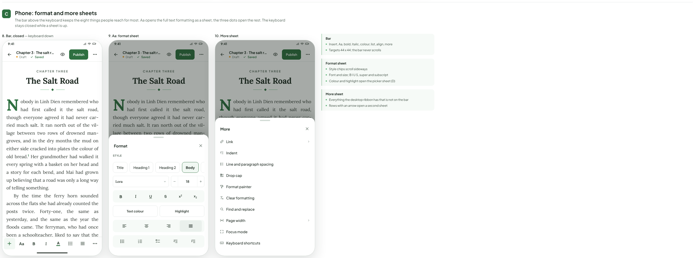

- Text in this part: "C" · "Phone: format and more sheets" · "The bar above the keyboard keeps the eight things people reach for most. Aa opens the full text formatting as a sheet, the three dots open the rest. The keyboard stays closed while a sheet is up." · "8. Bar, closed — keyboard down" · "9:41" · "Chapter 3 · The salt road" · "Draft" · "·" · "Saved" · "Publish" · "CHAPTER THREE" · "The Salt Road" · "N" · "obody in Linh Dien remembered who had first called it the salt road, though everyone agreed it had never carried much salt. It ran north out of the village between two rows of drowned mangroves, and in the dry months the mud on either side cracked into plates the colour of old bread.1 Her grandmother had walked it every spring with a basket on her head and a story for each bend, and Mai had grown up believing that a road was only a long way of telling something." · "By the time the ferry horn sounded across the flats she had already counted the posts twice. Forty-one, the same as yesterday, and the same as the year the floods came. The ferryman, who had once been a schoolteacher, liked to say that the village was the only place in the delta where the water kept better time than the clocks." · "1 The dry season at Linh Dien runs from November to April; see the survey notes in Chapter One." · "Aa" · "B" · "I" · "A" · "9. Aa: format sheet" · "Format" · "STYLE" · "Title" · "Heading 1" · "Heading 2" · "Body" · "Quote" · "Lora" · "18" · "U" · "S" · "x2" · "Text colour" · "Highlight" · "1" · "2" · "3" · "10. More sheet" · "More" · "Link" · "Indent" · "Line and paragraph spacing" · "Drop cap" · "Format painter" · "Clear formatting" · "Find and replace" · "Page width" · "Focus mode" · "Keyboard shortcuts" · "Bar" · "Insert, Aa, bold, italic, colour, list, align, more" · "Targets 44 x 44; the bar never scrolls" · "Format sheet" · "Style chips scroll sideways" · "Font and size; B I U S, super and subscript" · "Colour and highlight open the picker sheet (D)" · "More sheet" · "Everything the desktop ribbon has that is not on the bar" · "Rows with an arrow open a second sheet"

---

## Text colour and highlight

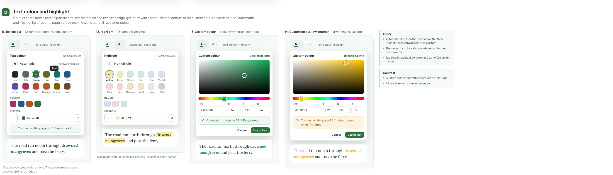

- Text in this part: "D" · "Text colour and highlight" · "Colours come from a named palette first: twelve for text and twelve for highlight, each with a name. Recent colours and a custom colour sit under it, and “Automatic” and “No highlight” put the page default back. Anyone can still type a hex colour." · "11. Text colour — 12 named colours, recent, custom" · "A" · "Text colour · Highlight" · "Text colour" · "Named colours" · "Automatic" · "follows the page" · "Ink" · "Slate" · "Green" · "Olive" · "Teal" · "Blue" · "Violet" · "Pink" · "Red" · "Orange" · "Amber" · "Brown" · "RECENT" · "CUSTOM" · "#2E6F40" · "Contrast on this page 6.1 : 1. Easy to read." · "The road ran north through drowned mangroves and past the ferry." · "12 text colours, each with a name. The same names are used everywhere in the product." · "12. Highlight — 12 named highlights" · "Highlight" · "No highlight" · "Yellow" · "Lime" · "Sand" · "Grey" · "#FFE9A8" · "12 highlight colours. Table cell shading uses these same names." · "13. Custom colour — picker with hex and contrast" · "Custom colour" · "Back to palette" · "HEX" · "R" · "46" · "G" · "111" · "B" · "64" · "Cancel" · "Use colour" · "14. Custom colour, low contrast — a warning, not a block" · "#E8B93A" · "232" · "185" · "58" · "Contrast on this page 1.8 : 1. Hard to read on white. Try Amber." · "Order" · "Automatic first, then the named palette, then Recent (the last five used), then Custom" · "The name of a colour shows on hover and under each swatch" · "Table cell shading draws from the same 12 highlight names" · "Contrast" · "Custom colours show their contrast on this page" · "A low value warns, it never stops you"

---

## The palette follows the page

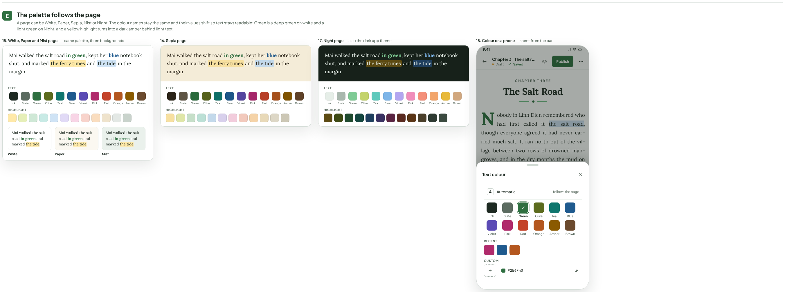

- Text in this part: "E" · "The palette follows the page" · "A page can be White, Paper, Sepia, Mist or Night. The colour names stay the same and their values shift so text stays readable: Green is a deep green on white and a light green on Night, and a yellow highlight turns into a dark amber behind light text." · "15. White, Paper and Mist pages — same palette, three backgrounds" · "Mai walked the salt road in green, kept her blue notebook shut, and marked the ferry times and the tide in the margin." · "TEXT" · "Ink" · "Slate" · "Green" · "Olive" · "Teal" · "Blue" · "Violet" · "Pink" · "Red" · "Orange" · "Amber" · "Brown" · "HIGHLIGHT" · "Mai walked the salt road in green and marked the tide." · "White" · "Paper" · "Mist" · "16. Sepia page" · "17. Night page — also the dark app theme" · "18. Colour on a phone — sheet from the bar" · "9:41" · "Chapter 3 · The salt road" · "Draft" · "·" · "Saved" · "Publish" · "CHAPTER THREE" · "The Salt Road" · "N" · "obody in Linh Dien remembered who had first called it the salt road, though everyone agreed it had never carried much salt. It ran north out of the village between two rows of drowned mangroves, and in the dry months the mud on either side cracked into plates the colour of old bread.1 Her grandmother had walked it every spring with a basket on her head and a story for each bend, and Mai had grown up believing that a road was only a long way of telling something." · "By the time the ferry horn sounded across the flats she had already counted the posts twice. Forty-one, the same as yesterday, and the same as the year the floods came. The ferryman, who had once been a schoolteacher, liked to say that the village was the only place in the delta where the water kept better time than the clocks." · "1 The dry season at Linh Dien runs from November to April; see the survey notes in Chapter One." · "Aa" · "B" · "I" · "A" · "Text colour" · "Automatic" · "follows the page" · "RECENT" · "CUSTOM" · "#2E6F40"

---

## Type, paragraph, lists and links

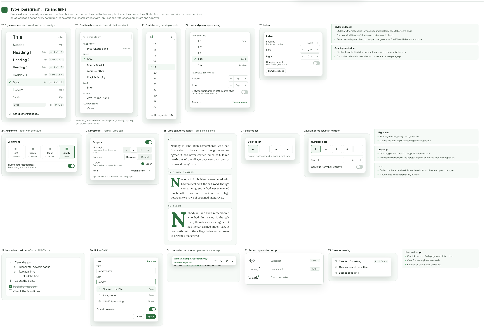

- Text in this part: "F" · "Type, paragraph, lists and links" · "Every text tool is a small popover with the few choices that matter, drawn with a live sample of what the choice does. Styles first, then font and size for the exceptions; paragraph tools act on every paragraph the selection touches; lists nest with Tab; links and references come from one popover." · "19. Styles menu — each row drawn in its own style" · "Title" · "40 px" · "Subtitle" · "22 px" · "Heading 1" · "30 px" · "Ctrl Alt 1" · "Heading 2" · "24 px" · "Ctrl Alt 2" · "Heading 3" · "20 px" · "Ctrl Alt 3" · "HEADING 4" · "16 px" · "Ctrl Alt 4" · "Body" · "18 px" · "Ctrl Alt 0" · "Quote" · "Caption" · "13 px" · "Code" · "14 px" · "Ctrl E" · "Set sizes for this page…" · "20. Font family — names drawn in their own font" · "Search fonts" · "PAGE FONT" · "Plus Jakarta Sans" · "default" · "SERIF" · "Lora" · "Source Serif 4" · "Merriweather" · "Playfair Display" · "SANS" · "Inter" · "MONO" · "JetBrains Mono" · "HANDWRITING" · "Caveat" · "The Sans / Serif / Editorial / Mono pairings in Page settings are presets over this list." · "21. Font size — type, step or pick" · "18" · "px" · "10" · "12" · "14" · "16" · "20" · "24" · "28" · "32" · "40" · "48" · "64" · "Use the style size (18)" · "22. Line and paragraph spacing" · "LINE SPACING" · "1.0" · "Tight" · "1.25" · "1.5" · "1.75" · "Book" · "2.0" · "Double" · "PARAGRAPH SPACING" · "Before" · "0" · "After" · "Between paragraphs of the same style" · "Off for books, on for web text" · "Apply to" · "This paragraph" · "23. Indent" · "Indent" · "First line" · "Books and stories" · "1.6" · "em" · "Left" · "Right" · "Hanging indent" · "First line out, the rest in" · "Remove indent" · "Styles and fonts" · "Styles are the first choice for headings and quotes; a style follows the page" · "“Set sizes for this page” changes every block of that style" · "Seven fonts ship with the app; a typed size goes from 8 to 160 and is kept as a number" · "Spacing and indent" · "Five line heights, 1.75 is the book setting; space before and after in px" · "A first-line indent is how stories and books mark a new paragraph" · "24. Alignment — four, with shortcuts" · "Alignment" · "Ctrl Shift L" · "Centre" · "Ctrl Shift E" · "Ctrl Shift R" · "Justify" · "Ctrl Shift J" · "Hyphenate justified text" · "Breaks long words at line ends" · "25. Drop cap — Format, Drop cap" · "Drop cap"

---

## The selection toolbar

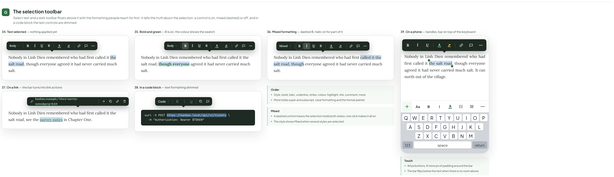

- Text in this part: "G" · "The selection toolbar" · "Select text and a dark toolbar floats above it with the formatting people reach for first. It tells the truth about the selection: a control is on, mixed (dashed) or off, and in a code block the text controls are dimmed." · "34. Text selected — nothing applied yet" · "Nobody in Linh Dien remembered who had first called it the salt road, though everyone agreed it had never carried much salt." · "Body" · "B" · "I" · "U" · "S" · "A" · "35. Bold and green — B is on, the colour shows the swatch" · "36. Mixed formatting — dashed B, italic on for part of it" · "Mixed" · "37. On a link — the bar turns into link actions" · "Nobody in Linh Dien remembered who had first called it the salt road, see the survey notes in Chapter One." · "kanban.example/?docs=survey-notes&proj=KAN" · "38. In a code block — text formatting dimmed" · "curl -X POST https://kanban.local/api/v1/tickets \" · "-H "Authorization: Bearer $TOKEN"" · "Code" · "Order" · "Style, bold, italic, underline, strike, colour, highlight, link, comment, more" · "More holds super and subscript, clear formatting and the format painter" · "A dashed control means the selection holds both states; one click makes it all on" · "The style shows Mixed when several styles are selected" · "39. On a phone — handles, bar on top of the keyboard" · "Nobody in Linh Dien remembered who had first called it the salt road" · ", though everyone agreed it had never carried much salt. It ran north out of the village." · "Aa" · "Q" · "W" · "E" · "R" · "T" · "Y" · "O" · "P" · "D" · "F" · "H" · "J" · "K" · "L" · "Z" · "X" · "C" · "V" · "N" · "M" · "123" · "space" · "return" · "Touch" · "44 px buttons, 8 more px of padding around the bar" · "The bar flips below the text when there is no room above"

---

## The / insert menu

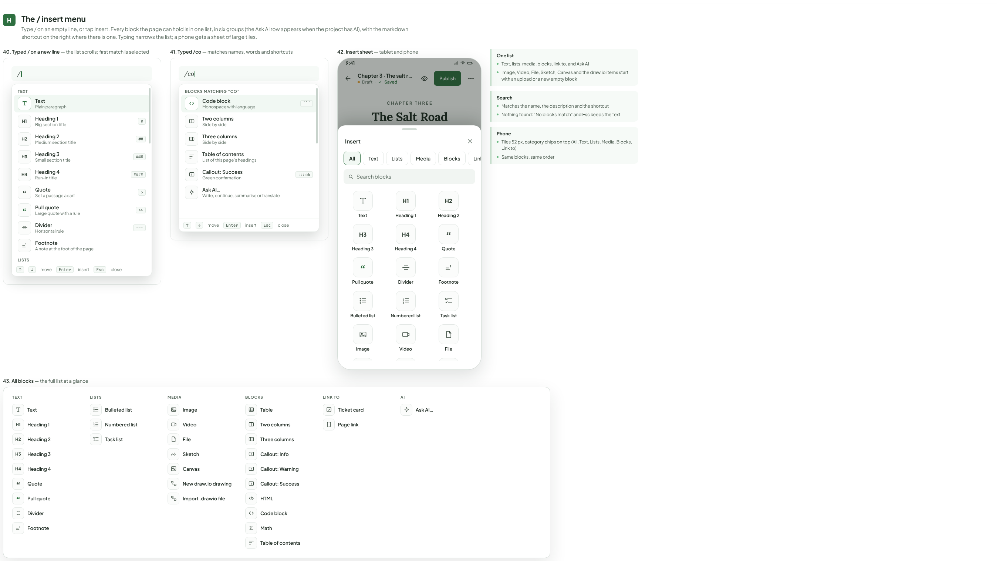

- Text in this part: "H" · "The / insert menu" · "Type / on an empty line, or tap Insert. Every block the page can hold is in one list, in six groups (the Ask AI row appears when the project has AI), with the markdown shortcut on the right where there is one. Typing narrows the list; a phone gets a sheet of large tiles." · "40. Typed / on a new line — the list scrolls; first match is selected" · "/" · "TEXT" · "Text" · "Plain paragraph" · "H1" · "Heading 1" · "Big section title" · "#" · "H2" · "Heading 2" · "Medium section title" · "##" · "H3" · "Heading 3" · "Small section title" · "###" · "H4" · "Heading 4" · "Run-in title" · "####" · "“" · "Quote" · "Set a passage apart" · ">" · "Pull quote" · "Large quote with a rule" · ">>" · "Divider" · "Horizontal rule" · "---" · "1" · "Footnote" · "A note at the foot of the page" · "LISTS" · "Bulleted list" · "Simple list of items" · "-" · "2" · "3" · "Numbered list" · "Ordered steps" · "1." · "Task list" · "Checkable items" · "[]" · "MEDIA" · "Image" · "Upload or paste" · "Video" · "Upload or paste a link" · "File" · "Attach Excel, Word, PDF or any file" · "Sketch" · "Draw freehand, like a paint program" · "Canvas" · "Boards on one large plane" · "New draw.io drawing" · "Boxes and arrows, edited in draw.io" · "Import .drawio file" · "Also drop a file onto the page" · "BLOCKS" · "Table" · "3 × 3 to start" · "Two columns" · "Side by side" · "Three columns" · "Callout: Info" · "Blue note" · ":::info" · "Callout: Warning" · "Amber caution" · ":::warn" · "Callout: Success" · "Green confirmation" · ":::ok" · "HTML" · "A sandboxed block" · "Code block" · "Monospace with language" · "```" · "Math" · "A formula" · "Table of contents" · "List of this page’s headings" · "LINK TO" · "Ticket card" · "Embed a ticket as KAN-12" · "KAN-" · "Page link" · "Link a page or section" · "[[" · "AI" · "Ask AI…" · "Write, continue, summarise or translate" · "↑" · "↓" · "move" · "Enter" · "insert" · "Esc" · "close" · "41. Typed /co — matches names, words and shortcuts" · "/co" · "BLOCKS MATCHING “CO”" · "42. Insert sheet — tablet and phone" · "9:41"

---

## Keyboard shortcuts

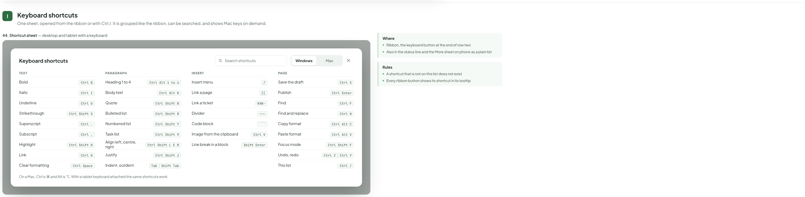

- Text in this part: "I" · "Keyboard shortcuts" · "One sheet, opened from the ribbon or with Ctrl /. It is grouped like the ribbon, can be searched, and shows Mac keys on demand." · "44. Shortcut sheet — desktop and tablet with a keyboard" · "Search shortcuts" · "Windows" · "Mac" · "TEXT" · "Bold" · "Ctrl B" · "Italic" · "Ctrl I" · "Underline" · "Ctrl U" · "Strikethrough" · "Ctrl Shift X" · "Superscript" · "Ctrl ." · "Subscript" · "Ctrl ," · "Highlight" · "Ctrl Shift H" · "Link" · "Ctrl K" · "Clear formatting" · "Ctrl Space" · "PARAGRAPH" · "Heading 1 to 4" · "Ctrl Alt 1 to 4" · "Body text" · "Ctrl Alt 0" · "Quote" · "Ctrl Shift B" · "Bulleted list" · "Ctrl Shift 8" · "Numbered list" · "Ctrl Shift 7" · "Task list" · "Ctrl Shift 9" · "Align left, centre, right" · "Ctrl Shift L E R" · "Justify" · "Ctrl Shift J" · "Indent, outdent" · "TabShift Tab" · "INSERT" · "Insert menu" · "/" · "Link a page" · "[[" · "Link a ticket" · "KAN-" · "Divider" · "---" · "Code block" · "```" · "Image from the clipboard" · "Ctrl V" · "Line break in a block" · "Shift Enter" · "PAGE" · "Save the draft" · "Ctrl S" · "Publish" · "Ctrl Enter" · "Find" · "Ctrl F" · "Find and replace" · "Ctrl H" · "Copy format" · "Ctrl Alt C" · "Paste format" · "Ctrl Alt V" · "Focus mode" · "Ctrl Shift F" · "Undo, redo" · "Ctrl ZCtrl Y" · "This list" · "Ctrl /" · "On a Mac, Ctrl is ⌘ and Alt is ⌥. With a tablet keyboard attached the same shortcuts work." · "Where" · "Ribbon, the keyboard button at the end of row two" · "Also in the status line and the More sheet on phone as a plain list" · "Rules" · "A shortcut that is not on this list does not exist" · "Every ribbon button shows its shortcut in its tooltip"

---

## Find and replace

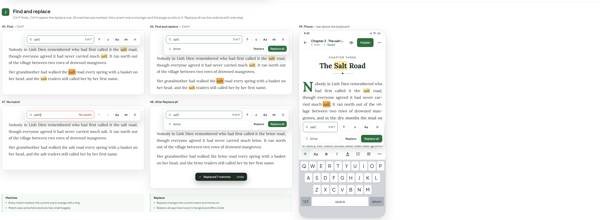

- Text in this part: "J" · "Find and replace" · "Ctrl F finds, Ctrl H opens the replace row. All matches are marked, the current one is stronger and the page scrolls to it. Replace all can be undone with one step." · "45. Find — Ctrl F" · "Nobody in Linh Dien remembered who had first called it the salt road, though everyone agreed it had never carried much salt. It ran north out of the village between two rows of drowned mangroves." · "Her grandmother had walked the salt road every spring with a basket on her head, and the salt traders still called her by her first name." · "salt" · "3 of 7" · "Aa" · "ab" · "46. Find and replace — Ctrl H" · "brine" · "Replace" · "Replace all" · "47. No match" · "saltt" · "No results" · "48. After Replace all" · "Nobody in Linh Dien remembered who had first called it the brine road, though everyone agreed it had never carried much brine. It ran north out of the village between two rows of drowned mangroves." · "Her grandmother had walked the brine road every spring with a basket on her head, and the brine traders still called her by her first name." · "0 of 0" · "Replaced 7 matches" · "Undo" · "Matches" · "Every match marked, the current one in orange with a ring" · "Match case and whole word are two small toggles" · "Replace changes the current match and moves on" · "Replace all says how many it changed and offers Undo" · "49. Phone — bar above the keyboard" · "9:41" · "Chapter 3 · The salt road" · "Draft" · "·" · "Saved" · "Publish" · "CHAPTER THREE" · "The Salt Road" · "N" · "obody in Linh Dien remembered who had first called it the salt road, though everyone agreed it had never carried much salt. It ran north out of the village between two rows of drowned mangroves, and in the dry months the mud on either side cracked into plates the colour of old bread.1 Her grandmother had walked it every spring with a basket on her head and a story for each bend, and Mai had grown up believing that a road was only a long way of telling something." · "By the time the ferry horn sounded across the flats she had already counted the posts twice. Forty-one, the same as yesterday, and the same as the year the floods came. The ferryman, who had once been a schoolteacher, liked to say that the village was the only place in the delta where the water kept better time than the clocks." · "1 The dry season at Linh Dien runs from November to April; see the survey notes in Chapter One." · "B" · "I" · "A" · "Q" · "W" · "E" · "R" · "T" · "Y" · "U" · "O" · "P" · "S" · "D" · "F" · "G" · "H" · "K" · "L" · "Z" · "X" · "C" · "V" · "M" · "123" · "space" · "return"

---

## Pasting from Word and the web

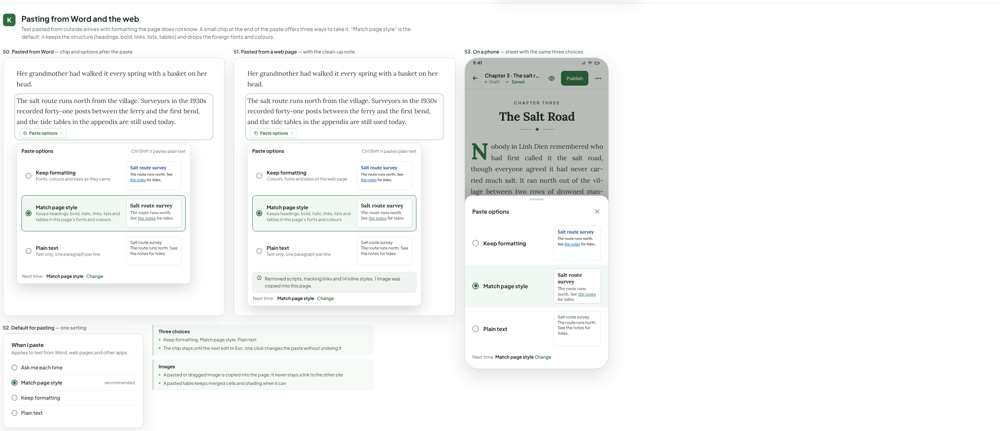

- Text in this part: "K" · "Pasting from Word and the web" · "Text pasted from outside arrives with formatting the page does not know. A small chip at the end of the paste offers three ways to take it. “Match page style” is the default: it keeps the structure (headings, bold, links, lists, tables) and drops the foreign fonts and colours." · "50. Pasted from Word — chip and options after the paste" · "Her grandmother had walked it every spring with a basket on her head." · "The salt route runs north from the village. Surveyors in the 1930s recorded forty-one posts between the ferry and the first bend, and the tide tables in the appendix are still used today." · "Paste options" · "Ctrl Shift V pastes plain text" · "Keep formatting" · "Fonts, colours and sizes as they came" · "Salt route survey" · "The route runs north. See the notes for tides." · "Match page style" · "Keeps headings, bold, italic, links, lists and tables in this page’s fonts and colours" · "Plain text" · "Text only, one paragraph per line" · "Next time:" · "Change" · "51. Pasted from a web page — with the clean-up note" · "Colours, fonts and sizes of the web page" · "Removed scripts, tracking links and 14 inline styles. 1 image was copied into this page." · "52. Default for pasting — one setting" · "When I paste" · "Applies to text from Word, web pages and other apps." · "Ask me each time" · "recommended" · "Three choices" · "Keep formatting, Match page style, Plain text" · "The chip stays until the next edit or Esc; one click changes the paste without undoing it" · "Images" · "A pasted or dragged image is copied into the page; it never stays a link to the other site" · "A pasted table keeps merged cells and shading when it can" · "53. On a phone — sheet with the same three choices" · "9:41" · "Chapter 3 · The salt road" · "Draft" · "·" · "Saved" · "Publish" · "CHAPTER THREE" · "The Salt Road" · "N" · "obody in Linh Dien remembered who had first called it the salt road, though everyone agreed it had never carried much salt. It ran north out of the village between two rows of drowned mangroves, and in the dry months the mud on either side cracked into plates the colour of old bread.1 Her grandmother had walked it every spring with a basket on her head and a story for each bend, and Mai had grown up believing that a road was only a long way of telling something." · "By the time the ferry horn sounded across the flats she had already counted the posts twice. Forty-one, the same as yesterday, and the same as the year the floods came. The ferryman, who had once been a schoolteacher, liked to say that the village was the only place in the delta where the water kept better time than the clocks." · "1 The dry season at Linh Dien runs from November to April; see the survey notes in Chapter One." · "Aa" · "B" · "I" · "A" · "Next time: Match page style Change"

---

## Dark mode

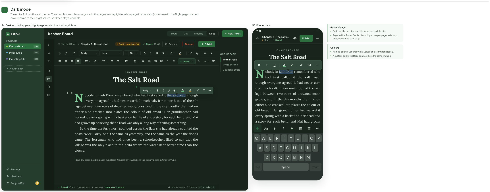

- Text in this part: "L" · "Dark mode" · "The editor follows the app theme. Chrome, ribbon and menus go dark; the page can stay light (a White page in a dark app) or follow with the Night page. Named colours swap to their Night values, so Green stays readable." · "54. Desktop, dark app and Night page — selection, toolbar, ribbon" · "KANBAN" · "PROJECTS" · "Kanban Board" · "KAN" · "Mobile App" · "MOB" · "Marketing Site" · "MKT" · "New Project" · "Settings" · "Members" · "Recycle Bin" · "3" · "Board" · "List" · "Timeline" · "Docs" · "New Ticket" · "The Salt Road" · "Chapter 3 · The salt road" · "Draft · based on v14" · "Saved" · "10:42" · "Preview" · "Discard" · "Publish" · "Body" · "Lora" · "18" · "B" · "I" · "U" · "S" · "A" · "x2" · "1" · "2" · "“" · "Insert" · "/" · "CHAPTER THREE" · "N" · "obody in Linh Dien remembered who had first called it the salt road, though everyone agreed it had never carried much salt. It ran north out of the village between two rows of drowned mangroves, and in the dry months the mud on either side cracked into plates the colour of old bread.1 Her grandmother had walked it every spring with a basket on her head and a story for each bend, and Mai had grown up believing that a road was only a long way of telling something." · "By the time the ferry horn sounded across the flats she had already counted the posts twice. Forty-one, the same as yesterday, and the same as the year the floods came. The ferryman, who had once been a schoolteacher, liked to say that the village was the only place in the delta where the water kept better time than the clocks." · "1 The dry season at Linh Dien runs from November to April; see the survey notes in Chapter One." · "1,284 words" · "6 min read" · "Selected: 3 words" · "Normal width" · "Focus" · "Ctrl Shift F" · "ON THIS PAGE" · "The salt road" · "The ferry horn" · "Counting posts" · "55. Phone, dark" · "9:41" · "Draft" · "·" · "Aa" · "Q" · "W" · "E" · "R" · "T" · "Y" · "O" · "P" · "D" · "F" · "G" · "H" · "J" · "K" · "Z" · "X" · "C" · "V" · "M" · "123" · "space" · "return" · "App and page" · "Dark app theme: sidebar, ribbon, menus and sheets" · "Page: White, Paper, Sepia, Mist or Night, set per page; a dark app does not force a dark page" · "Colours" · "Named colours use their Night values on a Night page (see E)" · "A custom colour that fails contrast gets the same warning"

---

## Focus mode

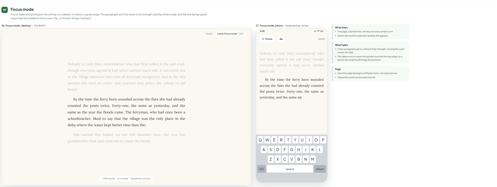

- Text in this part: "M" · "Focus mode" · "Focus hides everything but the writing: no sidebar, no ribbon, a quiet page. The paragraph with the caret is full strength and the others fade, and the line being typed stays near the middle of the screen. Esc, or the pill, brings it all back." · "56. Focus mode, desktop — Ctrl Shift F" · "Saved" · "Leave Focus mode" · "Esc" · "Nobody in Linh Dien remembered who had first called it the salt road, though everyone agreed it had never carried much salt. It ran north out of the village between two rows of drowned mangroves, and in the dry months the mud on either side cracked into plates the colour of old bread." · "By the time the ferry horn sounded across the flats she had already counted the posts twice. Forty-one, the same as yesterday, and the same as the year the floods came. The ferryman, who had once been a schoolteacher, liked to say that the village was the only place in the delta where the water kept better time than the" · "Mai carried the basket on her left shoulder now, the way her grandmother had, and tried not to count the bends." · "1,284 words" · "6 min read" · "Typewriter scroll on" · "57. Focus mode, phone — keyboard up, no bar" · "9:41" · "Focus" · "Aa" · "Nobody in Linh Dien remembered who had first called it the salt road, though everyone agreed it had never carried much salt." · "By the time the ferry horn sounded across the flats she had already counted the posts twice. Forty-one, the same as yesterday, and the same as" · "Q" · "W" · "E" · "R" · "T" · "Y" · "U" · "I" · "O" · "P" · "A" · "S" · "D" · "F" · "G" · "H" · "J" · "K" · "L" · "Z" · "X" · "C" · "V" · "B" · "N" · "123" · "space" · "return" · "What stays" · "The page, a Saved note, the way out and a small count" · "Select text and the selection toolbar still appears" · "What fades" · "Other paragraphs go to a third of their strength; moving the caret moves the light" · "The ribbon returns when the pointer touches the top edge; on a phone the small Aa pill brings the bar back" · "Page" · "Uses the page background (Paper here), not a special one" · "Typewriter scroll can be switched off"

---

## Format painter

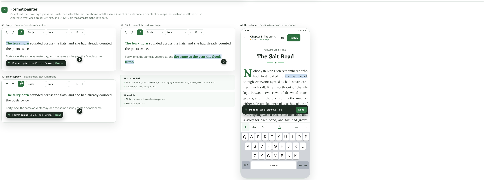

- Text in this part: "N" · "Format painter" · "Select text that looks right, press the brush, then select the text that should look the same. One click paints once; a double click keeps the brush on until Done or Esc. A bar says what was copied. Ctrl Alt C and Ctrl Alt V do the same from the keyboard." · "58. Copy — brush pressed on a selection" · "Body" · "Lora" · "18" · "The ferry horn sounded across the flats, and she had already counted the posts twice." · "Forty-one, the same as yesterday, and the same as the year the floods came." · "Format copied · Lora 18 · bold · Green" · "Keep on" · "59. Paint — select the text to change" · "60. Brush kept on — double click, stays until Done" · "Done" · "What is copied" · "Font, size, bold, italic, underline, colour, highlight and the paragraph style of the selection" · "Not copied: links, images, text" · "Where it is" · "Ribbon, row one; More sheet on phone" · "Esc or Done ends it" · "61. On a phone — Painting bar above the keyboard" · "9:41" · "Chapter 3 · The salt road" · "Draft" · "·" · "Saved" · "Publish" · "CHAPTER THREE" · "The Salt Road" · "obody in Linh Dien remembered who had first called it the salt road, though everyone agreed it had never carried much salt. It ran north out of the village between two rows of drowned mangroves, and in the dry months the mud on either side cracked into plates the colour of old bread.1 Her grandmother had walked it every spring with a basket on her head and a story for each bend, and Mai had grown up believing that a road was only a long way of telling something." · "By the time the ferry horn sounded across the flats she had already counted the posts twice. Forty-one, the same as yesterday, and the same as the year the floods came. The ferryman, who had once been a schoolteacher, liked to say that the village was the only place in the delta where the water kept better time than the clocks." · "1 The dry season at Linh Dien runs from November to April; see the survey notes in Chapter One." · "Aa" · "B" · "I" · "A" · "Q" · "W" · "E" · "R" · "T" · "Y" · "U" · "O" · "P" · "S" · "D" · "F" · "G" · "H" · "J" · "K" · "L" · "Z" · "X" · "C" · "V" · "M" · "123" · "space" · "return" · "Painting · tap or drag over text"

---

## Real states

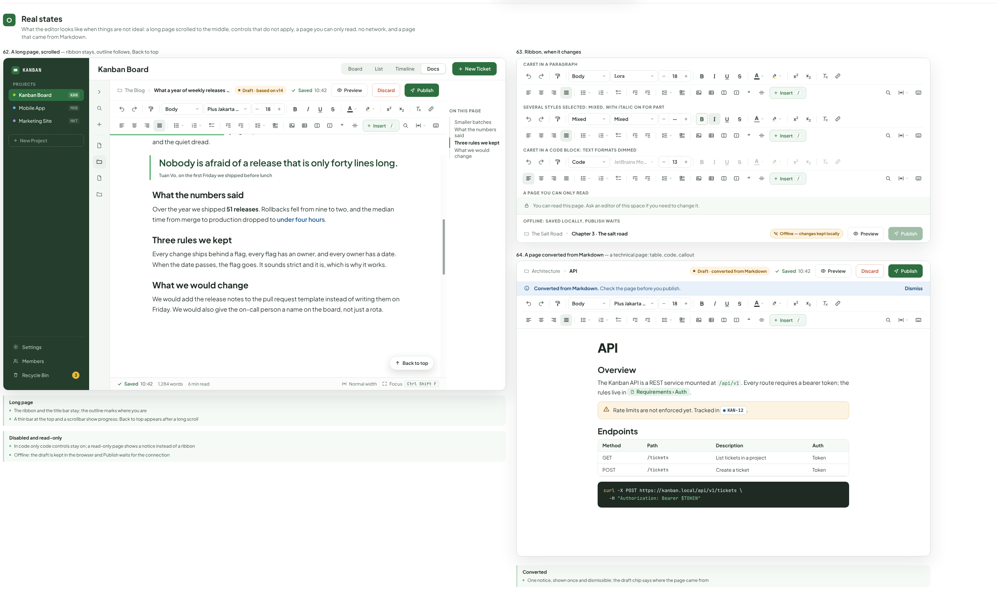

- Text in this part: "O" · "Real states" · "What the editor looks like when things are not ideal: a long page scrolled to the middle, controls that do not apply, a page you can only read, no network, and a page that came from Markdown." · "62. A long page, scrolled — ribbon stays, outline follows, Back to top" · "KANBAN" · "PROJECTS" · "Kanban Board" · "KAN" · "Mobile App" · "MOB" · "Marketing Site" · "MKT" · "New Project" · "Settings" · "Members" · "Recycle Bin" · "3" · "Board" · "List" · "Timeline" · "Docs" · "New Ticket" · "The Blog" · "What a year of weekly releases taught us" · "Draft · based on v14" · "Saved" · "10:42" · "Preview" · "Discard" · "Publish" · "Body" · "Plus Jakarta Sans" · "18" · "B" · "I" · "U" · "S" · "A" · "x2" · "1" · "2" · "“" · "Insert" · "/" · "ENGINEERING NOTES" · "HM" · "Hoa Mai" · "·" · "12 Nov 2026" · "8 min read" · "When we moved from monthly to weekly releases last autumn, the first thing that changed was not the code. It was the Fridays. They became calmer than they had been in years, and nobody could quite say why until we counted the incidents." · "Smaller batches, calmer Fridays" · "Release train, week 14: the board that replaced our monthly checklist." · "A monthly release carried about sixty tickets. A weekly one carries fourteen. When something breaks, the list of suspects is short enough to read out loud in a stand-up, and the rollback is a single revert instead of an archaeology project." · "We kept the same checks, the same reviewers and the same board. What went away was the release freeze, the Thursday night spreadsheet and the quiet dread." · "Nobody is afraid of a release that is only forty lines long." · "Tuan Vo, on the first Friday we shipped before lunch" · "What the numbers said" · "Over the year we shipped 51 releases. Rollbacks fell from nine to two, and the median time from merge to production dropped to under four hours." · "Three rules we kept" · "Every change ships behind a flag, every flag has an owner, and every owner has a date. When the date passes, the flag goes. It sounds strict and it is, which is why it works." · "What we would change" · "We would add the release notes to the pull request template instead of writing them on Friday. We would also give the on-call person a name on the board, not just a rota." · "Back to top" · "1,284 words" · "6 min read" · "Normal width" · "Focus" · "Ctrl Shift F" · "ON THIS PAGE" · "Smaller batches" · "Long page" · "The ribbon and the title bar stay; the outline marks where you are" · "A thin bar at the top and a scrollbar show progress; Back to top appears after a long scroll" · "Disabled and read-only" · "In code only code controls stay on; a read-only page shows a notice instead of a ribbon" · "Offline: the draft is kept in the browser and Publish waits for the connection" · "63. Ribbon, when it changes" · "CARET IN A PARAGRAPH" · "Lora" · "SEVERAL STYLES SELECTED: MIXED, WITH ITALIC ON FOR PART" · "Mixed" · "—" · "CARET IN A CODE BLOCK: TEXT FORMATS DIMMED" · "Code" · "JetBrains Mono" · "13" · "A PAGE YOU CAN ONLY READ" · "You can read this page. Ask an editor of this space if you need to change it." · "OFFLINE: SAVED LOCALLY, PUBLISH WAITS" · "The Salt Road" · "Chapter 3 · The salt road" · "Offline — changes kept locally" · "64. A page converted from Markdown — a technical page: table, code, callout" · "Architecture" · "API" · "Draft · converted from Markdown" · "Converted from Markdown. Check the page before you publish." · "Dismiss" · "Overview" · "The Kanban API is a REST service mounted at /api/v1. Every route requires a bearer token; the rules live in" · "Requirements › Auth." · "Rate limits are not enforced yet. Tracked in" · "KAN-12." · "Endpoints" · "Method" · "Path" · "Description" · "Auth" · "GET"

---

## A narrower desktop, and when saving goes wrong

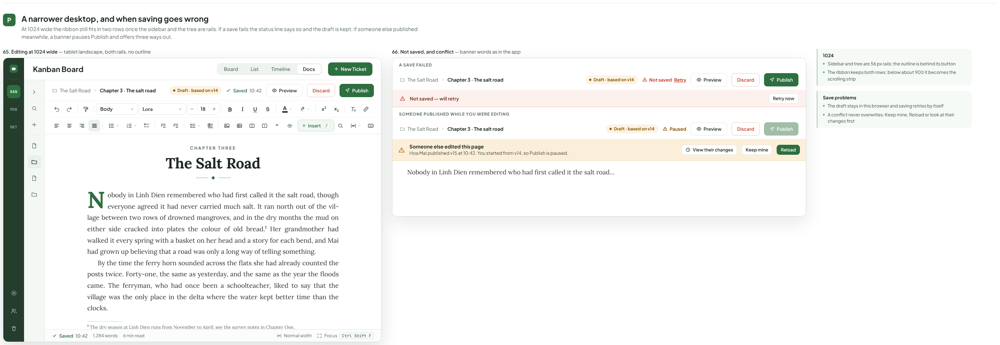

- Text in this part: "P" · "A narrower desktop, and when saving goes wrong" · "At 1024 wide the ribbon still fits in two rows once the sidebar and the tree are rails. If a save fails the status line says so and the draft is kept; if someone else published meanwhile, a banner pauses Publish and offers three ways out." · "65. Editing at 1024 wide — tablet landscape, both rails, no outline" · "KAN" · "MOB" · "MKT" · "Kanban Board" · "Board" · "List" · "Timeline" · "Docs" · "New Ticket" · "The Salt Road" · "Chapter 3 · The salt road" · "Draft · based on v14" · "Saved" · "10:42" · "Preview" · "Discard" · "Publish" · "Body" · "Lora" · "18" · "B" · "I" · "U" · "S" · "A" · "x2" · "1" · "2" · "3" · "“" · "Insert" · "/" · "CHAPTER THREE" · "N" · "obody in Linh Dien remembered who had first called it the salt road, though everyone agreed it had never carried much salt. It ran north out of the village between two rows of drowned mangroves, and in the dry months the mud on either side cracked into plates the colour of old bread.1 Her grandmother had walked it every spring with a basket on her head and a story for each bend, and Mai had grown up believing that a road was only a long way of telling something." · "By the time the ferry horn sounded across the flats she had already counted the posts twice. Forty-one, the same as yesterday, and the same as the year the floods came. The ferryman, who had once been a schoolteacher, liked to say that the village was the only place in the delta where the water kept better time than the clocks." · "1 The dry season at Linh Dien runs from November to April; see the survey notes in Chapter One." · "1,284 words" · "6 min read" · "Normal width" · "Focus" · "Ctrl Shift F" · "66. Not saved, and conflict — banner words as in the app" · "A SAVE FAILED" · "Not saved" · "Retry" · "Not saved — will retry" · "Retry now" · "SOMEONE PUBLISHED WHILE YOU WERE EDITING" · "Paused" · "Someone else edited this page" · "Hoa Mai published v15 at 10:42. You started from v14, so Publish is paused." · "View their changes" · "Keep mine" · "Reload" · "Nobody in Linh Dien remembered who had first called it the salt road…" · "1024" · "Sidebar and tree are 56 px rails; the outline is behind its button" · "The ribbon keeps both rows; below about 900 it becomes the scrolling strip" · "Save problems" · "The draft stays in this browser and saving retries by itself" · "A conflict never overwrites: Keep mine, Reload or look at their changes first"

---

## Frames, code that must change, and decisions for the owner

RichDocsShell: width 2800, finalH 10131, 29 frames. RichDocsEditor: width 2800, finalH 16375, 64 frames. Generators in c/rd1_editor/ (run.sh Shell|Editor). Fonts: both files add Lora, Source Serif 4, Merriweather, Playfair Display, Caveat, Inter to the Google Fonts link in the head: the link must be kept.

Shell: A reading (1 Desktop 1360, 2 Tablet 820, 3 Phone 390); B width and long-form (4 four page widths, 5 page layout popover, 6-8 long-form desktop/tablet/phone); C tablet (9 sidebar drawer, 10 tree drawer, 11 search); D phone (12 sidebar, 13 tree, 14 search, 15 page menu sheet, 16 On this page sheet, 17 page layout sheet); E (18 page bar at three widths, 19 page menu with Export, 20 On this page popover); F editing (21 desktop, 22 tablet, 23 phone); G (24 tablet landscape, 25 phone landscape reading, 26 phone landscape editing); H (27 touch targets, 28 gestures, 29 keyboard).
Editor: A 1-3 editing screen (desktop chapter, tablet blog, phone chapter); B 4 ribbon groups, 5 control states, 6-7 tablet strip; C 8-10 phone bar, Aa sheet, More sheet; D 11 text colour, 12 highlight, 13 custom colour, 14 low-contrast warning; E 15-17 palette on White/Sepia/Night, 18 phone colour sheet; F 19 styles, 20 font, 21 size, 22 spacing, 23 indent, 24 alignment, 25-26 drop cap, 27-28 bullets and numbering, 29 nested and checklist, 30-31 link, 32 super/subscript, 33 clear formatting; G 34-39 selection toolbar (plain, bold, mixed, link, code, phone); H 40-43 "/" menu (full, filtered, sheet, all blocks); I 44 shortcut sheet; J 45-49 find and replace; K 50-53 paste (Word, web, default setting, phone); L 54-55 dark desktop and phone; M 56-57 focus mode; N 58-61 format painter; O 62 long page scrolled, 63 ribbon states, 64 page converted from Markdown (spec sample).

## Code must change
Rich format with float images, columns, drop cap, text styles, named palette, page background and width as page settings. Ribbon in two rows + status line (words, reading time, selection count). New page layout popover/sheet. New touch layouts: tree and sidebar as drawers, search as its own screen, bottom sheets, bottom bar above the keyboard, left rail in phone landscape. Find and replace, paste chip, focus mode, format painter, shortcut sheet are new.
Drawn differently from code: Visual/Markdown switch is gone (Preview in its place); tree row actions always visible on touch; page title is part of the document, not page chrome.

## Not drawn / owner OK
Not drawn: AI marks, comments, history, tables, images (other boards). Dark mode: app has no dark theme yet (only a data-theme hook and a bw theme); dark screens are a proposal from a colour mapping.
Decisions: (1) page widths 560 / 680 / 880 / full; Wide and Full fold the tree to a rail and the outline to a button; (2) five page backgrounds (White, Paper, Sepia, Mist, Night), named palette of 12 text and 12 highlight colours whose values shift per background; custom hex allowed with contrast warning; (3) seven bundled fonts; (4) "Match page style" default paste mode with a setting; (5) edge swipe opens the tree (may collide with iOS back gesture; every gesture has a button); (6) app bar and tabs hide while editing on tablet and phone; (7) read-only notice instead of a ribbon; (8) invented shortcuts, e.g. Ctrl Alt C/V format painter, Ctrl Shift F focus; (9) text colour Automatic and "No highlight"; (10) the "converted from Markdown" notice.
Not checked: real devices, iOS keyboard heights, how the exporter treats these styles.

---
## Final update after review (supersedes the numbers above)
RichDocsShell 2800 wide, finalH 10443, 29 frames. RichDocsEditor 2800 wide, finalH 17643, 66 frames: new Editor 65 (ribbon at 1024), 66 (save failed + conflict banner). Page layout is now "Page settings…" (the panel of the Start board; Shell 5, 17 show its Layout tab with "More settings…"). Palette: 12 text colours + 12 highlights are the canonical palette of the whole product; table cell shading uses the same names. Page widths: Narrow 560, Normal 680, Wide 880, Full. Clear formatting is Ctrl Space; Ctrl \ = tree; Ctrl K = Go to page while reading (Link while editing). "/" menu uses the code strings (Task list, Ticket card, Page link, Callout: Info / Warning / Success, New draw.io drawing, Import .drawio file, Math, Footnote, Ask AI…). Find and replace already exists in the code (FindInPage.tsx): Editor 45-49 re-draw it. Not drawn on purpose: loading skeleton and long-title page bar (States board).
