# Rich Docs — embeds & files

> New screen (Rich Docs) · canvas `1794929703-2a72` · the board is split into 3 boards on the canvas because a browser cannot paint one board taller than about 8000 px; frame numbers run on across the parts. Sources: [`RichDocsEmbeds1.dc.html`](../source/RichDocsEmbeds1.dc.html) (sha256 `4250c2a1958c…`, full value in `MANIFEST.json`), [`RichDocsEmbeds2.dc.html`](../source/RichDocsEmbeds2.dc.html) (sha256 `bc018b8af0a3…`, full value in `MANIFEST.json`), [`RichDocsEmbeds3.dc.html`](../source/RichDocsEmbeds3.dc.html) (sha256 `1c167c753405…`, full value in `MANIFEST.json`)

> A new board that lives next to the older Docs boards (it does not replace them). Where a screen already exists in the code, the words follow the code (`ui/src/components/docs/`); the rich-format parts (colours, float images, merged cells, embeds, suggestions, export, public links, highlights) are a design proposal and need the code changes listed at the end. Names, ids, costs and times in the mock-ups are sample data. Frames are numbered on the canvas; desktop is 1360 wide, tablet 820, phone 390.

## COMPONENT — RICH DOCS

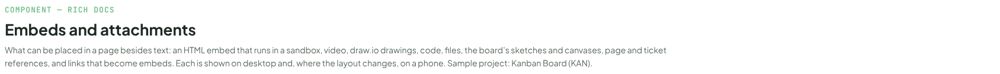

- Text in this part: "COMPONENT — RICH DOCS" · "Embeds and attachments" · "What can be placed in a page besides text: an HTML embed that runs in a sandbox, video, draw.io drawings, code, files, the board’s sketches and canvases, page and ticket references, and links that become embeds. Each is shown on desktop and, where the layout changes, on a phone. Sample project: Kanban Board (KAN)."

---

## HTML embed

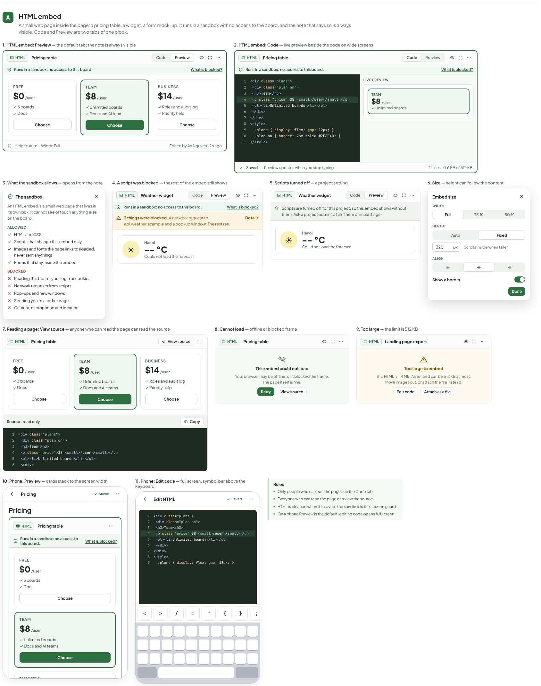

- Text in this part: "A" · "HTML embed" · "A small web page inside the page: a pricing table, a widget, a form mock-up. It runs in a sandbox with no access to the board, and the note that says so is always visible. Code and Preview are two tabs of one block." · "1. HTML embed: Preview — the default tab; the note is always visible" · "HTML" · "Pricing table" · "Code" · "Preview" · "Runs in a sandbox: no access to this board." · "What is blocked?" · "FREE" · "$0 /user" · "✓ 3 boards" · "✓ Docs" · "Choose" · "TEAM" · "$8 /user" · "✓ Unlimited boards" · "✓ Docs and AI teams" · "BUSINESS" · "$14 /user" · "✓ Roles and audit log" · "✓ Priority help" · "Height: Auto  ·  Width: Full" · "Edited by An Nguyen · 2h ago" · "2. HTML embed: Code — live preview beside the code on wide screens" · "1" · "
" · "2" · "
" · "3" · "<h3>Team</h3>" · "4" · "
$8 <small>/user</small>
" · "5" · "<ul><li>Unlimited boards</li></ul>" · "6" · "
" · "7" · "8" · "" · "LIVE PREVIEW" · "Saved" · "·  Preview updates when you stop typing" · "11 lines · 0.6 KB of 512 KB" · "3. What the sandbox allows — opens from the note" · "The sandbox" · "An HTML embed is a small web page that lives in its own box. It cannot see or touch anything else on the board." · "ALLOWED" · "HTML and CSS" · "Scripts that change this embed only" · "Images and fonts the page links to (loaded, never sent anything)" · "Forms that stay inside the embed" · "BLOCKED" · "Reading this board, your login or cookies" · "Network requests from scripts" · "Pop-ups and new windows" · "Sending you to another page" · "Camera, microphone and location" · "4. A script was blocked — the rest of the embed still shows" · "Weather widget" · "2 things were blocked. A network request to api.weather.example and a pop-up window. The rest ran." · "Details" · "☀" · "Hanoi" · "-- °C" · "Could not load the forecast" · "5. Scripts turned off — a project setting" · "Scripts are turned off for this project, so this embed shows without them. Ask a project admin to turn them on in Settings." · "6. Size — height can follow the content" · "Embed size" · "WIDTH" · "Full" · "75 %" · "50 %" · "HEIGHT" · "Auto" · "Fixed" · "320" · "px" · "Scrolls inside when taller" · "ALIGN" · "Show a border" · "Done" · "7. Reading a page: View source — anyone who can read the page can read the source" · "View source" · "Source · read only" · "Copy" · "8. Cannot load — offline or blocked frame" · "This embed could not load" · "Your browser may be offline, or it blocked the frame. The page itself is fine." · "Retry" · "9. Too large — the limit is 512 KB" · "Landing page export" · "Too large to embed" · "This HTML is 1.4 MB. An embed can be 512 KB at most. Move images out, or attach the file instead." · "Edit code" · "Attach as a file" · "10. Phone: Preview — cards stack to the screen width" · "Pricing" · "11. Phone: Edit code — full screen, symbol bar above the keyboard" · "Edit HTML" · "<" · ">"

---

## Video

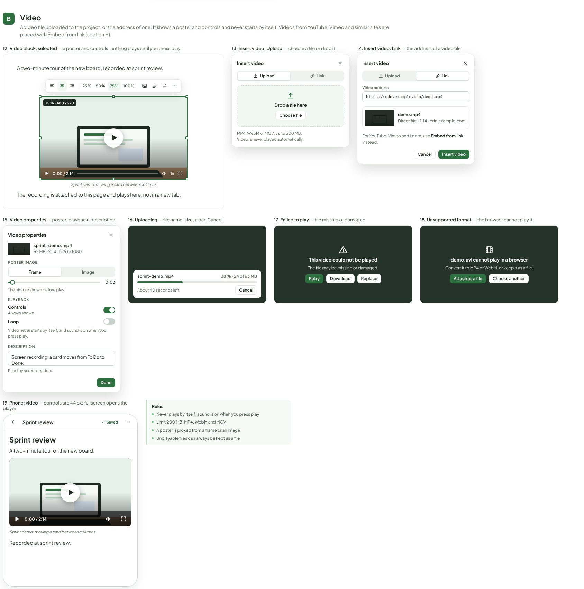

- Text in this part: "B" · "Video" · "A video file uploaded to the project, or the address of one. It shows a poster and controls and never starts by itself. Videos from YouTube, Vimeo and similar sites are placed with Embed from link (section H)." · "12. Video block, selected — a poster and controls; nothing plays until you press play" · "A two-minute tour of the new board, recorded at sprint review." · "25%" · "50%" · "75%" · "100%" · "0:00 / 2:14" · "1x" · "75 % · 480 x 270" · "Sprint demo: moving a card between columns" · "The recording is attached to this page and plays here, not in a new tab." · "13. Insert video: Upload — choose a file or drop it" · "Insert video" · "Upload" · "Link" · "Drop a file here" · "Choose file" · "MP4, WebM or MOV, up to 200 MB." · "Video is never played automatically." · "14. Insert video: Link — the address of a video file" · "Video address" · "https://cdn.example.com/demo.mp4" · "demo.mp4" · "Direct file · 2:14 · cdn.example.com" · "For YouTube, Vimeo and Loom, use Embed from link instead." · "Cancel" · "15. Video properties — poster, playback, description" · "Video properties" · "sprint-demo.mp4" · "63 MB · 2:14 · 1920 x 1080" · "POSTER IMAGE" · "Frame" · "Image" · "0:03" · "The picture shown before play." · "PLAYBACK" · "Controls" · "Always shown" · "Loop" · "Video never starts by itself, and sound is on when you press play." · "DESCRIPTION" · "Screen recording: a card moves from To Do to Done." · "Read by screen readers." · "Done" · "16. Uploading — file name, size, a bar, Cancel" · "38 % · 24 of 63 MB" · "About 40 seconds left" · "17. Failed to play — file missing or damaged" · "This video could not be played" · "The file may be missing or damaged." · "Retry" · "Download" · "Replace" · "18. Unsupported format — the browser cannot play it" · "demo.avi cannot play in a browser" · "Convert it to MP4 or WebM, or keep it as a file." · "Attach as a file" · "Choose another" · "19. Phone: video — controls are 44 px; fullscreen opens the player" · "Sprint review" · "Saved" · "A two-minute tour of the new board." · "Recorded at sprint review." · "Rules" · "Never plays by itself; sound is on when you press play" · "Limit 200 MB; MP4, WebM and MOV" · "A poster is picked from a frame or an image" · "Unplayable files can always be kept as a file"

---

## draw.io diagrams

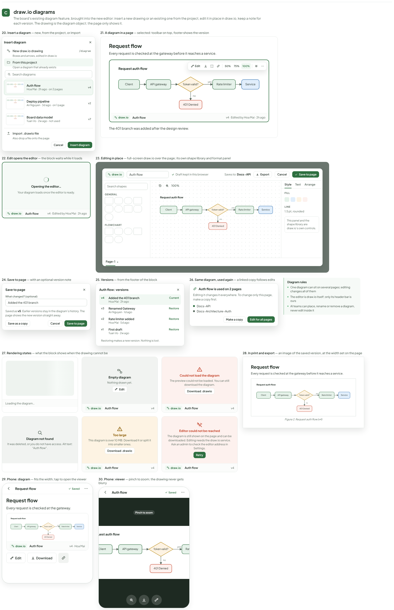

- Text in this part: "C" · "draw.io diagrams" · "The board’s existing diagram feature, brought into the new editor: insert a new drawing or an existing one from the project, edit it in place in draw.io, keep a note for each version. The drawing is the diagram object; the page only shows it." · "20. Insert a diagram — new, from the project, or import" · "Insert diagram" · "New draw.io drawing" · "/diagram" · "Boxes and arrows, edited in draw.io" · "From this project" · "Open a diagram that already exists" · "Search diagrams" · "Client" · "API gateway" · "Token valid?" · "yes" · "Rate limiter" · "Service" · "no" · "401 Denied" · "Auth flow" · "Hoa Mai · 2h ago · on 2 pages" · "v4" · "Deploy pipeline" · "An Nguyen · 3d ago · on 1 page" · "v2" · "Board data model" · "Tuan Vo · 2w ago · not used" · "v7" · "Import .drawio file" · "Also drop a file onto the page" · "Cancel" · "21. A diagram in a page — selected: toolbar on top, footer shows the version" · "Request flow" · "Every request is checked at the gateway before it reaches a service." · "Request auth flow" · "draw.io" · "v4 · Edited by Hoa Mai · 2h ago" · "Edit" · "50%" · "75%" · "100%" · "The 401 branch was added after the design review." · "22. Edit opens the editor — the block waits while it loads" · "Opening the editor…" · "Your diagram loads once the editor is ready." · "23. Editing in place — full-screen draw.io over the page; its own shape library and format panel" · "Draft kept in this browser" · "Saves to: Docs › API" · "Export" · "Save to page" · "Search shapes" · "GENERAL" · "FLOWCHART" · "Style" · "Text" · "Arrange" · "FILL" · "LINE" · "1.5 pt, rounded" · "This panel and the shape library are draw.io’s own controls." · "Page-1" · "+" · "24. Save to page — with an optional version note" · "What changed? (optional)" · "Added the 401 branch" · "Saved as v5. Earlier versions stay in the diagram’s history. The page shows the new version straight away." · "Save as a copy" · "25. Versions — from the footer of the block" · "Auth flow: versions" · "Hoa Mai · 2h ago" · "Current" · "v3" · "Renamed Gateway" · "An Nguyen · 1d ago" · "Restore" · "Rate limiter added" · "Hoa Mai · 5d ago" · "v1" · "First draft" · "Tuan Vo · 2w ago" · "Restoring makes a new version. Nothing is lost." · "26. Same diagram, used again — a linked copy follows edits" · "Auth flow is used on 2 pages" · "Editing it changes it everywhere. To change only this page, make a copy first." · "Docs › API" · "Docs › Architecture › Auth" · "Make a copy" · "Edit for all pages" · "Diagram rules" · "One diagram can sit on several pages; editing changes all of them" · "The editor is draw.io itself; only its header bar is ours" · "AI teams can place, rename or remove a diagram, never edit inside it" · "27. Rendering states — what the block shows when the drawing cannot be" · "Loading the diagram…" · "Empty diagram" · "Nothing drawn yet." · "Could not load the diagram" · "The preview could not be loaded. You can still download the diagram." · "Download .drawio" · "Diagram not found" · "It was deleted, or you do not have access. Alt text: “Auth flow”." · "Too large" · "This diagram is over 10 MB. Download it or split it into smaller ones." · "Editor could not be reached" · "The diagram is still shown on the page and can be downloaded. Editing needs the draw.io service. Ask an admin to check the editor address in Settings." · "Retry" · "28. In print and export — an image of the saved version, at the width set on the page" · "Figure 2. Request auth flow (v4)" · "29. Phone: diagram — fits the width; tap to open the viewer" · "Saved"

---

## Code block

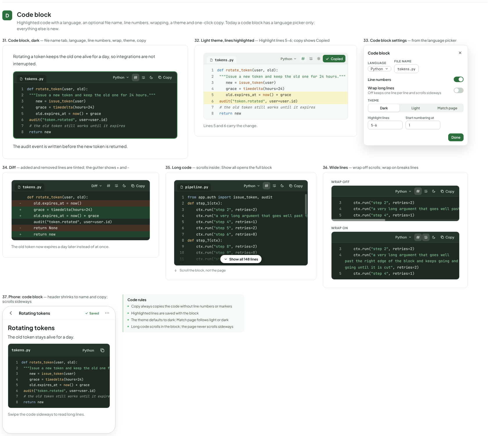

- Text in this part: "D" · "Code block" · "Highlighted code with a language, an optional file name, line numbers, wrapping, a theme and one-click copy. Today a code block has a language picker only; everything else is new." · "31. Code block, dark — file name tab, language, line numbers, wrap, theme, copy" · "Rotating a token keeps the old one alive for a day, so integrations are not interrupted." · "tokens.py" · "Python" · "Copy" · "1" · "def rotate_token(user, old):" · "2" · """"Issue a new token and keep the old one for 24 hours."""" · "3" · "new = issue_token(user)" · "4" · "grace = timedelta(hours=24)" · "5" · "old.expires_at = now() + grace" · "6" · "audit("token.rotated", user=user.id)" · "7" · "# the old token still works until it expires" · "8" · "return new" · "The audit event is written before the new token is returned." · "32. Light theme, lines highlighted — Highlight lines 5-6; copy shows Copied" · "Copied" · "Lines 5 and 6 carry the change." · "33. Code block settings — from the language picker" · "LANGUAGE" · "FILE NAME" · "Line numbers" · "Wrap long lines" · "Off keeps one line per line and scrolls sideways" · "THEME" · "Dark" · "Light" · "Match page" · "Highlight lines" · "5-6" · "Start numbering at" · "Done" · "34. Diff — added and removed lines are tinted; the gutter shows + and -" · "Diff" · "-" · "old.expires_at = now()" · "+" · "return None" · "The old token now expires a day later instead of at once." · "35. Long code — scrolls inside; Show all opens the full block" · "pipeline.py" · "from app.auth import issue_token, audit" · "def step_1(ctx):" · "ctx.run("step 2", retries=2)" · "ctx.run("a very long argument that goes well past the right edge of the block and keeps going and going until it is cut", retries=2)" · "ctx.run("step 4", retries=1)" · "ctx.run("step 5", retries=2)" · "ctx.run("step 6", retries=0)" · "def step_7(ctx):" · "9" · "ctx.run("step 8", retries=2)" · "10" · "ctx.run("step 9", retries=0)" · "11" · "ctx.run("step 10", retries=1)" · "12" · "ctx.run("step 11", retries=2)" · "13" · "ctx.run("step 12", retries=0)" · "14" · "def step_13(ctx):" · "15" · "ctx.run("step 14", retries=2)" · "16" · "ctx.run("step 15", retries=0)" · "17" · "ctx.run("step 16", retries=1)" · "18" · "ctx.run("step 17", retries=2)" · "Show all 148 lines" · "Scroll the block, not the page" · "36. Wide lines — wrap off scrolls; wrap on breaks lines" · "WRAP OFF" · "WRAP ON" · "37. Phone: code block — header shrinks to name and copy; scrolls sideways" · "Rotating tokens" · "Saved" · "The old token stays alive for a day." · "Swipe the code sideways to read long lines." · "Code rules" · "Copy always copies the code without line numbers or markers" · "Highlighted lines are saved with the block" · "The theme defaults to dark; Match page follows light or dark" · "Long code scrolls in the block; the page never scrolls sideways"

---

## File attachments

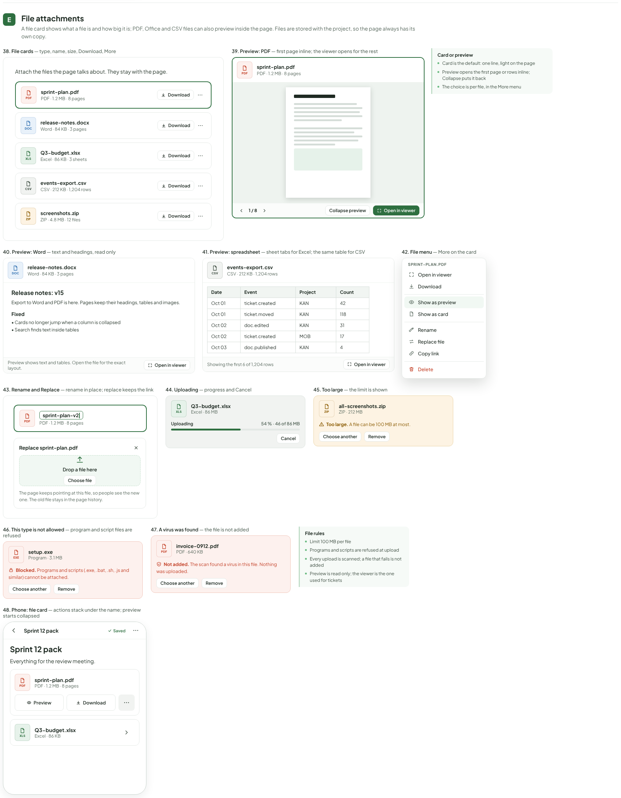

- Text in this part: "E" · "File attachments" · "A file card shows what a file is and how big it is; PDF, Office and CSV files can also preview inside the page. Files are stored with the project, so the page always has its own copy." · "38. File cards — type, name, size, Download, More" · "Attach the files the page talks about. They stay with the page." · "PDF" · "sprint-plan.pdf" · "PDF · 1.2 MB · 8 pages" · "Download" · "DOC" · "release-notes.docx" · "Word · 84 KB · 3 pages" · "XLS" · "Q3-budget.xlsx" · "Excel · 86 KB · 3 sheets" · "CSV" · "events-export.csv" · "CSV · 212 KB · 1,204 rows" · "ZIP" · "screenshots.zip" · "ZIP · 4.8 MB · 12 files" · "39. Preview: PDF — first page inline; the viewer opens for the rest" · "1 / 8" · "Collapse preview" · "Open in viewer" · "Card or preview" · "Card is the default: one line, light on the page" · "Preview opens the first page or rows inline; Collapse puts it back" · "The choice is per file, in the More menu" · "40. Preview: Word — text and headings, read only" · "Release notes: v15" · "Export to Word and PDF is here. Pages keep their headings, tables and images." · "Fixed" · "• Cards no longer jump when a column is collapsed" · "• Search finds text inside tables" · "Preview shows text and tables. Open the file for the exact layout." · "41. Preview: spreadsheet — sheet tabs for Excel; the same table for CSV" · "Date	Event	Project	Count" · "Oct 01	ticket.created	KAN	42" · "Oct 01	ticket.moved	KAN	118" · "Oct 02	doc.edited	KAN	31" · "Oct 02	ticket.created	MOB	17" · "Oct 03	doc.published	KAN	4" · "Showing the first 6 of 1,204 rows" · "42. File menu — More on the card" · "SPRINT-PLAN.PDF" · "Show as preview" · "Show as card" · "Rename" · "Replace file" · "Copy link" · "Delete" · "43. Rename and Replace — rename in place; replace keeps the link" · "sprint-plan-v2" · "Replace sprint-plan.pdf" · "Drop a file here" · "Choose file" · "The page keeps pointing at this file, so people see the new one. The old file stays in the page history." · "44. Uploading — progress and Cancel" · "Excel · 86 MB" · "Uploading" · "54 % · 46 of 86 MB" · "Cancel" · "45. Too large — the limit is shown" · "all-screenshots.zip" · "ZIP · 212 MB" · "Too large. A file can be 100 MB at most." · "Choose another" · "Remove" · "46. This type is not allowed — program and script files are refused" · "EXE" · "setup.exe" · "Program · 3.1 MB" · "Blocked. Programs and scripts (.exe, .bat, .sh, .js and similar) cannot be attached." · "47. A virus was found — the file is not added" · "invoice-0912.pdf" · "PDF · 640 KB" · "Not added. The scan found a virus in this file. Nothing was uploaded." · "File rules" · "Limit 100 MB per file" · "Programs and scripts are refused at upload" · "Every upload is scanned; a file that fails is not added" · "Preview is read only; the viewer is the one used for tickets" · "48. Phone: file card — actions stack under the name; preview starts collapsed" · "Sprint 12 pack" · "Saved" · "Everything for the review meeting." · "Preview" · "Excel · 86 KB"

---

## Sketches and canvases

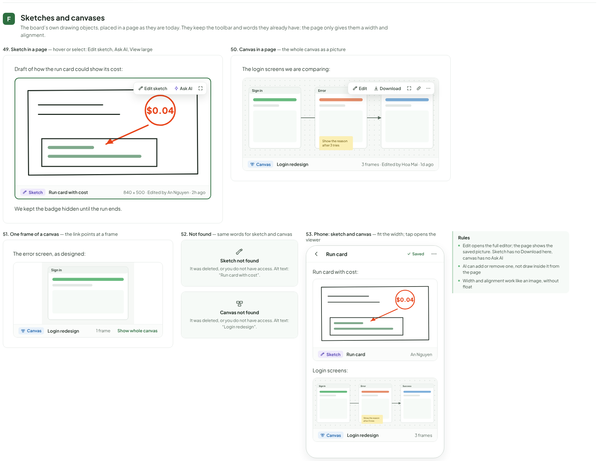

- Text in this part: "F" · "Sketches and canvases" · "The board’s own drawing objects, placed in a page as they are today. They keep the toolbar and words they already have; the page only gives them a width and alignment." · "49. Sketch in a page — hover or select: Edit sketch, Ask AI, View large" · "Draft of how the run card could show its cost:" · "$0.04" · "Sketch" · "Run card with cost" · "840 × 500 · Edited by An Nguyen · 2h ago" · "Edit sketch" · "Ask AI" · "We kept the badge hidden until the run ends." · "50. Canvas in a page — the whole canvas as a picture" · "The login screens we are comparing:" · "Sign in" · "Error" · "Success" · "Show the reason" · "after 3 tries" · "Canvas" · "Login redesign" · "3 frames · Edited by Hoa Mai · 1d ago" · "Edit" · "Download" · "51. One frame of a canvas — the link points at a frame" · "The error screen, as designed:" · "1 frame" · "Show whole canvas" · "52. Not found — same words for sketch and canvas" · "Sketch not found" · "It was deleted, or you do not have access. Alt text: “Run card with cost”." · "Canvas not found" · "It was deleted, or you do not have access. Alt text: “Login redesign”." · "53. Phone: sketch and canvas — fit the width; tap opens the viewer" · "Run card" · "Saved" · "Run card with cost:" · "An Nguyen" · "Login screens:" · "3 frames" · "Rules" · "Edit opens the full editor; the page shows the saved picture. Sketch has no Download here, canvas has no Ask AI" · "AI can add or remove one, not draw inside it from the page" · "Width and alignment work like an image, without float"

---

## Page and ticket references

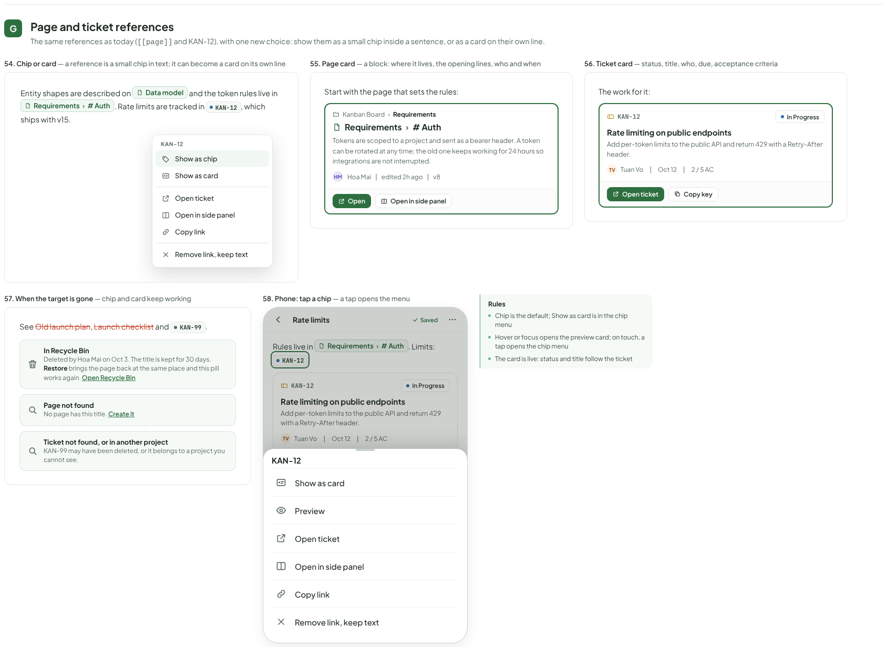

- Text in this part: "G" · "Page and ticket references" · "The same references as today ([[page]] and KAN-12), with one new choice: show them as a small chip inside a sentence, or as a card on their own line." · "54. Chip or card — a reference is a small chip in text; it can become a card on its own line" · "Entity shapes are described on" · "Data model and the token rules live in" · "Requirements" · "›" · "# Auth. Rate limits are tracked in" · "KAN-12, which ships with v15." · "KAN-12" · "Show as chip" · "Show as card" · "Open ticket" · "Open in side panel" · "Copy link" · "Remove link, keep text" · "55. Page card — a block: where it lives, the opening lines, who and when" · "Start with the page that sets the rules:" · "Kanban Board" · "# Auth" · "Tokens are scoped to a project and sent as a bearer header. A token can be rotated at any time; the old one keeps working for 24 hours so integrations are not interrupted." · "HM" · "Hoa Mai" · "|" · "edited 2h ago" · "v8" · "Open" · "56. Ticket card — status, title, who, due, acceptance criteria" · "The work for it:" · "In Progress" · "Rate limiting on public endpoints" · "Add per-token limits to the public API and return 429 with a Retry-After header." · "TV" · "Tuan Vo" · "Oct 12" · "2 / 5 AC" · "Copy key" · "57. When the target is gone — chip and card keep working" · "See Old launch plan, Launch checklist and" · "KAN-99." · "In Recycle Bin" · "Deleted by Hoa Mai on Oct 3. The title is kept for 30 days. Restore brings the page back at the same place and this pill works again. Open Recycle Bin" · "Page not found" · "No page has this title. Create it" · "Ticket not found, or in another project" · "KAN-99 may have been deleted, or it belongs to a project you cannot see." · "58. Phone: tap a chip — a tap opens the menu" · "Rate limits" · "Saved" · "Rules live in" · "# Auth. Limits:" · "KAN-12." · "Preview" · "Rules" · "Chip is the default; Show as card is in the chip menu" · "Hover or focus opens the preview card; on touch, a tap opens the chip menu" · "The card is live: status and title follow the ticket"

---

## Embed from a link

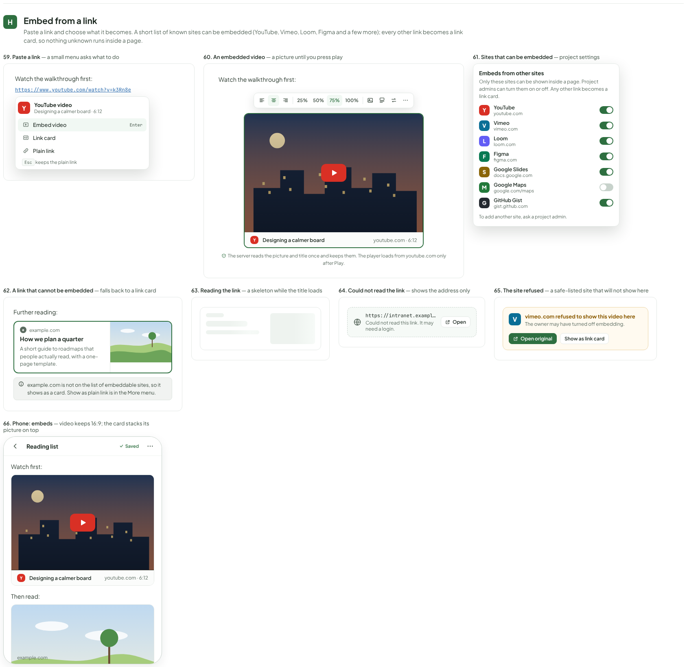

- Text in this part: "H" · "Embed from a link" · "Paste a link and choose what it becomes. A short list of known sites can be embedded (YouTube, Vimeo, Loom, Figma and a few more); every other link becomes a link card, so nothing unknown runs inside a page." · "59. Paste a link — a small menu asks what to do" · "Watch the walkthrough first:" · "https://www.youtube.com/watch?v=k3Rn8e" · "Y" · "YouTube video" · "Designing a calmer board · 6:12" · "Embed video" · "Enter" · "Link card" · "Plain link" · "Esc keeps the plain link" · "60. An embedded video — a picture until you press play" · "25%" · "50%" · "75%" · "100%" · "Designing a calmer board" · "youtube.com · 6:12" · "The server reads the picture and title once and keeps them. The player loads from youtube.com only after Play." · "61. Sites that can be embedded — project settings" · "Embeds from other sites" · "Only these sites can be shown inside a page. Project admins can turn them on or off. Any other link becomes a link card." · "YouTube" · "youtube.com" · "V" · "Vimeo" · "vimeo.com" · "L" · "Loom" · "loom.com" · "F" · "Figma" · "figma.com" · "S" · "Google Slides" · "docs.google.com" · "M" · "Google Maps" · "google.com/maps" · "G" · "GitHub Gist" · "gist.github.com" · "To add another site, ask a project admin." · "62. A link that cannot be embedded — falls back to a link card" · "Further reading:" · "e" · "example.com" · "How we plan a quarter" · "A short guide to roadmaps that people actually read, with a one-page template." · "example.com is not on the list of embeddable sites, so it shows as a card. Show as plain link is in the More menu." · "63. Reading the link — a skeleton while the title loads" · "64. Could not read the link — shows the address only" · "https://intranet.example.com/plans/q4" · "Could not read this link. It may need a login." · "Open" · "65. The site refused — a safe-listed site that will not show here" · "vimeo.com refused to show this video here" · "The owner may have turned off embedding." · "Open original" · "Show as link card" · "66. Phone: embeds — video keeps 16:9; the card stacks its picture on top" · "Reading list" · "Saved" · "Watch first:" · "Then read:" · "A short guide to roadmaps people read."

---

## Formulas

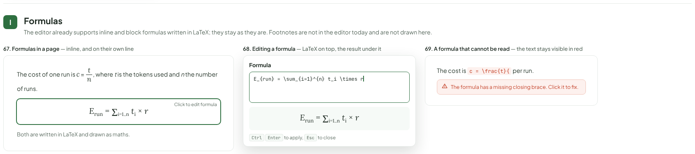

- Text in this part: "I" · "Formulas" · "The editor already supports inline and block formulas written in LaTeX; they stay as they are. Footnotes are not in the editor today and are not drawn here." · "67. Formulas in a page — inline, and on their own line" · "The cost of one run is c =" · "t" · "n" · ", where t is the tokens used and n the number of runs." · "Erun = Σi=1..n ti × r" · "Click to edit formula" · "Both are written in LaTeX and drawn as maths." · "68. Editing a formula — LaTeX on top, the result under it" · "Formula" · "E_{run} = \sum_{i=1}^{n} t_i \times r" · "Ctrl Enter to apply, Esc to close" · "69. A formula that cannot be read — the text stays visible in red" · "The cost is c = \frac{t}{ per run." · "The formula has a missing closing brace. Click it to fix."

---

## Tablet, and more states

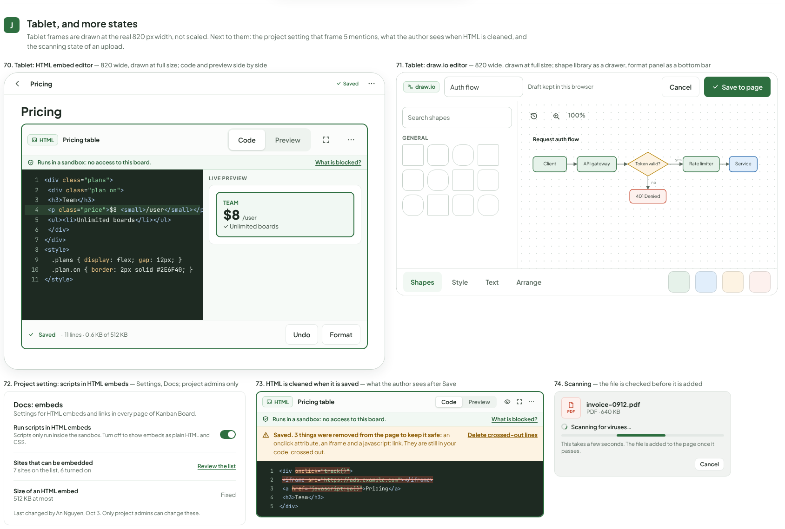

- Text in this part: "J" · "Tablet, and more states" · "Tablet frames are drawn at the real 820 px width, not scaled. Next to them: the project setting that frame 5 mentions, what the author sees when HTML is cleaned, and the scanning state of an upload." · "70. Tablet: HTML embed editor — 820 wide, drawn at full size; code and preview side by side" · "Pricing" · "Saved" · "HTML" · "Pricing table" · "Code" · "Preview" · "Runs in a sandbox: no access to this board." · "What is blocked?" · "1" · "
" · "2" · "
" · "3" · "<h3>Team</h3>" · "4" · "
$8 <small>/user</small>
" · "5" · "<ul><li>Unlimited boards</li></ul>" · "6" · "
" · "7" · "8" · "" · "LIVE PREVIEW" · "TEAM" · "$8 /user" · "✓ Unlimited boards" · "·  11 lines · 0.6 KB of 512 KB" · "Undo" · "Format" · "71. Tablet: draw.io editor — 820 wide, drawn at full size; shape library as a drawer, format panel as a bottom bar" · "draw.io" · "Auth flow" · "Draft kept in this browser" · "Cancel" · "Save to page" · "Search shapes" · "GENERAL" · "Request auth flow" · "Client" · "API gateway" · "Token valid?" · "yes" · "Rate limiter" · "Service" · "no" · "401 Denied" · "100%" · "Shapes" · "Style" · "Text" · "Arrange" · "72. Project setting: scripts in HTML embeds — Settings, Docs; project admins only" · "Docs: embeds" · "Settings for HTML embeds and links in every page of Kanban Board." · "Run scripts in HTML embeds" · "Scripts only run inside the sandbox. Turn off to show embeds as plain HTML and CSS." · "Sites that can be embedded" · "7 sites on the list, 6 turned on" · "Review the list" · "Size of an HTML embed" · "512 KB at most" · "Fixed" · "Last changed by An Nguyen, Oct 3. Only project admins can change these." · "73. HTML is cleaned when it is saved — what the author sees after Save" · "Saved. 3 things were removed from the page to keep it safe: an onclick attribute, an iframe and a javascript: link. They are still in your code, crossed out." · "Delete crossed-out lines" · "
" · "<iframe src="https://ads.example.com"></iframe>" · "<a href="javascript:go()">Pricing</a>" · "74. Scanning — the file is checked before it is added" · "PDF" · "invoice-0912.pdf" · "PDF · 640 KB" · "Scanning for viruses…" · "This takes a few seconds. The file is added to the page once it passes."

---

## Frames, code that must change, and decisions for the owner

Both boards 1760 wide. RichDocsBlocks finalH 14600 (60 frames, A-K), RichDocsEmbeds finalH 14817 (69 frames, A-I). Frame lists in frames_blocks.txt / frames_embeds.txt.

Blocks: A Images (1-4) placements, float right with wrap band, float left in a book chapter, centred block with alt badge; B (5-10) toolbar anatomy, Layout/Style/Text and link tabs of properties popover, phone strip and sheet; C (11-13) resize with snapping, crop, border/corners/shadow; D (14-21) Upload/Link/Board files, drag-drop, uploading, failed, too large, not found; E (22-24) float on desktop, tablet, phone; F Tables (25-35) size picker and phone steppers, handles, select and merge, merged and shaded, cell properties, table properties, styles, phone scroll, cell bar, shading sheet; G Columns (36-40); H (41-47) callouts, properties, pull quotes, block quotes, dividers, scene break; I Lists (48,49); J (50-55) block handle, moving, several selected, block menu, phone menu/select; K Insert (56-60) palette of 34 blocks, slash search, empty line, phone sheet, phone quick bar.

Embeds: A HTML (1-11) preview, code, sandbox rules, blocked script, scripts off, size, view source, cannot load, too large, two phones; B Video (12-19); C draw.io (20-30) insert, in page, opening, editor, save with version note, versions, shared use, six states, print, two phones; D Code (31-37); E Files (38-48) cards, PDF/Word/spreadsheet preview, menu, rename/replace, uploading, too large, blocked type, virus, phone; F Sketch and canvas (49-53); G References (54-58); H Embed from a link (59-66); I Formulas (67-69).

## Code must change
Today's code has none of: float or wrap, image align and crop, caption, alt and link attributes, merged cells, cell shading and borders, columns, pull quote, divider styles, custom callouts, block handle and menu, video, HTML embed, code filename/theme/diff/line numbers, file preview, safe-listed link embed. New: rich JSON schema, sandboxed iframe, virus scan service, project setting for scripts in HTML embeds, chip/card choice for references. Drawn but not in code: diagram version note, "used on 2 pages" warning, image/video/file upload limit. Slash menu becomes a catalog with a rail. Existing strings kept (draw.io, sketch, canvas, slash items, "Not found").

## Not drawn / owner OK needed
No footnotes (not in code); math drawn as it exists. No AI marks, no export UI, no paper-page edges.
Decisions to confirm: limits image 10 MB, video 200 MB, file 100 MB, HTML 512 KB; sandbox blocks network requests from scripts; embedded YouTube loads only after Play; the safe list of sites; pasted images copied into the project; uploads virus-scanned; programs and scripts refused; tablet keeps floats and columns; phones stack floats and columns below 600 px; a diagram can be shared by several pages with "Edit for all pages" or "Make a copy".
Not checked: real fonts offline (Lora linked from Google Fonts for book/story samples); no touch behaviour beyond drawn layouts.

---
## Final update after review (supersedes the numbers above)
Both boards 1784 wide. RichDocsBlocks finalH 17145, 70 frames (new Blocks L 61-70: tablet tables, image properties, Insert palette, block menu; merge disabled, split cell, merged table on phone, image skeleton, hover/focus states, 3-column properties). RichDocsEmbeds finalH 16158, 74 frames (new J 70-74: tablet HTML and draw.io editors, project setting for scripts in HTML embeds, "HTML is cleaned when saved" feedback, Scanning state). The Insert catalog has 28 blocks. Terms: "Project files" tab, "frame" for canvas pieces. Sketch / canvas toolbars use the code strings. Code must change, added: the Insert rail, project setting "scripts in HTML embeds" (Ask before running; 7 sites on the safe list, project admins decide), "Delete crossed-out lines" feedback.
