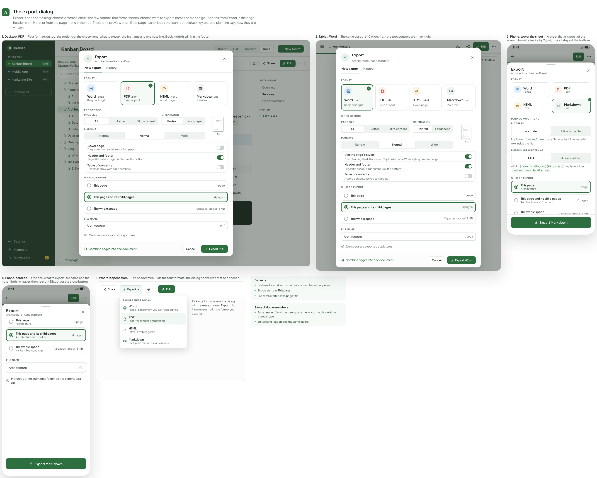
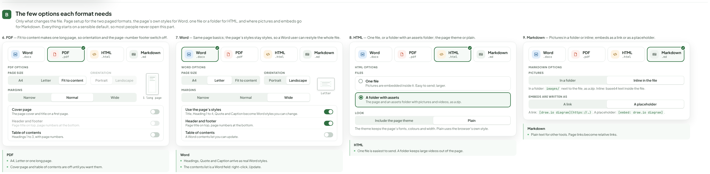
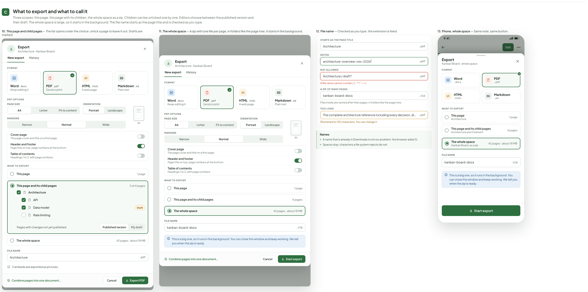
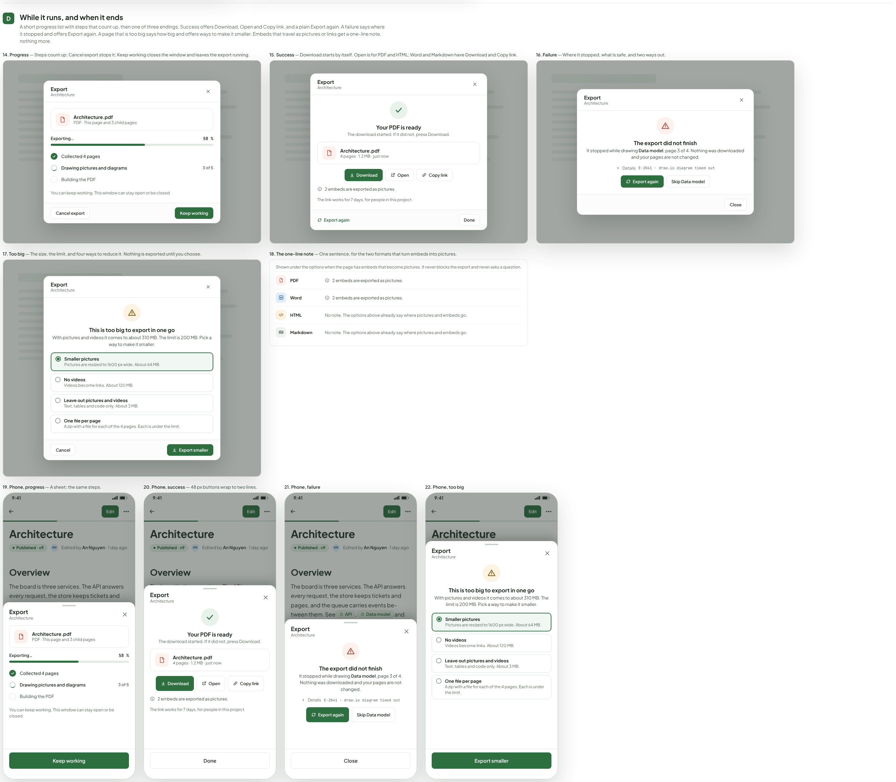
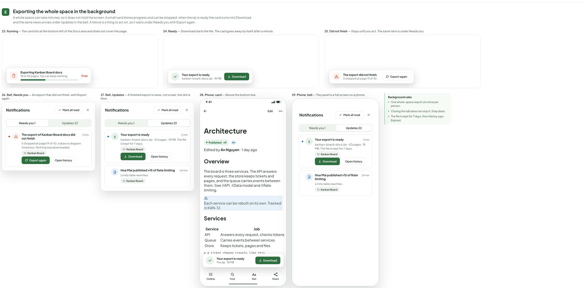
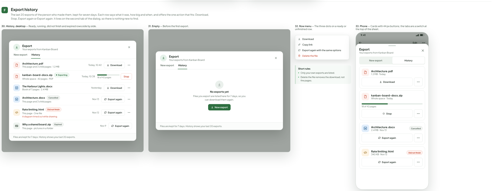
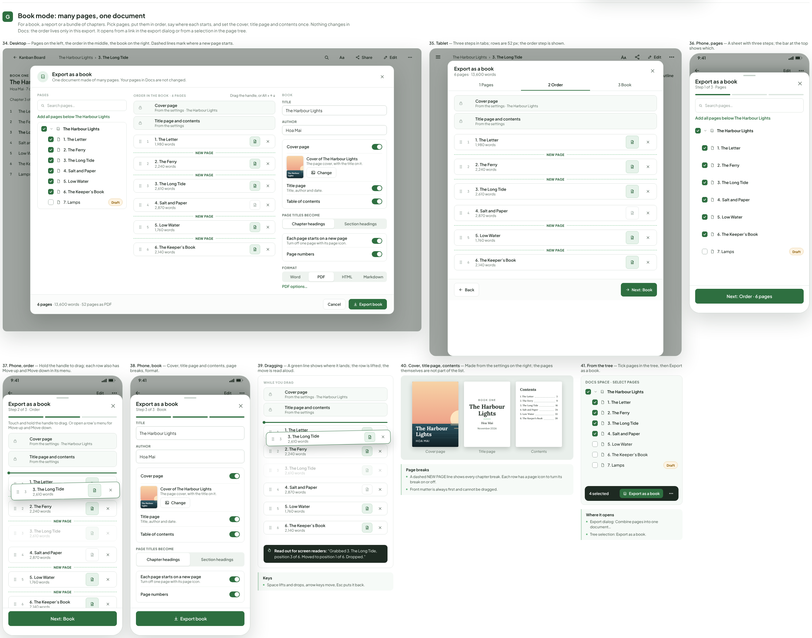
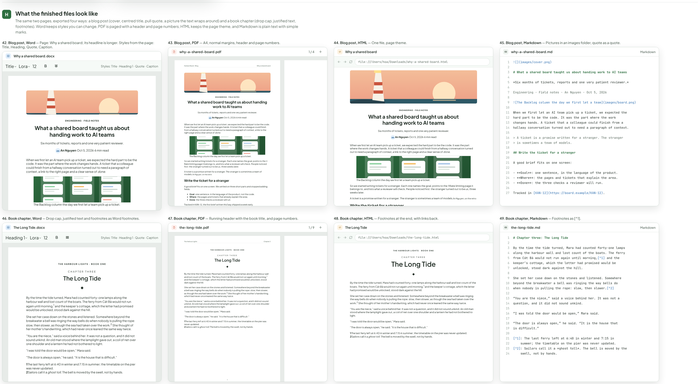
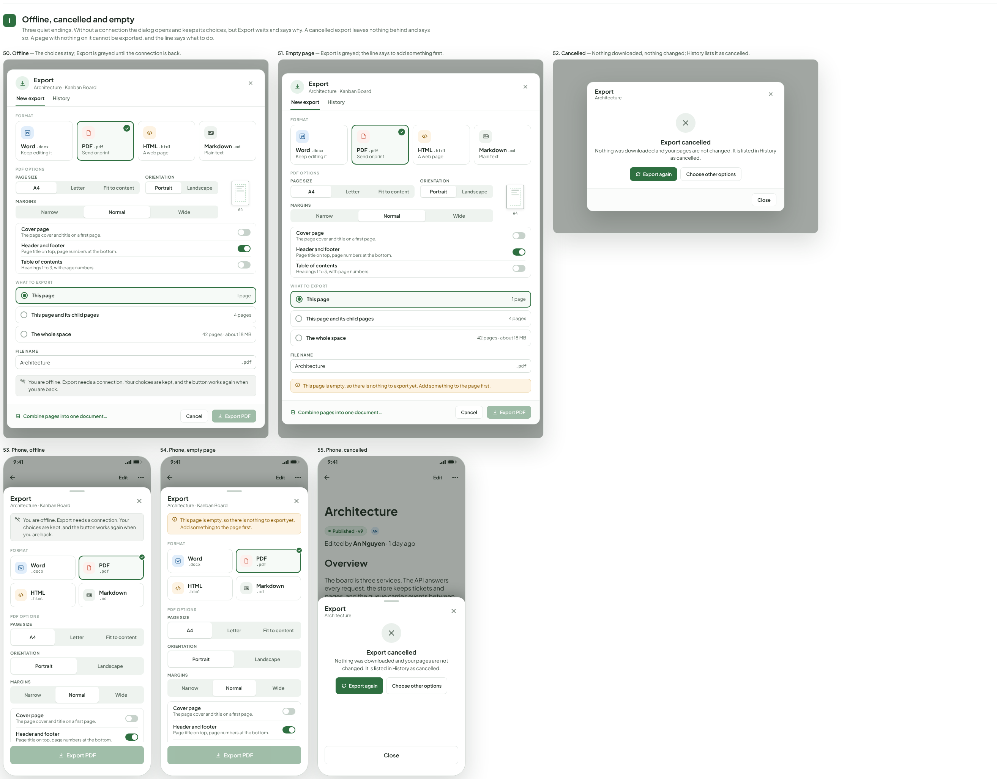

# Rich Docs — export

> New screen (Rich Docs) · canvas `1794929703-2a72` · the board is split into 3 boards on the canvas because a browser cannot paint one board taller than about 8000 px; frame numbers run on across the parts. Sources: [`RichDocsExport1.dc.html`](../source/RichDocsExport1.dc.html) (sha256 `208fcdae8285…`, full value in `MANIFEST.json`), [`RichDocsExport2.dc.html`](../source/RichDocsExport2.dc.html) (sha256 `2ed48a81bbce…`, full value in `MANIFEST.json`), [`RichDocsExport3.dc.html`](../source/RichDocsExport3.dc.html) (sha256 `510056519feb…`, full value in `MANIFEST.json`)

> A new board that lives next to the older Docs boards (it does not replace them). Where a screen already exists in the code, the words follow the code (`ui/src/components/docs/`); the rich-format parts (colours, float images, merged cells, embeds, suggestions, export, public links, highlights) are a design proposal and need the code changes listed at the end. Names, ids, costs and times in the mock-ups are sample data. Frames are numbered on the canvas; desktop is 1360 wide, tablet 820, phone 390.

## SCREENS, NEW — RICH DOCS

- Text in this part: "SCREENS, NEW — RICH DOCS" · "Export" · "Choose a format and go: Word, PDF, HTML or Markdown, for one page, a page with its children or the whole space. The dialog on desktop, tablet and phone; progress, success, failure and files that are too big; background export of a whole space; the history of exports; book mode for one document made of many pages; and what the finished files look like. Sample project: Kanban Board (KAN)."

---

## The export dialog

- Text in this part: "A" · "The export dialog" · "Export is one short dialog: choose a format, check the few options that format needs, choose what to export, name the file and go. It opens from Export in the page header, from More, or from the page menu in the tree. There is no preview step. If the page has embeds that cannot travel as they are, one plain line says how they are written." · "1. Desktop, PDF — Four formats on top, the options of the chosen one, what to export, the file name and one note line. Book mode is a link in the footer." · "KANBAN" · "PROJECTS" · "Kanban Board" · "KAN" · "Mobile App" · "MOB" · "Marketing Site" · "MKT" · "New Project" · "Settings" · "Members" · "Recycle Bin" · "3" · "Board" · "List" · "Timeline" · "Docs" · "New Ticket" · "DOCS SPACE" · "Space: Kanban Board" · "Search pages…" · "/" · "Overview" · "Requirements" · "Auth" · "Billing" · "Architecture" · "API" · "Data model" · "Rate limiting" · "Decision log" · "Meeting notes" · "Blog" · "Why a shared board" · "The Harbour Lights" · "3. The Long Tide" · "New page" · "›" · "Share" · "Edit" · "Published · v9" · "AN" · "Edited by An Nguyen · 1 day ago" · "The board is three services. The API answers every request, the store keeps tickets and pages, and the queue carries events between them. See" · "API," · "Data model and" · "Rate limiting." · "Each service can be rebuilt on its own. Tracked in" · "KAN-12." · "Services" · "Service	Job	Owner" · "API	Answers every request, checks tokens	Hoa Mai" · "Queue	Carries events between services	Tuan Vo" · "Store	Keeps tickets, pages and files	An Nguyen" · "# A ticket change travels like this" · "client  -> api" · "api     -> store   # write" · "api     -> queue   # event" · "Open questions" · "Where do files live" · "One queue or two" · "KAN-31" · "ON THIS PAGE" · "5 min left" · "Back to top" · "Export" · "Architecture · Kanban Board" · "New export" · "History" · "FORMAT" · "Word .docx" · "Keep editing it" · "PDF .pdf" · "Send or print" · "HTML .html" · "A web page" · "Markdown .md" · "Plain text" · "PDF OPTIONS" · "PAGE SIZE" · "A4" · "Letter" · "Fit to content" · "ORIENTATION" · "Portrait" · "Landscape" · "MARGINS" · "Narrow" · "Normal" · "Wide" · "Cover page" · "The page cover and title on a first page." · "Header and footer" · "Page title on top, page numbers at the bottom." · "Table of contents" · "Headings 1 to 3, with page numbers." · "WHAT TO EXPORT" · "This page" · "1 page" · "This page and its child pages" · "4 pages" · "The whole space" · "42 pages · about 18 MB" · "FILE NAME" · ".pdf" · "2 embeds are exported as pictures."

---

## The few options each format needs

- Text in this part: "B" · "The few options each format needs" · "Only what changes the file. Page setup for the two paged formats, the page’s own styles for Word, one file or a folder for HTML, and where pictures and embeds go for Markdown. Everything starts on a sensible default, so most people never open this part." · "6. PDF — Fit to content makes one long page, so orientation and the page-number footer switch off." · "Word" · ".docx" · "PDF" · ".pdf" · "HTML" · ".html" · "Markdown" · ".md" · "PDF OPTIONS" · "PAGE SIZE" · "A4" · "Letter" · "Fit to content" · "ORIENTATION" · "Portrait" · "Landscape" · "MARGINS" · "Narrow" · "Normal" · "Wide" · "1 long page" · "Cover page" · "The page cover and title on a first page." · "Header and footer" · "Page title on top, page numbers at the bottom." · "Table of contents" · "Headings 1 to 3, with page numbers." · "A4, Letter or one long page." · "Cover page and table of contents are off until you want them." · "7. Word — Same page basics; the page’s styles stay styles, so a Word user can restyle the whole file." · "WORD OPTIONS" · "Use the page’s styles" · "Title, Heading 1 to 4, Quote and Caption become Word styles you can change." · "A Word contents list you can update." · "Headings, Quote and Caption arrive as real Word styles." · "The contents list is a Word field: right-click, Update." · "8. HTML — One file, or a folder with an assets folder; the page theme or plain." · "HTML OPTIONS" · "FILES" · "One file" · "Pictures are embedded inside it. Easy to send; larger." · "A folder with assets" · "The page and an assets folder with pictures and videos, as a zip." · "LOOK" · "Include the page theme" · "Plain" · "The theme keeps the page’s fonts, colours and width. Plain uses the browser’s own style." · "One file is easiest to send. A folder keeps large videos out of the page." · "9. Markdown — Pictures in a folder or inline; embeds as a link or as a placeholder." · "MARKDOWN OPTIONS" · "PICTURES" · "In a folder" · "Inline in the file" · "In a folder: images/ next to the file, as a zip. Inline: base64 text inside the file." · "EMBEDS ARE WRITTEN AS" · "A link" · "A placeholder" · "A link: [draw.io diagram](https://…). A placeholder: [embed: draw.io diagram]." · "Plain text for other tools. Page links become relative links."

---

## What to export and what to call it

- Text in this part: "C" · "What to export and what to call it" · "Three scopes: this page, this page with its children, the whole space as a zip. Children can be unticked one by one. Editors choose between the published version and their draft. The whole space is large, so it starts in the background. The file name starts as the page title and is checked as you type." · "10. This page and child pages — The list opens under the choice: untick a page to leave it out. Drafts are marked." · "Export" · "Architecture · Kanban Board" · "New export" · "History" · "FORMAT" · "Word .docx" · "Keep editing it" · "PDF .pdf" · "Send or print" · "HTML .html" · "A web page" · "Markdown .md" · "Plain text" · "PDF OPTIONS" · "PAGE SIZE" · "A4" · "Letter" · "Fit to content" · "ORIENTATION" · "Portrait" · "Landscape" · "MARGINS" · "Narrow" · "Normal" · "Wide" · "Cover page" · "The page cover and title on a first page." · "Header and footer" · "Page title on top, page numbers at the bottom." · "Table of contents" · "Headings 1 to 3, with page numbers." · "WHAT TO EXPORT" · "This page" · "1 page" · "This page and its child pages" · "3 of 4 pages" · "Architecture" · "API" · "Data model" · "Draft" · "Rate limiting" · "Pages with changes not yet published" · "Published version" · "My draft" · "The whole space" · "42 pages · about 18 MB" · "FILE NAME" · ".pdf" · "2 embeds are exported as pictures." · "Combine pages into one document…" · "Cancel" · "Export PDF" · "11. The whole space — A zip with one file per page, in folders like the page tree. It starts in the background." · "4 pages" · "kanban-board-docs" · ".zip" · "This is a big one, so it runs in the background. You can close this window and keep working. We tell you when the zip is ready." · "Start export" · "12. File name — Checked as you type; the extension is fixed." · "STARTS AS THE PAGE TITLE" · "EDITED" · "architecture-overview-nov-2026" · "NOT ALLOWED" · "Architecture / draft?" · "A file name cannot contain / \ : * ? " < > |" · "A ZIP OF MANY PAGES" · "Files inside are named after their pages, in folders like the page tree." · "TOO LONG" · "The complete architecture reference including every decision, diagram and meeting note we wrote in 2026" · "Shortened to 120 characters. You can change it." · "Names" · "A name that is already in Downloads is not our problem: the browser adds (1)." · "Spaces stay; characters a file system rejects do not." · "13. Phone, whole space — Same note, same button." · "9:41" · "Edit" · "Published · v9" · "AN" · "Edited by An Nguyen · 1 day ago" · "Overview" · "The board is three services. The API answers every request, the store keeps tickets and pages, and the queue carries events between them. See" · "API," · "Data model and" · "Rate limiting." · "Each service can be rebuilt on its own. Tracked in" · "KAN-12." · "Services" · "Service	Job	Owner" · "API	Answers every request, checks tokens	Hoa Mai" · "Queue	Carries events between services	Tuan Vo" · "Store	Keeps tickets, pages and files	An Nguyen" · "# A ticket change travels like this" · "client  -> api" · "api     -> store   # write" · "api     -> queue   # event" · "Open questions" · "Where do files live" · "One queue or two" · "KAN-31" · "Outline" · "Find" · "Text" · "Share" · "Kanban Board · whole space" · "Word" · ".docx"

---

## While it runs, and when it ends

- Text in this part: "D" · "While it runs, and when it ends" · "A short progress list with steps that count up, then one of three endings. Success offers Download, Open and Copy link, and a plain Export again. A failure says where it stopped and offers Export again. A page that is too big says how big and offers ways to make it smaller. Embeds that travel as pictures or links get a one-line note, nothing more." · "14. Progress — Steps count up; Cancel export stops it; Keep working closes the window and leaves the export running." · "Export" · "Architecture" · "Architecture.pdf" · "PDF · This page and 3 child pages" · "Exporting…" · "58 %" · "Collected 4 pages" · "Drawing pictures and diagrams" · "3 of 5" · "Building the PDF" · "You can keep working. This window can stay open or be closed." · "Cancel export" · "Keep working" · "15. Success — Download starts by itself. Open is for PDF and HTML; Word and Markdown have Download and Copy link." · "Your PDF is ready" · "The download started. If it did not, press Download." · "4 pages · 1.2 MB · just now" · "Download" · "Open" · "Copy link" · "2 embeds are exported as pictures." · "The link works for 7 days, for people in this project." · "Export again" · "Done" · "16. Failure — Where it stopped, what is safe, and two ways out." · "The export did not finish" · "It stopped while drawing Data model, page 3 of 4. Nothing was downloaded and your pages are not changed." · "Details" · "E-2041 · draw.io diagram timed out" · "Skip Data model" · "Close" · "17. Too big — The size, the limit, and four ways to reduce it. Nothing is exported until you choose." · "This is too big to export in one go" · "With pictures and videos it comes to about 310 MB. The limit is 200 MB. Pick a way to make it smaller." · "Smaller pictures" · "Pictures are resized to 1600 px wide. About 64 MB." · "No videos" · "Videos become links. About 120 MB." · "Leave out pictures and videos" · "Text, tables and code only. About 3 MB." · "One file per page" · "A zip with a file for each of the 4 pages. Each is under the limit." · "Cancel" · "Export smaller" · "18. The one-line note — One sentence, for the two formats that turn embeds into pictures." · "Shown under the options when the page has embeds that become pictures. It never blocks the export and never asks a question." · "PDF" · "Word" · "HTML" · "No note. The options above already say where pictures and embeds go." · "Markdown" · "19. Phone, progress — A sheet; the same steps." · "9:41" · "Edit" · "Published · v9" · "AN" · "Edited by An Nguyen · 1 day ago" · "Overview" · "The board is three services. The API answers every request, the store keeps tickets and pages, and the queue carries events between them. See" · "API," · "Data model and" · "Rate limiting." · "Each service can be rebuilt on its own. Tracked in" · "KAN-12." · "Services" · "Service	Job	Owner" · "API	Answers every request, checks tokens	Hoa Mai" · "Queue	Carries events between services	Tuan Vo" · "Store	Keeps tickets, pages and files	An Nguyen" · "# A ticket change travels like this" · "client  -> api" · "api     -> store   # write" · "api     -> queue   # event" · "Open questions" · "Where do files live" · "One queue or two" · "KAN-31" · "Outline" · "Find" · "Text" · "Share" · "20. Phone, success — 48 px buttons wrap to two lines." · "21. Phone, failure" · "22. Phone, too big"

---

## Exporting the whole space in the background

- Text in this part: "E" · "Exporting the whole space in the background" · "A whole space can take minutes, so it does not hold the screen. A small card shows progress and can be stopped; when the zip is ready the card turns into Download, and the same news arrives under Updates in the bell. A failure is a thing to act on, so it waits under Needs you with Export again." · "23. Running — The card sits at the bottom left of the Docs area and does not cover the page." · "Exporting Kanban Board docs" · "18 of 42 pages. You can keep working." · "Stop" · "24. Ready — Download starts the file. The card goes away by itself after a minute." · "Your export is ready" · "kanban-board-docs.zip · 18 MB" · "Download" · "25. Did not finish — Stays until you act. The same item is under Needs you." · "The export did not finish" · "It stopped at page 19 of 42." · "Export again" · "26. Bell, Needs you — An export that did not finish, with Export again." · "Notifications" · "Mark all read" · "Needs you 1" · "Updates 22" · "The export of Kanban Board docs did not finish" · "4 min" · "It stopped at page 19 of 42: a draw.io diagram timed out. Nothing was downloaded." · "Kanban Board" · "Open history" · "27. Bell, Updates — A finished export is news, not a task; the dot is blue." · "2 min" · "kanban-board-docs.zip · 42 pages · 18 MB. The file is kept for 7 days." · "Hoa Mai published v15 of Rate limiting" · "34 min" · "Limits table rewritten." · "28. Phone, card — Above the bottom bar." · "9:41" · "Edit" · "Architecture" · "Published · v9" · "AN" · "Edited by An Nguyen · 1 day ago" · "Overview" · "The board is three services. The API answers every request, the store keeps tickets and pages, and the queue carries events between them. See API, Data model and Rate limiting." · "Each service can be rebuilt on its own. Tracked in KAN-12." · "Services" · "Service	Job	Owner" · "API	Answers every request, checks tokens	Hoa Mai" · "Queue	Carries events between services	Tuan Vo" · "Store	Keeps tickets, pages and files	An Nguyen" · "# A ticket change travels like this" · "client  -> api" · "api     -> store   # write" · "api     -> queue   # event" · "Open questions" · "Where do files live" · "One queue or two KAN-31" · "Outline" · "Find" · "Text" · "Share" · "The zip · 18 MB" · "29. Phone, bell — The panel is a full screen on a phone." · "Background rules" · "One whole-space export at a time per person." · "Closing the tab does not stop it; Stop does." · "The file is kept for 7 days, then History says Expired."

---

## Export history

- Text in this part: "F" · "Export history" · "The last 20 exports of the person who made them, kept for seven days. Each row says what it was, how big and when, and offers the one action that fits: Download, Stop, Export again or Export again. It lives on the second tab of the dialog, so there is nothing new to find." · "30. History, desktop — Ready, running, did not finish and expired rows side by side." · "Export" · "Your exports from Kanban Board" · "New export" · "History" · "Architecture.pdf" · "This page and 3 child pages · 1.2 MB" · "Today, 10:42" · "Download" · "kanban-board-docs.zip" · "Exporting" · "Whole space · 42 pages · PDF" · "Today, 10:38" · "18 of 42 pages" · "Stop" · "The Harbour Lights.docx" · "Book of 7 pages · 2.4 MB" · "Yesterday" · "Architecture.docx" · "Cancelled" · "This page and 3 child pages" · "Nov 13" · "Export again" · "Rate limiting.html" · "Did not finish" · "This page · One file" · "A diagram timed out while drawing." · "Nov 12" · "Why a shared board.zip" · "Expired" · "This page · pictures in a folder" · "Nov 9" · "Files are kept for 7 days. History shows your last 20 exports." · "31. Empty — Before the first export." · "No exports yet" · "Files you export are listed here for 7 days, so you can download them again." · "32. Row menu — The three dots on a ready or unfinished row." · "Copy link" · "Export again with the same options" · "Delete the file" · "Short rules" · "Only your own exports are listed." · "Delete the file removes the download, not the pages." · "33. Phone — Cards with 44 px buttons; the tabs are a switch at the top of the sheet." · "9:41" · "Edit" · "Architecture" · "Published · v9" · "AN" · "Edited by An Nguyen · 1 day ago" · "Overview" · "The board is three services. The API answers every request, the store keeps tickets and pages, and the queue carries events between them. See API, Data model and Rate limiting." · "Each service can be rebuilt on its own. Tracked in KAN-12." · "Services" · "Service	Job	Owner" · "API	Answers every request, checks tokens	Hoa Mai" · "Queue	Carries events between services	Tuan Vo" · "Store	Keeps tickets, pages and files	An Nguyen" · "# A ticket change travels like this" · "client  -> api" · "api     -> store   # write" · "api     -> queue   # event" · "Open questions" · "Where do files live" · "One queue or two KAN-31" · "Outline" · "Find" · "Text" · "Share" · "1.2 MB · Today" · "Whole space · Today" · "2.4 MB · Nov 13" · "340 KB · Nov 12"

---

## Book mode: many pages, one document

- Text in this part: "G" · "Book mode: many pages, one document" · "For a book, a report or a bundle of chapters. Pick pages, put them in order, say where each starts, and set the cover, title page and contents once. Nothing changes in Docs: the order lives only in this export. It opens from a link in the export dialog or from a selection in the page tree." · "34. Desktop — Pages on the left, the order in the middle, the book on the right. Dashed lines mark where a new page starts." · "Kanban Board" · "The Harbour Lights" · "›" · "3. The Long Tide" · "Aa" · "Share" · "Edit" · "BOOK ONE" · "Hoa Mai · 7 chapters · 1 h 20 min" · "Chapter 3 of 7" · "1" · "The Letter" · "2" · "The Ferry" · "3" · "The Long Tide" · "4" · "Salt and Paper" · "5" · "Low Water" · "6" · "The Keeper’s Book" · "7" · "Lamps" · "THE HARBOUR LIGHTS · BOOK ONE" · "CHAPTER THREE" · "◆" · "By the time the tide turned, Mara had counted forty-one lamps along the harbour wall and lost count of the boats. The ferry from Cát Bà would not run again until morning,1 and the keeper’s cottage, which the letter had promised would be unlocked, stood dark against the hill." · "She set her case down on the stones and listened. Somewhere beyond the breakwater a bell was ringing the way bells do when nobody is pulling the rope: slow, then slower, as though the sea had taken over the work.2 She thought of her mother’s handwriting, which had never once leaned the same way twice." · "“You are the niece,” said a voice behind her. It was not a question, and it did not sound unkind. An old man stood where the lamplight gave out, a coil of net over one shoulder and a lantern he had not bothered to light." · "“I was told the door would be open,” Mara said." · "“The door is always open,” he said. “It is the house that is difficult.”" · "1The last ferry left at 6:40 in winter and 7:15 in summer; the timetable on the pier was never updated." · "2Sailors call it a ghost toll. The bell is moved by the swell, not by hands." · "ON THIS PAGE" · "Dusk" · "The bell" · "The keeper" · "5 min left" · "Back to top" · "Export as a book" · "One document made of many pages. Your pages in Docs are not changed." · "PAGES" · "Search pages…" · "Add all pages below The Harbour Lights" · "1. The Letter" · "2. The Ferry" · "4. Salt and Paper" · "5. Low Water" · "6. The Keeper’s Book" · "7. Lamps" · "Draft" · "ORDER IN THE BOOK · 6 PAGES" · "Drag the handle, or Alt + ↑ ↓" · "Cover page" · "From the settings · The Harbour Lights" · "Title page and contents" · "From the settings" · "1,980 words" · "NEW PAGE" · "2,240 words" · "2,610 words" · "2,870 words" · "1,760 words" · "2,140 words" · "BOOK" · "TITLE" · "AUTHOR" · "Hoa Mai" · "Cover of The Harbour Lights" · "The page cover, with the title on it." · "Change" · "Title page" · "Title, author and date." · "Table of contents" · "PAGE TITLES BECOME" · "Chapter headings" · "Section headings" · "Each page starts on a new page" · "Turn off one page with its page icon." · "Page numbers" · "FORMAT" · "Word" · "PDF" · "HTML" · "Markdown" · "PDF options…" · "6 pages · 13,600 words · 52 pages as PDF" · "Cancel" · "Export book" · "35. Tablet — Three steps in tabs; rows are 52 px; the order step is shown." · "Outline" · "6 pages · 13,600 words" · "1 Pages" · "2 Order" · "3 Book" · "Back" · "Next: Book" · "36. Phone, pages — A sheet with three steps; the bar at the top shows which." · "9:41" · "Find" · "Text" · "Step 1 of 3 · Pages" · "Next: Order · 6 pages" · "37. Phone, order — Hold the handle to drag; each row also has Move up and Move down in its menu." · "Step 2 of 3 · Order"

---

## What the finished files look like

- Text in this part: "H" · "What the finished files look like" · "The same two pages, exported four ways: a blog post (cover, centred title, pull quote, a picture the text wraps around) and a book chapter (drop cap, justified text, footnotes). Word keeps styles you can change, PDF is paged with a header and page numbers, HTML keeps the page theme, and Markdown is plain text with simple marks." · "42. Blog post, Word — Page: Why a shared board; its headline is longer. Styles from the page: Title, Heading, Quote, Caption." · "Why a shared board.docx" · "Title" · "Lora" · "12" · "Styles: Title · Heading 1 · Quote · Caption" · "ENGINEERING · FIELD NOTES" · "What a shared board taught us about handing work to AI teams" · "Six months of tickets, reports and one very patient reviewer." · "ANAn Nguyen·Oct 5, 2026·6 min read" · "When we first let an AI team pick up a ticket, we expected the hard part to be the code. It was the part where the work changes hands. A ticket that a colleague could finish from a hallway conversation turned out to need a paragraph of context, a link to the right page and a clear sense of done." · "The Backlog column the day we first let a team pick up a ticket." · "So we started writing tickets for a stranger. Each one names the goal, points to the Rate limiting page it belongs to, and lists what a reviewer will check. People noticed first: the stranger turned out to be us, three weeks later." · "A ticket is a promise written for a stranger. The stranger is sometimes a team of models.An Nguyen, on the retro" · "Write the ticket for a stranger" · "A good brief fits on one screen. We settled on three short parts and stopped adding fields:" · "Goal: one sentence, in the language of the product, not the code." · "Where: the pages and tickets that already explain the area." · "Done: the three checks a reviewer will run." · "Tracked in KAN-12, the first brief written this way shipped a week early." · "Read the report, not the log" · "The log tells you what happened. The report tells you what the team decided and what it wants you to look at. We read the second and open the first only when something smells." · "43. Blog post, PDF — A4, normal margins, header and page numbers." · "why-a-shared-board.pdf" · "1 / 4" · "Kanban Board · Blog" · "Why a shared board" · "1" · "44. Blog post, HTML — One file, page theme." · "file:///Users/hoa/Downloads/why-a-shared-board.html" · "45. Blog post, Markdown — Pictures in an images folder, quote as a quote." · "why-a-shared-board.md" · "Markdown" · "2" · "3" · "4" · "5" · "6" · "7" · "8" · "9" · "10" · "11" · "13" · "14" · "15" · "16" · "17" · "18" · "19" · "20" · "21" · "22" · "23" · "24" · "25" · "26" · "27" · "" · "# What a shared board taught us about handing work to AI teams" · "*Six months of tickets, reports and one very patient reviewer.*" · "Engineering · Field notes · An Nguyen · Oct 5, 2026" · "" · "When we first let an AI team pick up a ticket, we expected the" · "hard part to be the code. It was the part where the work" · "changes hands. A ticket that a colleague could finish from a" · "hallway conversation turned out to need a paragraph of context." · "> A ticket is a promise written for a stranger. The stranger" · "> is sometimes a team of models." · "## Write the ticket for a stranger" · "A good brief fits on one screen:" · "- **Goal**: one sentence, in the language of the product." · "- **Where**: the pages and tickets that explain the area." · "- **Done**: the three checks a reviewer will run." · "Tracked in [KAN-12](https://board.example/KAN-12)." · "46. Book chapter, Word — Drop cap, justified text and footnotes as Word footnotes." · "The Long Tide.docx" · "Heading 1" · "THE HARBOUR LIGHTS · BOOK ONE" · "CHAPTER THREE" · "The Long Tide" · "◆" · "By the time the tide turned, Mara had counted forty-one lamps along the harbour wall and lost count of the boats. The ferry from Cát Bà would not run again until morning,1 and the keeper’s cottage, which the letter had promised would be unlocked, stood dark against the hill." · "She set her case down on the stones and listened. Somewhere beyond the breakwater a bell was ringing the way bells do when nobody is pulling the rope: slow, then slower, as though the sea had taken over the work.2 She thought of her mother’s handwriting, which had never once leaned the same way twice." · "“You are the niece,” said a voice behind her. It was not a question, and it did not sound unkind. An old man stood where the lamplight gave out, a coil of net over one shoulder and a lantern he had not bothered to light." · "“I was told the door would be open,” Mara said." · "“The door is always open,” he said. “It is the house that is difficult.”" · "1The last ferry left at 6:40 in winter and 7:15 in summer; the timetable on the pier was never updated." · "2Sailors call it a ghost toll. The bell is moved by the swell, not by hands." · "47. Book chapter, PDF — Running header with the book title, and page numbers." · "the-long-tide.pdf" · "1 / 9" · "The Harbour Lights" · "Chapter 3" · "48. Book chapter, HTML — Footnotes at the end, with links back." · "file:///Users/hoa/Downloads/the-long-tide.html" · "49. Book chapter, Markdown — Footnotes as [^1]." · "the-long-tide.md" · "# Chapter three: The Long Tide" · "By the time the tide turned, Mara had counted forty-one lamps" · "along the harbour wall and lost count of the boats. The ferry" · "from Cát Bà would not run again until morning,[^1] and the" · "keeper’s cottage, which the letter had promised would be" · "unlocked, stood dark against the hill." · "She set her case down on the stones and listened. Somewhere" · "beyond the breakwater a bell was ringing the way bells do" · "when nobody is pulling the rope: slow, then slower.[^2]"

---

## Offline, cancelled and empty

- Text in this part: "I" · "Offline, cancelled and empty" · "Three quiet endings. Without a connection the dialog opens and keeps its choices, but Export waits and says why. A cancelled export leaves nothing behind and says so. A page with nothing on it cannot be exported, and the line says what to do." · "50. Offline — The choices stay; Export is greyed until the connection is back." · "Export" · "Architecture · Kanban Board" · "New export" · "History" · "FORMAT" · "Word .docx" · "Keep editing it" · "PDF .pdf" · "Send or print" · "HTML .html" · "A web page" · "Markdown .md" · "Plain text" · "PDF OPTIONS" · "PAGE SIZE" · "A4" · "Letter" · "Fit to content" · "ORIENTATION" · "Portrait" · "Landscape" · "MARGINS" · "Narrow" · "Normal" · "Wide" · "Cover page" · "The page cover and title on a first page." · "Header and footer" · "Page title on top, page numbers at the bottom." · "Table of contents" · "Headings 1 to 3, with page numbers." · "WHAT TO EXPORT" · "This page" · "1 page" · "This page and its child pages" · "4 pages" · "The whole space" · "42 pages · about 18 MB" · "FILE NAME" · "Architecture" · ".pdf" · "You are offline. Export needs a connection. Your choices are kept, and the button works again when you are back." · "Combine pages into one document…" · "Cancel" · "Export PDF" · "51. Empty page — Export is greyed; the line says to add something first." · "This page is empty, so there is nothing to export yet. Add something to the page first." · "52. Cancelled — Nothing downloaded, nothing changed; History lists it as cancelled." · "Export cancelled" · "Nothing was downloaded and your pages are not changed. It is listed in History as cancelled." · "Export again" · "Choose other options" · "Close" · "53. Phone, offline" · "9:41" · "Edit" · "Published · v9" · "AN" · "Edited by An Nguyen · 1 day ago" · "Overview" · "The board is three services. The API answers every request, the store keeps tickets and pages, and the queue carries events between them. See API, Data model and Rate limiting." · "Each service can be rebuilt on its own. Tracked in KAN-12." · "Services" · "Service	Job	Owner" · "API	Answers every request, checks tokens	Hoa Mai" · "Queue	Carries events between services	Tuan Vo" · "Store	Keeps tickets, pages and files	An Nguyen" · "# A ticket change travels like this" · "client  -> api" · "api     -> store   # write" · "api     -> queue   # event" · "Open questions" · "Where do files live" · "One queue or two KAN-31" · "Outline" · "Find" · "Text" · "Share" · "Word" · ".docx" · "PDF" · "HTML" · ".html" · "Markdown" · ".md" · "Architecture and 3 below it" · "Kanban Board, as a zip" · "54. Phone, empty page" · "55. Phone, cancelled"

---

## Frames, code that must change, and decisions for the owner

## RichDocsExport (2730 wide, finalH 14613, 55 frames)
A (1-5) Dialog: desktop PDF, tablet Word, phone sheet (top, scrolled), header menu. B (6-9) Options per format. C (10-13) Scope with child list, whole space, file name, phone. D (14-22) Progress, success, failure, too big, one-line note, four phones. E (23-29) Background export: running, ready, did not finish, bell Needs you and Updates, phone card and bell. F (30-33) History (with Cancelled), empty, row menu, phone. G (34-41) Book mode. H (42-49) Finished files (blog post and book chapter as Word, PDF, HTML, Markdown). I (50-55) Offline, empty page, cancelled, three phones.

## RichDocsStates (2730 wide, finalH 26487, 83 frames)
A (1-7) Loading. B (8-12) Converting. C (13-20) Saving. D (21-28) Offline. E (29-37) Two editors. F (38-48) Session ended, no access, deleted, Recycle Bin, not found, Docs off. G (49-56) Limits and browsers. H (57-61) Viewer and Docs team at work. I (62-67) Search. J (68-75) Accessibility. K (76-80) Dark mode (proposal). L (81-83) Docs off for a non-admin, with two phone frames.

## Code must change
- Export for four formats from the rich format; options per format; background whole-space job; files kept 7 days; history of the last 20; "Export again"; size limit; "Needs you" for a failed export.
- Book mode (order lives only in the export); page-tree multi-select "Export as a book".
- Block-level merge and a block-by-block conflict dialog replace the line-based ConflictBanner diff.
- Save-status chip with six states; offline queue including pictures; the offline banner string ("Editing is off until you reconnect" is replaced: offline editing is queued; the banner also carries the version).
- Conversion status per page; presence chip.
- Limits: image 10 MB, video 200 MB, file 100 MB, HTML 512 KB, page 50 MB (warning at 75 %).
- Blocked-embed block; storage quota dialog; browser capability check; viewer role UI; AI hold shown as paused blocks.
- Search markers for table, caption, alt text, code and comment.
- Readability check (never blocks Publish); reduced-motion handling.
- Restore toast with Undo.

## Decisions for the owner
- Dark mode is a proposal (the app has no dark theme).
- Offline editing is allowed (queued changes, merged on reconnect).
- Files kept 7 days, 20 in history; 200 MB export limit; whole-space export runs in the background, one at a time; failed export goes to Needs you, ready goes to Updates; editors can export the published version or the draft.
- The Docs team never locks the whole page, only the blocks it is changing; "also editing" presence chip.
- Search does not read inside pictures or videos.
- A failed page conversion keeps the original Markdown read-only.
- Palette: the names and values of the Editor board.
