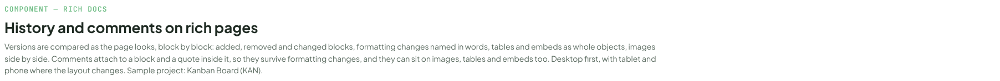
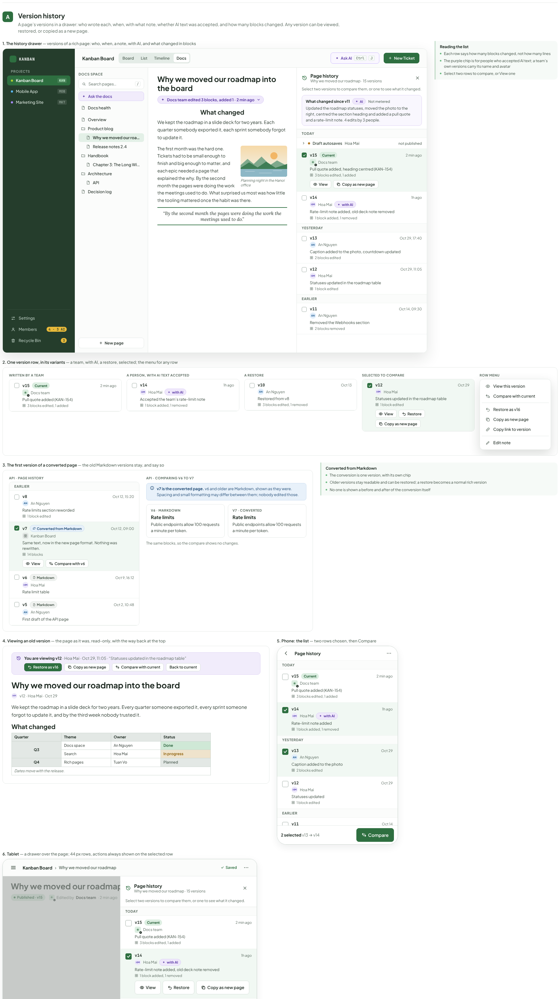
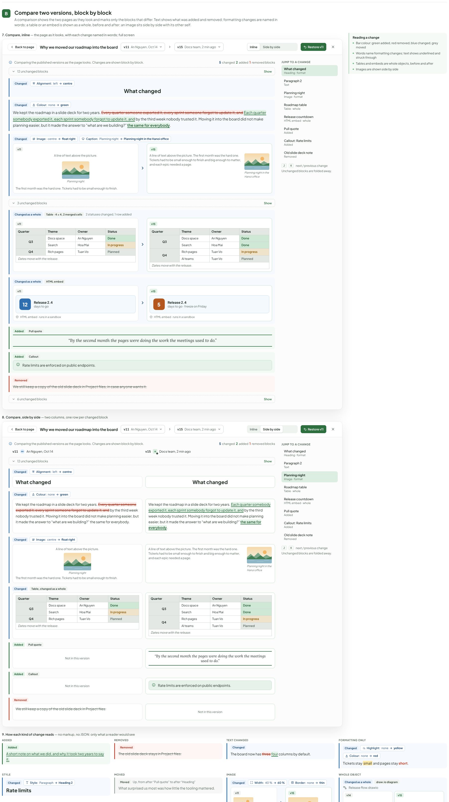
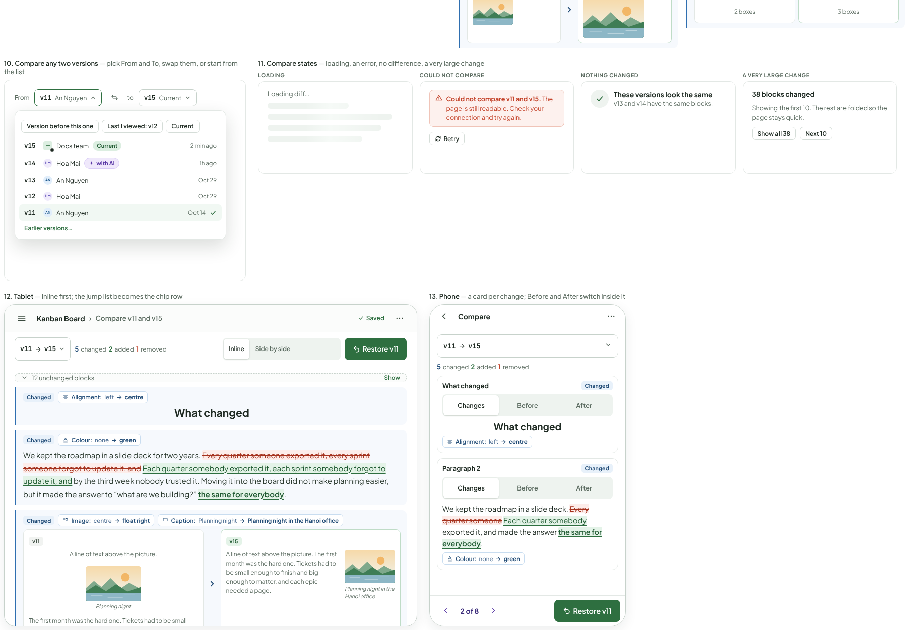
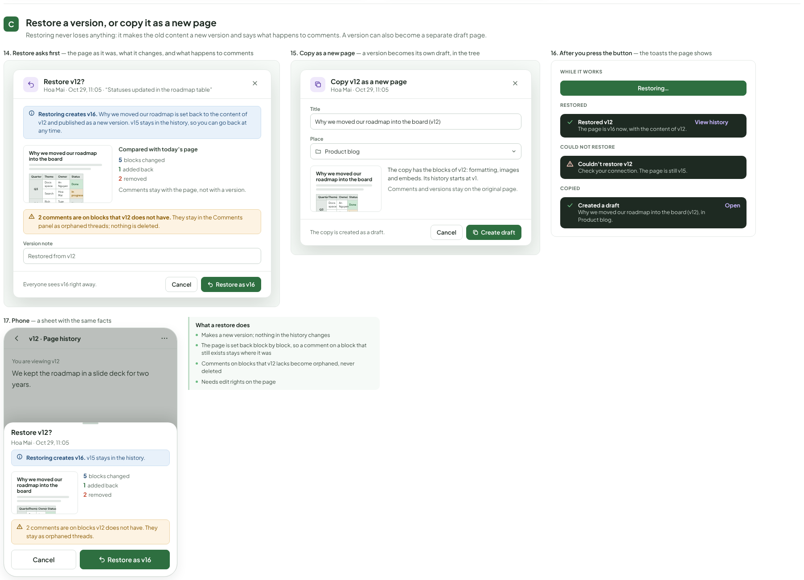
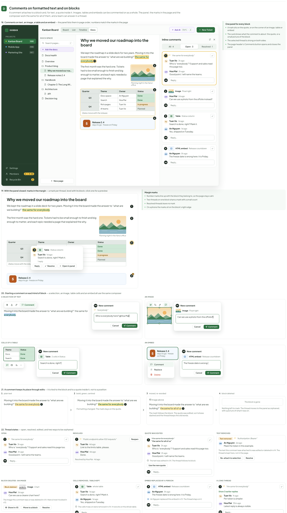
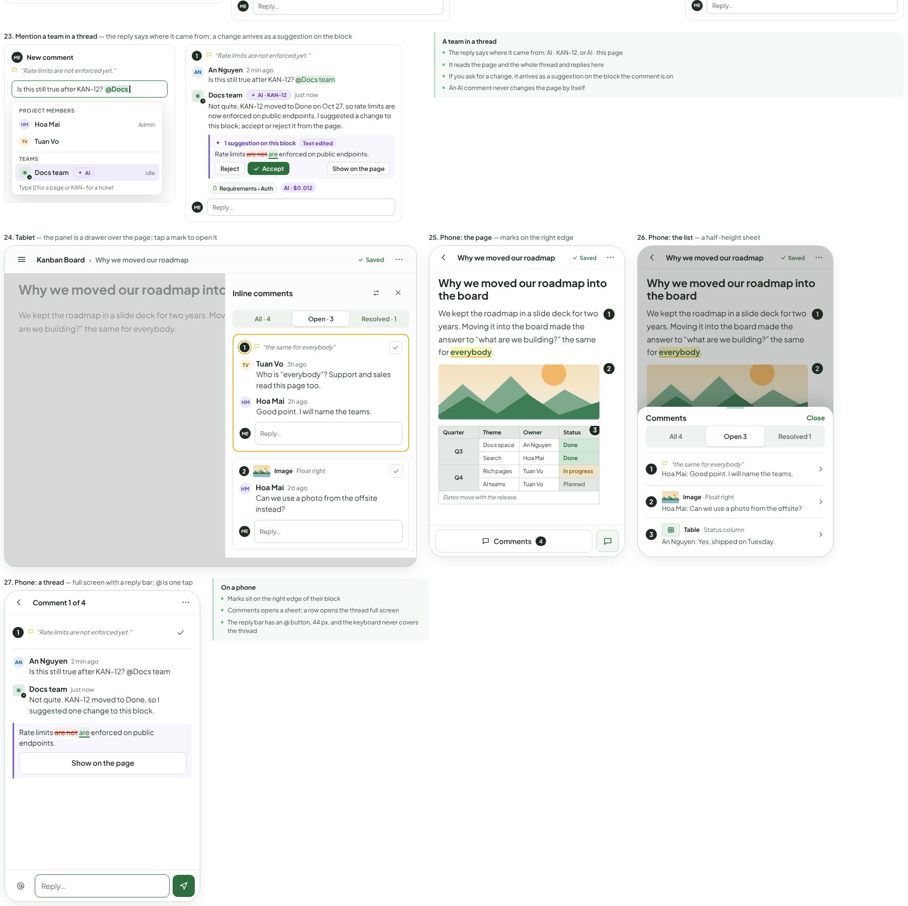

# Rich Docs — history & comments

> New screen (Rich Docs) · canvas `1794929703-2a72` · the board is split into 3 boards on the canvas because a browser cannot paint one board taller than about 8000 px; frame numbers run on across the parts. Sources: [`RichDocsHistory1.dc.html`](../source/RichDocsHistory1.dc.html) (sha256 `a374c467275a…`, full value in `MANIFEST.json`), [`RichDocsHistory2.dc.html`](../source/RichDocsHistory2.dc.html) (sha256 `98d3c960a65e…`, full value in `MANIFEST.json`), [`RichDocsHistory3.dc.html`](../source/RichDocsHistory3.dc.html) (sha256 `84e7a39e3ef6…`, full value in `MANIFEST.json`)

> A new board that lives next to the older Docs boards (it does not replace them). Where a screen already exists in the code, the words follow the code (`ui/src/components/docs/`); the rich-format parts (colours, float images, merged cells, embeds, suggestions, export, public links, highlights) are a design proposal and need the code changes listed at the end. Names, ids, costs and times in the mock-ups are sample data. Frames are numbered on the canvas; desktop is 1360 wide, tablet 820, phone 390.

## COMPONENT — RICH DOCS

- Text in this part: "COMPONENT — RICH DOCS" · "History and comments on rich pages" · "Versions are compared as the page looks, block by block: added, removed and changed blocks, formatting changes named in words, tables and embeds as whole objects, images side by side. Comments attach to a block and a quote inside it, so they survive formatting changes, and they can sit on images, tables and embeds too. Desktop first, with tablet and phone where the layout changes. Sample project: Kanban Board (KAN)."

---

## Version history

- Text in this part: "A" · "Version history" · "A page’s versions in a drawer: who wrote each, when, with what note, whether AI text was accepted, and how many blocks changed. Any version can be viewed, restored, or copied as a new page." · "1. The history drawer — versions of a rich page: who, when, a note, with AI, and what changed in blocks" · "KANBAN" · "PROJECTS" · "Kanban Board" · "KAN" · "Mobile App" · "MOB" · "Marketing Site" · "MKT" · "Settings" · "Members" · "4 · 3 AI" · "Recycle Bin" · "3" · "Board" · "List" · "Timeline" · "Docs" · "Ask AI" · "Ctrl" · "J" · "New Ticket" · "DOCS SPACE" · "Search pages…" · "/" · "Ask the docs" · "Docs health" · "Overview" · "Product blog" · "Why we moved our roadmap" · "Release notes 2.4" · "Handbook" · "Chapter 3: The Long Winter" · "Architecture" · "API" · "Decision log" · "New page" · "Why we moved our roadmap into the board" · "Docs team edited 3 blocks, added 1 · 2 min ago" · "What changed" · "We kept the roadmap in a slide deck for two years. Each quarter somebody exported it, each sprint somebody forgot to update it." · "Planning night in the Hanoi office" · "The first month was the hard one. Tickets had to be small enough to finish and big enough to matter, and each epic needed a page that explained the why. By the second month the pages were doing the work the meetings used to do. What surprised us most was how little the tooling mattered once the habit was there." · "“By the second month the pages were doing the work the meetings used to do.”" · "Page history" · "Why we moved our roadmap · 15 versions" · "Select two versions to compare them, or one to see what it changed." · "What changed since v11" · "AI" · "Not metered" · "Updated the roadmap statuses, moved the photo to the right, centred the section heading and added a pull quote and a rate-limit note. 4 edits by 3 people." · "TODAY" · "Draft autosaves" · "Hoa Mai" · "not published" · "v15" · "Current" · "2 min ago" · "Docs team" · "Pull quote added, heading centred (KAN-154)" · "3 blocks edited, 1 added" · "View" · "Copy as new page" · "v14" · "1h ago" · "HM" · "with AI" · "Rate-limit note added, old deck note removed" · "1 block added, 1 removed" · "YESTERDAY" · "v13" · "Oct 29, 17:40" · "AN" · "An Nguyen" · "Caption added to the photo, countdown updated" · "2 blocks edited" · "v12" · "Oct 29, 11:05" · "Statuses updated in the roadmap table" · "1 block edited" · "EARLIER" · "v11" · "Oct 14, 09:30" · "Removed the Webhooks section" · "2 blocks removed" · "Reading the list" · "Each row says how many blocks changed, not how many lines" · "The purple chip is for people who accepted AI text; a team’s own versions carry its name and avatar" · "Select two rows to compare, or View one" · "2. One version row, in its variants — a team, with AI, a restore, selected; the menu for any row" · "WRITTEN BY A TEAM" · "Pull quote added (KAN-154)" · "A PERSON, WITH AI TEXT ACCEPTED" · "Accepted the team’s rate-limit note" · "A RESTORE" · "v10" · "Oct 13" · "Restored from v8" · "3 blocks edited, 1 removed" · "SELECTED TO COMPARE" · "Oct 29" · "Restore" · "ROW MENU" · "View this version" · "Compare with current" · "Restore as v16" · "Copy link to version"

---

## Compare two versions, block by block

- Text in this part: "B" · "Compare two versions, block by block" · "A comparison shows the two pages as they look and marks only the blocks that differ. Text shows what was added and removed; formatting changes are named in words; a table or an embed is shown as a whole, before and after; an image sits side by side with its other self." · "7. Compare, inline — the page as it looks, with each change named in words; full screen" · "Back to page" · "Why we moved our roadmap into the board" · "v11" · "An Nguyen, Oct 14" · "v15" · "Docs team, 2 min ago" · "Inline" · "Side by side" · "Restore v11" · "Comparing the published versions as the page looks. Changes are shown block by block." · "5" · "changed" · "2" · "added" · "1" · "removed" · "blocks" · "12 unchanged blocks" · "Show" · "Changed" · "Alignment:" · "left" · "→" · "centre" · "What changed" · "Colour:" · "none" · "green" · "We kept the roadmap in a slide deck for two years. Every quarter someone exported it, every sprint someone forgot to update it, and Each quarter somebody exported it, each sprint somebody forgot to update it, and by the third week nobody trusted it. Moving it into the board did not make planning easier, but it made the answer to “what are we building?” the same for everybody." · "Image:" · "float right" · "Caption:" · "Planning night" · "Planning night in the Hanoi office" · "A line of text above the picture." · "The first month was the hard one. Tickets had to be small enough to finish." · "A line of text above the picture. The first month was the hard one. Tickets had to be small enough to finish and big enough to matter, and each epic needed a page." · "3 unchanged blocks" · "Changed as a whole" · "Table · 4 × 4, 2 merged cells" · "2 statuses changed, 1 row added" · "Quarter	Theme	Owner	Status" · "Q3	Docs space	An Nguyen	Done" · "Search	Hoa Mai	In progress" · "Q4	Rich pages	Tuan Vo	Planned" · "Dates move with the release." · "Search	Hoa Mai	Done" · "Q4	Rich pages	Tuan Vo	In progress" · "AI teams	Tuan Vo	Planned" · "HTML embed" · "12" · "Release 2.4" · "days to go" · "HTML embed · runs in a sandbox" · "days to go · freeze on Friday" · "Added" · "Pull quote" · "“By the second month the pages were doing the work the meetings used to do.”" · "Callout" · "Rate limits are enforced on public endpoints." · "Removed" · "We still keep a copy of the old slide deck in Project files, in case anyone wants it." · "6 unchanged blocks" · "JUMP TO A CHANGE" · "Heading · format" · "Paragraph 2" · "Text" · "Image · format" · "Roadmap table" · "Table · whole" · "Release countdown" · "HTML embed · whole" · "Callout: Rate limits" · "Old slide deck note" · "J" · "K" · "next / previous change" · "Unchanged blocks are folded away." · "Reading a change" · "Bar colour: green added, red removed, blue changed, grey moved" · "Words name formatting changes; text shows underlined and struck through" · "Tables and embeds are whole objects, before and after" · "Images are shown side by side" · "8. Compare, side by side — two columns, one row per changed block" · "AN" · "We kept the roadmap in a slide deck for two years. Every quarter someone exported it, every sprint someone forgot to update it, and by the third week nobody trusted it. Moving it into the board did not make planning easier, but it made the answer to “what are we building?” the same for everybody." · "We kept the roadmap in a slide deck for two years. Each quarter somebody exported it, each sprint somebody forgot to update it, and by the third week nobody trusted it. Moving it into the board did not make planning easier, but it made the answer to “what are we building?” the same for everybody." · "Table, changed as a whole" · "Not in this version" · "We still keep a copy of the old slide deck in Project files." · "9. How each kind of change reads — no markup, no JSON: only what a reader would see" · "ADDED" · "A short note on what we did, and why it took two years to say it." · "REMOVED" · "The old slide deck stays in Project files." · "TEXT CHANGED" · "The board now has three four columns by default." · "FORMATTING ONLY" · "Highlight:" · "yellow" · "red" · "Tickets stay small and pages stay short." · "STYLE" · "Style:" · "Paragraph" · "Heading 2"

---

## Restore a version, or copy it as a new page

- Text in this part: "C" · "Restore a version, or copy it as a new page" · "Restoring never loses anything: it makes the old content a new version and says what happens to comments. A version can also become a separate draft page." · "14. Restore asks first — the page as it was, what it changes, and what happens to comments" · "Restore v12?" · "Hoa Mai · Oct 29, 11:05 · “Statuses updated in the roadmap table”" · "Restoring creates v16. Why we moved our roadmap is set back to the content of v12 and published as a new version. v15 stays in the history, so you can go back at any time." · "Why we moved our roadmap into the board" · "Quarter	Theme	Owner	Status" · "Q3	Docs space	An Nguyen	Done" · "Search	Hoa Mai	In progress" · "Q4	Rich pages	Tuan Vo	Planned" · "Dates move with the release." · "Compared with today’s page" · "5" · "blocks changed" · "1" · "added back" · "2" · "removed" · "Comments stay with the page, not with a version." · "2 comments are on blocks that v12 does not have. They stay in the Comments panel as orphaned threads; nothing is deleted." · "Version note" · "Restored from v12" · "Everyone sees v16 right away." · "Cancel" · "Restore as v16" · "15. Copy as a new page — a version becomes its own draft, in the tree" · "Copy v12 as a new page" · "Hoa Mai · Oct 29, 11:05" · "Title" · "Why we moved our roadmap into the board (v12)" · "Place" · "Product blog" · "The copy has the blocks of v12: formatting, images and embeds. Its history starts at v1." · "Comments and versions stay on the original page." · "The copy is created as a draft." · "Create draft" · "16. After you press the button — the toasts the page shows" · "WHILE IT WORKS" · "Restoring…" · "RESTORED" · "Restored v12" · "The page is v16 now, with the content of v12." · "View history" · "COULD NOT RESTORE" · "Couldn’t restore v12" · "Check your connection. The page is still v15." · "COPIED" · "Created a draft" · "Why we moved our roadmap into the board (v12), in Product blog." · "Open" · "17. Phone — a sheet with the same facts" · "v12 · Page history" · "You are viewing v12" · "We kept the roadmap in a slide deck for two years." · "Restoring creates v16. v15 stays in the history." · "2 comments are on blocks v12 does not have. They stay as orphaned threads." · "What a restore does" · "Makes a new version; nothing in the history changes" · "The page is set back block by block, so a comment on a block that still exists stays where it was" · "Comments on blocks that v12 lacks become orphaned, never deleted" · "Needs edit rights on the page"

---

## Comments on formatted text and on blocks

- Text in this part: "D" · "Comments on formatted text and on blocks" · "A comment attaches to a block and, for text, a quote inside it. Images, tables and embeds can be commented on as a whole. The panel, the marks in the page and the composer work the same for all of them, and a team can answer in a thread." · "18. Comments on text, an image, a table and an embed — the panel lists them in page order; numbers match the marks in the page" · "KANBAN" · "PROJECTS" · "Kanban Board" · "KAN" · "Mobile App" · "MOB" · "Marketing Site" · "MKT" · "Settings" · "Members" · "4 · 3 AI" · "Recycle Bin" · "3" · "Board" · "List" · "Timeline" · "Docs" · "Ask AI" · "Ctrl" · "J" · "New Ticket" · "DOCS SPACE" · "Search pages…" · "/" · "Ask the docs" · "Docs health" · "Overview" · "Product blog" · "Why we moved our roadmap" · "Release notes 2.4" · "Handbook" · "Chapter 3: The Long Winter" · "Architecture" · "API" · "Decision log" · "New page" · "Why we moved our roadmap into the board" · "We kept the roadmap in a slide deck for two years. Moving it into the board made the answer to “what are we building?” the same for everybody1." · "2" · "Planning night in the Hanoi office" · "The first month was the hard one. Tickets had to be small enough to finish and big enough to matter, and each epic needed a page that explained the why." · "Quarter	Theme	Owner	Status" · "Q3	Docs space	An Nguyen	Done" · "Search	Hoa Mai	Done" · "Q4	Rich pages	Tuan Vo	In progress" · "AI teams	Tuan Vo	Planned" · "Dates move with the release." · "5" · "Release 2.4" · "days to go · freeze on Friday" · "4" · "Inline comments" · "All · 4" · "Open · 3" · "Resolved · 1" · "1" · "“the same for everybody”" · "TV" · "Tuan Vo" · "3h ago" · "Who is “everybody”? Support and sales read this page too." · "HM" · "Hoa Mai" · "2h ago" · "Good point. I will name the teams." · "ME" · "Reply…" · "Image · Float right" · "2d ago" · "Can we use a photo from the offsite instead?" · "Table · Status column" · "1d ago" · "Search is done, right? Mark it." · "AN" · "An Nguyen" · "Yes, shipped on Tuesday." · "HTML embed · Release countdown" · "5h ago" · "The freeze date is wrong here: it is Friday." · "One panel for every block" · "A mark sits on the quote, or on the corner of an image, table or embed" · "The card shows what the comment is about: the quote, or a small picture of the block" · "The selected thread is strong on both sides" · "The page header’s Comments button opens and closes the panel" · "19. With the panel closed: marks in the margin — a mark per thread, level with its block; click one for a preview" · "We kept the roadmap in a slide deck for two years. Moving it into the board made the answer to “what are we building?” the same for everybody." · "1 reply" · "Reply" · "Resolve" · "Open in panel" · "Margin marks" · "Number marks line up with the block they belong to, so the page stays calm" · "Two threads on one block share a mark with a small count" · "Resolved threads leave no mark" · "On a phone the marks sit on the block’s right edge" · "20. Starting a comment on each kind of block — a selection, an image, table cells and an embed all use the same composer" · "A SELECTION OF TEXT" · "B" · "Comment" · "Moving it into the board made the answer to “what are we building?” the same for everybody." · "New comment" · "“everybody”" · "Who is everybody here? @Hoa Mai" · "Cancel" · "AN IMAGE" · "Can we use a photo from the offsite?"

---

## Frames, code that must change, and decisions for the owner

Folder `scratchpad/c/rd4_ai/`. Both boards are 1900 wide.

## RichDocsAi.dc.html (finalH 16010, 55 frames)
- A. Header chip: 1 Suggestions waiting, 2 Edited directly, 3 Tablet, 4 Phone, 5 Phone: the list.
- B. Suggestions: 6 A rich page with four suggestions (one stale), 7 How each kind of change reads, 8 Accepted, rejected, accept all, 9 Apply directly: on the page, 10 Apply directly: for a team.
- C. Tablet and phone: 11 Tablet, 12 Phone: the page, 13 Phone: a text suggestion, 14 Phone: a layout change.
- D. Whole objects: 15 Table, 16 HTML embed, 17 Video, 18 New diagram, 19 File card, 20 Tablet, 21 Phone: in the page, 22 Phone: the sheet.
- E. Give a page, new page: 23 Give this page to a team, 24 On an empty page, 25 A new page, written by a team, 26 Phone: the same draft, 27 Phone: Give the page.
- F. Ask the team: 28 Select text, 29 The menu, 30 Change tone and Translate, 31 Sent, 32 Tablet, 33 Phone: selection, 34 Phone: the sheet.
- G. Limits and run states: 35 Locked block, 36 "Left this block as it is", 37 Person and team on the same block, 38 A team is working, 39 When the run ends, 40 Tablet, 41 Phone: a team at work, 42 Phone: a conflict.
- H. Since viewed, care, palette: 43 On the page: the same four blocks, 44 In the space: the digest, 45 Phone: on the page, 46 AI care: banner points at blocks, 47 Docs health: broken links and embeds, 48 Phone: the digest, 49 The named palette, 50 Phone: the picker.
- I. More states of the review: 51 Reject all asks first, 52 All suggestions settled, 53 Accept does not go through, 54 Phone: Accept failed, 55 Phone: a stale block.

## RichDocsHistory.dc.html (finalH 14441, 27 frames)
- A. Version history: 1 The history drawer, 2 One version row in its variants, 3 The first version of a converted page, 4 Viewing an old version, 5 Phone: the list, 6 Tablet.
- B. Compare (v11 to v15): 7 Inline, 8 Side by side, 9 How each kind of change reads, 10 Compare any two versions, 11 Compare states, 12 Tablet, 13 Phone.
- C. Restore and copy: 14 Restore asks first, 15 Copy as a new page, 16 After you press the button, 17 Phone.
- D. Comments: 18 Text, image, table and embed, 19 Marks in the margin, 20 Starting a comment on each kind of block, 21 A comment keeps its place through edits, 22 Thread states, 23 Mention a team in a thread, 24 Tablet, 25 Phone: the page, 26 Phone: the list, 27 Phone: a thread.

## Code must change
- Rich format with a stable id on every block.
- Block-level suggestion layer: per-block Accept and Reject, a review bar with a stepper, and Accept all and Reject all with confirmation.
- Stale-block rule: Accept stays disabled until the reviewer chooses "Look at it" ("Changed since the team wrote it"); Accept all skips stale blocks.
- Apply-directly setting at page level (page menu) and team level (Settings); the page wins over the team.
- Block lock "Teams cannot change this".
- "Left this block as it is" notice.
- Conflict handling: a person's edit wins and the team's version becomes a suggestion ("Keep mine / Use the team's").
- Page banner for a team at work, with a failed or needs-you ending.
- Accept failure states (offline and save error, with Retry).
- Settled chip, "No suggestions waiting".
- "Ask the team" selection bar. It replaces "AI", "Ask AI…", "Send to AI", "Fix spelling" and "Improve". Its tone and translate lists drop the code's languages.
- Shared named palette: 12 text colours and 12 highlights, shading uses the same names, a hand-picked colour is "custom" to teams.
- Docs health gains embed and image rows; its columns are now PAGE / WHAT IS BROKEN / IN / EDITED.
- History shows rendered block diffs instead of markdown, with a per-row block count, "Copy as new page" and a "Converted from Markdown" version.
- Comments anchored to a block id plus a quote, including images, tables and embeds, with "quote edited" and "block deleted" states.
- The since-viewed banner names blocks instead of sections.
- Min target is 44 px on tablet and phone.

## Decisions for the owner
- Suggest first is the default.
- A team never edits inside a draw.io diagram, sketch or HTML embed. It replaces, adds or removes whole blocks. It may add a new diagram. Removing a file card keeps the file.
- "Left this block as it is": the board warns about lost formatting, which sits beside the server-side merge that should keep it. Please confirm.
- Old Markdown versions stay readable; the conversion is one extra version authored by "Kanban Board".
- A restore creates a new version. Comments on blocks the old version lacks become orphaned, never deleted.
- The 12 shading hex values were not copied from the Editor board (they reuse the highlight values); confirm.
- Drop cap is not drawn as something a team can write.
- Skipped: the recycle bin and deleted-page states, since they do not change with the rich format.
- Not drawn: dark theme.
