# Rich Docs — search, links & backlinks

> New screen (Rich Docs) · canvas `1794929703-2a72` · the board is split into 5 boards on the canvas because a browser cannot paint one board taller than about 8000 px; frame numbers run on across the parts. Sources: [`RichDocsLinks1.dc.html`](../source/RichDocsLinks1.dc.html) (sha256 `2bbf0d57a765…`, full value in `MANIFEST.json`), [`RichDocsLinks2.dc.html`](../source/RichDocsLinks2.dc.html) (sha256 `a0818a0c2406…`, full value in `MANIFEST.json`), [`RichDocsLinks3.dc.html`](../source/RichDocsLinks3.dc.html) (sha256 `08a261f3ed36…`, full value in `MANIFEST.json`), [`RichDocsLinks4.dc.html`](../source/RichDocsLinks4.dc.html) (sha256 `5ac631c9bed8…`, full value in `MANIFEST.json`), [`RichDocsLinks5.dc.html`](../source/RichDocsLinks5.dc.html) (sha256 `b0718f7b8568…`, full value in `MANIFEST.json`)

> A new board that lives next to the older Docs boards (it does not replace them). Where a screen already exists in the code, the words follow the code (`ui/src/components/docs/`); the rich-format parts (colours, float images, merged cells, embeds, suggestions, export, public links, highlights) are a design proposal and need the code changes listed at the end. Names, ids, costs and times in the mock-ups are sample data. Frames are numbered on the canvas; desktop is 1360 wide, tablet 820, phone 390.

## SCREENS, NEW — RICH DOCS

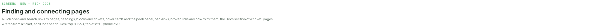

- Text in this part: "SCREENS, NEW — RICH DOCS" · "Finding and connecting pages" · "Quick open and search, links to pages, headings, blocks and tickets, hover cards and the peek panel, backlinks, broken links and how to fix them, the Docs section of a ticket, pages written from a ticket, and Docs health. Desktop is 1360, tablet 820, phone 390."

---

## Quick open

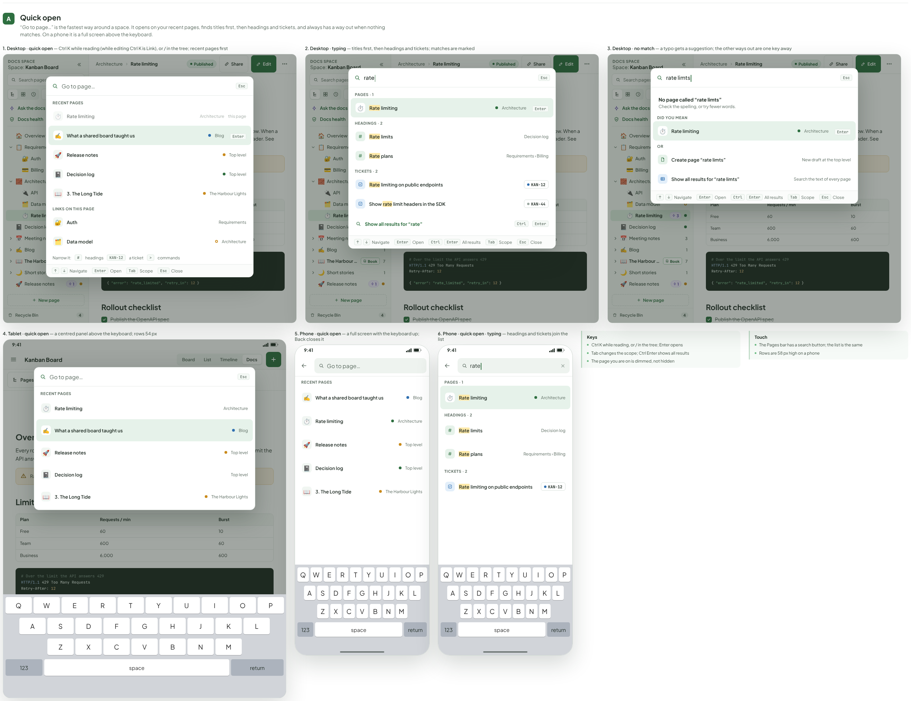

- Text in this part: "A" · "Quick open" · "“Go to page…” is the fastest way around a space. It opens on your recent pages, finds titles first, then headings and tickets, and always has a way out when nothing matches. On a phone it is a full screen above the keyboard." · "1. Desktop · quick open — Ctrl K while reading (while editing Ctrl K is Link), or / in the tree; recent pages first" · "DOCS SPACE" · "Space: Kanban Board" · "Search pages…" · "/" · "Filter" · "Ask the docs" · "Docs health" · "13" · "🏠" · "Overview" · "📋" · "Requirements" · "🔐" · "Auth" · "💳" · "Billing" · "🧱" · "Architecture" · "🔌" · "API" · "🗂️" · "Data model" · "⏱️" · "Rate limiting" · "3" · "📓" · "Decision log" · "📅" · "Meeting notes" · "✍️" · "Blog" · "1" · "📖" · "The Harbour Lights" · "Book" · "7" · "🌙" · "Short stories" · "🚀" · "Release notes" · "New page" · "Recycle Bin" · "4" · "Published" · "Share" · "Edit" · "Published · v15" · "HM" · "Edited by Hoa Mai · 2h ago" · "Every route counts requests per token in a sliding one-minute window. When a token goes over its limit the API answers 429 with a Retry-After header. See" · "Auth for how tokens are issued." · "Rate limits are not enforced yet. Tracked in" · "KAN-12." · "Limits" · "Plan	Requests / min	Burst" · "Free	60	10" · "Team	600	60" · "Business	6,000	600" · "# Over the limit the API answers 429" · "HTTP/1.1 429 Too Many Requests" · "Retry-After: 12" · "{ "error": "rate_limited", "retry_in": 12 }" · "Rollout checklist" · "Publish the OpenAPI spec" · "Count requests per token" · "KAN-9" · "Enforce on public endpoints" · "KAN-12" · "Webhook retries" · "KAN-31" · "Go to page…" · "Esc" · "RECENT PAGES" · "this page" · "What a shared board taught us" · "Enter" · "Top level" · "3. The Long Tide" · "LINKS ON THIS PAGE" · "Narrow it:" · "#" · "headings" · "a ticket" · ">" · "commands" · "↑" · "↓" · "Navigate" · "Open" · "Tab" · "Scope" · "Close" · "2. Desktop · typing — titles first, then headings and tickets; matches are marked" · "rate" · "PAGES · 1" · "HEADINGS · 2" · "Rate limits" · "Rate plans" · "Requirements › Billing" · "TICKETS · 2" · "Rate limiting on public endpoints" · "Show rate limit headers in the SDK" · "KAN-44" · "Show all results for “rate”" · "Ctrl" · "All results"

---

## Search page

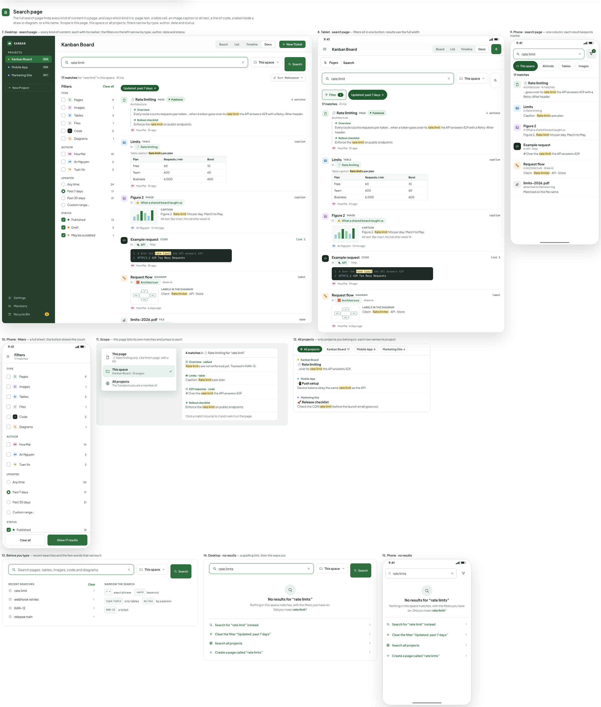

- Text in this part: "B" · "Search page" · "The full search page finds every kind of content in a page, and says which kind it is: page text, a table cell, an image caption or alt text, a line of code, a label inside a draw.io diagram, or a file name. Scope is this page, this space or all projects; filters narrow by type, author, date and status." · "7. Desktop · search page — every kind of content, each with its marker; the filters on the left narrow by type, author, date and status" · "KANBAN" · "PROJECTS" · "Kanban Board" · "KAN" · "Mobile App" · "MOB" · "Marketing Site" · "MKT" · "New Project" · "Settings" · "Members" · "Recycle Bin" · "6" · "Board" · "List" · "Timeline" · "Docs" · "New Ticket" · "rate limit" · "This space" · "Search" · "17 matches for “rate limit” in this space · 41 ms" · "Sort" · "Relevance" · "Filters" · "Clear all" · "TYPE" · "Pages" · "9" · "Images" · "1" · "Tables" · "3" · "Files" · "Code" · "2" · "Diagrams" · "AUTHOR" · "HM" · "Hoa Mai" · "10" · "AN" · "An Nguyen" · "5" · "TV" · "Tuan Vo" · "UPDATED" · "Any time" · "24" · "Past 7 days" · "17" · "Past 30 days" · "21" · "Custom range…" · "STATUS" · "Published" · "13" · "Draft" · "May be outdated" · "Updated: past 7 days" · "⏱️ Rate limiting" · "PAGE" · "4 matches" · "Architecture" · "Overview" · "Every route counts requests per token… when a token goes over its rate limit the API answers 429 with a Retry-After header." · "Rollout checklist" · "Enforce the rate limit on public endpoints" · "Hoa Mai · 2h ago" · "Limits" · "TABLE" · "caption" · "in" · "⏱️" · "Rate limiting" · "Table caption: Rate limits per plan" · "Plan	Requests / min	Burst" · "Free	60	10" · "Team	600	60" · "Business	6,000	600" · "Figure 2" · "IMAGE" · "✍️" · "What a shared board taught us" · "CAPTION" · "Figure 2. Rate limit hits per day, March to May." · "Alt text: Bar chart, hits fall after week 14" · "An Nguyen · 12 min ago" · "Example request" · "CODE" · "line 1" · "🔌" · "API" · "· http" · "1# Over the rate limit the API answers 429" · "2HTTP/1.1 429 Too Many Requests" · "Request flow" · "DIAGRAM" · "label" · "🧱" · "· draw.io" · "Client" · "Queue" · "Store" · "LABELS IN THE DIAGRAM" · "Client · Rate limiter · API · Store"

---

## Linking in the text

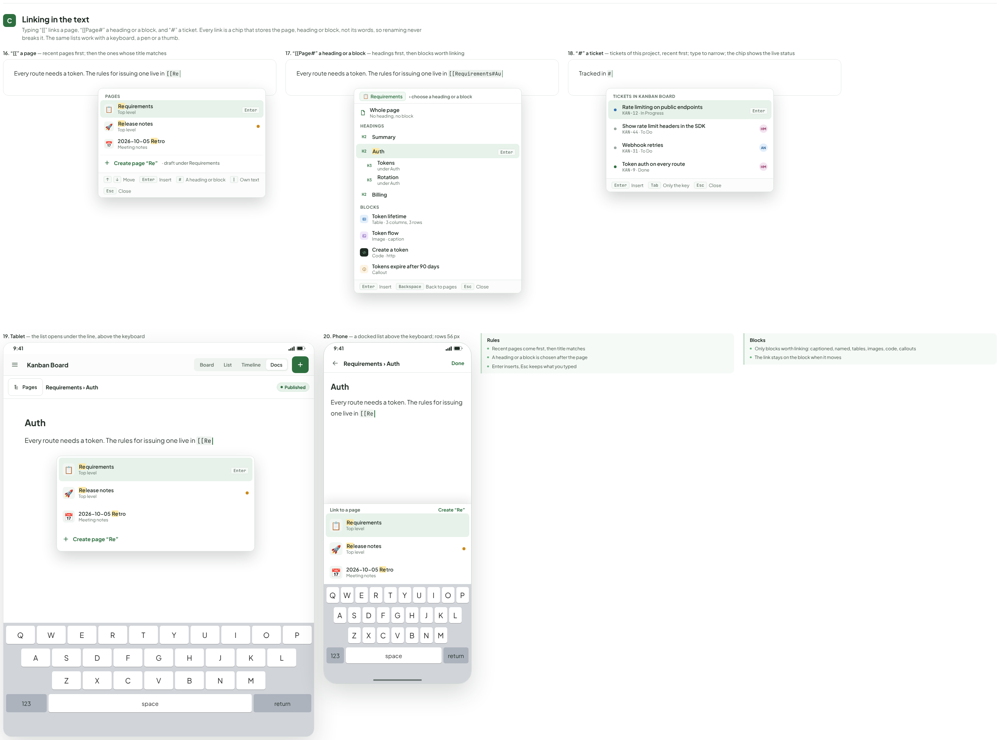

- Text in this part: "C" · "Linking in the text" · "Typing “[[” links a page, “[[Page#” a heading or a block, and “#” a ticket. Every link is a chip that stores the page, heading or block, not its words, so renaming never breaks it. The same lists work with a keyboard, a pen or a thumb." · "16. “[[” a page — recent pages first; then the ones whose title matches" · "Every route needs a token. The rules for issuing one live in [[Re" · "PAGES" · "📋" · "Requirements" · "Top level" · "Enter" · "🚀" · "Release notes" · "📅" · "2026-10-05 Retro" · "Meeting notes" · "Create page “Re”" · "· draft under Requirements" · "↑" · "↓" · "Move" · "Insert" · "#" · "A heading or block" · "|" · "Own text" · "Esc" · "Close" · "17. “[[Page#” a heading or a block — headings first, then blocks worth linking" · "Every route needs a token. The rules for issuing one live in [[Requirements#Au" · "› choose a heading or a block" · "Whole page" · "No heading, no block" · "HEADINGS" · "H2" · "Summary" · "Auth" · "H3" · "Tokens" · "under Auth" · "Rotation" · "Billing" · "BLOCKS" · "Token lifetime" · "Table · 3 columns, 3 rows" · "Token flow" · "Image · caption" · "Create a token" · "Code · http" · "Tokens expire after 90 days" · "Callout" · "Backspace" · "Back to pages" · "18. “#” a ticket — tickets of this project, recent first; type to narrow; the chip shows the live status" · "Tracked in #" · "TICKETS IN KANBAN BOARD" · "Rate limiting on public endpoints" · "KAN-12 · In Progress" · "Show rate limit headers in the SDK" · "KAN-44 · To Do" · "HM" · "Webhook retries" · "KAN-31 · To Do" · "AN" · "Token auth on every route" · "KAN-9 · Done" · "Tab" · "Only the key" · "19. Tablet — the list opens under the line, above the keyboard" · "9:41" · "Kanban Board" · "Board" · "List" · "Timeline" · "Docs" · "Pages" · "Requirements › Auth" · "Published" · "Q" · "W" · "E" · "R" · "T" · "Y" · "U" · "I" · "O" · "P" · "A" · "S" · "D" · "F" · "G" · "H" · "J" · "K" · "L" · "Z" · "X" · "V" · "B" · "N" · "M" · "123" · "space" · "return" · "20. Phone — a docked list above the keyboard; rows 56 px" · "Done" · "Link to a page" · "Create “Re”" · "Rules"

---

## Links to a heading or a block

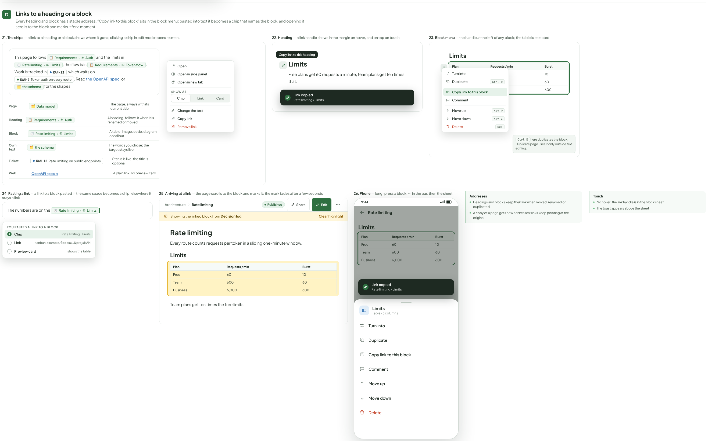

- Text in this part: "D" · "Links to a heading or a block" · "Every heading and block has a stable address. “Copy link to this block” sits in the block menu; pasted into text it becomes a chip that names the block, and opening it scrolls to the block and marks it for a moment." · "21. The chips — a link to a heading or a block shows where it goes; clicking a chip in edit mode opens its menu" · "This page follows" · "📋" · "Requirements" · "›" · "Auth" · "and the limits in" · "⏱️" · "Rate limiting" · "Limits" · "; the flow is in" · "Token flow" · ". Work is tracked in" · "KAN-12" · ", which waits on" · "KAN-9" · "Token auth on every route" · ". Read the OpenAPI spec, or" · "🗂️" · "the schema for the shapes." · "Page" · "Data model" · "The page, always with its current title" · "Heading" · "A heading; follows it when it is renamed or moved" · "Block" · "A table, image, code, diagram or callout" · "Own text" · "the schema" · "The words you chose; the target stays live" · "Ticket" · "Rate limiting on public endpoints" · "Status is live; the title is optional" · "Web" · "OpenAPI spec ↗" · "A plain link, no preview card" · "Open" · "Open in side panel" · "Open in new tab" · "SHOW AS" · "Chip" · "Link" · "Card" · "Change the text" · "Copy link" · "Remove link" · "22. Heading — a link handle shows in the margin on hover, and on tap on touch" · "Copy link to this heading" · "Free plans get 60 requests a minute; team plans get ten times that." · "Link copied" · "Rate limiting › Limits" · "23. Block menu — the handle at the left of any block; the table is selected" · "Plan	Requests / min	Burst" · "Free	60	10" · "Team	600	60" · "Business	6,000	600" · "Turn into" · "Duplicate" · "Ctrl D" · "Copy link to this block" · "Comment" · "Move up" · "Alt ↑" · "Move down" · "Alt ↓" · "Delete" · "Del" · "Ctrl D here duplicates the block. Duplicate page uses it only outside text editing." · "24. Pasting a link — a link to a block pasted in the same space becomes a chip; elsewhere it stays a link" · "The numbers are on the" · "YOU PASTED A LINK TO A BLOCK" · "kanban.example/?docs=…&proj=KAN" · "Preview card" · "shows the table" · "25. Arriving at a link — the page scrolls to the block and marks it; the mark fades after a few seconds" · "Architecture" · "Published" · "Share" · "Edit" · "Showing the linked block from Decision log" · "Clear highlight" · "Every route counts requests per token in a sliding one-minute window." · "Team plans get ten times the free limits." · "26. Phone — long-press a block, ⋯ in the bar, then the sheet" · "9:41" · "Table · 3 columns" · "Addresses" · "Headings and blocks keep their link when moved, renamed or duplicated" · "A copy of a page gets new addresses; links keep pointing at the original" · "Touch" · "No hover: the link handle is in the block sheet" · "The toast appears above the sheet"

---

## Hover cards and the peek panel

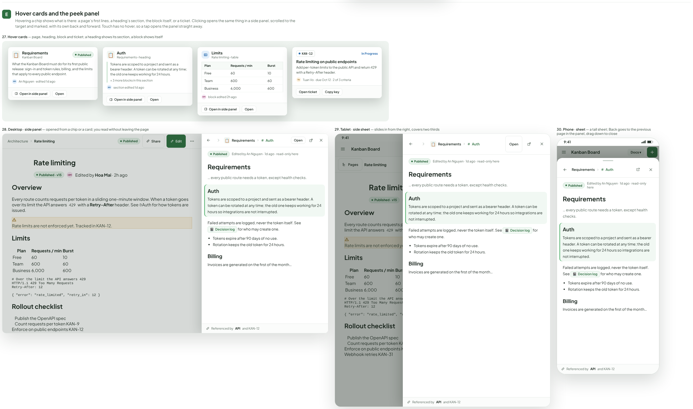

- Text in this part: "E" · "Hover cards and the peek panel" · "Hovering a chip shows what is there: a page’s first lines, a heading’s section, the block itself, or a ticket. Clicking opens the same thing in a side panel, scrolled to the target and marked, with its own back and forward. Touch has no hover, so a tap opens the panel straight away." · "27. Hover cards — page, heading, block and ticket; a heading shows its section, a block shows itself" · "📋" · "Requirements" · "Kanban Board" · "Published" · "What the Kanban Board must do for its first public release: sign-in and token rules, billing, and the limits that apply to every public endpoint." · "AN" · "An Nguyen · edited 1d ago" · "Open in side panel" · "Open" · "Auth" · "Requirements › heading" · "Tokens are scoped to a project and sent as a bearer header. A token can be rotated at any time; the old one keeps working for 24 hours." · "+ 3 more blocks in this section" · "section edited 1d ago" · "Limits" · "Rate limiting › table" · "Plan	Requests / min	Burst" · "Free	60	10" · "Team	600	60" · "Business	6,000	600" · "HM" · "block edited 2h ago" · "KAN-12" · "In Progress" · "Rate limiting on public endpoints" · "Add per-token limits to the public API and return 429 with a Retry-After header." · "TV" · "Tuan Vo · due Oct 12 · 2 of 3 criteria" · "Open ticket" · "Copy key" · "28. Desktop · side panel — opened from a chip or a card; you read without leaving the page" · "Architecture" · "Rate limiting" · "Share" · "Edit" · "Published · v15" · "Edited by Hoa Mai · 2h ago" · "Overview" · "Every route counts requests per token in a sliding one-minute window. When a token goes over its limit the API answers 429 with a Retry-After header. See Auth for how tokens are issued." · "Rate limits are not enforced yet. Tracked in KAN-12." · "# Over the limit the API answers 429" · "HTTP/1.1 429 Too Many Requests" · "Retry-After: 12" · "{ "error": "rate_limited", "retry_in": 12 }" · "Rollout checklist" · "Publish the OpenAPI spec" · "Count requests per token KAN-9" · "Enforce on public endpoints KAN-12" · "Webhook retries KAN-31" · "Edited by An Nguyen · 1d ago · read-only here" · "… every public route needs a token, except health checks." · "Tokens are scoped to a project and sent as a bearer header. A token can be rotated at any time; the old one keeps working for 24 hours so integrations are not interrupted." · "Failed attempts are logged, never the token itself. See" · "📓" · "Decision log for who may create one." · "Tokens expire after 90 days of no use." · "Rotation keeps the old token for 24 hours." · "Billing" · "Invoices are generated on the first of the month…" · "Referenced by" · "API" · "and KAN-12" · "29. Tablet · side sheet — slides in from the right, covers two thirds" · "9:41" · "Board" · "List" · "Timeline" · "Docs" · "Pages" · "30. Phone · sheet — a tall sheet; Back goes to the previous page in the panel, drag down to close" · "Docs ▾"

---

## Referenced by

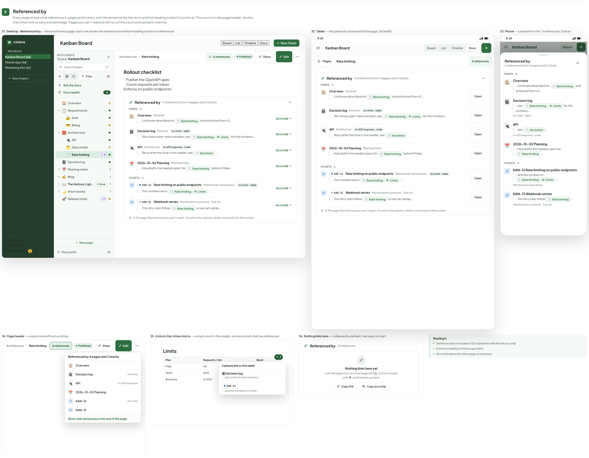

- Text in this part: "F" · "Referenced by" · "Every page shows what references it: pages and tickets, with the sentence the link sits in and the heading or block it points at. The count is in the page header; blocks that others link to carry a small badge. Pages you can’t read are left out of the count and named in one line." · "31. Desktop · Referenced by — the end of every page; each row shows the sentence and which heading or block is referenced" · "KANBAN" · "PROJECTS" · "Kanban BoardKAN" · "Mobile AppMOB" · "Marketing SiteMKT" · "New Project" · "Settings" · "Members" · "Recycle Bin6" · "Kanban Board" · "Board" · "List" · "Timeline" · "Docs" · "New Ticket" · "DOCS SPACE" · "Space: Kanban Board" · "Search pages…" · "/" · "Filter" · "Ask the docs" · "Docs health" · "13" · "🏠" · "Overview" · "📋" · "Requirements" · "🔐" · "Auth" · "💳" · "Billing" · "🧱" · "Architecture" · "🔌" · "API" · "🗂️" · "Data model" · "⏱️" · "Rate limiting" · "3" · "📓" · "Decision log" · "📅" · "Meeting notes" · "✍️" · "Blog" · "1" · "📖" · "The Harbour Lights" · "Book" · "7" · "🌙" · "Short stories" · "🚀" · "Release notes" · "New page" · "Recycle Bin" · "4" · "6 references" · "Published" · "Share" · "Edit" · "Rollout checklist" · "Publish the OpenAPI spec" · "Count requests per token" · "Enforce on public endpoints" · "6 references from 4 pages and 2 tickets" · "PAGES · 4" · "Top level" · "…Limits are described on" · "Rate limiting and enforced from v2.…" · "Go to link" · "to Limits · table" · "…We chose a per-token window, see" · "›" · "Limits" · "for the numbers.…" · "to 429 response · code" · "…Retry after the time in the header, see" · "the limiter .…" · "2026-10-02 Planning" · "…Hoa drafts the headers spec for" · "Rate limiting before Friday.…" · "TICKETS · 2" · "KAN-12" · "Rate limiting on public endpoints" · "Mentioned in description" · "…The numbers are in" · ".…" · "KAN-31" · "Webhook retries" · "Mentioned in comment · Tuan Vo" · "…The retry rules follow" · "Rate limiting so we can replay.…" · "A 7th page links here but you can’t read it. It is not in the 6 above; drafts count only for their author." · "32. Tablet — the panel sits at the end of the page, full width" · "9:41" · "Pages" · "Open" · "33. Phone — a sheet from the “6 references” button" · "Docs ▾" · "Published · v15" · "HM" · "Edited by Hoa Mai · 2h ago" · "Every route counts requests per token in a sliding one-minute window. When a token goes over its limit the API answers 429 with a Retry-After header. See Auth for how tokens are issued." · "Rate limits are not enforced yet. Tracked in KAN-12."

---

## Broken links and the link checker

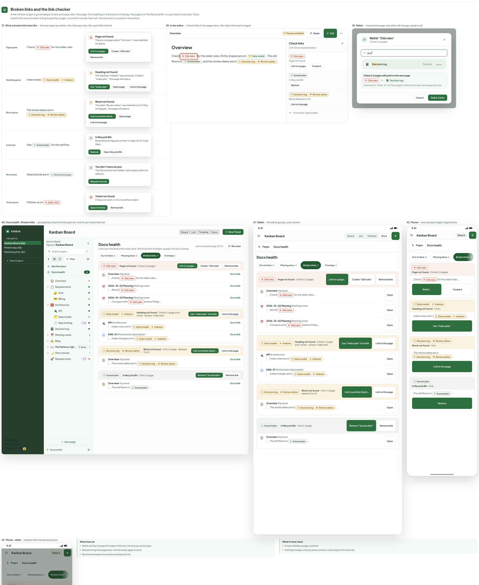

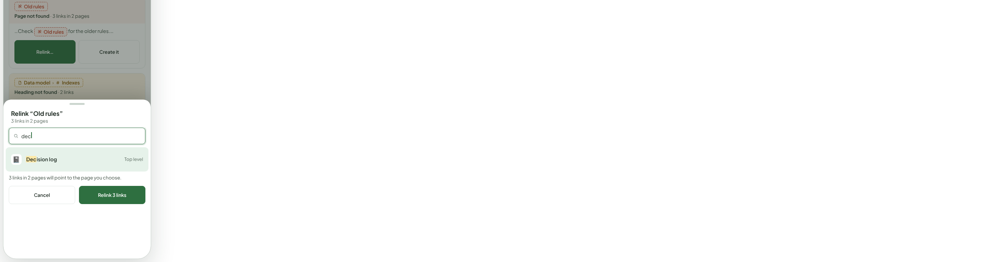

- Text in this part: "G" · "Broken links and the link checker" · "A link whose target is gone keeps its text and says why: the page, the heading or the block is missing, the page is in the Recycle Bin, or you have no access. Docs health lists every broken link grouped by target, so one fix mends them all; the same list is a panel in the editor." · "37. What a broken link looks like — the text stays as written; the chip says why, the card offers the fix" · "Page gone" · "Check" · "Old rules for the older rules." · "Page not found" · "There is no page called “Old rules”. It was deleted for good." · "Link to a page…" · "Create “Old rules”" · "Remove link" · "Heading gone" · "Index notes:" · "Data model" · "›" · "Indexes" · "Heading not found" · "The heading “Indexes” was removed. Closest: “Index plan”. The page still opens." · "Use “Index plan”" · "Open page" · "Link to the page" · "Block gone" · "The review dates are in" · "Decision log" · "Review dates" · "." · "Block not found" · "The table “Review dates” was deleted on Oct 8 by An Nguyen. The page still opens." · "Link to another block…" · "In the bin" · "See" · "Sunset plan for the old flow." · "In Recycle Bin" · "Deleted by An Nguyen on Nov 14. Kept for 27 more days." · "Restore" · "Open Recycle Bin" · "No access" · "Salary bands are in" · "Restricted page." · "You don’t have access" · "The title and text are hidden. Ask a space admin to add you." · "Request access" · "Ticket gone" · "Follows up on" · "KAN-404." · "Ticket not found" · "It does not exist, or it is in another project." · "Search tickets" · "38. In the editor — Check links in the page menu; the chip in the text is ringed" · "Overview" · "May be outdated" · "Share" · "Edit" · "Old rules for the older rules. Entity shapes are on" · "🗂️" · "Data model. The old flow is in" · "Sunset plan, and the review dates are in" · "Check links" · "3 of 4 links need attention" · "Old rules" · "Create it" · "Sunset plan" · "Block deleted Oct 8" · "1 link is fine: Data model" · "39. Relink — choose the page, see what will change, apply to all" · "Relink “Old rules”" · "3 links in 2 pages" · "dec" · "📓" · "Top level" · "Enter" · "3 links in 2 pages will point to the new page" · "Overview (1) · 2026-10-02 Planning (2). A link with its own text keeps that text." · "Cancel" · "Relink 3 links" · "40. Docs health · Broken links — grouped by what the links point at; one fix can mend them all" · "KANBAN" · "PROJECTS" · "Kanban BoardKAN" · "Mobile AppMOB" · "Marketing SiteMKT" · "New Project" · "Settings" · "Members" · "Recycle Bin6" · "Kanban Board" · "Board" · "List" · "Timeline" · "Docs" · "New Ticket" · "DOCS SPACE" · "Space: Kanban Board" · "Search pages…" · "/" · "Filter" · "Ask the docs" · "Docs health" · "13" · "🏠" · "📋" · "Requirements" · "🔐" · "Auth" · "💳" · "Billing" · "🧱" · "Architecture" · "🔌"

---

## Rename with a link preview

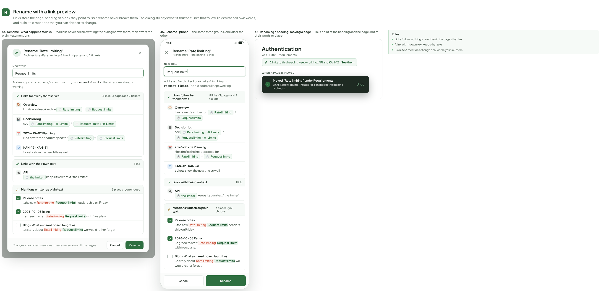

- Text in this part: "H" · "Rename with a link preview" · "Links store the page, heading or block they point to, so a rename never breaks them. The dialog still says what it touches: links that follow, links with their own words, and plain-text mentions that you can choose to change." · "44. Rename · what happens to links — real links never need rewriting; the dialog shows them, then offers the plain-text mentions" · "Rename 'Rate limiting'" · "Architecture › Rate limiting · 6 links in 4 pages and 2 tickets" · "NEW TITLE" · "Request limits" · "Address …/architecture/rate-limiting → request-limits. The old address keeps working." · "Links follow by themselves" · "5 links · 3 pages and 2 tickets" · "🏠" · "Overview" · "Limits are described on" · "⏱️" · "Rate limiting" · "📓" · "Decision log" · "see" · "›" · "Limits" · "📅" · "2026-10-02 Planning" · "Hoa drafts the headers spec for" · "KAN-12 · KAN-31" · "tickets show the new title as well" · "Links with their own text" · "1 link" · "🔌" · "API" · "the limiter keeps its own text “the limiter”" · "Mentions written as plain text" · "3 places · you choose" · "Release notes" · "…the new Rate limiting Request limits headers ship on Friday." · "2026-10-05 Retro" · "…agreed to start Rate limiting Request limits with free plans." · "Blog › What a shared board taught us" · "…a story about Rate limiting Request limits we would rather forget." · "Changes 2 plain-text mentions · creates a version on those pages" · "Cancel" · "Rename" · "45. Rename · phone — the same three groups, one after the other" · "9:41" · "Architecture › Rate limiting · 6 links" · "46. Renaming a heading, moving a page — links point at the heading and the page, not at their words or place" · "Authentication" · "was “Auth” · Requirements" · "2 links to this heading keep working: API and KAN-12" · "See them" · "WHEN A PAGE IS MOVED" · "Moved “Rate limiting” under Requirements" · "Links keep working. The address changed; the old one redirects." · "Undo" · "Rules" · "Links follow; nothing is rewritten in the pages that link" · "A link with its own text keeps that text" · "Plain-text mentions change only where you tick them"

---

## The ticket side

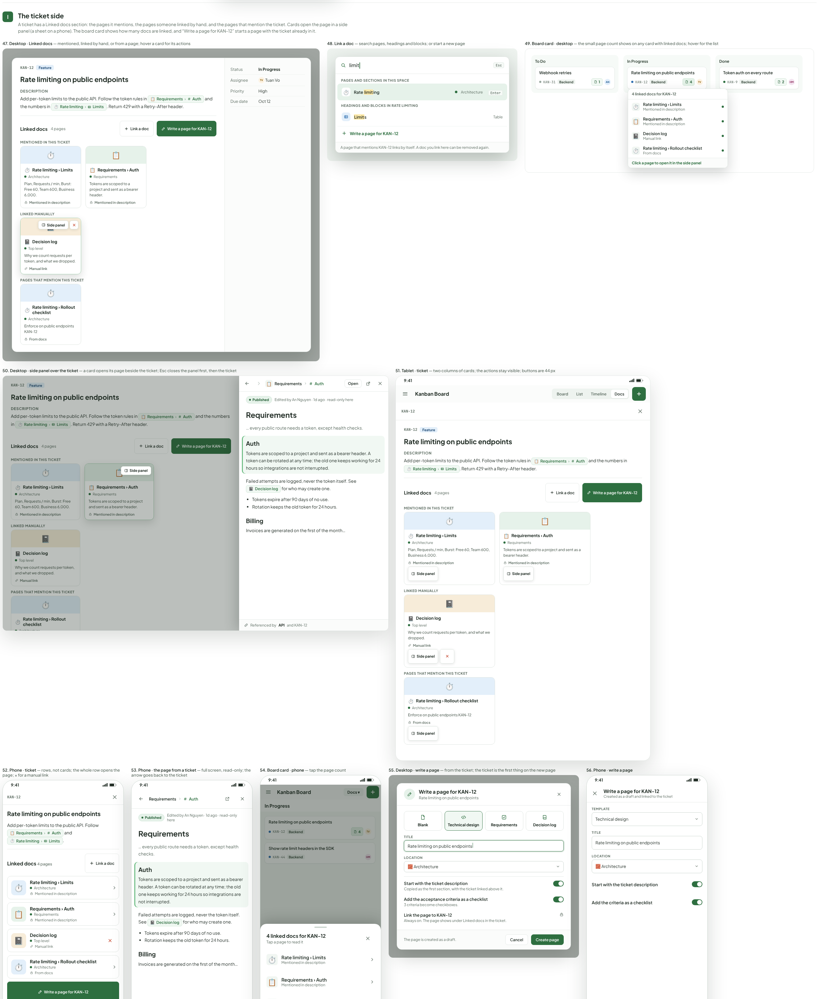

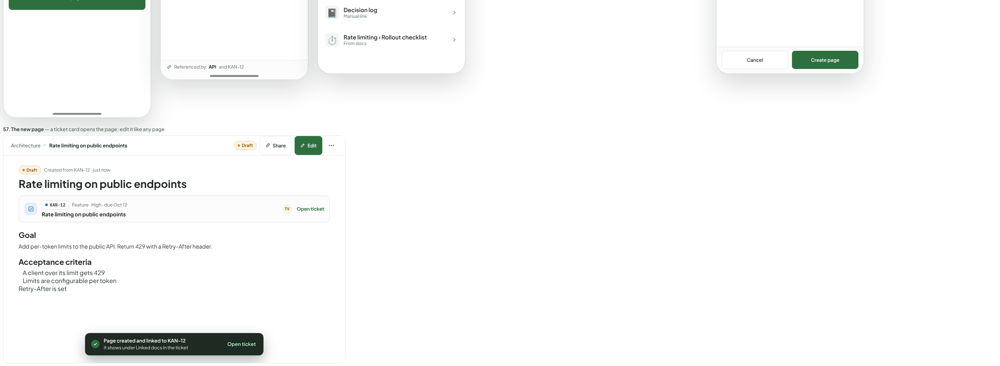

- Text in this part: "I" · "The ticket side" · "A ticket has a Linked docs section: the pages it mentions, the pages someone linked by hand, and the pages that mention the ticket. Cards open the page in a side panel (a sheet on a phone). The board card shows how many docs are linked, and “Write a page for KAN-12” starts a page with the ticket already in it." · "47. Desktop · Linked docs — mentioned, linked by hand, or from a page; hover a card for its actions" · "KAN-12" · "Feature" · "Rate limiting on public endpoints" · "DESCRIPTION" · "Add per-token limits to the public API. Follow the token rules in" · "📋" · "Requirements" · "›" · "Auth" · "and the numbers in" · "⏱️" · "Rate limiting" · "Limits" · ". Return 429 with a Retry-After header." · "Linked docs" · "4 pages" · "Link a doc" · "Write a page for KAN-12" · "MENTIONED IN THIS TICKET" · "Rate limiting › Limits" · "Architecture" · "Plan, Requests / min, Burst: Free 60, Team 600, Business 6,000." · "Mentioned in description" · "Requirements › Auth" · "Tokens are scoped to a project and sent as a bearer header." · "LINKED MANUALLY" · "📓" · "Side panel" · "Decision log" · "Top level" · "Why we count requests per token, and what we dropped." · "Manual link" · "PAGES THAT MENTION THIS TICKET" · "Rate limiting › Rollout checklist" · "Enforce on public endpoints KAN-12" · "From docs" · "Status" · "In Progress" · "Assignee" · "TV" · "Tuan Vo" · "Priority" · "High" · "Due date" · "Oct 12" · "48. Link a doc — search pages, headings and blocks; or start a new page" · "limit" · "Esc" · "PAGES AND SECTIONS IN THIS SPACE" · "Enter" · "HEADINGS AND BLOCKS IN RATE LIMITING" · "Table" · "A page that mentions KAN-12 links by itself. A doc you link here can be removed again." · "49. Board card · desktop — the small page count shows on any card with linked docs; hover for the list" · "To Do" · "Webhook retries" · "KAN-31" · "Backend" · "1" · "AN" · "4" · "Done" · "Token auth on every route" · "KAN-9" · "2" · "HM" · "4 linked docs for KAN-12" · "Click a page to open it in the side panel" · "50. Desktop · side panel over the ticket — a card opens its page beside the ticket; Esc closes the panel first, then the ticket" · "Open" · "Published" · "Edited by An Nguyen · 1d ago · read-only here" · "… every public route needs a token, except health checks." · "Tokens are scoped to a project and sent as a bearer header. A token can be rotated at any time; the old one keeps working for 24 hours so integrations are not interrupted." · "Failed attempts are logged, never the token itself. See" · "Decision log for who may create one." · "Tokens expire after 90 days of no use." · "Rotation keeps the old token for 24 hours." · "Billing" · "Invoices are generated on the first of the month…" · "Referenced by" · "API" · "and KAN-12" · "51. Tablet · ticket — two columns of cards; the actions stay visible; buttons are 44 px" · "9:41" · "Kanban Board" · "Board" · "List" · "Timeline" · "Docs" · "52. Phone · ticket — rows, not cards; the whole row opens the page; × for a manual link" · "Add per-token limits to the public API. Follow" · "and" · "." · "Linked docs 4 pages" · "53. Phone · the page from a ticket — full screen, read-only; the arrow goes back to the ticket" · "54. Board card · phone — tap the page count" · "Docs ▾" · "Show rate limit headers in the SDK" · "KAN-44" · "Tap a page to read it" · "55. Desktop · write a page — from the ticket; the ticket is the first thing on the new page" · "Blank" · "Technical design" · "TITLE" · "LOCATION"

---

## Docs health with rich pages

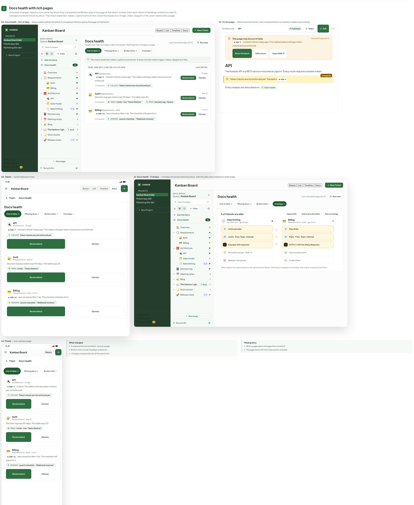

- Text in this part: "J" · "Docs health with rich pages" · "Only what changes: reasons now name the block they compared and Review opens the page at that block; broken links reach down to headings and blocks (see G); overlaps are shown block by block. The check reads text, tables, captions and alt text, never the inside of an image, video, diagram or file, and it never edits a page." · "58. Docs health · Out of date — every reason names the block it compared; Review opens the page at that block" · "KANBAN" · "PROJECTS" · "Kanban BoardKAN" · "Mobile AppMOB" · "Marketing SiteMKT" · "New Project" · "Settings" · "Members" · "Recycle Bin6" · "Kanban Board" · "Board" · "List" · "Timeline" · "Docs" · "New Ticket" · "DOCS SPACE" · "Space: Kanban Board" · "Search pages…" · "/" · "Filter" · "Ask the docs" · "Docs health" · "13" · "🏠" · "Overview" · "📋" · "Requirements" · "🔐" · "Auth" · "💳" · "Billing" · "🧱" · "Architecture" · "🔌" · "API" · "🗂️" · "Data model" · "⏱️" · "Rate limiting" · "3" · "📓" · "Decision log" · "📅" · "Meeting notes" · "✍️" · "Blog" · "1" · "📖" · "The Harbour Lights" · "Book" · "7" · "🌙" · "Short stories" · "🚀" · "Release notes" · "New page" · "Recycle Bin" · "4" · "Pages that may no longer match the board. Nothing here changes a page." · "Last checked today 06:10" · "Run now" · "Out of date" · "Missing docs" · "2" · "Broken links" · "Overlaps" · "The check reads text, tables, captions and alt text. It does not look inside images, videos, diagrams or files." · "PAGE, AND WHY IT MAY BE OUT OF DATE" · "LAST EDITED" · "API Architecture" · "KAN-9" · "moved to Done 2 days ago. This callout still says token checks are not enforced." · "Compared:" · "CALLOUT" · "Token checks are not enforced yet." · "2h ago" · "Review block" · "Dismiss" · "Auth Requirements" · "Decision log says tokens last 90 days. This table says 30." · "TABLE" · "Limits · row “Token lifetime”" · "PAGE" · "Decision log › Tokens" · "Sep 12" · "Billing Requirements · draft" · "KAN-61" · "was closed as Won’t do. The checklist still plans for it." · "HEADING" · "Launch checklist › “Webhook invoices”" · "Oct 9" · "59. On the page — editors see the banner; the compared block is marked, readers see nothing" · "Published" · "Share" · "Edit" · "This page may be out of date" · "moved to Done 2 days ago. The marked callout still says token checks are not enforced." · "Show the block" · "Still correct" · "Open KAN-9" · "Checked today 06:10" · "The Kanban API is a REST service mounted at /api/v1. Every route requires a bearer token." · "Token checks are not enforced yet. Tracked in" · "." · "Compared" · "Entity shapes are described on"

---

## States and touch cards

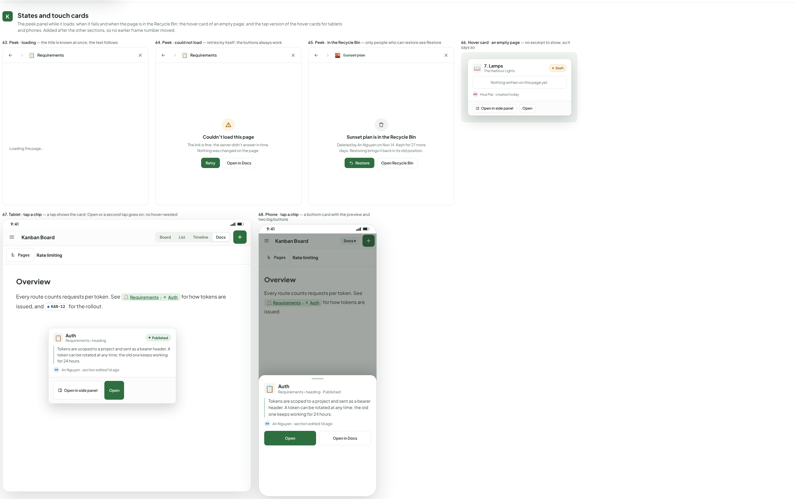

- Text in this part: "K" · "States and touch cards" · "The peek panel while it loads, when it fails and when the page is in the Recycle Bin; the hover card of an empty page; and the tap version of the hover cards for tablets and phones. Added after the other sections, so no earlier frame number moved." · "63. Peek · loading — the title is known at once; the text follows" · "📋" · "Requirements" · "Loading the page…" · "64. Peek · could not load — retries by itself; the buttons always work" · "Couldn’t load this page" · "The link is fine; the server didn’t answer in time. Nothing was changed on the page." · "Retry" · "Open in Docs" · "65. Peek · in the Recycle Bin — only people who can restore see Restore" · "🌇" · "Sunset plan" · "Sunset plan is in the Recycle Bin" · "Deleted by An Nguyen on Nov 14. Kept for 27 more days. Restoring brings it back in its old position." · "Restore" · "Open Recycle Bin" · "66. Hover card · an empty page — no excerpt to show, so it says so" · "📖" · "7. Lamps" · "The Harbour Lights" · "Draft" · "Nothing written on this page yet." · "HM" · "Hoa Mai · created today" · "Open in side panel" · "Open" · "67. Tablet · tap a chip — a tap shows the card; Open or a second tap goes on; no hover needed" · "9:41" · "Kanban Board" · "Board" · "List" · "Timeline" · "Docs" · "Pages" · "Rate limiting" · "Overview" · "Every route counts requests per token. See" · "›" · "Auth" · "for how tokens are issued, and" · "KAN-12" · "for the rollout." · "Requirements › heading" · "Published" · "Tokens are scoped to a project and sent as a bearer header. A token can be rotated at any time; the old one keeps working for 24 hours." · "AN" · "An Nguyen · section edited 1d ago" · "68. Phone · tap a chip — a bottom card with the preview and two big buttons" · "Docs ▾" · "for how tokens are issued." · "Requirements › heading · Published"

---

## Frames, code that must change, and decisions for the owner

RichDocsTree 2730 wide, finalH 23782, 66 frames. RichDocsLinks 2730 wide, finalH 26601, 68 frames. A facts sheet (`c/rd6_tree/FACTS.md`: page tree, link graph, counts, sample book, people) drives every count in both boards.

## RichDocsTree (1-66)
A 1-6 tree on three sizes, row states, hover cards, book and chapters. B 7-17 gallery, inside a book, view and sort, recent, filters, no match. C 18-26 drag, drop cues, after-move toasts and keys, reorder mode, multi-select. D 27-39 row menu, rename, icon picker, move to, duplicate, delete, toasts. E 40-48 Recycle Bin. F 49-60 Docs space settings. G 61-66 empty views, rename problems, move states, save failed, Access tab.

## RichDocsLinks (1-68)
A 1-6 quick open. B 7-15 search. C 16-20 `[[` and `#` suggesters. D 21-26 heading and block links. E 27-30 hover cards and peek. F 31-36 Referenced by. G 37-43 broken links. H 44-46 rename. I 47-57 ticket side. J 58-62 Docs health. K 63-68 peek states, empty-page card, tap cards.

## Code must change
- Rich row data: icon, cover, status ("May be outdated"), the ✦ "AI suggestions waiting" count, book and chapter fields.
- Gallery and recent views, filters ("With AI suggestions" included), multi-select, reorder mode, hover cover card.
- Page settings gains Book and Access tabs; the row menu gains "Turn into a book…", "Not for AI teams" and "Give to an AI team…".
- Docs settings: Docs AI per team, "Ask before running" scripts in HTML embeds, public-link switch (owner turns on, admin can switch off per project), per-project new-page style, templates, upload limits.
- Rename counts the links and keeps them by id; Duplicate gains comments and files options; Delete counts files and linking tickets; Recycle Bin gets days-left colours, file sizes, scope choice on empty bin, restore-where choice.
- Search and quick open find tables, captions, alt text, code, draw.io labels and file names with a kind marker; Go to page with headings and tickets.
- Links: chips store page, heading or block ids; "#" ticket trigger; "Copy link to this block"; Referenced by with block anchors and the "6 references" button wording; link checker for headings and blocks; peek states (loading, error, in the bin); tap cards on touch.
- Ticket Docs cards become a card grid; board cards show a page count; "Write a page for KAN-12".
- Docs health reasons point at a block; "Docs health" and "Ask the docs" stay in the tree header.

## Decisions for the owner
- Chips store ids, so a rename never breaks a link.
- Unreadable pages are left out of counts and named in one line.
- Filters combine (AND).
- Ctrl D (page Duplicate) works only outside text editing, so it does not collide with block Duplicate.
- The limits and public-link defaults in the settings frames are proposals (expiry default Never).
- Docs health only reads text, tables, captions and alt text, never inside images, video, diagrams or files; search does not read file contents, only names.
- "Not for AI teams" is a per-page setting; a book numbers its chapters in the tree; Recycle Bin keeps files 30 days with the page.
- Invented shortcut keys (move page up / down etc.) and the link checker fixes (relink all, restore, use closest heading) are proposals.
