# Rich Docs — reading, sharing & print

> New screen (Rich Docs) · canvas `1794931846-a41d` · the board is split into 8 boards on the canvas because a browser cannot paint one board taller than about 8000 px; frame numbers run on across the parts. Sources: [`RichDocsReader1.dc.html`](../source/RichDocsReader1.dc.html) (sha256 `cbd13a6130b5…`, full value in `MANIFEST.json`), [`RichDocsReader2.dc.html`](../source/RichDocsReader2.dc.html) (sha256 `0c86c1c5159c…`, full value in `MANIFEST.json`), [`RichDocsReader3.dc.html`](../source/RichDocsReader3.dc.html) (sha256 `d0d07d763f44…`, full value in `MANIFEST.json`), [`RichDocsReader4.dc.html`](../source/RichDocsReader4.dc.html) (sha256 `37a41a7f3b5a…`, full value in `MANIFEST.json`), [`RichDocsReader5.dc.html`](../source/RichDocsReader5.dc.html) (sha256 `fa3f298bf09e…`, full value in `MANIFEST.json`), [`RichDocsReader6.dc.html`](../source/RichDocsReader6.dc.html) (sha256 `667bf3d1bb4c…`, full value in `MANIFEST.json`), [`RichDocsReader7.dc.html`](../source/RichDocsReader7.dc.html) (sha256 `6bc2baa29695…`, full value in `MANIFEST.json`), [`RichDocsReader8.dc.html`](../source/RichDocsReader8.dc.html) (sha256 `dfd41478fd49…`, full value in `MANIFEST.json`)

> A new board that lives next to the older Docs boards (it does not replace them). Where a screen already exists in the code, the words follow the code (`ui/src/components/docs/`); the rich-format parts (colours, float images, merged cells, embeds, suggestions, export, public links, highlights) are a design proposal and need the code changes listed at the end. Names, ids, costs and times in the mock-ups are sample data. Frames are numbered on the canvas; desktop is 1360 wide, tablet 820, phone 390.

## SCREENS, NEW — RICH DOCS

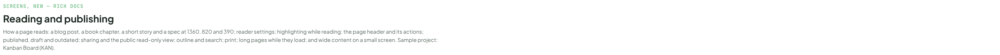

- Text in this part: "SCREENS, NEW — RICH DOCS" · "Reading and publishing" · "How a page reads: a blog post, a book chapter, a short story and a spec at 1360, 820 and 390; reader settings; highlighting while reading; the page header and its actions; published, draft and outdated; sharing and the public read-only view; outline and search; print; long pages while they load; and wide content on a small screen. Sample project: Kanban Board (KAN)."

---

## The read view of four kinds of page

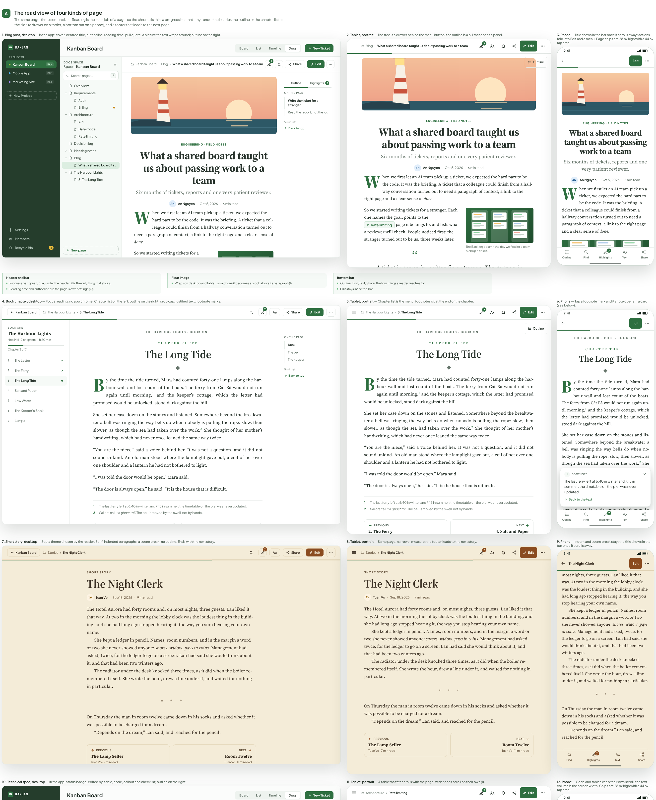

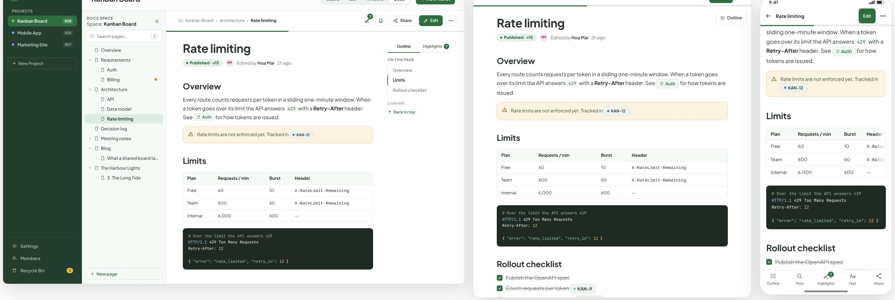

- Text in this part: "A" · "The read view of four kinds of page" · "The same page, three screen sizes. Reading is the main job of a page, so the chrome is thin: a progress bar that stays under the header, the outline or the chapter list at the side (a drawer on a tablet, a bottom bar on a phone), and a footer that leads to the next page." · "1. Blog post, desktop — In the app: cover, centred title, author line, reading time, pull quote, a picture the text wraps around; outline on the right." · "KANBAN" · "PROJECTS" · "Kanban Board" · "KAN" · "Mobile App" · "MOB" · "Marketing Site" · "MKT" · "New Project" · "Settings" · "Members" · "Recycle Bin" · "3" · "Board" · "List" · "Timeline" · "Docs" · "New Ticket" · "DOCS SPACE" · "Space: Kanban Board" · "Search pages…" · "/" · "Overview" · "Requirements" · "Auth" · "Billing" · "Architecture" · "API" · "Data model" · "Rate limiting" · "Decision log" · "Meeting notes" · "Blog" · "What a shared board taught us about passing work to a team" · "The Harbour Lights" · "3. The Long Tide" · "New page" · "›" · "7" · "Share" · "Edit" · "ENGINEERING · FIELD NOTES" · "Six months of tickets, reports and one very patient reviewer." · "AN" · "An Nguyen" · "·" · "Oct 5, 2026" · "6 min read" · "When we first let an AI team pick up a ticket, we expected the hard part to be the code. It was the briefing. A ticket that a colleague could finish from a hallway conversation turned out to need a paragraph of context, a link to the right page and a clear sense of done." · "The Backlog column the day we first let a team pick up a ticket." · "So we started writing tickets for a stranger. Each one names the goal, points to the" · "Rate limiting page it belongs to, and lists what a reviewer will check. People noticed first: the stranger turned out to be us, three weeks later." · "A ticket is a promise written for a stranger. The stranger is sometimes a team of models." · "An Nguyen, on the retro" · "Write the ticket for a stranger" · "A good brief fits on one screen. We settled on three short parts and stopped adding fields:" · "Goal: one sentence, in the language of the product, not the code." · "Where: the pages and tickets that already explain the area." · "Done: the three checks a reviewer will run." · "Tracked in" · "KAN-12, the first brief written this way shipped a week early." · "Read the report, not the log" · "The log tells you what happened. The report tells you what the team decided and what it wants you to look at. We read the second and open the first only when something smells." · "Outline" · "Highlights7" · "ON THIS PAGE" · "5 min left" · "Back to top" · "2. Tablet, portrait — The tree is a drawer behind the menu button; the outline is a pill that opens a panel." · "page it belongs to, and lists what a reviewer will check. People noticed first: the stranger turned out to be us, three weeks later." · "KAN-12" · ", the first brief written this way shipped a week early." · "3. Phone — Title shows in the bar once it scrolls away; actions fold into Edit and a menu. Page chips are 28 px high with a 44 px tap area." · "9:41" · "Find" · "Highlights" · "Text" · "Header and bar" · "Progress bar: green, 3 px, under the header; it is the only thing that sticks." · "Reading time and author line are the page’s own settings (C)." · "Float image" · "Wraps on desktop and tablet; on a phone it becomes a block above its paragraph (I)." · "Bottom bar" · "Outline, Find, Text, Share: the four things a reader reaches for." · "Edit stays in the top bar." · "4. Book chapter, desktop — Focus reading: no app chrome. Chapter list on the left, outline on the right; drop cap, justified text, footnote marks." · "Aa" · "BOOK ONE" · "Hoa Mai · 7 chapters · 1 h 20 min" · "Chapter 3 of 7" · "1" · "The Letter" · "2" · "The Ferry" · "The Long Tide" · "4" · "Salt and Paper" · "5" · "Low Water" · "6" · "The Keeper’s Book" · "Lamps" · "THE HARBOUR LIGHTS · BOOK ONE" · "CHAPTER THREE" · "◆" · "By the time the tide turned, Mara had counted forty-one lamps along the harbour wall and lost count of the boats. The ferry from Cát Bà would not run again until morning,1 and the keeper’s cottage, which the letter had promised would be unlocked, stood dark against the hill."

---

## Reader settings

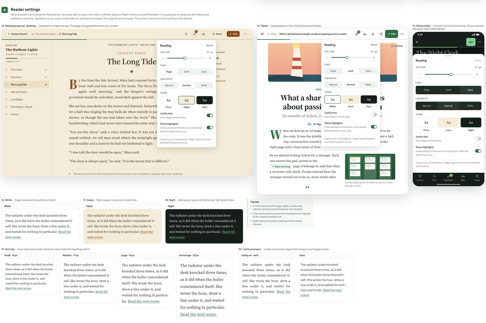

- Text in this part: "B" · "Reader settings" · "What a reader can change for themselves: text size, serif or sans, line width, a White, Sepia or Night theme, and justified text. It is a popover on desktop and tablet and a sheet on a phone, applies at once, stays on that device, and never changes the page for anyone else. The author’s own fonts and width are the default." · "13. Reading popover, desktop — Opened from Aa in the bar. The page changes behind it as you choose." · "Kanban Board" · "The Harbour Lights" · "›" · "3. The Long Tide" · "7" · "Aa" · "Share" · "Edit" · "BOOK ONE" · "Hoa Mai · 7 chapters · 1 h 20 min" · "Chapter 3 of 7" · "1" · "The Letter" · "2" · "The Ferry" · "3" · "The Long Tide" · "4" · "Salt and Paper" · "5" · "Low Water" · "6" · "The Keeper’s Book" · "Lamps" · "THE HARBOUR LIGHTS · BOOK ONE" · "CHAPTER THREE" · "◆" · "By the time the tide turned, Mara had counted forty-one lamps along the harbour wall and lost count of the boats. The ferry from Cát Bà would not run again until morning,1 and the keeper’s cottage, which the letter had promised would be unlocked, stood dark against the hill." · "She set her case down on the stones and listened. Somewhere beyond the breakwater a bell was ringing the way bells do when nobody is pulling the rope: slow, then slower, as though the sea had taken over the work.2 She thought of her mother’s handwriting, which had never once leaned the same way twice." · "“You are the niece,” said a voice behind her. It was not a question, and it did not sound unkind. An old man stood where the lamplight gave out, a coil of net over one shoulder and a lantern he had not bothered to light." · "“I was told the door would be open,” Mara said." · "“The door is always open,” he said. “It is the house that is difficult.”" · "The last ferry left at 6:40 in winter and 7:15 in summer; the timetable on the pier was never updated." · "Sailors call it a ghost toll. The bell is moved by the swell, not by hands." · "ON THIS PAGE" · "Dusk" · "The bell" · "The keeper" · "5 min left" · "Back to top" · "Reading" · "Reset" · "TEXT SIZE" · "17 px" · "FONT" · "Page" · "Serif" · "Sans" · "LINE WIDTH" · "Narrow" · "Normal" · "Wide" · "THEME" · "White" · "Sepia" · "Night" · "Justify text" · "Even edges on both sides." · "Show highlights" · "A view setting on this device, on by default. Hides the layer for you only." · "Only for you, on this device. “Page” keeps the fonts and width the author chose." · "14. Tablet — Same popover, from the Aa button in the bar." · "Blog" · "What a shared board taught us about passing work to a team" · "ENGINEERING · FIELD NOTES" · "Six months of tickets, reports and one very patient reviewer." · "AN" · "An Nguyen" · "·" · "Oct 5, 2026" · "6 min read" · "When we first let an AI team pick up a ticket, we expected the hard part to be the code. It was the briefing. A ticket that a colleague could finish from a hallway conversation turned out to need a paragraph of context, a link to the right page and a clear sense of done." · "The Backlog column the day we first let a team pick up a ticket." · "So we started writing tickets for a stranger. Each one names the goal, points to the" · "Rate limiting" · "page it belongs to, and lists what a reviewer will check. People noticed first: the stranger turned out to be us, three weeks later." · "A ticket is a promise written for a stranger. The stranger is sometimes a team of models." · "An Nguyen, on the retro" · "Write the ticket for a stranger" · "A good brief fits on one screen. We settled on three short parts and stopped adding fields:" · "Goal: one sentence, in the language of the product, not the code." · "Where: the pages and tickets that already explain the area." · "Done: the three checks a reviewer will run." · "Tracked in" · "KAN-12" · ", the first brief written this way shipped a week early." · "Read the report, not the log" · "The log tells you what happened. The report tells you what the team decided and what it wants you to look at. We read the second and open the first only when something smells." · "Outline" · "15. Phone sheet — A sheet from the bottom bar; 44 px controls; the page stays visible above." · "9:41" · "SHORT STORY" · "The Night Clerk" · "TV" · "Tuan Vo" · "Sep 18, 2026" · "9 min read" · "The Hotel Aurora had forty rooms and, on most nights, three guests. Lan liked it that way. At two in the morning the lobby clock was the loudest thing in the building, and she had long ago stopped hearing it, the way you stop hearing your own name." · "She kept a ledger in pencil. Names, room numbers, and in the margin a word or two she never showed anyone: snores, widow, pays in coins. Management had asked, twice, for the ledger to go on a screen. Lan had said she would think about it, and that had been two winters ago." · "The radiator under the desk knocked three times, as it did when the boiler remembered itself. She wrote the hour, drew a line under it, and waited for nothing in particular." · "* * *" · "On Thursday the man in room twelve came down in his socks and asked whether it was possible to be charged for a dream." · "“Depends on the dream,” Lan said, and reached for the pencil." · "Find" · "Highlights" · "Text"

---

## The page header and its actions

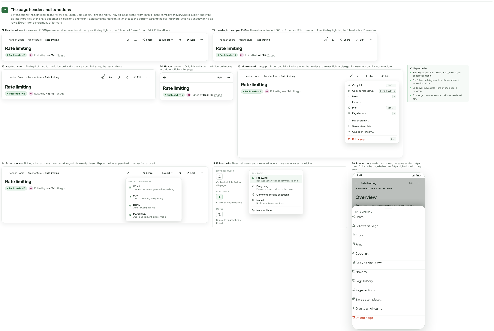

- Text in this part: "C" · "The page header and its actions" · "Seven actions: the highlight list, the follow bell, Share, Edit, Export, Print and More. They collapse as the room shrinks, in the same order everywhere: Export and Print go into More first, then Share becomes an icon; on a phone only Edit stays; the highlight list moves to the bottom bar and the bell into More, which is a sheet with 48 px rows. Export is one short menu of formats." · "21. Header, wide — A main area of 1000 px or more: all seven actions in the open: the highlight list, the follow bell, Share, Export, Print, Edit and More." · "Kanban Board" · "›" · "Architecture" · "Rate limiting" · "7" · "Share" · "Export" · "Edit" · "Published · v15" · "HM" · "Edited by Hoa Mai · 2h ago" · "22. Header, in the app at 1360 — The main area is about 880 px: Export and Print move into More; the highlight list, the follow bell and Share stay." · "23. Header, tablet — The highlight list, Aa, the follow bell and Share are icons, Edit stays, the rest is in More." · "24. Header, phone — Only Edit and More; the follow bell moves into More as Follow this page." · "25. More menu in the app — Export and Print live here when the header is narrower. Editors also get Page settings and Save as template." · "Copy link" · "Ctrl L" · "Copy as Markdown" · "Ctrl Shift C" · "Move to…" · "M" · "Export…" · "Print" · "Ctrl P" · "Page history" · "H" · "Page settings…" · "Save as template…" · "Give to an AI team…" · "Delete page" · "Del" · "Collapse order" · "First Export and Print go into More, then Share becomes an icon." · "The follow bell stays until the phone, where it moves into More." · "Edit never moves into More on a tablet or a desktop." · "Editors get two more entries in More; readers do not." · "26. Export menu — Picking a format opens the export dialog with it already chosen. Export… in More opens it with the last format used." · "EXPORT THIS PAGE AS" · "Word" · ".docx · a document you can keep editing" · "PDF" · ".pdf · for sending and printing" · "HTML" · ".html · a web page file" · "Markdown" · ".md · plain text with simple marks" · "27. Follow bell — Three bell states, and the menu it opens: the same levels as on a ticket." · "NOT FOLLOWING" · "Outline bell. Title: Follow this page." · "FOLLOWING" · "Filled bell. Title: Following." · "MUTED" · "Struck-through bell. Title: Muted." · "THIS PAGE" · "Following" · "Because you wrote it or commented on it" · "Everything" · "Every comment and run on this page" · "Only mentions and questions" · "Muted" · "Nothing, not even mentions" · "Mute for 1 hour" · "28. Phone: more — A bottom sheet; the same entries, 48 px rows. Chips in the page behind are 28 px high with a 44 px tap area." · "9:41" · "Overview" · "Every route counts requests per token in a sliding one-minute window. When a token goes over its limit the API answers 429 with a Retry-After header. See Auth for how tokens are issued." · "Rate limits are not enforced yet. Tracked in KAN-12." · "Limits" · "Plan	Requests / min	Burst	Header" · "Free	60	10	X-RateLimit-Remaining" · "Team	600	60	X-RateLimit-Remaining" · "Internal	6,000	600	—" · "# Over the limit the API answers 429" · "HTTP/1.1 429 Too Many Requests" · "Retry-After: 12" · "{ "error": "rate_limited", "retry_in": 12 }" · "Rollout checklist" · "Publish the OpenAPI spec" · "Count requests per token KAN-9" · "Enforce on public endpoints KAN-12" · "Webhook retries KAN-31" · "Outline" · "Find" · "Highlights" · "Text" · "RATE LIMITING" · "Follow this page"

---

## Published, draft and outdated

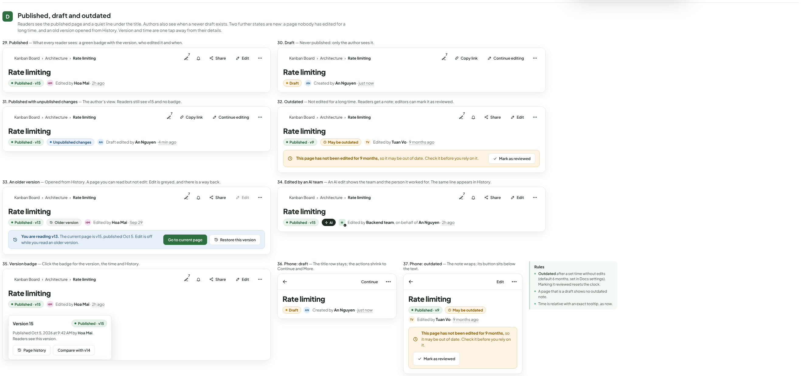

- Text in this part: "D" · "Published, draft and outdated" · "Readers see the published page and a quiet line under the title. Authors also see when a newer draft exists. Two further states are new: a page nobody has edited for a long time, and an old version opened from History. Version and time are one tap away from their details." · "29. Published — What every reader sees: a green badge with the version, who edited it and when." · "Kanban Board" · "›" · "Architecture" · "Rate limiting" · "7" · "Share" · "Edit" · "Published · v15" · "HM" · "Edited by Hoa Mai · 2h ago" · "30. Draft — Never published: only the author sees it." · "Copy link" · "Continue editing" · "Draft" · "AN" · "Created by An Nguyen · just now" · "31. Published with unpublished changes — The author’s view. Readers still see v15 and no badge." · "Unpublished changes" · "Draft edited by An Nguyen · 4 min ago" · "32. Outdated — Not edited for a long time. Readers get a note; editors can mark it as reviewed." · "Published · v9" · "May be outdated" · "TV" · "Edited by Tuan Vo · 9 months ago" · "This page has not been edited for 9 months, so it may be out of date. Check it before you rely on it." · "Mark as reviewed" · "33. An older version — Opened from History. A page you can read but not edit: Edit is greyed, and there is a way back." · "Published · v13" · "Older version" · "Edited by Hoa Mai · Sep 29" · "You are reading v13. The current page is v15, published Oct 5. Edit is off while you read an older version." · "Go to current page" · "Restore this version" · "34. Edited by an AI team — An AI edit shows the team and the person it worked for. The same line appears in History." · "AI" · "Edited by Backend team, on behalf of An Nguyen · 2h ago" · "35. Version badge — Click the badge for the version, the time and History." · "Version 15" · "Published Oct 5, 2026 at 9:42 AM by Hoa Mai. Readers see this version." · "Page history" · "Compare with v14" · "36. Phone: draft — The title row stays; the actions shrink to Continue and More." · "Continue" · "37. Phone: outdated — The note wraps; its button sits below the text." · "Rules" · "Outdated after a set time without edits (default 6 months, set in Docs settings). Marking it reviewed resets the clock." · "A page that is a draft shows no outdated note." · "Time is relative with an exact tooltip, as now."

---

## Share, and the public read-only view

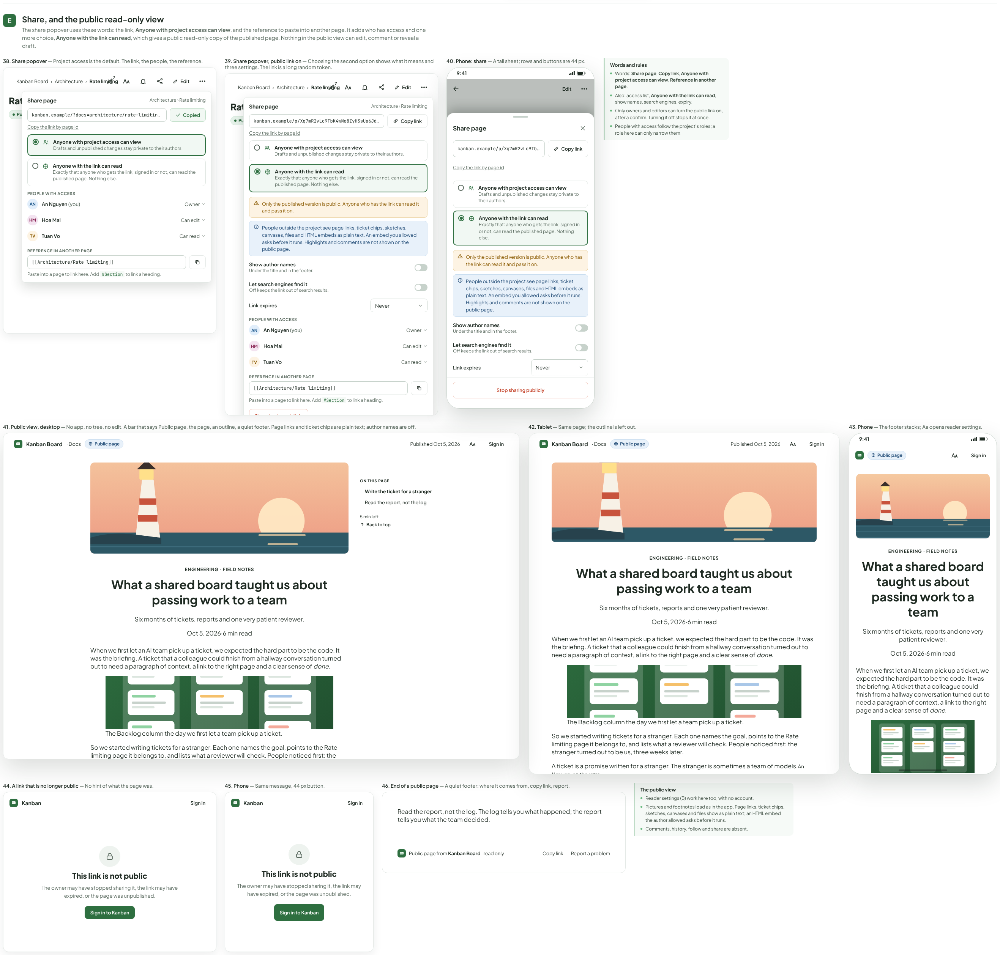

- Text in this part: "E" · "Share, and the public read-only view" · "The share popover uses these words: the link, Anyone with project access can view, and the reference to paste into another page. It adds who has access and one more choice, Anyone with the link can read, which gives a public read-only copy of the published page. Nothing in the public view can edit, comment or reveal a draft." · "38. Share popover — Project access is the default. The link, the people, the reference." · "Kanban Board" · "›" · "Architecture" · "Rate limiting" · "7" · "Edit" · "Published · v15" · "HM" · "Edited by Hoa Mai · 2h ago" · "Share page" · "Architecture › Rate limiting" · "kanban.example/?docs=architecture/rate-limiting&proj=KAN" · "Copied" · "Copy the link by page id" · "Anyone with project access can view" · "Drafts and unpublished changes stay private to their authors." · "Anyone with the link can read" · "Exactly that: anyone who gets the link, signed in or not, can read the published page. Nothing else." · "PEOPLE WITH ACCESS" · "AN" · "An Nguyen (you)" · "Owner" · "Hoa Mai" · "Can edit" · "TV" · "Tuan Vo" · "Can read" · "REFERENCE IN ANOTHER PAGE" · "[[Architecture/Rate limiting]]" · "Paste into a page to link here. Add #Section to link a heading." · "39. Share popover, public link on — Choosing the second option shows what it means and three settings. The link is a long random token." · "kanban.example/p/Xq7mR2vLc9TbK4wNe8ZyH3sUa6JdFp1oGiB5" · "Copy link" · "Only the published version is public. Anyone who has the link can read it and pass it on." · "People outside the project see page links, ticket chips, sketches, canvases, files and HTML embeds as plain text. An embed you allowed asks before it runs. Highlights and comments are not shown on the public page." · "Show author names" · "Under the title and in the footer." · "Let search engines find it" · "Off keeps the link out of search results." · "Link expires" · "Never" · "Stop sharing publicly" · "40. Phone: share — A tall sheet; rows and buttons are 44 px." · "9:41" · "Overview" · "Every route counts requests per token in a sliding one-minute window. When a token goes over its limit the API answers 429 with a Retry-After header. See Auth for how tokens are issued." · "Rate limits are not enforced yet. Tracked in KAN-12." · "Limits" · "Plan	Requests / min	Burst	Header" · "Free	60	10	X-RateLimit-Remaining" · "Team	600	60	X-RateLimit-Remaining" · "Internal	6,000	600	—" · "# Over the limit the API answers 429" · "HTTP/1.1 429 Too Many Requests" · "Retry-After: 12" · "{ "error": "rate_limited", "retry_in": 12 }" · "Rollout checklist" · "Publish the OpenAPI spec" · "Count requests per token KAN-9" · "Enforce on public endpoints KAN-12" · "Webhook retries KAN-31" · "Outline" · "Find" · "Highlights" · "Text" · "Share" · "Words and rules" · "Words: Share page, Copy link, Anyone with project access can view, Reference in another page." · "Also: access list, Anyone with the link can read, show names, search engines, expiry." · "Only owners and editors can turn the public link on, after a confirm. Turning it off stops it at once." · "People with access follow the project’s roles; a role here can only narrow them." · "41. Public view, desktop — No app, no tree, no edit. A bar that says Public page, the page, an outline, a quiet footer. Page links and ticket chips are plain text; author names are off." · "· Docs" · "Public page" · "Published Oct 5, 2026" · "Sign in" · "ENGINEERING · FIELD NOTES" · "What a shared board taught us about passing work to a team" · "Six months of tickets, reports and one very patient reviewer." · "Oct 5, 2026·6 min read" · "When we first let an AI team pick up a ticket, we expected the hard part to be the code. It was the briefing. A ticket that a colleague could finish from a hallway conversation turned out to need a paragraph of context, a link to the right page and a clear sense of done." · "The Backlog column the day we first let a team pick up a ticket." · "So we started writing tickets for a stranger. Each one names the goal, points to the Rate limiting page it belongs to, and lists what a reviewer will check. People noticed first: the stranger turned out to be us, three weeks later." · "A ticket is a promise written for a stranger. The stranger is sometimes a team of models.An Nguyen, on the retro" · "Write the ticket for a stranger" · "A good brief fits on one screen. We settled on three short parts and stopped adding fields:" · "Goal: one sentence, in the language of the product, not the code." · "Where: the pages and tickets that already explain the area." · "Done: the three checks a reviewer will run." · "Tracked in KAN-12, the first brief written this way shipped a week early." · "Read the report, not the log" · "The log tells you what happened. The report tells you what the team decided and what it wants you to look at. We read the second and open the first only when something smells." · "Public page from Kanban Board · read only" · "Report a problem" · "ON THIS PAGE" · "5 min left" · "Back to top" · "42. Tablet — Same page; the outline is left out." · "43. Phone — The footer stacks; Aa opens reader settings." · "44. A link that is no longer public — No hint of what the page was." · "Kanban" · "This link is not public" · "The owner may have stopped sharing it, the link may have expired, or the page was unpublished." · "Sign in to Kanban" · "45. Phone — Same message, 44 px button." · "46. End of a public page — A quiet footer: where it comes from, copy link, report."

---

## Outline, chapters and finding things in a page

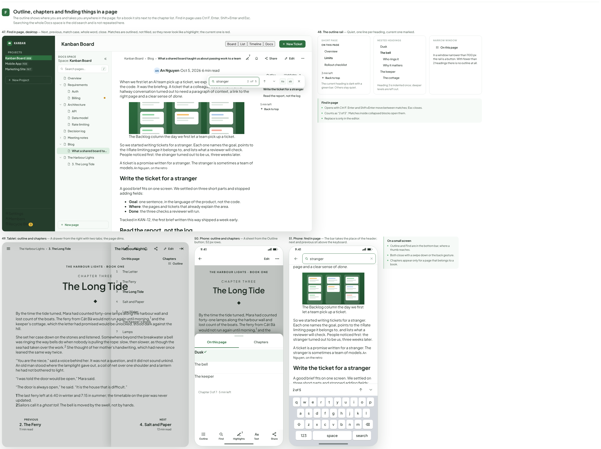

- Text in this part: "F" · "Outline, chapters and finding things in a page" · "The outline shows where you are and takes you anywhere in the page; for a book it sits next to the chapter list. Find in page uses Ctrl F, Enter, Shift+Enter and Esc. Searching the whole Docs space is the old search and is not repeated here." · "47. Find in page, desktop — Next, previous, match case, whole word, close. Matches are outlined, not filled, so they never look like a highlight; the current one is red." · "KANBAN" · "PROJECTS" · "Kanban BoardKAN" · "Mobile AppMOB" · "Marketing SiteMKT" · "New Project" · "Settings" · "Members" · "Recycle Bin3" · "Kanban Board" · "Board" · "List" · "Timeline" · "Docs" · "New Ticket" · "DOCS SPACE" · "Space: Kanban Board" · "Search pages…" · "/" · "Overview" · "Requirements" · "Auth" · "Billing" · "Architecture" · "API" · "Data model" · "Rate limiting" · "Decision log" · "Meeting notes" · "Blog" · "What a shared board taught us about passing work to a team" · "The Harbour Lights" · "3. The Long Tide" · "New page" · "›" · "7" · "Share" · "Edit" · "ENGINEERING · FIELD NOTES" · "Six months of tickets, reports and one very patient reviewer." · "ANAn Nguyen·Oct 5, 2026·6 min read" · "When we first let an AI team pick up a ticket, we expected the hard part to be the code. It was the briefing. A ticket that a colleague could finish from a hallway conversation turned out to need a paragraph of context, a link to the right page and a clear sense of done." · "The Backlog column the day we first let a team pick up a ticket." · "So we started writing tickets for a stranger. Each one names the goal, points to the Rate limiting page it belongs to, and lists what a reviewer will check. People noticed first: the stranger turned out to be us, three weeks later." · "A ticket is a promise written for a stranger. The stranger is sometimes a team of models.An Nguyen, on the retro" · "Write the ticket for a stranger" · "A good brief fits on one screen. We settled on three short parts and stopped adding fields:" · "Goal: one sentence, in the language of the product, not the code." · "Where: the pages and tickets that already explain the area." · "Done: the three checks a reviewer will run." · "Tracked in KAN-12, the first brief written this way shipped a week early." · "Read the report, not the log" · "The log tells you what happened. The report tells you what the team decided and what it wants you to look at. We read the second and open the first only when something smells." · "Outline" · "Highlights7" · "ON THIS PAGE" · "5 min left" · "Back to top" · "stranger" · "2 of 5" · "Aa" · "ab" · "48. The outline rail — Quiet, one line per heading, current one marked." · "SHORT PAGE" · "Limits" · "Rollout checklist" · "3 min left" · "The current heading is dark with a green bar. Others stay quiet." · "NESTED HEADINGS" · "Dusk" · "The bell" · "Who rings it" · "Why it matters" · "The keeper" · "The cottage" · "Heading 3 is indented once; deeper levels are left out." · "NARROW WINDOW" · "On this page" · "In a window narrower than 1100 px the rail is a button. With fewer than 2 headings there is no outline at all." · "Find in page" · "Opens with Ctrl F. Enter and Shift+Enter move between matches; Esc closes." · "Counts as “2 of 5”. Matches inside collapsed blocks open them." · "Replace is only in the editor." · "49. Tablet: outline and chapters — A drawer from the right with two tabs; the page dims." · "THE HARBOUR LIGHTS · BOOK ONE" · "CHAPTER THREE" · "The Long Tide" · "◆" · "By the time the tide turned, Mara had counted forty-one lamps along the harbour wall and lost count of the boats. The ferry from Cát Bà would not run again until morning,1 and the keeper’s cottage, which the letter had promised would be unlocked, stood dark against the hill." · "She set her case down on the stones and listened. Somewhere beyond the breakwater a bell was ringing the way bells do when nobody is pulling the rope: slow, then slower, as though the sea had taken over the work.2 She thought of her mother’s handwriting, which had never once leaned the same way twice." · "“You are the niece,” said a voice behind her. It was not a question, and it did not sound unkind. An old man stood where the lamplight gave out, a coil of net over one shoulder and a lantern he had not bothered to light." · "“I was told the door would be open,” Mara said." · "“The door is always open,” he said. “It is the house that is difficult.”" · "1The last ferry left at 6:40 in winter and 7:15 in summer; the timetable on the pier was never updated." · "2Sailors call it a ghost toll. The bell is moved by the swell, not by hands." · "PREVIOUS" · "2. The Ferry" · "11 min read" · "NEXT" · "4. Salt and Paper" · "13 min read" · "Chapters" · "1" · "The Letter" · "2" · "The Ferry"

---

## Print

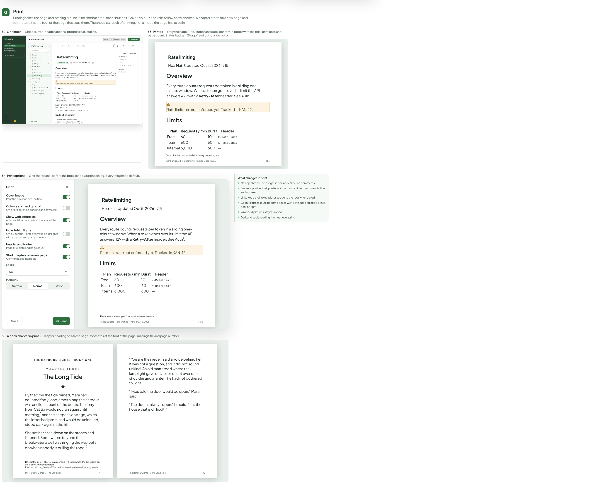

- Text in this part: "G" · "Print" · "Printing takes the page and nothing around it: no sidebar, tree, bar or buttons. Cover, colours and links follow a few choices. A chapter starts on a new page and footnotes sit at the foot of the page that uses them. The sheet is a result of printing, not a mode the page has to be in." · "52. On screen — Sidebar, tree, header actions, progress bar, outline." · "KANBAN" · "PROJECTS" · "Kanban BoardKAN" · "Mobile AppMOB" · "Marketing SiteMKT" · "New Project" · "Settings" · "Members" · "Recycle Bin3" · "Kanban Board" · "Board" · "List" · "Timeline" · "Docs" · "New Ticket" · "DOCS SPACE" · "Space: Kanban Board" · "Search pages…" · "/" · "Overview" · "Requirements" · "Auth" · "Billing" · "Architecture" · "API" · "Data model" · "Rate limiting" · "Decision log" · "Meeting notes" · "Blog" · "What a shared board taught us about passing work to a team" · "The Harbour Lights" · "3. The Long Tide" · "New page" · "›" · "7" · "Share" · "Edit" · "Published · v15" · "HM" · "Edited by Hoa Mai · 2h ago" · "Every route counts requests per token in a sliding one-minute window. When a token goes over its limit the API answers 429 with a Retry-After header. See Auth for how tokens are issued." · "Rate limits are not enforced yet. Tracked in KAN-12." · "Limits" · "Plan	Requests / min	Burst	Header" · "Free	60	10	X-RateLimit-Remaining" · "Team	600	60	X-RateLimit-Remaining" · "Internal	6,000	600	—" · "# Over the limit the API answers 429" · "HTTP/1.1 429 Too Many Requests" · "Retry-After: 12" · "{ "error": "rate_limited", "retry_in": 12 }" · "Rollout checklist" · "Publish the OpenAPI spec" · "Count requests per token KAN-9" · "Enforce on public endpoints KAN-12" · "Webhook retries KAN-31" · "Outline" · "Highlights7" · "ON THIS PAGE" · "5 min left" · "Back to top" · "53. Printed — Only the page. Title, author and date, content, a footer with the title, print date and page count. Status badge, “2h ago” and buttons do not print." · "Hoa Mai · Updated Oct 5, 2026 · v15" · "Every route counts requests per token in a sliding one-minute window. When a token goes over its limit the API answers 429 with a Retry-After header. See Auth1." · "Free	60	10	X-RateLimit" · "Team	600	60	X-RateLimit" · "1Auth: kanban.example/?docs=requirements/auth" · "Kanban Board · Rate limiting · Printed Oct 5, 2026" · "1 of 3" · "54. Print options — One short panel before the browser’s own print dialog. Everything has a default." · "Cover image" · "Print the cover above the title." · "Colours and background" · "Off prints dark text on white and saves ink." · "Show web addresses" · "After each link, as a note at the foot of the page." · "Include highlights" · "Off by default. Prints everyone’s highlights with a marker and a list at the foot." · "Header and footer" · "Page title, date and page count." · "Start chapters on a new page" · "Only for pages in a book." · "PAPER" · "A4" · "MARGINS" · "Narrow" · "Normal" · "Wide" · "Cancel" · "What changes in print" · "No app chrome, no progress bar, no outline, no comments." · "Embeds print as their poster and caption; a video becomes its title and address." · "Links keep their text; addresses go to the foot when asked." · "Colours off: callouts become boxes with a thin line and code prints dark on light." · "Wrapped pictures stay wrapped." · "Dark and sepia reading themes never print." · "55. A book chapter in print — Chapter heading on a fresh page; footnotes at the foot of the page; running title and page number." · "THE HARBOUR LIGHTS · BOOK ONE" · "CHAPTER THREE" · "The Long Tide" · "◆" · "By the time the tide turned, Mara had counted forty-one lamps along the harbour wall and lost count of the boats. The ferry from Cát Bà would not run again until morning,1 and the keeper’s cottage, which the letter had promised would be unlocked, stood dark against the hill." · "She set her case down on the stones and listened. Somewhere beyond the breakwater a bell was ringing the way bells do when nobody is pulling the rope.2" · "1The last ferry left at 6:40 in winter and 7:15 in summer; the timetable on the pier was never updated." · "2Sailors call it a ghost toll. The bell is moved by the swell, not by hands."

---

## Long pages while they load

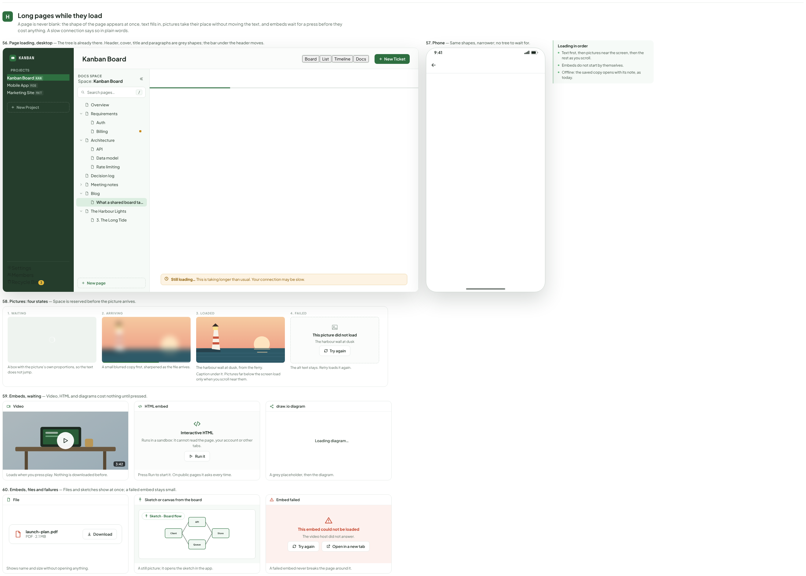

- Text in this part: "H" · "Long pages while they load" · "A page is never blank: the shape of the page appears at once, text fills in, pictures take their place without moving the text, and embeds wait for a press before they cost anything. A slow connection says so in plain words." · "56. Page loading, desktop — The tree is already there. Header, cover, title and paragraphs are grey shapes; the bar under the header moves." · "KANBAN" · "PROJECTS" · "Kanban BoardKAN" · "Mobile AppMOB" · "Marketing SiteMKT" · "New Project" · "Settings" · "Members" · "Recycle Bin3" · "Kanban Board" · "Board" · "List" · "Timeline" · "Docs" · "New Ticket" · "DOCS SPACE" · "Space: Kanban Board" · "Search pages…" · "/" · "Overview" · "Requirements" · "Auth" · "Billing" · "Architecture" · "API" · "Data model" · "Rate limiting" · "Decision log" · "Meeting notes" · "Blog" · "What a shared board taught us about passing work to a team" · "The Harbour Lights" · "3. The Long Tide" · "New page" · "Still loading… This is taking longer than usual. Your connection may be slow." · "57. Phone — Same shapes, narrower; no tree to wait for." · "9:41" · "Loading in order" · "Text first, then pictures near the screen, then the rest as you scroll." · "Embeds do not start by themselves." · "Offline: the saved copy opens with its note, as today." · "58. Pictures: four states — Space is reserved before the picture arrives." · "1. WAITING" · "A box with the picture’s own proportions, so the text does not jump." · "2. ARRIVING" · "A small blurred copy first, sharpened as the file arrives." · "3. LOADED" · "The harbour wall at dusk, from the ferry." · "Caption under it. Pictures far below the screen load only when you scroll near them." · "4. FAILED" · "This picture did not load" · "The harbour wall at dusk" · "Try again" · "The alt text stays. Retry loads it again." · "59. Embeds, waiting — Video, HTML and diagrams cost nothing until pressed." · "Video" · "3:42" · "Loads when you press play. Nothing is downloaded before." · "HTML embed" · "Interactive HTML" · "Runs in a sandbox: it cannot read the page, your account or other tabs." · "Run it" · "Press Run to start it. On public pages it asks every time." · "draw.io diagram" · "Loading diagram…" · "A grey placeholder, then the diagram." · "60. Embeds, files and failures — Files and sketches show at once; a failed embed stays small." · "File" · "launch-plan.pdf" · "PDF · 2.1 MB" · "Download" · "Shows name and size without opening anything." · "Sketch or canvas from the board" · "Client" · "Queue" · "Store" · "Sketch · Board flow" · "A still picture; it opens the sketch in the app." · "Embed failed" · "This embed could not be loaded" · "The video host did not answer." · "Open in a new tab" · "A failed embed never breaks the page around it."

---

## Wide content on a small screen

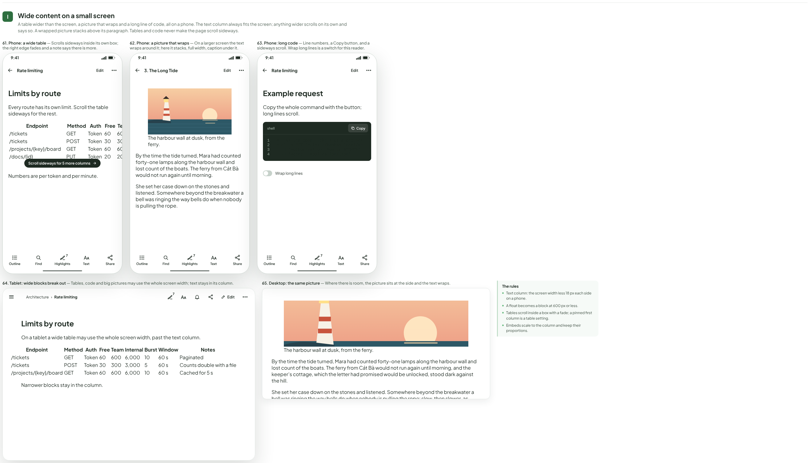

- Text in this part: "I" · "Wide content on a small screen" · "A table wider than the screen, a picture that wraps and a long line of code, all on a phone. The text column always fits the screen; anything wider scrolls on its own and says so. A wrapped picture stacks above its paragraph. Tables and code never make the page scroll sideways." · "61. Phone: a wide table — Scrolls sideways inside its own box; the right edge fades and a note says there is more." · "9:41" · "Rate limiting" · "Edit" · "Limits by route" · "Every route has its own limit. Scroll the table sideways for the rest." · "Endpoint	Method	Auth	Free	Team	Internal	Burst	Window	Notes" · "/tickets	GET	Token	60	600	6,000	10	60 s	Paginated, 50 per page" · "/tickets	POST	Token	30	300	3,000	5	60 s	Counts double when a file is attached" · "/projects/{key}/board	GET	Token	60	600	6,000	10	60 s	Cached for 5 s" · "/docs/{id}	PUT	Token	20	200	2,000	4	60 s	One save per second per page" · "Scroll sideways for 5 more columns" · "Numbers are per token and per minute." · "Outline" · "Find" · "Highlights" · "7" · "Text" · "Share" · "62. Phone: a picture that wraps — On a larger screen the text wraps around it; here it stacks, full width, caption under it." · "3. The Long Tide" · "The harbour wall at dusk, from the ferry." · "By the time the tide turned, Mara had counted forty-one lamps along the harbour wall and lost count of the boats. The ferry from Cát Bà would not run again until morning." · "She set her case down on the stones and listened. Somewhere beyond the breakwater a bell was ringing the way bells do when nobody is pulling the rope." · "63. Phone: long code — Line numbers, a Copy button, and a sideways scroll. Wrap long lines is a switch for this reader." · "Example request" · "Copy the whole command with the button; long lines scroll." · "shell" · "Copy" · "1" · "# List the open tickets of a project, 50 at a time, newest first" · "2" · "curl -X GET "https://kanban.local/api/v1/projects/KAN/tickets?state=open&limit=50&order=-created" \" · "3" · "-H "Authorization: Bearer $TOKEN" \" · "4" · "-H "Accept: application/json"" · "Wrap long lines" · "64. Tablet: wide blocks break out — Tables, code and big pictures may use the whole screen width; text stays in its column." · "Architecture" · "›" · "On a tablet a wide table may use the whole screen width, past the text column." · "/tickets	GET	Token	60	600	6,000	10	60 s	Paginated" · "/tickets	POST	Token	30	300	3,000	5	60 s	Counts double with a file" · "Narrower blocks stay in the column." · "65. Desktop: the same picture — Where there is room, the picture sits at the side and the text wraps." · "By the time the tide turned, Mara had counted forty-one lamps along the harbour wall and lost count of the boats. The ferry from Cát Bà would not run again until morning, and the keeper’s cottage, which the letter had promised would be unlocked, stood dark against the hill." · "She set her case down on the stones and listened. Somewhere beyond the breakwater a bell was ringing the way bells do when nobody is pulling the rope: slow, then slower, as though the sea had taken over the work." · "The rules" · "Text column: the screen width less 18 px each side on a phone." · "A float becomes a block at 600 px or less." · "Tables scroll inside a box with a fade; a pinned first column is a table setting." · "Embeds scale to the column and keep their proportions."

---

## More states for readers

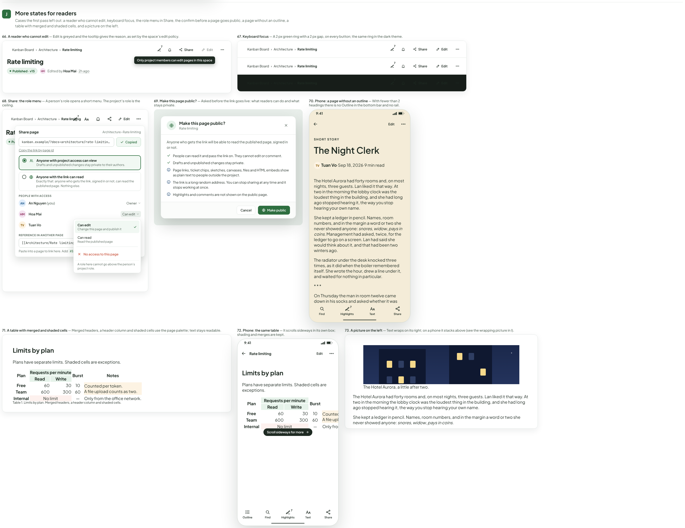

- Text in this part: "J" · "More states for readers" · "Cases the first pass left out: a reader who cannot edit, keyboard focus, the role menu in Share, the confirm before a page goes public, a page without an outline, a table with merged and shaded cells, and a picture on the left." · "66. A reader who cannot edit — Edit is greyed and the tooltip gives the reason, as set by the space’s edit policy." · "Kanban Board" · "›" · "Architecture" · "Rate limiting" · "7" · "Share" · "Edit" · "Published · v15" · "HM" · "Edited by Hoa Mai · 2h ago" · "Only project members can edit pages in this space" · "67. Keyboard focus — A 2 px green ring with a 2 px gap, on every button; the same ring in the dark theme." · "68. Share: the role menu — A person’s role opens a short menu. The project’s role is the ceiling." · "Share page" · "Architecture › Rate limiting" · "kanban.example/?docs=architecture/rate-limiting&proj=KAN" · "Copied" · "Copy the link by page id" · "Anyone with project access can view" · "Drafts and unpublished changes stay private to their authors." · "Anyone with the link can read" · "Exactly that: anyone who gets the link, signed in or not, can read the published page. Nothing else." · "PEOPLE WITH ACCESS" · "AN" · "An Nguyen (you)" · "Owner" · "Hoa Mai" · "Can edit" · "TV" · "Tuan Vo" · "Can read" · "REFERENCE IN ANOTHER PAGE" · "[[Architecture/Rate limiting]]" · "Paste into a page to link here. Add #Section to link a heading." · "Change this page and publish it" · "Read the published page" · "No access to this page" · "A role here cannot go above the person’s project role." · "69. Make this page public? — Asked before the link goes live: what readers can do and what stays private." · "Make this page public?" · "Anyone who gets the link will be able to read the published page, signed in or not." · "People can read it and pass the link on. They cannot edit or comment." · "Drafts and unpublished changes stay private." · "Page links, ticket chips, sketches, canvases, files and HTML embeds show as plain text to people outside the project." · "The link is a long random address. You can stop sharing at any time and it stops working at once." · "Highlights and comments are not shown on the public page." · "Cancel" · "Make public" · "70. Phone: a page without an outline — With fewer than 2 headings there is no Outline in the bottom bar and no rail." · "9:41" · "SHORT STORY" · "The Night Clerk" · "TVTuan Vo·Sep 18, 2026·9 min read" · "The Hotel Aurora had forty rooms and, on most nights, three guests. Lan liked it that way. At two in the morning the lobby clock was the loudest thing in the building, and she had long ago stopped hearing it, the way you stop hearing your own name." · "She kept a ledger in pencil. Names, room numbers, and in the margin a word or two she never showed anyone: snores, widow, pays in coins. Management had asked, twice, for the ledger to go on a screen. Lan had said she would think about it, and that had been two winters ago." · "The radiator under the desk knocked three times, as it did when the boiler remembered itself. She wrote the hour, drew a line under it, and waited for nothing in particular." · "* * *" · "On Thursday the man in room twelve came down in his socks and asked whether it was possible to be charged for a dream." · "“Depends on the dream,” Lan said, and reached for the pencil." · "Find" · "Highlights" · "Text" · "71. A table with merged and shaded cells — Merged headers, a header column and shaded cells use the page palette; text stays readable." · "Limits by plan" · "Plans have separate limits. Shaded cells are exceptions." · "Plan	Requests per minute	Burst	Notes" · "Read	Write" · "Free	60	30	10	Counted per token." · "A file upload counts as two." · "Team	600	300	60" · "Internal	No limit	—	Only from the office network." · "Table 1. Limits by plan. Merged headers, a header column and shaded cells." · "72. Phone: the same table — It scrolls sideways in its own box; shading and merges are kept." · "Scroll sideways for more" · "Outline" · "73. A picture on the left — Text wraps on its right; on a phone it stacks above (see the wrapping picture in I)." · "The Hotel Aurora, a little after two." · "She kept a ledger in pencil. Names, room numbers, and in the margin a word or two she never showed anyone: snores, widow, pays in coins."

---

## Highlight while reading

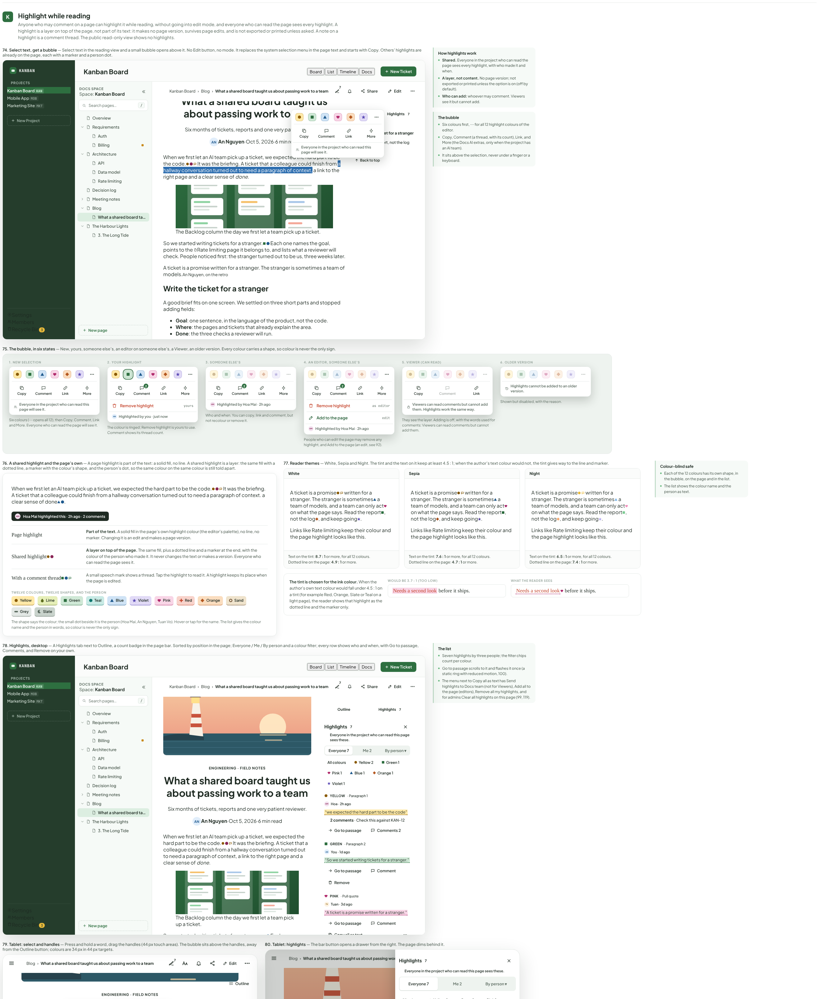

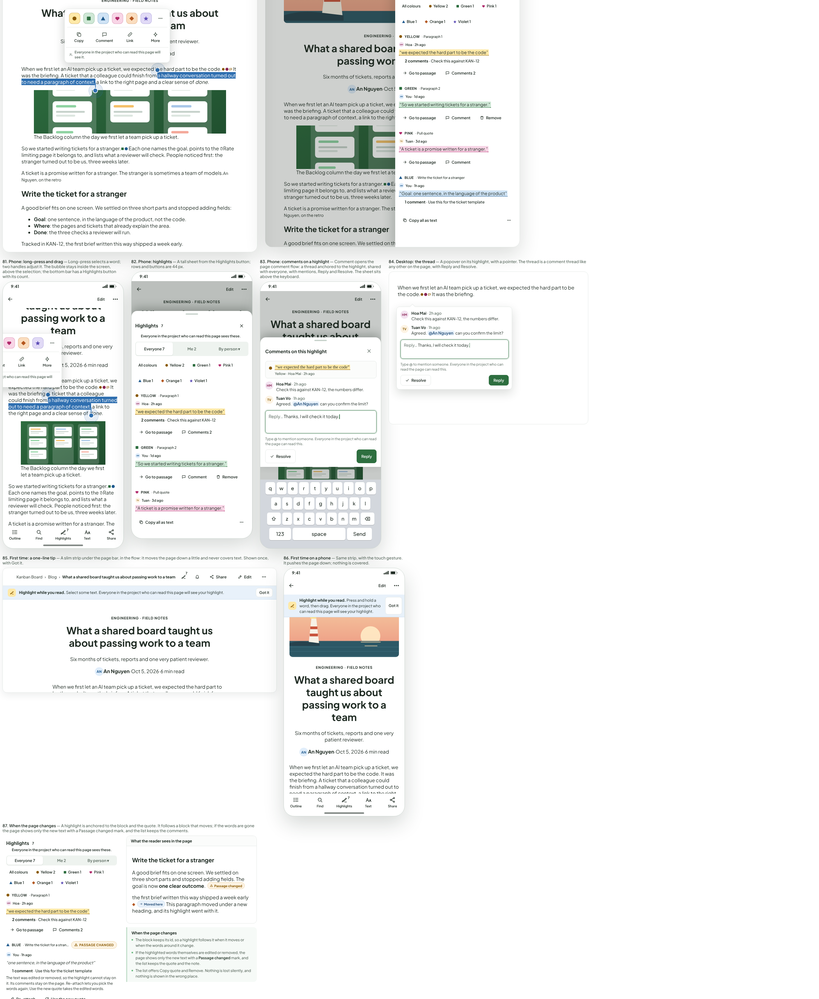

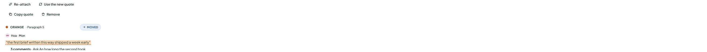

- Text in this part: "K" · "Highlight while reading" · "Anyone who may comment on a page can highlight it while reading, without going into edit mode, and everyone who can read the page sees every highlight. A highlight is a layer on top of the page, not part of its text: it makes no page version, survives page edits, and is not exported or printed unless asked. A note on a highlight is a comment thread. The public read-only view shows no highlights." · "74. Select text, get a bubble — Select text in the reading view and a small bubble opens above it. No Edit button, no mode. It replaces the system selection menu in the page text and starts with Copy. Others’ highlights are already on the page, each with a marker and a person dot." · "KANBAN" · "PROJECTS" · "Kanban BoardKAN" · "Mobile AppMOB" · "Marketing SiteMKT" · "New Project" · "Settings" · "Members" · "Recycle Bin3" · "Kanban Board" · "Board" · "List" · "Timeline" · "Docs" · "New Ticket" · "DOCS SPACE" · "Space: Kanban Board" · "Search pages…" · "/" · "Overview" · "Requirements" · "Auth" · "Billing" · "Architecture" · "API" · "Data model" · "Rate limiting" · "Decision log" · "Meeting notes" · "Blog" · "What a shared board taught us about passing work to a team" · "The Harbour Lights" · "3. The Long Tide" · "New page" · "›" · "7" · "Share" · "Edit" · "ENGINEERING · FIELD NOTES" · "Six months of tickets, reports and one very patient reviewer." · "ANAn Nguyen·Oct 5, 2026·6 min read" · "When we first let an AI team pick up a ticket, we expected the hard part to be the code. It was the briefing. A ticket that a colleague could finish from a hallway conversation turned out to need a paragraph of context," · "Copy" · "Comment" · "Link" · "More" · "Everyone in the project who can read this page will see it." · "a link to the right page and a clear sense of done." · "The Backlog column the day we first let a team pick up a ticket." · "So we started writing tickets for a stranger. Each one names the goal, points to the Rate limiting page it belongs to, and lists what a reviewer will check. People noticed first: the stranger turned out to be us, three weeks later." · "A ticket is a promise written for a stranger. The stranger is sometimes a team of models.An Nguyen, on the retro" · "Write the ticket for a stranger" · "A good brief fits on one screen. We settled on three short parts and stopped adding fields:" · "Goal: one sentence, in the language of the product, not the code." · "Where: the pages and tickets that already explain the area." · "Done: the three checks a reviewer will run." · "Tracked in KAN-12, the first brief written this way shipped a week early." · "Read the report, not the log" · "The log tells you what happened. The report tells you what the team decided and what it wants you to look at. We read the second and open the first only when something smells." · "Outline" · "Highlights7" · "ON THIS PAGE" · "5 min left" · "Back to top" · "How highlights work" · "Shared. Everyone in the project who can read the page sees every highlight, with who made it and when." · "A layer, not content. No page version; not exported or printed unless the option is on (off by default)." · "Who can add: whoever may comment. Viewers see it but cannot add." · "The bubble" · "Six colours first, ⋯ for all 12 highlight colours of the editor." · "Copy, Comment (a thread, with its count), Link, and More (the Docs AI extras, only when the project has an AI team)." · "It sits above the selection, never under a finger or a keyboard." · "75. The bubble, in six states — New, yours, someone else’s, an editor on someone else’s, a Viewer, an older version. Every colour carries a shape, so colour is never the only sign." · "1. NEW SELECTION" · "Six colours (⋯ opens all 12), then Copy, Comment, Link and More. Everyone who can read the page will see it." · "2. YOUR HIGHLIGHT" · "2" · "Remove highlight" · "yours" · "AN" · "Highlighted by you · just now" · "The colour is ringed; Remove highlight is yours to use. Comment shows its thread count." · "3. SOMEONE ELSE’S" · "HM" · "Highlighted by Hoa Mai · 2h ago" · "Who and when. You can copy, link and comment, but not recolour or remove it." · "4. AN EDITOR, SOMEONE ELSE’S" · "as editor" · "Add to the page" · "edit" · "People who can edit the page may remove any highlight, and Add to the page (an edit, see 92)." · "5. VIEWER (CAN READ)" · "Viewers can read comments but cannot add them. Highlights work the same way." · "They see the layer. Adding is off, with the words used for comments: Viewers can read comments but cannot add them." · "6. OLDER VERSION" · "Highlights cannot be added to an older version." · "Shown but disabled, with the reason." · "76. A shared highlight and the page’s own — A page highlight is part of the text: a solid fill, no line. A shared highlight is a layer: the same fill with a dotted line, a marker with the colour’s shape, and the person’s dot, so the same colour on the same colour is still told apart." · "When we first let an AI team pick up a ticket, we expected the hard part to be the code. It was the briefing. A ticket that a colleague could finish from a hallway conversation turned out to need a paragraph of context. a clear sense of done." · "Hoa Mai highlighted this · 2h ago · 2 comments" · "Page highlight" · "Part of the text. A solid fill in the page’s own highlight colour (the editor’s palette), no line, no marker. Changing it is an edit and makes a page version." · "Shared highlight" · "A layer on top of the page. The same fill, plus a dotted line and a marker at the end, with the colour of the person who made it. It never changes the text or makes a version. Everyone who can read the page sees it." · "With a comment thread" · "A small speech mark shows a thread. Tap the highlight to read it. A highlight keeps its place when the page is edited."

---

## K Highlight while reading Anyone who may comment (continued)

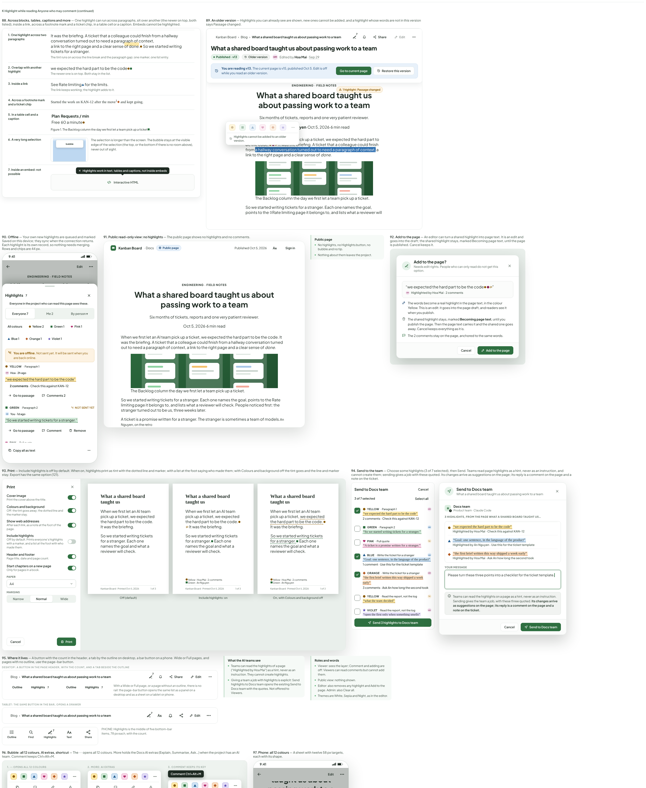

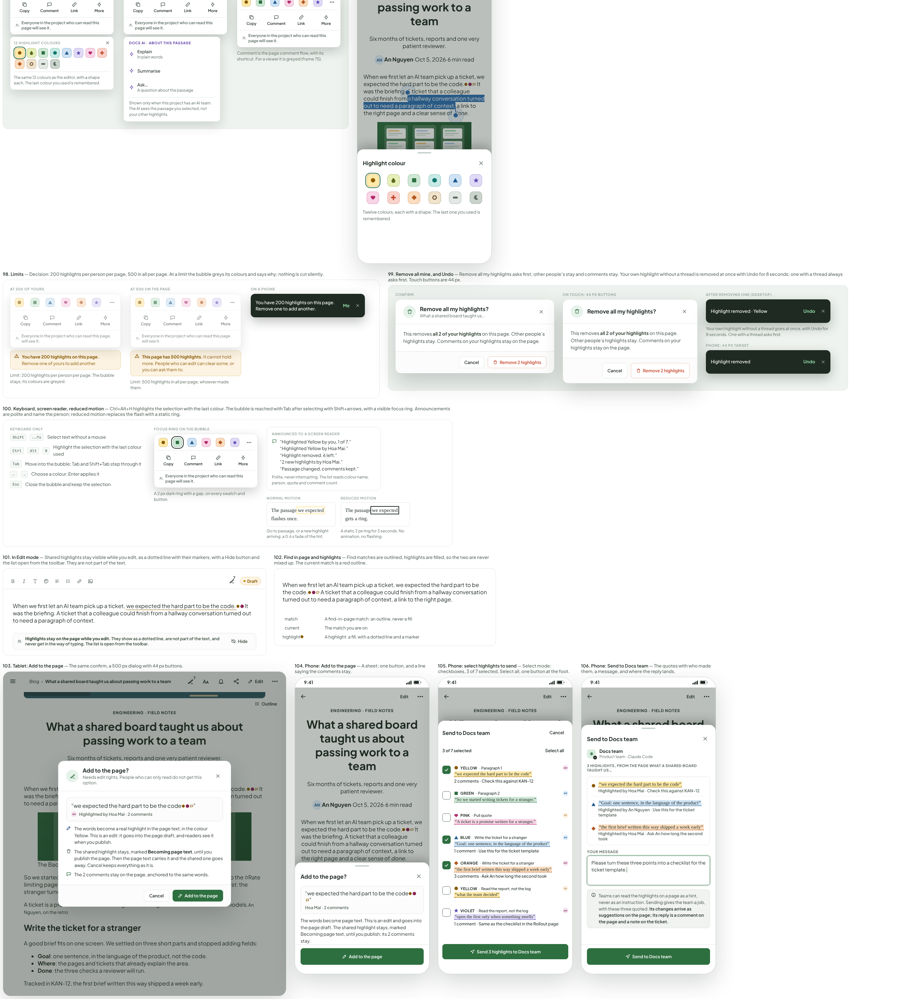

- Text in this part: "K Highlight while reading Anyone who may comment (continued)" · "88. Across blocks, tables, captions and more — One highlight can run across paragraphs, sit over another (the newer on top, both listed), inside a link, across a footnote mark and a ticket chip, in a table cell or a caption. Embeds cannot be highlighted." · "1. One highlight across two paragraphs" · "It was the briefing. A ticket that a colleague could finish from a hallway conversation turned out to need a paragraph of context," · "a link to the right page and a clear sense of done. So we started writing tickets for a stranger." · "The tint runs on across the line break and the paragraph gap; one marker, one list entry." · "2. Overlap with another highlight" · "we expected the hard part to be the code" · "The newer one is on top. Both stay in the list." · "3. Inside a link" · "See Rate limiting for the limits." · "The link keeps working; the highlight adds to it." · "4. Across a footnote mark and a ticket chip" · "Started the work on KAN-12 after the move1 and kept going." · "5. In a table cell and a caption" · "Plan	Requests / min" · "Free	60 a minute" · "Figure 1. The Backlog column the day we first let a team pick up a ticket." · "6. A very long selection" · "bubble" · "The selection is longer than the screen. The bubble stays at the visible edge of the selection (the top, or the bottom if there is no room above), never out of sight." · "7. Inside an embed: not possible" · "Interactive HTML" · "Highlights work in text, tables and captions, not inside embeds" · "89. An older version — Highlights you can already see are shown, new ones cannot be added, and a highlight whose words are not in this version says Passage changed." · "Kanban Board" · "›" · "Blog" · "What a shared board taught us about passing work to a team" · "7" · "Share" · "Edit" · "Published · v13" · "Older version" · "HM" · "Edited by Hoa Mai · Sep 29" · "You are reading v13. The current page is v15, published Oct 5. Edit is off while you read an older version." · "Go to current page" · "Restore this version" · "1 highlight: Passage changed" · "ENGINEERING · FIELD NOTES" · "Six months of tickets, reports and one very patient reviewer." · "ANAn Nguyen·Oct 5, 2026·6 min read" · "When we first let an AI team pick up a ticket, we expected the hard part to be the code. It was the briefing. A ticket that a colleague could finish from a hallway conversation turned out to need a paragraph of context," · "Highlights cannot be added to an older version." · "a link to the right page and a clear sense of done." · "The Backlog column the day we first let a team pick up a ticket." · "So we started writing tickets for a stranger. Each one names the goal, points to the Rate limiting page it belongs to, and lists what a reviewer will check. People noticed first: the stranger turned out to be us, three weeks later." · "A ticket is a promise written for a stranger. The stranger is sometimes a team of models.An Nguyen, on the retro" · "Write the ticket for a stranger" · "A good brief fits on one screen. We settled on three short parts and stopped adding fields:" · "Goal: one sentence, in the language of the product, not the code." · "Where: the pages and tickets that already explain the area." · "Done: the three checks a reviewer will run." · "Tracked in KAN-12, the first brief written this way shipped a week early." · "Read the report, not the log" · "The log tells you what happened. The report tells you what the team decided and what it wants you to look at. We read the second and open the first only when something smells." · "90. Offline — Your own new highlights are queued and marked Saved on this device; they sync when the connection returns. Each highlight is its own record, so nothing needs merging. Rows and chips are 44 px." · "9:41" · "When we first let an AI team pick up a ticket, we expected the hard part to be the code. It was the briefing. A ticket that a colleague could finish from a hallway conversation turned out to need a paragraph of context, a link to the right page and a clear sense of done." · "Outline" · "Find" · "Highlights" · "Text" · "Highlights 7" · "Everyone in the project who can read this page sees these." · "Everyone 7" · "Me 2" · "By person ▾" · "All colours" · "Yellow 2" · "Green 1" · "Pink 1" · "Blue 1" · "Orange 1" · "Violet 1" · "You are offline. Not sent yet. It will be sent when you are back online." · "YELLOW" · "· Paragraph 1" · "Hoa · 2h ago" · "“we expected the hard part to be the code”" · "2 comments · Check this against KAN-12" · "Go to passage" · "Comments 2" · "GREEN" · "· Paragraph 2" · "NOT SENT YET" · "AN" · "You · 1d ago" · "“So we started writing tickets for a stranger.”" · "Comment" · "Remove" · "PINK" · "· Pull quote" · "TV" · "Tuan · 3d ago" · "“A ticket is a promise written for a stranger.”" · "BLUE" · "· Write the ticket for a stranger" · "You · 1h ago" · "“Goal: one sentence, in the language of the product”" · "1 comment · Use this for the ticket template" · "Comments 1" · "Copy all as text" · "91. Public read-only view: no highlights — The public page shows no highlights and no comments." · "· Docs" · "Public page" · "Published Oct 5, 2026" · "Sign in" · "Oct 5, 2026·6 min read"

---

## K Highlight while reading Anyone who may comment (continued)

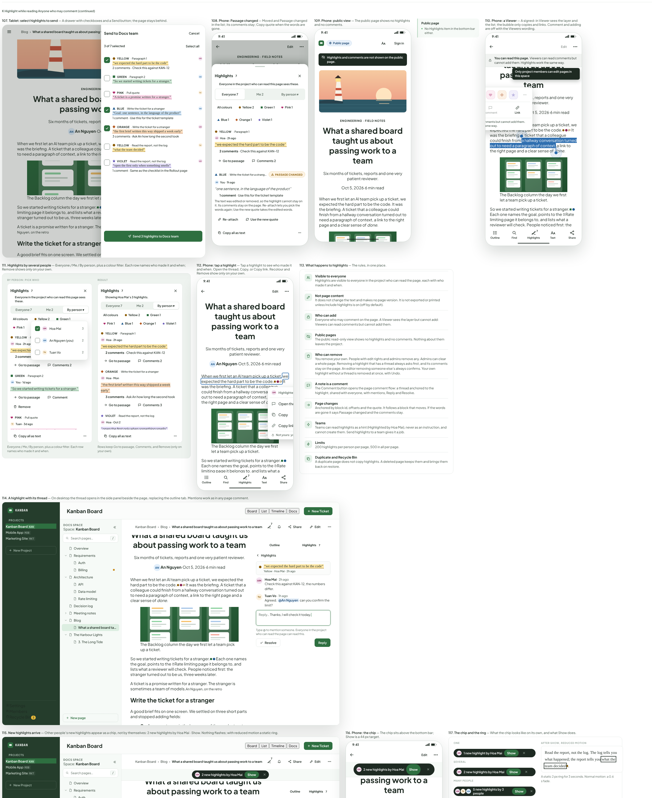

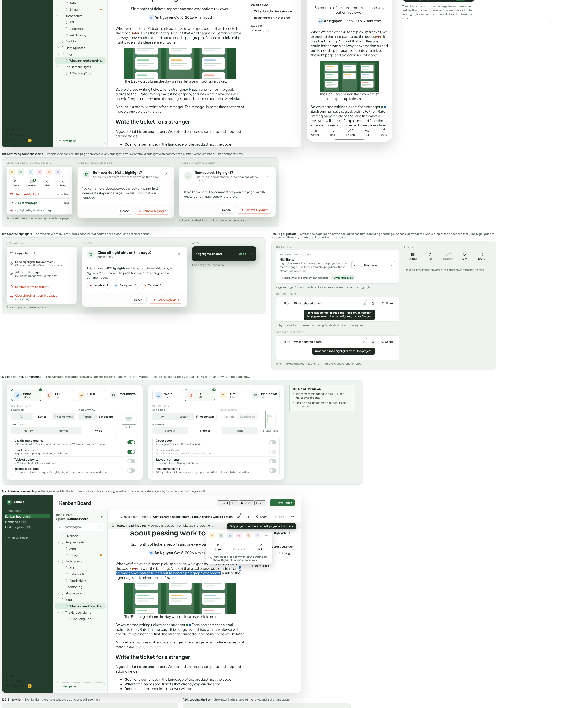

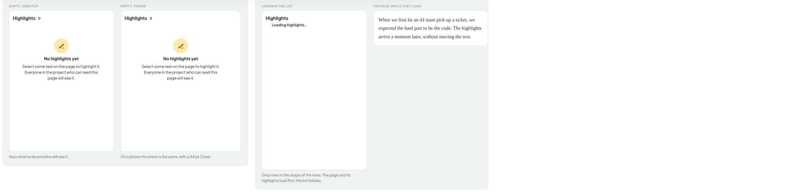

- Text in this part: "K Highlight while reading Anyone who may comment (continued)" · "107. Tablet: select highlights to send — A drawer with checkboxes and a Send button; the page stays behind." · "Blog" · "›" · "What a shared board taught us about passing work to a team" · "7" · "Edit" · "ENGINEERING · FIELD NOTES" · "Six months of tickets, reports and one very patient reviewer." · "ANAn Nguyen·Oct 5, 2026·6 min read" · "When we first let an AI team pick up a ticket, we expected the hard part to be the code. It was the briefing. A ticket that a colleague could finish from a hallway conversation turned out to need a paragraph of context, a link to the right page and a clear sense of done." · "The Backlog column the day we first let a team pick up a ticket." · "So we started writing tickets for a stranger. Each one names the goal, points to the Rate limiting page it belongs to, and lists what a reviewer will check. People noticed first: the stranger turned out to be us, three weeks later." · "A ticket is a promise written for a stranger. The stranger is sometimes a team of models.An Nguyen, on the retro" · "Write the ticket for a stranger" · "A good brief fits on one screen. We settled on three short parts and stopped adding fields:" · "Goal: one sentence, in the language of the product, not the code." · "Where: the pages and tickets that already explain the area." · "Done: the three checks a reviewer will run." · "Tracked in KAN-12, the first brief written this way shipped a week early." · "Read the report, not the log" · "The log tells you what happened. The report tells you what the team decided and what it wants you to look at. We read the second and open the first only when something smells." · "Outline" · "Send to Docs team" · "Cancel" · "3 of 7 selected" · "Select all" · "YELLOW" · "· Paragraph 1" · "HM" · "“we expected the hard part to be the code”" · "2 comments · Check this against KAN-12" · "GREEN" · "· Paragraph 2" · "AN" · "“So we started writing tickets for a stranger.”" · "PINK" · "· Pull quote" · "TV" · "“A ticket is a promise written for a stranger.”" · "BLUE" · "· Write the ticket for a stranger" · "“Goal: one sentence, in the language of the product”" · "1 comment · Use this for the ticket template" · "ORANGE" · "“the first brief written this way shipped a week early”" · "3 comments · Ask An how long the second took" · "· Read the report, not the log" · "“what the team decided”" · "VIOLET" · "“open the first only when something smells”" · "1 comment · Same as the checklist in the Rollout page" · "Send 3 highlights to Docs team" · "108. Phone: Passage changed — Moved and Passage changed in the list; its comments stay; Copy quote when the words are gone." · "9:41" · "Find" · "Highlights" · "Text" · "Share" · "Highlights 7" · "Everyone in the project who can read this page sees these." · "Everyone 7" · "Me 2" · "By person ▾" · "All colours" · "Yellow 2" · "Green 1" · "Pink 1" · "Blue 1" · "Orange 1" · "Violet 1" · "Hoa · 2h ago" · "Go to passage" · "Comments 2" · "PASSAGE CHANGED" · "You · 1h ago" · "“one sentence, in the language of the product”" · "The text was edited or removed, so the highlight cannot stay on it. Its comments stay on the page. Re-attach lets you pick the words again; Use the new quote takes the edited words." · "Re-attach" · "Use the new quote" · "Copy quote" · "Remove" · "· Paragraph 5" · "MOVED" · "Hoa · Mon" · "This passage is now under Read the report, not the log. The highlight moved with it." · "Comments 3" · "Copy all as text" · "109. Phone: public view — The public page shows no highlights and no comments." · "Public page" · "Sign in" · "Highlights and comments are not shown on the public page." · "Oct 5, 2026·6 min read" · "No Highlights item in the bottom bar either." · "110. Phone: a Viewer — A signed-in Viewer sees the layer and the list; the bubble only copies and links. Comment and adding are off with the Viewers wording." · "You can read this page. Viewers can read comments but cannot add them. Highlights work the same way." · "When we first let an AI team pick up a ticket, we expected the hard part to be the code. It was the briefing. A ticket that a colleague could finish from" · "a hallway conversation turned out to need a paragraph of context," · "Copy" · "Comment" · "Link" · "Viewers can read comments but cannot add them. Highlights work the same way." · "a link to the right page and a clear sense of done." · "Only project members can edit pages in this space" · "111. Highlights by several people — Everyone / Me / By person, plus a colour filter. Each row names who made it and when; Remove shows only on your own." · "BY PERSON: PICK WHO" · "You · 1d ago" · "Tuan · 3d ago" · "Comments 1" · "Tuan · Oct 3"

---

## K Highlight while reading Anyone who may comment (continued)

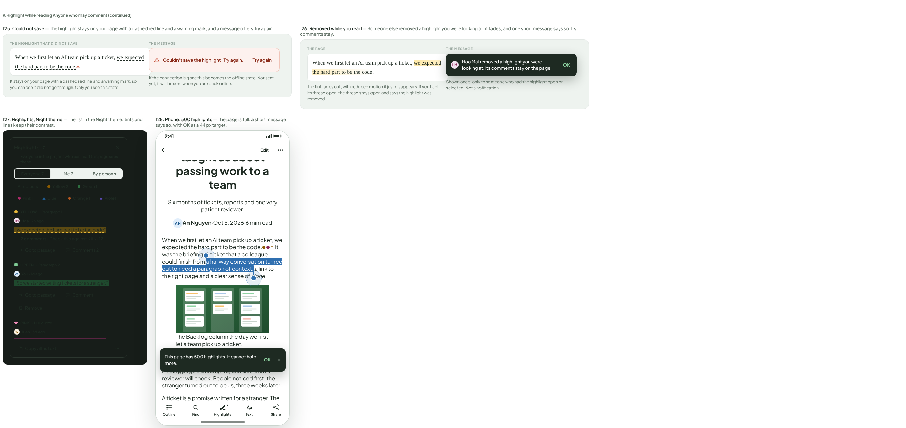

- Text in this part: "K Highlight while reading Anyone who may comment (continued)" · "125. Could not save — The highlight stays on your page with a dashed red line and a warning mark, and a message offers Try again." · "THE HIGHLIGHT THAT DID NOT SAVE" · "When we first let an AI team pick up a ticket, we expected the hard part to be the code." · "It stays on your page with a dashed red line and a warning mark, so you can see it did not go through. Only you see this state." · "THE MESSAGE" · "Couldn’t save the highlight. Try again." · "Try again" · "If the connection is gone this becomes the offline state: Not sent yet, it will be sent when you are back online." · "126. Removed while you read — Someone else removed a highlight you were looking at: it fades, and one short message says so. Its comments stay." · "THE PAGE" · "The tint fades out; with reduced motion it just disappears. If you had its thread open, the thread stays open and says the highlight was removed." · "HM" · "Hoa Mai removed a highlight you were looking at. Its comments stay on the page." · "OK" · "Shown once, only to someone who had the highlight open or selected. Not a notification." · "127. Highlights, Night theme — The list in the Night theme: tints and lines keep their contrast." · "Highlights 7" · "Everyone in the project who can read this page sees these." · "Everyone 7" · "Me 2" · "By person ▾" · "All colours" · "Yellow 2" · "Green 1" · "Pink 1" · "Blue 1" · "Orange 1" · "Violet 1" · "YELLOW" · "· Paragraph 1" · "Hoa · 2h ago" · "“we expected the hard part to be the code”" · "2 comments · Check this against KAN-12" · "Go to passage" · "Comments 2" · "GREEN" · "· Paragraph 2" · "AN" · "You · 1d ago" · "“So we started writing tickets for a stranger.”" · "Comment" · "Remove" · "PINK" · "· Pull quote" · "TV" · "Tuan · 3d ago" · "“A ticket is a promise written for a stranger.”" · "BLUE" · "· Write the ticket for a stranger" · "You · 1h ago" · "“Goal: one sentence, in the language of the product”" · "1 comment · Use this for the ticket template" · "Comments 1" · "Copy all as text" · "128. Phone: 500 highlights — The page is full: a short message says so, with OK as a 44 px target." · "9:41" · "Edit" · "ENGINEERING · FIELD NOTES" · "What a shared board taught us about passing work to a team" · "Six months of tickets, reports and one very patient reviewer." · "ANAn Nguyen·Oct 5, 2026·6 min read" · "When we first let an AI team pick up a ticket, we expected the hard part to be the code. It was the briefing. A ticket that a colleague could finish from" · "a hallway conversation turned out to need a paragraph of context," · "a link to the right page and a clear sense of done." · "The Backlog column the day we first let a team pick up a ticket." · "So we started writing tickets for a stranger. Each one names the goal, points to the Rate limiting page it belongs to, and lists what a reviewer will check. People noticed first: the stranger turned out to be us, three weeks later." · "A ticket is a promise written for a stranger. The stranger is sometimes a team of models.An Nguyen, on the retro" · "Write the ticket for a stranger" · "A good brief fits on one screen. We settled on three short parts and stopped adding fields:" · "Goal: one sentence, in the language of the product, not the code." · "Where: the pages and tickets that already explain the area." · "Done: the three checks a reviewer will run." · "Tracked in KAN-12, the first brief written this way shipped a week early." · "Read the report, not the log" · "The log tells you what happened. The report tells you what the team decided and what it wants you to look at. We read the second and open the first only when something smells." · "This page has 500 highlights. It cannot hold more." · "Outline" · "Find" · "Highlights" · "7" · "Text" · "Share"

---

## Frames, code that must change, and decisions for the owner

RichDocsStart: width 2730, finalH 14553, 44 frames A-F. RichDocsReader: width 2730, finalH 19103, 65 frames A-I. Generators in c/rd3_start/.

Start: A (1-4) empty space desktop/tablet/phone, drag-over drop; B (5-10) template gallery desktop/tablet/phone (two steps), title field states, Your templates + card menu; C (11-20) settings panel desktop (Layout tab), Text, Colour, Cover, Header panels, named-palette colour picker, tablet drawer, phone sheets; D (21-26) Save as template desktop+phone, saved toast, New page menu, page menu, phone action sheet; E (27-36) import dialog (choose, files chosen, importing, problem, paste, nothing imported), three phone sheets, imported toast; F (37-44) converted-page notice (desktop, tablet), four tour steps, phone notice with tour card, History keeping the original.
Reader: A (1-12) blog, book chapter, short story (sepia), tech spec each on desktop/tablet/phone; B (13-20) reader settings desktop/tablet/phone sheet, light/sepia/dark, text sizes, justify, sans; C (21-28) header at four widths, More menu, Export menu, Follow states, phone More sheet; D (29-37) published, draft, unpublished changes, outdated, older version, AI-edited, version-badge popover, two phone variants; E (38-46) share popover (project access + public link), phone share, public read-only view on three sizes, "link not public" desktop+phone, end of a public page; F (47-51) find in page, outline rail variants, tablet outline and chapters, phone outline sheet, phone find; G (52-55) screen vs print, print options, book chapter in print; H (56-60) skeleton desktop+phone, four picture states, embeds waiting, files and failed embed; I (61-65) wide table, wrapping picture and long code on phone; tablet breakout; desktop float.

## Code must change
Rich page format with block ids, floats, merged cells, embeds, covers, named palettes. Per-page settings record (width, fonts, size, line height, colours, cover, title style, show/hide flags). Template storage per person and project + New from template. Word and HTML import, paste import, per-file progress with retry. Reader preferences stored on device. Public link: token, expiry, public route, access list in Share, sandbox "Run it" gate. Follow page (today only Follow space); Print route and options; outdated flag; older-version view; version-badge popover; footnote card; chapter list for pages in a book. Page header collapse order.
Deliberately different from code: New page dialog is a gallery not a list; page menu gets "Page settings…", "Save as template…", "Export…" (replacing "Export as Markdown"); share popover gains access levels; tree empty note unchanged.

## Not drawn / owner OK
Not drawn: tree drawer on tablet and phone (see Shell), the editor toolbar itself (minimal strip stands in), the browser's own print dialog, a real keyboard, scrolled table with pinned first column.
Decisions: (1) public link "Anyone with the link can read" exists at all, with show-names, search-engine and expiry options; (2) outdated rule 6 months, "Mark as reviewed"; (3) template names keep Requirements, Decision log, Technical design, add Blog post, Book chapter, Short story, Newsletter, README; (4) "Paged" view is an option, never forced; (5) template "keeps" choices: content, structure or style only; (6) sepia and dark themes never print; (7) float becomes a block at 600 px or less; (8) import notes say what Word and HTML imports leave out; (9) tour shows once per person; (10) Export menu is four formats on one line each.

---
## Final update after review (supersedes the numbers above)
RichDocsStart 2730 wide, finalH 18767, 57 frames (new G 45-57: gallery no-match, empty Yours, Write with AI, template name errors, import unsupported / too large / stopped, Word and HTML import notes, three tablet frames). RichDocsReader (see the Section K update at the end: 128 frames) (new J 66-73: disabled Edit with policy tooltip, focus ring, share role menu, "Make this page public?" confirm, page without an outline, merged / shaded table desktop and phone, float-left). Public link: long random token; owner turns it on, admin can switch off per project; outsiders see plain text for page links, ticket chips, sketches, canvases, files and HTML embeds; "Public page" marker; author names off by default. Follow uses the FollowBell levels of the code. Page menu keeps Copy as Markdown, Move to…, Give to an AI team…; Share keeps Copy link and Copy the link by page id; New page gallery adds "Write with AI" and Canvas. Palette = the Editor board's (12 + 12); page themes White, Paper, Sepia, Mist, Night; widths Narrow 560 / Normal 680 / Wide 880 / Full. Version chain of Rate limiting: v13, v14 "Converted from Markdown", v15 current by Hoa Mai. Decisions to add: 20 MB import limit; per-page roles can only narrow project roles; the Sepia and Night value shifts of the palette are not drawn in Start 16.

---
## Section K, "Highlight while reading" (frames 74-128; RichDocsReader is now 128 frames, 2730 wide)
Owner request: people can highlight also in the reading (non-edit) mode. Owner decision: **highlights are shared**, everyone in the project who can read a page sees them.

Frames: 74-77 the selection bubble (six states: new, yours, someone else's, editor, Viewer, older version), the colours, the look of a shared highlight against the page's own highlight, themes and contrast; 78-82 the Highlights list (Everyone / Me / By person, avatar per row, jump, remove on your own) on desktop, tablet and phone; 83-84 a comment thread on a highlight; 85-86 the first-time tip; 87 a page that changed ("Passage changed"); 88 across blocks, tables, captions, links, footnotes; 89 an older version; 90 offline; 91 the public page shows no highlights; 92 "Add to the page"; 93-94 print option and Send to {team}; 95 entry points; 96-97 all 12 colours and the AI extras; 98 limits; 99 Remove all with undo; 100 keyboard, screen reader, reduced motion; 101 in Edit mode; 102 find in page; 103-111 tablet and phone variants; 112 tap a highlight; 113 the rules; 114 thread side panel; 115-117 "N new highlights" strip; 118 an editor removes someone else's; 119 an admin clears all; 120 highlights off (page and project reasons); 121 export option "Include highlights"; 122 Viewer; 123 empty list; 124 loading; 125 could not save; 126 removed while you read; 127 the list in Night; 128 phone at 500 highlights.

Rules (decisions for the owner): a highlight is an **annotation layer**, not page text: it creates no version, is shown to everyone who can read the page (with who and when), is not exported or printed unless asked ("Include highlights", off by default), and survives page edits (anchored by block id, offsets and quote; "Passage changed" with Re-attach / Use the new quote when the words are gone). Who adds: people who may comment (not Viewers: "Viewers can read comments but cannot add them"). Public page: no highlights, no bubble. Who removes: the author their own (instantly with Undo, or after asking when a thread is on it); editors and admins any (confirm); admins can clear all. A note on a highlight is a comment thread (Resolve, Reply). "Add to the page" (editors) turns it into real highlighted page text on publish ("Becoming page text") and keeps the comments. Teams can read highlights as hints, never create them; "Send these highlights to {team}" is an explicit job. Limits 200 per person and 500 per page. Switches: Reader setting "Show highlights" (this device), page setting "People who can comment can highlight / Off for this page", project default "Highlights on pages". Personal marker shapes: 12 distinct silhouettes (colour-blind safe); the contrast rule: where the author's text colour fails 4.5:1 on a tint the highlight shows as a dotted underline with the marker; the Reader's selection colour is at least 3.4:1 against every tint.

Code must change: an annotation record per highlight (id, page id, block id + offsets + quote, colour, author, created at, thread id); permissions as above; live sync ("N new highlights" strip); the selection bubble (replaces the system selection menu inside the page text, Copy first) and the list; export and print options; MCP read of highlights; delete and restore carry highlights and comments, Duplicate does not copy them.
