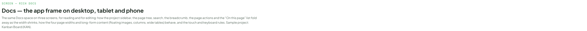
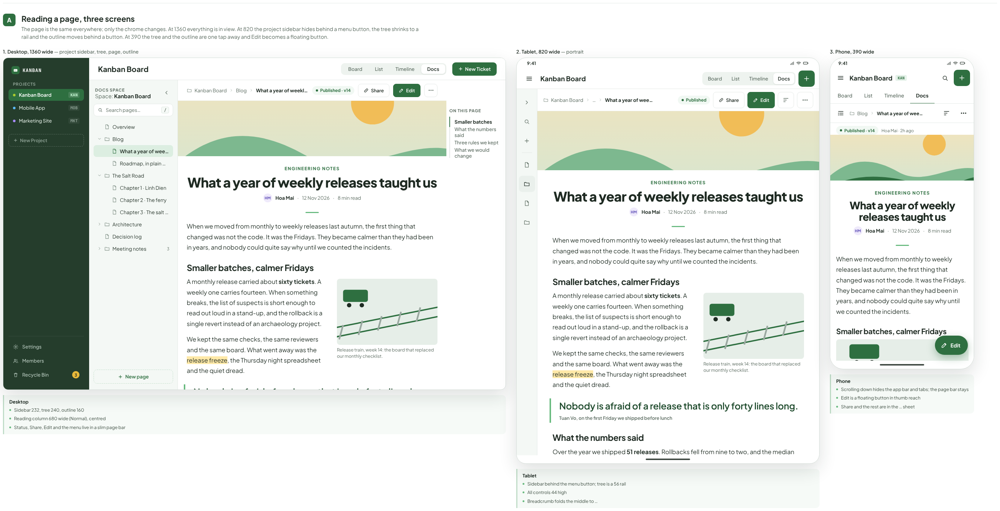
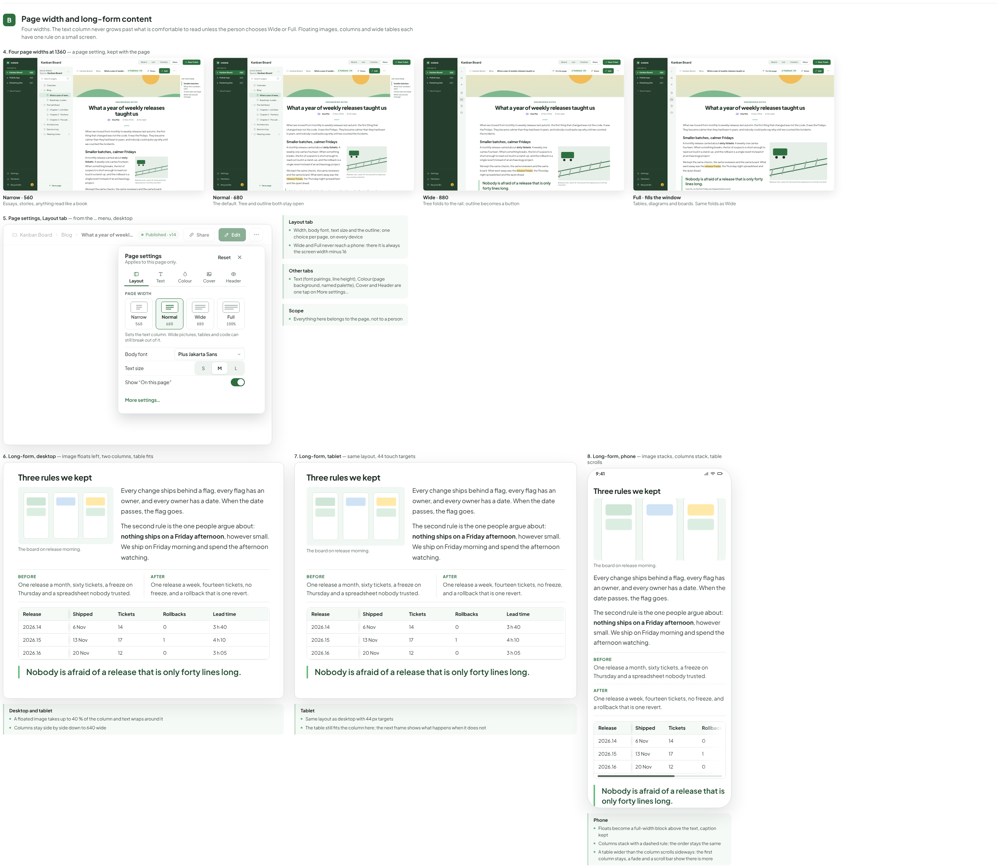
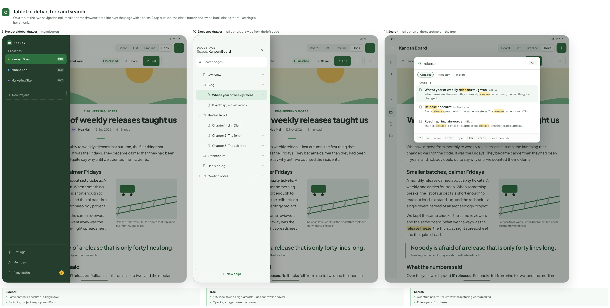
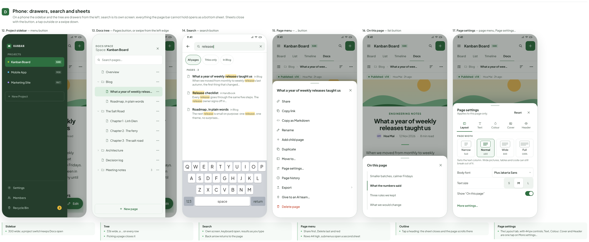
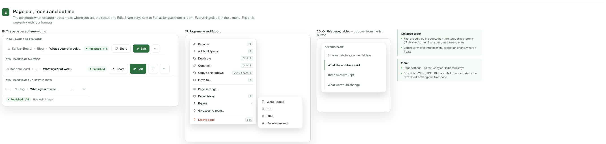
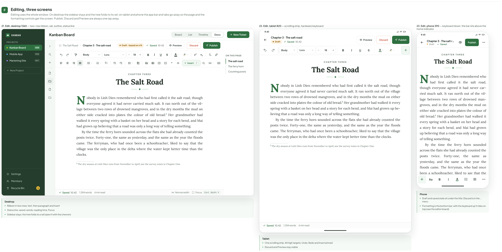
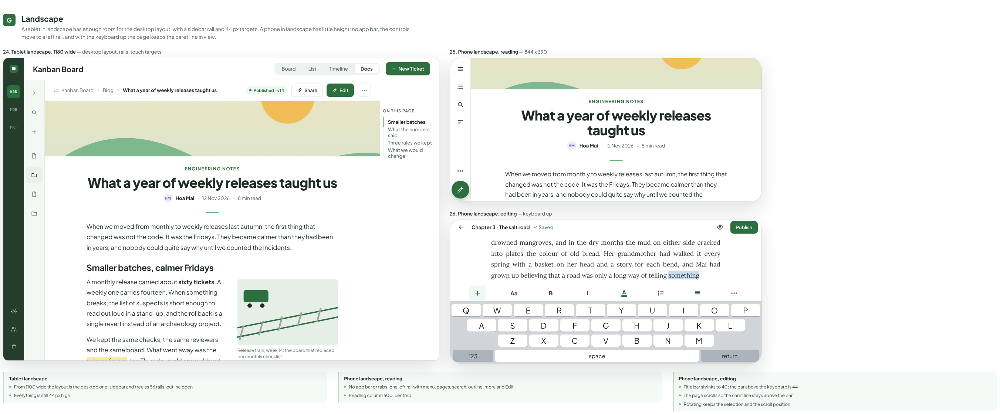
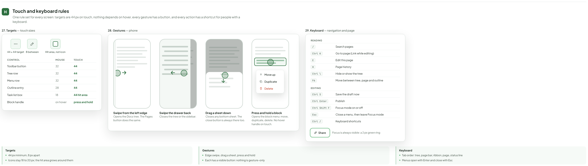

# Rich Docs — app frame & responsive

> New screen (Rich Docs) · canvas `1794931846-a41d` · the board is split into 2 boards on the canvas because a browser cannot paint one board taller than about 8000 px; frame numbers run on across the parts. Sources: [`RichDocsShell1.dc.html`](../source/RichDocsShell1.dc.html) (sha256 `ec7f6183fe3c…`, full value in `MANIFEST.json`), [`RichDocsShell2.dc.html`](../source/RichDocsShell2.dc.html) (sha256 `9502f2b49fa8…`, full value in `MANIFEST.json`)

> A new board that lives next to the older Docs boards (it does not replace them). Where a screen already exists in the code, the words follow the code (`ui/src/components/docs/`); the rich-format parts (colours, float images, merged cells, embeds, suggestions, export, public links, highlights) are a design proposal and need the code changes listed at the end. Names, ids, costs and times in the mock-ups are sample data. Frames are numbered on the canvas; desktop is 1360 wide, tablet 820, phone 390.

## SCREEN — RICH DOCS

- Text in this part: "SCREEN — RICH DOCS" · "Docs — the app frame on desktop, tablet and phone" · "The same Docs space on three screens, for reading and for editing: how the project sidebar, the page tree, search, the breadcrumb, the page actions and the “On this page” list fold away as the width shrinks, how the four page widths and long-form content (floating images, columns, wide tables) behave, and the touch and keyboard rules. Sample project: Kanban Board (KAN)."

---

## Reading a page, three screens

- Text in this part: "A" · "Reading a page, three screens" · "The page is the same everywhere; only the chrome changes. At 1360 everything is in view. At 820 the project sidebar hides behind a menu button, the tree shrinks to a rail and the outline moves behind a button. At 390 the tree and the outline are one tap away and Edit becomes a floating button." · "1. Desktop, 1360 wide — project sidebar, tree, page, outline" · "KANBAN" · "PROJECTS" · "Kanban Board" · "KAN" · "Mobile App" · "MOB" · "Marketing Site" · "MKT" · "New Project" · "Settings" · "Members" · "Recycle Bin" · "3" · "Board" · "List" · "Timeline" · "Docs" · "New Ticket" · "DOCS SPACE" · "Space: Kanban Board" · "Search pages…" · "/" · "Overview" · "Blog" · "What a year of weekly releases taught us" · "Roadmap, in plain words" · "The Salt Road" · "Chapter 1 · Linh Dien" · "Chapter 2 · The ferry" · "Chapter 3 · The salt road" · "Architecture" · "Decision log" · "Meeting notes" · "New page" · "Published · v14" · "Share" · "Edit" · "ENGINEERING NOTES" · "HM" · "Hoa Mai" · "·" · "12 Nov 2026" · "8 min read" · "When we moved from monthly to weekly releases last autumn, the first thing that changed was not the code. It was the Fridays. They became calmer than they had been in years, and nobody could quite say why until we counted the incidents." · "Smaller batches, calmer Fridays" · "Release train, week 14: the board that replaced our monthly checklist." · "A monthly release carried about sixty tickets. A weekly one carries fourteen. When something breaks, the list of suspects is short enough to read out loud in a stand-up, and the rollback is a single revert instead of an archaeology project." · "We kept the same checks, the same reviewers and the same board. What went away was the release freeze, the Thursday night spreadsheet and the quiet dread." · "Nobody is afraid of a release that is only forty lines long." · "Tuan Vo, on the first Friday we shipped before lunch" · "What the numbers said" · "Over the year we shipped 51 releases. Rollbacks fell from nine to two, and the median time from merge to production dropped to under four hours." · "ON THIS PAGE" · "Smaller batches" · "Three rules we kept" · "What we would change" · "Desktop" · "Sidebar 232, tree 240, outline 160" · "Reading column 680 wide (Normal), centred" · "Status, Share, Edit and the menu live in a slim page bar" · "2. Tablet, 820 wide — portrait" · "9:41" · "…" · "What a year of wee…" · "Published" · "Tablet" · "Sidebar behind the menu button; tree is a 56 rail" · "All controls 44 high" · "Breadcrumb folds the middle to …" · "3. Phone, 390 wide" · "Hoa Mai · 2h ago" · "Phone" · "Scrolling down hides the app bar and tabs; the page bar stays" · "Edit is a floating button in thumb reach" · "Share and the rest are in the … sheet"

---

## Page width and long-form content

- Text in this part: "B" · "Page width and long-form content" · "Four widths. The text column never grows past what is comfortable to read unless the person chooses Wide or Full. Floating images, columns and wide tables each have one rule on a small screen." · "4. Four page widths at 1360 — a page setting, kept with the page" · "KANBAN" · "PROJECTS" · "Kanban Board" · "KAN" · "Mobile App" · "MOB" · "Marketing Site" · "MKT" · "New Project" · "Settings" · "Members" · "Recycle Bin" · "3" · "Board" · "List" · "Timeline" · "Docs" · "New Ticket" · "DOCS SPACE" · "Space: Kanban Board" · "Search pages…" · "/" · "Overview" · "Blog" · "What a year of weekly releases taught us" · "Roadmap, in plain words" · "The Salt Road" · "Chapter 1 · Linh Dien" · "Chapter 2 · The ferry" · "Chapter 3 · The salt road" · "Architecture" · "Decision log" · "Meeting notes" · "New page" · "Published · v14" · "Share" · "Edit" · "ENGINEERING NOTES" · "HM" · "Hoa Mai" · "·" · "12 Nov 2026" · "8 min read" · "When we moved from monthly to weekly releases last autumn, the first thing that changed was not the code. It was the Fridays. They became calmer than they had been in years, and nobody could quite say why until we counted the incidents." · "Smaller batches, calmer Fridays" · "Release train, week 14: the board that replaced our monthly checklist." · "A monthly release carried about sixty tickets. A weekly one carries fourteen. When something breaks, the list of suspects is short enough to read out loud in a stand-up, and the rollback is a single revert instead of an archaeology project." · "We kept the same checks, the same reviewers and the same board. What went away was the release freeze, the Thursday night spreadsheet and the quiet dread." · "Nobody is afraid of a release that is only forty lines long." · "Tuan Vo, on the first Friday we shipped before lunch" · "What the numbers said" · "Over the year we shipped 51 releases. Rollbacks fell from nine to two, and the median time from merge to production dropped to under four hours." · "ON THIS PAGE" · "Smaller batches" · "Three rules we kept" · "What we would change" · "Narrow · 560" · "Essays, stories, anything read like a book" · "Normal · 680" · "The default. Tree and outline both stay open" · "On this page" · "Wide · 880" · "Tree folds to the rail; outline becomes a button" · "Full · fills the window" · "Tables, diagrams and boards. Same folds as Wide" · "5. Page settings, Layout tab — from the … menu, desktop" · "Page settings" · "Applies to this page only." · "Reset" · "Layout" · "Text" · "Colour" · "Cover" · "Header" · "PAGE WIDTH" · "Narrow" · "560" · "Normal" · "680" · "Wide" · "880" · "Full" · "100%" · "Sets the text column. Wide pictures, tables and code can still break out of it." · "Body font" · "Plus Jakarta Sans" · "Text size" · "S" · "M" · "L" · "Show “On this page”" · "More settings…" · "Layout tab" · "Width, body font, text size and the outline; one choice per page, on every device" · "Wide and Full never reach a phone: there it is always the screen width minus 16" · "Other tabs" · "Text (font pairings, line height), Colour (page background, named palette), Cover and Header are one tap on More settings…" · "Scope" · "Everything here belongs to the page, not to a person" · "6. Long-form, desktop — image floats left, two columns, table fits" · "The board on release morning." · "Every change ships behind a flag, every flag has an owner, and every owner has a date. When the date passes, the flag goes." · "The second rule is the one people argue about: nothing ships on a Friday afternoon, however small. We ship on Friday morning and spend the afternoon watching." · "BEFORE" · "One release a month, sixty tickets, a freeze on Thursday and a spreadsheet nobody trusted." · "AFTER"

---

## Tablet: sidebar, tree and search

- Text in this part: "C" · "Tablet: sidebar, tree and search" · "On a tablet the two navigation columns become drawers that slide over the page with a scrim. A tap outside, the close button or a swipe back closes them. Nothing is hover-only." · "9. Project sidebar drawer — menu button" · "9:41" · "Kanban Board" · "Board" · "List" · "Timeline" · "Docs" · "…" · "What a year of wee…" · "Published" · "Share" · "Edit" · "ENGINEERING NOTES" · "What a year of weekly releases taught us" · "HM" · "Hoa Mai" · "·" · "12 Nov 2026" · "8 min read" · "When we moved from monthly to weekly releases last autumn, the first thing that changed was not the code. It was the Fridays. They became calmer than they had been in years, and nobody could quite say why until we counted the incidents." · "Smaller batches, calmer Fridays" · "Release train, week 14: the board that replaced our monthly checklist." · "A monthly release carried about sixty tickets. A weekly one carries fourteen. When something breaks, the list of suspects is short enough to read out loud in a stand-up, and the rollback is a single revert instead of an archaeology project." · "We kept the same checks, the same reviewers and the same board. What went away was the release freeze, the Thursday night spreadsheet and the quiet dread." · "Nobody is afraid of a release that is only forty lines long." · "Tuan Vo, on the first Friday we shipped before lunch" · "What the numbers said" · "Over the year we shipped 51 releases. Rollbacks fell from nine to two, and the median time from merge to production dropped to under four hours." · "KANBAN" · "PROJECTS" · "KAN" · "Mobile App" · "MOB" · "Marketing Site" · "MKT" · "New Project" · "Settings" · "Members" · "Recycle Bin" · "3" · "10. Docs tree drawer — rail button, or swipe from the left edge" · "DOCS SPACE" · "Space: Kanban Board" · "Search pages…" · "Overview" · "Blog" · "Roadmap, in plain words" · "The Salt Road" · "Chapter 1 · Linh Dien" · "Chapter 2 · The ferry" · "Chapter 3 · The salt road" · "Architecture" · "Decision log" · "Meeting notes" · "New page" · "11. Search — rail button or the search field in the tree" · "release" · "Esc" · "All pages" · "Titles only" · "In Blog" · "PAGES · 3" · "in Blog" · "When we moved from monthly to weekly releases last autumn, the first thing that changed…" · "Release checklist" · "in Handbook" · "Every release goes through the same five steps. The release owner signs off in…" · "The next release is small on purpose: one release, one theme, no surprises…" · "↑" · "↓" · "move" · "Enter" · "open" · "Ctrl Enter" · "open in new tab" · "Sidebar" · "Same content as desktop, 44 high rows" · "Switching project keeps you on Docs" · "Tree" · "340 wide, rows 44 high, a visible … on each row (no hover)" · "Opening a page closes the drawer" · "Search" · "A centred palette, results with the matching words marked" · "Enter opens, Esc closes"

---

## Phone: drawers, search and sheets

- Text in this part: "D" · "Phone: drawers, search and sheets" · "On a phone the sidebar and the tree are drawers from the left; search is its own screen; everything the page bar cannot hold opens as a bottom sheet. Sheets close with the button, a tap outside or a swipe down." · "12. Project sidebar — menu button" · "9:41" · "Kanban Board" · "KAN" · "Board" · "List" · "Timeline" · "Docs" · "Blog" · "What a year of wee…" · "Published · v14" · "Hoa Mai · 2h ago" · "ENGINEERING NOTES" · "What a year of weekly releases taught us" · "HM" · "Hoa Mai" · "·" · "12 Nov 2026" · "8 min read" · "When we moved from monthly to weekly releases last autumn, the first thing that changed was not the code. It was the Fridays. They became calmer than they had been in years, and nobody could quite say why until we counted the incidents." · "Smaller batches, calmer Fridays" · "Release train, week 14: the board that replaced our monthly checklist." · "A monthly release carried about sixty tickets. A weekly one carries fourteen. When something breaks, the list of suspects is short enough to read out loud in a stand-up, and the rollback is a single revert instead of an archaeology project." · "We kept the same checks, the same reviewers and the same board. What went away was the release freeze, the Thursday night spreadsheet and the quiet dread." · "Nobody is afraid of a release that is only forty lines long." · "Tuan Vo, on the first Friday we shipped before lunch" · "What the numbers said" · "Over the year we shipped 51 releases. Rollbacks fell from nine to two, and the median time from merge to production dropped to under four hours." · "Edit" · "KANBAN" · "PROJECTS" · "Mobile App" · "MOB" · "Marketing Site" · "MKT" · "New Project" · "Settings" · "Members" · "Recycle Bin" · "3" · "13. Docs tree — Pages button, or swipe from the left edge" · "DOCS SPACE" · "Space: Kanban Board" · "Search pages…" · "Overview" · "Roadmap, in plain words" · "The Salt Road" · "Chapter 1 · Linh Dien" · "Chapter 2 · The ferry" · "Chapter 3 · The salt road" · "Architecture" · "Decision log" · "Meeting notes" · "New page" · "14. Search — search button" · "release" · "All pages" · "Titles only" · "In Blog" · "PAGES · 3" · "in Blog" · "When we moved from monthly to weekly releases last autumn, the first thing that changed…" · "Release checklist" · "in Handbook" · "Every release goes through the same five steps. The release owner signs off in…" · "The next release is small on purpose: one release, one theme, no surprises…" · "Q" · "W" · "E" · "R" · "T" · "Y" · "U" · "I" · "O" · "P" · "A" · "S" · "F" · "G" · "H" · "J" · "K" · "L" · "Z" · "X" · "C" · "V" · "B" · "N" · "M" · "123" · "space" · "return" · "15. Page menu — … button" · "Share" · "Copy link" · "Copy as Markdown" · "Rename" · "Add child page" · "Duplicate" · "Move to…" · "Page settings…" · "Page history" · "Export" · "Give to an AI team…" · "Delete page"

---

## Page bar, menu and outline

- Text in this part: "E" · "Page bar, menu and outline" · "The bar keeps what a reader needs most: where you are, the status and Edit. Share stays next to Edit as long as there is room. Everything else is in the … menu. Export is one entry with four formats." · "18. The page bar at three widths" · "1360 · PAGE BAR 728 WIDE" · "Kanban Board" · "Blog" · "What a year of weekly releases taught us" · "Published · v14" · "Share" · "Edit" · "820 · PAGE BAR 764 WIDE" · "…" · "What a year of wee…" · "Published" · "390 · PAGE BAR AND STATUS ROW" · "Hoa Mai · 2h ago" · "19. Page menu and Export" · "Rename" · "F2" · "Add child page" · "N" · "Duplicate" · "Ctrl D" · "Copy link" · "Ctrl L" · "Copy as Markdown" · "Ctrl Shift C" · "Move to…" · "M" · "Page settings…" · "Page history" · "H" · "Export" · "Give to an AI team…" · "Delete page" · "Del" · "Word (.docx)" · "PDF" · "HTML" · "Markdown (.md)" · "20. On this page, tablet — popover from the list button" · "ON THIS PAGE" · "Smaller batches, calmer Fridays" · "What the numbers said" · "Three rules we kept" · "What we would change" · "Collapse order" · "First the edit-by line goes, then the status chip shortens (“Published”), then Share becomes a menu entry" · "Edit never moves into the menu except on phone, where it floats" · "Menu" · "Page settings… is new; Copy as Markdown stays" · "Export lists Word, PDF, HTML and Markdown and starts the download; nothing else to choose"

---

## Editing, three screens

- Text in this part: "F" · "Editing, three screens" · "Editing uses the whole window. On desktop the sidebar stays and the tree folds to its rail; on tablet and phone the app bar and tabs go away so the page and the formatting controls get the screen. Publish, Discard and Preview are always one tap away." · "21. Edit, desktop 1360 — two-row ribbon, rail, outline, status line" · "KANBAN" · "PROJECTS" · "Kanban Board" · "KAN" · "Mobile App" · "MOB" · "Marketing Site" · "MKT" · "New Project" · "Settings" · "Members" · "Recycle Bin" · "3" · "Board" · "List" · "Timeline" · "Docs" · "New Ticket" · "The Salt Road" · "Chapter 3 · The salt road" · "Draft · based on v14" · "Saved" · "10:42" · "Preview" · "Discard" · "Publish" · "Body" · "Lora" · "18" · "B" · "I" · "U" · "S" · "A" · "x2" · "1" · "2" · "“" · "Insert" · "/" · "CHAPTER THREE" · "N" · "obody in Linh Dien remembered who had first called it the salt road, though everyone agreed it had never carried much salt. It ran north out of the village between two rows of drowned mangroves, and in the dry months the mud on either side cracked into plates the colour of old bread.1 Her grandmother had walked it every spring with a basket on her head and a story for each bend, and Mai had grown up believing that a road was only a long way of telling something." · "By the time the ferry horn sounded across the flats she had already counted the posts twice. Forty-one, the same as yesterday, and the same as the year the floods came. The ferryman, who had once been a schoolteacher, liked to say that the village was the only place in the delta where the water kept better time than the clocks." · "1 The dry season at Linh Dien runs from November to April; see the survey notes in Chapter One." · "1,284 words" · "6 min read" · "Normal width" · "Focus" · "Ctrl Shift F" · "ON THIS PAGE" · "The salt road" · "The ferry horn" · "Counting posts" · "Desktop" · "Ribbon in two rows: text, then paragraph and insert" · "Status line: saved, words, reading time, Focus" · "Sidebar stays; the tree folds to a rail (open it with the chevron)" · "22. Edit, tablet 820 — scrolling strip, hardware keyboard" · "9:41" · "Draft" · "Tablet" · "One scrolling strip, 44 high targets; Undo, Redo and Insert pinned" · "Discard and Preview stay visible" · "23. Edit, phone 390 — keyboard down: the bar sits above the home indicator" · "·" · "Aa" · "Phone" · "Draft and saved state sit under the title; Discard is in the … menu" · "Formatting is the bottom bar; with the keyboard up it rides on top (see the editor board)"

---

## Landscape

- Text in this part: "G" · "Landscape" · "A tablet in landscape has enough room for the desktop layout, with a sidebar rail and 44 px targets. A phone in landscape has little height: no app bar, the controls move to a left rail, and with the keyboard up the page keeps the caret line in view." · "24. Tablet landscape, 1180 wide — desktop layout, rails, touch targets" · "KAN" · "MOB" · "MKT" · "Kanban Board" · "Board" · "List" · "Timeline" · "Docs" · "New Ticket" · "Blog" · "What a year of weekly releases taught us" · "Published · v14" · "Share" · "Edit" · "ENGINEERING NOTES" · "HM" · "Hoa Mai" · "·" · "12 Nov 2026" · "8 min read" · "When we moved from monthly to weekly releases last autumn, the first thing that changed was not the code. It was the Fridays. They became calmer than they had been in years, and nobody could quite say why until we counted the incidents." · "Smaller batches, calmer Fridays" · "Release train, week 14: the board that replaced our monthly checklist." · "A monthly release carried about sixty tickets. A weekly one carries fourteen. When something breaks, the list of suspects is short enough to read out loud in a stand-up, and the rollback is a single revert instead of an archaeology project." · "We kept the same checks, the same reviewers and the same board. What went away was the release freeze, the Thursday night spreadsheet and the quiet dread." · "Nobody is afraid of a release that is only forty lines long." · "Tuan Vo, on the first Friday we shipped before lunch" · "What the numbers said" · "Over the year we shipped 51 releases. Rollbacks fell from nine to two, and the median time from merge to production dropped to under four hours." · "ON THIS PAGE" · "Smaller batches" · "Three rules we kept" · "What we would change" · "25. Phone landscape, reading — 844 x 390" · "26. Phone landscape, editing — keyboard up" · "Chapter 3 · The salt road  Saved" · "Publish" · "drowned mangroves, and in the dry months the mud on either side cracked into plates the colour of old bread. Her grandmother had walked it every spring with a basket on her head and a story for each bend, and Mai had grown up believing that a road was only a long way of telling something" · "Aa" · "B" · "I" · "A" · "Q" · "W" · "E" · "R" · "T" · "Y" · "U" · "O" · "P" · "S" · "D" · "F" · "H" · "J" · "K" · "L" · "Z" · "X" · "C" · "V" · "N" · "M" · "123" · "space" · "return" · "Tablet landscape" · "From 1100 wide the layout is the desktop one: sidebar and tree as 56 rails, outline open" · "Everything is still 44 px high" · "Phone landscape, reading" · "No app bar or tabs; one left rail with menu, pages, search, outline, more and Edit" · "Reading column 600, centred" · "Phone landscape, editing" · "Title bar shrinks to 40; the bar above the keyboard is 44" · "The page scrolls so the caret line stays above the bar" · "Rotating keeps the selection and the scroll position"

---

## Touch and keyboard rules

- Text in this part: "H" · "Touch and keyboard rules" · "One rule set for every screen: targets are 44 px on touch, nothing depends on hover, every gesture has a button, and every action has a shortcut for people with a keyboard." · "27. Targets — touch sizes" · "44 × 44 target" · "8 between" · "Hit area, not icon" · "CONTROL" · "MOUSE" · "TOUCH" · "Toolbar button" · "32" · "44" · "Tree row" · "Menu row" · "Outline entry" · "28" · "Task list box" · "18" · "44 hit area" · "Block handle" · "on hover" · "press and hold" · "28. Gestures — phone" · "Swipe from the left edge" · "Opens the Docs tree. The Pages button does the same." · "Swipe the drawer back" · "Closes the tree or the sidebar." · "Drag a sheet down" · "Closes any bottom sheet. The close button is always there too." · "Move up" · "Duplicate" · "Delete" · "Press and hold a block" · "Opens the block menu: move, duplicate, delete. No hover handle on touch." · "29. Keyboard — navigation and page" · "READING" · "/" · "Search pages" · "Ctrl K" · "Go to page (Link while editing)" · "E" · "Edit this page" · "Page history" · "Ctrl \" · "Hide or show the tree" · "F6" · "Move between tree, page and outline" · "EDITING" · "Ctrl S" · "Save the draft now" · "Ctrl Enter" · "Publish" · "Ctrl Shift F" · "Focus mode on or off" · "Esc" · "Close a menu, then leave Focus mode" · "Ctrl /" · "Keyboard shortcuts" · "Share" · "Focus is always visible: a 2 px green ring" · "Targets" · "44 px minimum, 8 px apart" · "Icons stay 18 to 20 px; the hit area grows around them" · "Gestures" · "Edge swipe, drag a sheet, press and hold" · "Each has a visible button: nothing is gesture-only" · "Keyboard" · "Tab order: tree, page bar, ribbon, page, status line" · "Menus open with Enter and close with Esc"

---

## Frames, code that must change, and decisions for the owner

RichDocsShell: width 2800, finalH 10131, 29 frames. RichDocsEditor: width 2800, finalH 16375, 64 frames. Generators in c/rd1_editor/ (run.sh Shell|Editor). Fonts: both files add Lora, Source Serif 4, Merriweather, Playfair Display, Caveat, Inter to the Google Fonts link in the head: the link must be kept.

Shell: A reading (1 Desktop 1360, 2 Tablet 820, 3 Phone 390); B width and long-form (4 four page widths, 5 page layout popover, 6-8 long-form desktop/tablet/phone); C tablet (9 sidebar drawer, 10 tree drawer, 11 search); D phone (12 sidebar, 13 tree, 14 search, 15 page menu sheet, 16 On this page sheet, 17 page layout sheet); E (18 page bar at three widths, 19 page menu with Export, 20 On this page popover); F editing (21 desktop, 22 tablet, 23 phone); G (24 tablet landscape, 25 phone landscape reading, 26 phone landscape editing); H (27 touch targets, 28 gestures, 29 keyboard).
Editor: A 1-3 editing screen (desktop chapter, tablet blog, phone chapter); B 4 ribbon groups, 5 control states, 6-7 tablet strip; C 8-10 phone bar, Aa sheet, More sheet; D 11 text colour, 12 highlight, 13 custom colour, 14 low-contrast warning; E 15-17 palette on White/Sepia/Night, 18 phone colour sheet; F 19 styles, 20 font, 21 size, 22 spacing, 23 indent, 24 alignment, 25-26 drop cap, 27-28 bullets and numbering, 29 nested and checklist, 30-31 link, 32 super/subscript, 33 clear formatting; G 34-39 selection toolbar (plain, bold, mixed, link, code, phone); H 40-43 "/" menu (full, filtered, sheet, all blocks); I 44 shortcut sheet; J 45-49 find and replace; K 50-53 paste (Word, web, default setting, phone); L 54-55 dark desktop and phone; M 56-57 focus mode; N 58-61 format painter; O 62 long page scrolled, 63 ribbon states, 64 page converted from Markdown (spec sample).

## Code must change
Rich format with float images, columns, drop cap, text styles, named palette, page background and width as page settings. Ribbon in two rows + status line (words, reading time, selection count). New page layout popover/sheet. New touch layouts: tree and sidebar as drawers, search as its own screen, bottom sheets, bottom bar above the keyboard, left rail in phone landscape. Find and replace, paste chip, focus mode, format painter, shortcut sheet are new.
Drawn differently from code: Visual/Markdown switch is gone (Preview in its place); tree row actions always visible on touch; page title is part of the document, not page chrome.

## Not drawn / owner OK
Not drawn: AI marks, comments, history, tables, images (other boards). Dark mode: app has no dark theme yet (only a data-theme hook and a bw theme); dark screens are a proposal from a colour mapping.
Decisions: (1) page widths 560 / 680 / 880 / full; Wide and Full fold the tree to a rail and the outline to a button; (2) five page backgrounds (White, Paper, Sepia, Mist, Night), named palette of 12 text and 12 highlight colours whose values shift per background; custom hex allowed with contrast warning; (3) seven bundled fonts; (4) "Match page style" default paste mode with a setting; (5) edge swipe opens the tree (may collide with iOS back gesture; every gesture has a button); (6) app bar and tabs hide while editing on tablet and phone; (7) read-only notice instead of a ribbon; (8) invented shortcuts, e.g. Ctrl Alt C/V format painter, Ctrl Shift F focus; (9) text colour Automatic and "No highlight"; (10) the "converted from Markdown" notice.
Not checked: real devices, iOS keyboard heights, how the exporter treats these styles.

---
## Final update after review (supersedes the numbers above)
RichDocsShell 2800 wide, finalH 10443, 29 frames. RichDocsEditor 2800 wide, finalH 17643, 66 frames: new Editor 65 (ribbon at 1024), 66 (save failed + conflict banner). Page layout is now "Page settings…" (the panel of the Start board; Shell 5, 17 show its Layout tab with "More settings…"). Palette: 12 text colours + 12 highlights are the canonical palette of the whole product; table cell shading uses the same names. Page widths: Narrow 560, Normal 680, Wide 880, Full. Clear formatting is Ctrl Space; Ctrl \ = tree; Ctrl K = Go to page while reading (Link while editing). "/" menu uses the code strings (Task list, Ticket card, Page link, Callout: Info / Warning / Success, New draw.io drawing, Import .drawio file, Math, Footnote, Ask AI…). Find and replace already exists in the code (FindInPage.tsx): Editor 45-49 re-draw it. Not drawn on purpose: loading skeleton and long-title page bar (States board).
