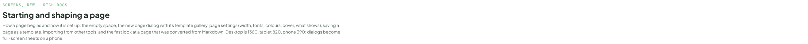
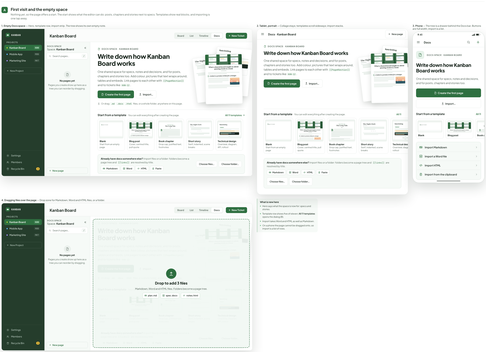
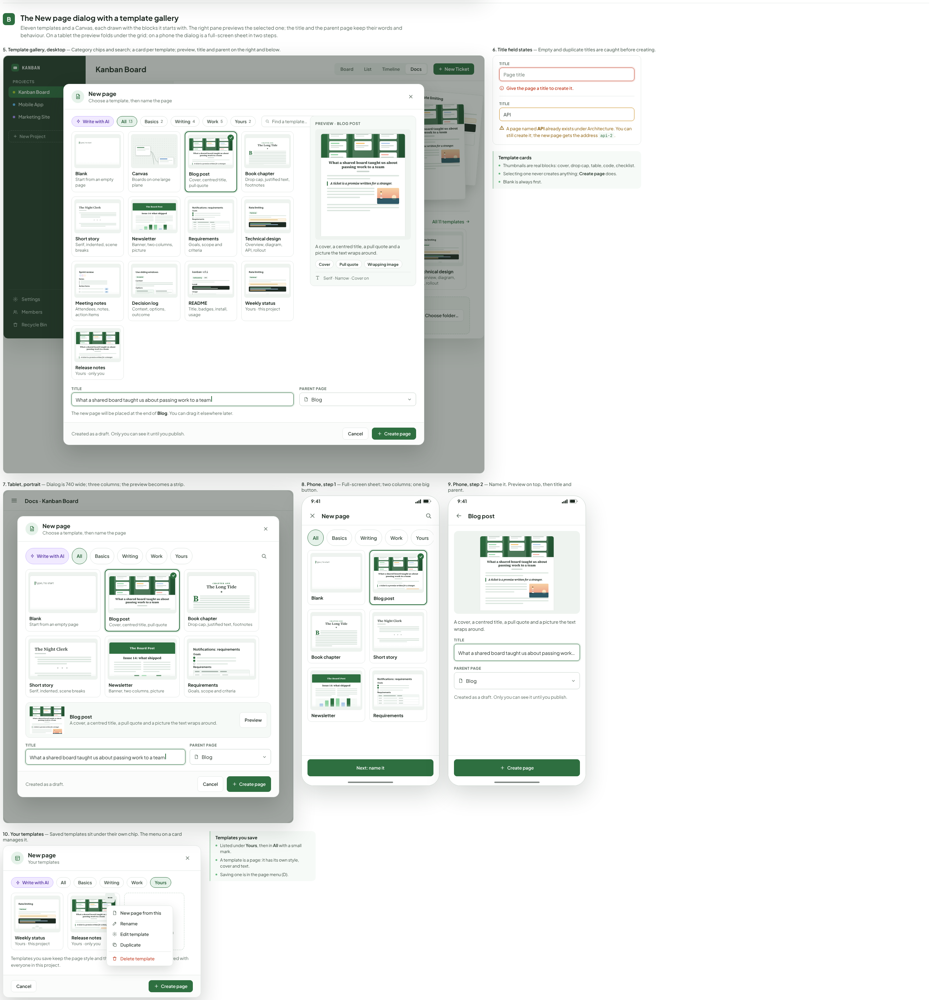
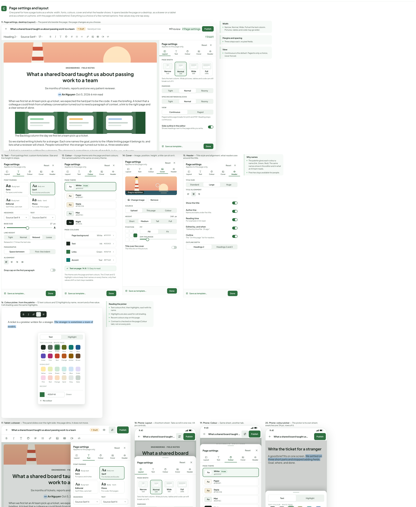
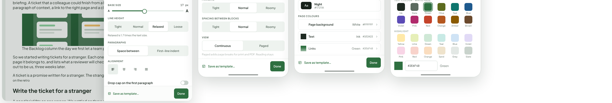
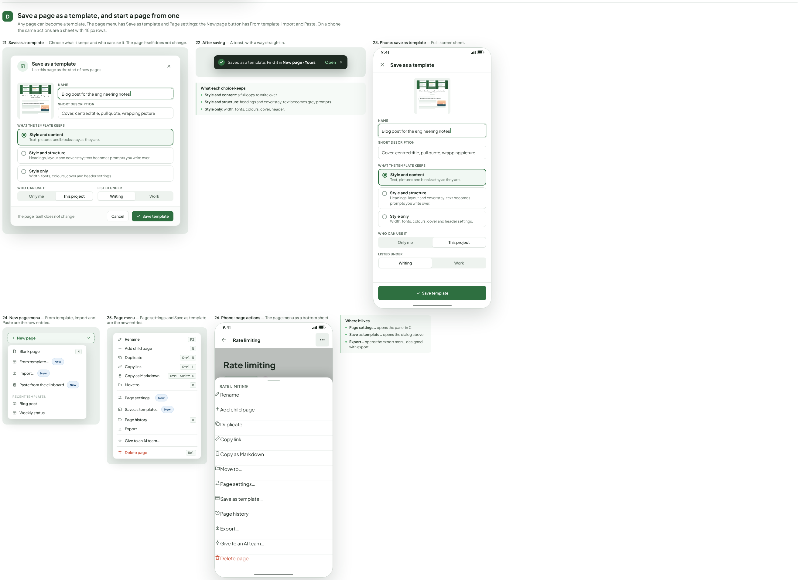
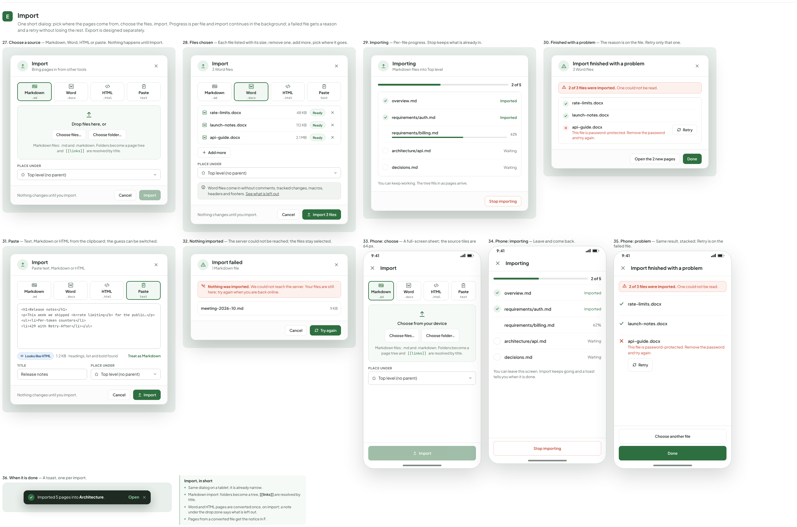
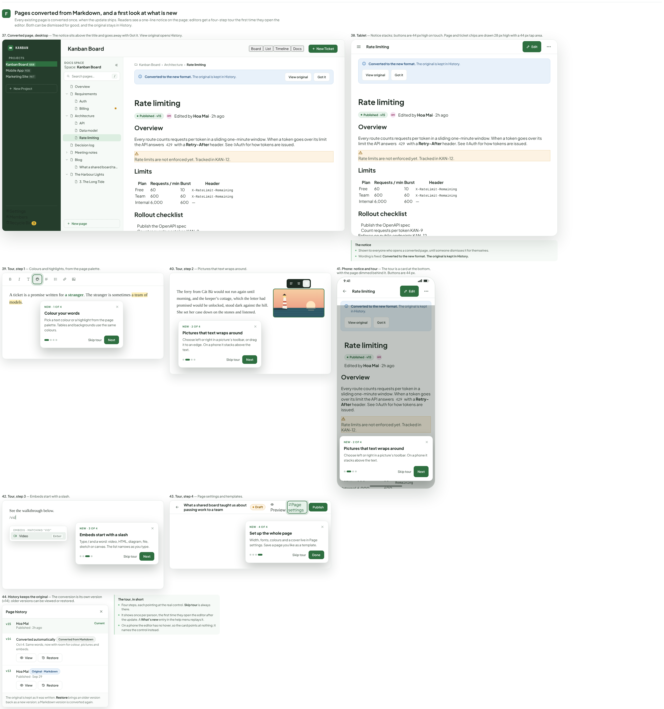
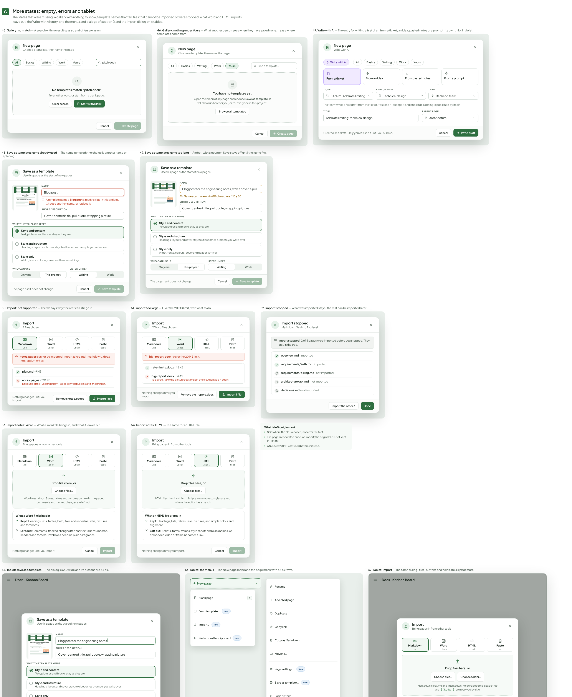
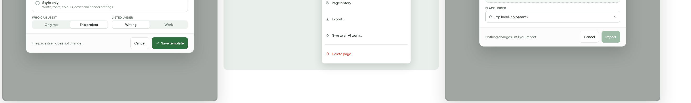

# Rich Docs — new page, templates & page settings

> New screen (Rich Docs) · canvas `1794931846-a41d` · the board is split into 4 boards on the canvas because a browser cannot paint one board taller than about 8000 px; frame numbers run on across the parts. Sources: [`RichDocsStart1.dc.html`](../source/RichDocsStart1.dc.html) (sha256 `b2893fd10515…`, full value in `MANIFEST.json`), [`RichDocsStart2.dc.html`](../source/RichDocsStart2.dc.html) (sha256 `54ecd1e8feb9…`, full value in `MANIFEST.json`), [`RichDocsStart3.dc.html`](../source/RichDocsStart3.dc.html) (sha256 `f9f93c644f2d…`, full value in `MANIFEST.json`), [`RichDocsStart4.dc.html`](../source/RichDocsStart4.dc.html) (sha256 `2a78e73a9d21…`, full value in `MANIFEST.json`)

> A new board that lives next to the older Docs boards (it does not replace them). Where a screen already exists in the code, the words follow the code (`ui/src/components/docs/`); the rich-format parts (colours, float images, merged cells, embeds, suggestions, export, public links, highlights) are a design proposal and need the code changes listed at the end. Names, ids, costs and times in the mock-ups are sample data. Frames are numbered on the canvas; desktop is 1360 wide, tablet 820, phone 390.

## SCREENS, NEW — RICH DOCS

- Text in this part: "SCREENS, NEW — RICH DOCS" · "Starting and shaping a page" · "How a page begins and how it is set up: the empty space, the new page dialog with its template gallery, page settings (width, fonts, colours, cover, what shows), saving a page as a template, importing from other tools, and the first look at a page that was converted from Markdown. Desktop is 1360, tablet 820, phone 390; dialogs become full-screen sheets on a phone."

---

## First visit and the empty space

- Text in this part: "A" · "First visit and the empty space" · "Nothing yet, so the page offers a start. The start shows what the editor can do: posts, chapters and stories next to specs. Templates show real blocks, and importing is one tap away." · "1. Empty Docs space — Hero, template row, import strip. The tree shows its own empty note." · "KANBAN" · "PROJECTS" · "Kanban Board" · "KAN" · "Mobile App" · "MOB" · "Marketing Site" · "MKT" · "New Project" · "Settings" · "Members" · "Recycle Bin" · "3" · "Board" · "List" · "Timeline" · "Docs" · "New Ticket" · "DOCS SPACE" · "Space: Kanban Board" · "Search pages…" · "/" · "No pages yet" · "Pages you create show up here as a tree you can reorder by dragging." · "New page" · "DOCS SPACE · KANBAN BOARD" · "Write down how Kanban Board works" · "One shared space for specs, notes and decisions, and for posts, chapters and stories too. Add colour, pictures that text wraps around, tables and embeds. Link pages to each other with [[Page#Section]] and to tickets like KAN-12." · "Create the first page" · "Import…" · "Or drag .md .docx .html files, or a whole folder, anywhere on this page." · "The Night Clerk" · "* * *" · "Rate limiting" · "Published" · "Client" · "API" · "Queue" · "Store" · "What a shared board taught us about passing work to a team" · "A ticket is a promise written for a stranger." · "Start from a template" · "You can edit everything after creating the page." · "All 11 templates" · "Type / to start" · "Blank" · "Start from an empty page" · "Blog post" · "Cover, centred title, pull quote" · "CHAPTER ONE" · "The Long Tide" · "◆" · "B" · "Book chapter" · "Drop cap, justified text, footnotes" · "Short story" · "Serif, indented, scene breaks" · "Technical design" · "Overview, diagram, API, rollout" · "Already have docs somewhere else? Import files or a folder: folders become a page tree and [[links]] are resolved by title." · "Markdown" · "Word" · "HTML" · "Paste" · "Choose files…" · "Choose folder…" · "2. Tablet, portrait — Collage stays; templates scroll sideways; import stacks." · "Docs · Kanban Board" · "All 11" · "3. Phone — The tree is a drawer behind the Docs bar. Buttons are full width; import is a list." · "9:41" · "One shared space for specs, notes and decisions, and for posts, chapters and stories too." · "Import Markdown" · "Import a Word file" · "Import HTML" · "Import from the clipboard" · "4. Dragging files over the page — Drop zone for Markdown, Word and HTML files, or a folder." · "Drop to add 3 files" · "Markdown, Word and HTML files. Folders become a page tree." · "plan.md" · "spec.docx" · "notes.html" · "What is new here" · "Hero says what the space is now for: specs and stories." · "Template row shows five of eleven; All 11 templates opens the dialog (B)." · "Import takes Word and HTML as well as Markdown." · "On a phone the page cannot be dragged onto, so import is a list of rows."

---

## The New page dialog with a template gallery

- Text in this part: "B" · "The New page dialog with a template gallery" · "Eleven templates and a Canvas, each drawn with the blocks it starts with. The right pane previews the selected one; the title and the parent page keep their words and behaviour. On a tablet the preview folds under the grid; on a phone the dialog is a full-screen sheet in two steps." · "5. Template gallery, desktop — Category chips and search; a card per template; preview, title and parent on the right and below." · "KANBAN" · "PROJECTS" · "Kanban Board" · "KAN" · "Mobile App" · "MOB" · "Marketing Site" · "MKT" · "New Project" · "Settings" · "Members" · "Recycle Bin" · "3" · "Board" · "List" · "Timeline" · "Docs" · "New Ticket" · "DOCS SPACE" · "Space: Kanban Board" · "Search pages…" · "/" · "No pages yet" · "Pages you create show up here as a tree you can reorder by dragging." · "New page" · "DOCS SPACE · KANBAN BOARD" · "Write down how Kanban Board works" · "One shared space for specs, notes and decisions, and for posts, chapters and stories too. Add colour, pictures that text wraps around, tables and embeds. Link pages to each other with [[Page#Section]] and to tickets like KAN-12." · "Create the first page" · "Import…" · "Or drag .md .docx .html files, or a whole folder, anywhere on this page." · "The Night Clerk" · "* * *" · "Rate limiting" · "Published" · "Client" · "API" · "Queue" · "Store" · "What a shared board taught us about passing work to a team" · "A ticket is a promise written for a stranger." · "Start from a template" · "You can edit everything after creating the page." · "All 11 templates" · "Type / to start" · "Blank" · "Start from an empty page" · "Blog post" · "Cover, centred title, pull quote" · "CHAPTER ONE" · "The Long Tide" · "◆" · "Book chapter" · "Drop cap, justified text, footnotes" · "Short story" · "Serif, indented, scene breaks" · "Technical design" · "Overview, diagram, API, rollout" · "Already have docs somewhere else? Import files or a folder: folders become a page tree and [[links]] are resolved by title." · "Markdown" · "Word" · "HTML" · "Paste" · "Choose files…" · "Choose folder…" · "Choose a template, then name the page" · "Write with AI" · "All" · "13" · "Basics" · "2" · "Writing" · "4" · "Work" · "5" · "Yours" · "Find a template…" · "Canvas" · "Boards on one large plane" · "The Board Post" · "Issue 14: what shipped" · "Newsletter" · "Banner, two columns, picture" · "Notifications: requirements" · "Goals" · "Requirements" · "Goals, scope and criteria" · "Sprint review" · "Notes" · "Action items" · "AN" · "Meeting notes" · "Attendees, notes, action items" · "Use sliding windows" · "Accepted" · "Context" · "Options" · "Outcome" · "Decision log" · "Context, options, outcome" · "kanban-cli" · "build passingMIT" · "Install" · "Usage" · "README" · "Title, badges, install, usage"

---

## Page settings and layout

- Text in this part: "C" · "Page settings and layout" · "One panel for how a page looks as a whole: width, fonts, colours, cover and what the header shows. It opens beside the page on a desktop, as a drawer on a tablet and as a sheet on a phone, with the page still visible behind. Everything is a choice of a few named options; free values stay one tap away." · "11. Page settings, desktop (Layout) — The panel sits beside the page; the page changes as you choose." · "What a shared board taught us about passing work to a team" · "Draft" · "Saved just now" · "Preview" · "Page settings" · "Publish" · "Heading 2" · "Source Serif" · "17" · "Insert" · "ENGINEERING · FIELD NOTES" · "Six months of tickets, reports and one very patient reviewer." · "ANAn Nguyen·Oct 5, 2026·6 min read" · "When we first let an AI team pick up a ticket, we expected the hard part to be the code. It was the briefing. A ticket that a colleague could finish from a hallway conversation turned out to need a paragraph of context, a link to the right page and a clear sense of done." · "The Backlog column the day we first let a team pick up a ticket." · "So we started writing tickets for a stranger. Each one names the goal, points to the Rate limiting page it belongs to, and lists what a reviewer will check. People noticed first: the stranger turned out to be us, three weeks later." · "A ticket is a promise written for a stranger. The stranger is sometimes a team of models.An Nguyen, on the retro" · "Write the ticket for a stranger" · "A good brief fits on one screen. We settled on three short parts and stopped adding fields:" · "Goal: one sentence, in the language of the product, not the code." · "Where: the pages and tickets that already explain the area." · "Done: the three checks a reviewer will run." · "Tracked in KAN-12, the first brief written this way shipped a week early." · "Read the report, not the log" · "The log tells you what happened. The report tells you what the team decided and what it wants you to look at. We read the second and open the first only when something smells." · "Applies to this page only." · "Reset" · "Layout" · "Text" · "Colour" · "Cover" · "Header" · "PAGE WIDTH" · "Narrow" · "560" · "Normal" · "680" · "Wide" · "880" · "Full" · "100%" · "Sets the text column. Wide pictures, tables and code can still break out of it." · "MARGINS" · "Tight" · "Roomy" · "SPACING BETWEEN BLOCKS" · "VIEW" · "Continuous" · "Paged" · "Paged adds page breaks for print and PDF. Reading stays continuous." · "Side outline in the editor" · "Shows headings next to the page while you write." · "Save as template…" · "Done" · "Width" · "Narrow, Normal, Wide, Full set the text column. Pictures, tables and code may go wider." · "Margins and spacing" · "Three steps each, no pixel fields." · "View" · "Continuous is the default. Paged is only a choice, never forced." · "12. Text — Font pairings first; custom fonts below. Size and line height in steps." · "FONT PAIRING" · "Aa" · "Body text" · "Sans" · "For specs and notes" · "Serif" · "For stories and books" · "Editorial" · "Serif titles, sans text" · "Mono" · "For code-first pages" · "HEADINGS" · "Source Serif 4" · "TEXT" · "BASE SIZE" · "17 px" · "A" · "LINE HEIGHT" · "Relaxed" · "Loose" · "Relaxed is 1.7 times the text size." · "PARAGRAPHS" · "Space between" · "First-line indent" · "ALIGNMENT" · "Drop cap on the first paragraph" · "13. Colour — A page theme sets the page and text colours; the named palette is the same on every theme." · "PAGE THEME" · "White In use" · "#FFFFFF" · "Paper" · "#FBF8F1" · "Sepia" · "#F4ECD8" · "Mist" · "#EAF1EC" · "Night" · "#17211A" · "PAGE COLOURS" · "Page background" · "White" · "Ink" · "#1E2A22" · "Links" · "Green"

---

## Save a page as a template, and start a page from one

- Text in this part: "D" · "Save a page as a template, and start a page from one" · "Any page can become a template. The page menu has Save as template and Page settings; the New page button has From template, Import and Paste. On a phone the same actions are a sheet with 48 px rows." · "21. Save as a template — Choose what it keeps and who can use it. The page itself does not change." · "Save as a template" · "Use this page as the start of new pages" · "What a shared board taught us about passing work to a team" · "A ticket is a promise written for a stranger." · "NAME" · "Blog post for the engineering notes" · "SHORT DESCRIPTION" · "Cover, centred title, pull quote, wrapping picture" · "WHAT THE TEMPLATE KEEPS" · "Style and content" · "Text, pictures and blocks stay as they are." · "Style and structure" · "Headings, layout and cover stay; text becomes prompts you write over." · "Style only" · "Width, fonts, colours, cover and header settings." · "WHO CAN USE IT" · "Only me" · "This project" · "LISTED UNDER" · "Writing" · "Work" · "The page itself does not change." · "Cancel" · "Save template" · "22. After saving — A toast, with a way straight in." · "Saved as a template. Find it in New page › Yours." · "Open" · "What each choice keeps" · "Style and content: a full copy to write over." · "Style and structure: headings and cover stay, text becomes grey prompts." · "Style only: width, fonts, colours, cover, header." · "23. Phone: save as template — Full-screen sheet." · "9:41" · "24. New page menu — From template, Import and Paste are the new entries." · "New page" · "Blank page" · "N" · "From template…" · "New" · "Import…" · "Paste from the clipboard" · "RECENT TEMPLATES" · "Blog post" · "Weekly status" · "25. Page menu — Page settings and Save as template are the new entries." · "Rename" · "F2" · "Add child page" · "Duplicate" · "Ctrl D" · "Copy link" · "Ctrl L" · "Copy as Markdown" · "Ctrl Shift C" · "Move to…" · "M" · "Page settings…" · "Save as template…" · "Page history" · "H" · "Export…" · "Give to an AI team…" · "Delete page" · "Del" · "26. Phone: page actions — The page menu as a bottom sheet." · "Rate limiting" · "Published · v15" · "HM" · "Edited by Hoa Mai · 2h ago" · "Overview" · "Every route counts requests per token in a sliding one-minute window. When a token goes over its limit the API answers 429 with a Retry-After header. See Auth for how tokens are issued." · "Rate limits are not enforced yet. Tracked in KAN-12." · "Limits" · "Plan	Requests / min	Burst	Header" · "Free	60	10	X-RateLimit-Remaining" · "Team	600	60	X-RateLimit-Remaining" · "Internal	6,000	600	—" · "Rollout checklist" · "Publish the OpenAPI spec" · "Count requests per token KAN-9" · "Enforce on public endpoints KAN-12" · "Webhook retries KAN-31" · "RATE LIMITING" · "Where it lives" · "Page settings… opens the panel in C." · "Save as template… opens the dialog above." · "Export… opens the export menu, designed with export."

---

## Import

- Text in this part: "E" · "Import" · "One short dialog: pick where the pages come from, choose the files, import. Progress is per file and import continues in the background; a failed file gets a reason and a retry without losing the rest. Export is designed separately." · "27. Choose a source — Markdown, Word, HTML or paste. Nothing happens until Import." · "Bring pages in from other tools" · "Markdown" · ".md" · "Word" · ".docx" · "HTML" · ".html" · "Paste" · "text" · "Drop files here, or" · "Choose files…" · "Choose folder…" · "Markdown files: .md and .markdown. Folders become a page tree and [[links]] are resolved by title." · "PLACE UNDER" · "Top level (no parent)" · "Nothing changes until you import." · "Cancel" · "28. Files chosen — Each file listed with its size; remove one, add more, pick where it goes." · "3 Word files" · "rate-limits.docx" · "48 KB" · "Ready" · "launch-notes.docx" · "112 KB" · "api-guide.docx" · "2.1 MB" · "Add more" · "Word files come in without comments, tracked changes, macros, headers and footers. See what is left out" · "Import 3 files" · "29. Importing — Per-file progress. Stop keeps what is already in." · "Importing" · "Markdown files into Top level" · "2 of 5" · "overview.md" · "Imported" · "requirements/auth.md" · "requirements/billing.md" · "62%" · "architecture/api.md" · "Waiting" · "decisions.md" · "You can keep working. The tree fills in as pages arrive." · "Stop importing" · "30. Finished with a problem — The reason is on the file; Retry only that one." · "Import finished with a problem" · "2 of 3 files were imported. One could not be read." · "This file is password-protected. Remove the password and try again." · "Retry" · "Open the 2 new pages" · "Done" · "31. Paste — Text, Markdown or HTML from the clipboard; the guess can be switched." · "Paste text, Markdown or HTML" · "<h1>Release notes</h1>" · "
This week we shipped <b>rate limiting</b> for the public…
" · "<ul><li>Per-token counters</li>" · "<li>429 with Retry-After</li></ul>" · "Looks like HTML" · "1.2 KB · headings, list and bold found" · "Treat as Markdown" · "TITLE" · "Release notes" · "32. Nothing imported — The server could not be reached; the files stay selected." · "Import failed" · "1 Markdown file" · "Nothing was imported. We could not reach the server. Your files are still here; try again when you are back online." · "meeting-2026-10.md" · "9 KB" · "Try again" · "33. Phone: choose — A full-screen sheet; the source tiles are 64 px." · "9:41" · "Choose from your device" · "34. Phone: importing — Leave and come back." · "You can leave this screen. Import keeps going and a toast tells you when it is done." · "35. Phone: problem — Same result, stacked; Retry is on the failed file." · "Choose another file" · "36. When it is done — A toast, one per import." · "Imported 5 pages into Architecture." · "Open" · "Import, in short" · "Same dialog on a tablet; it is already narrow." · "Markdown import: folders become a tree, [[links]] are resolved by title." · "Word and HTML pages are converted once, on import; a note under the drop zone says what is left out." · "Pages from a converted file get the notice in F."

---

## Pages converted from Markdown, and a first look at what is new

- Text in this part: "F" · "Pages converted from Markdown, and a first look at what is new" · "Every existing page is converted once, when the update ships. Readers see a one-line notice on the page; editors get a four-step tour the first time they open the editor. Both can be dismissed for good, and the original stays in History." · "37. Converted page, desktop — The notice sits above the title and goes away with Got it. View original opens History." · "KANBAN" · "PROJECTS" · "Kanban BoardKAN" · "Mobile AppMOB" · "Marketing SiteMKT" · "New Project" · "Settings" · "Members" · "Recycle Bin3" · "Kanban Board" · "Board" · "List" · "Timeline" · "Docs" · "New Ticket" · "DOCS SPACE" · "Space: Kanban Board" · "Search pages…" · "/" · "Overview" · "Requirements" · "Auth" · "Billing" · "Architecture" · "API" · "Data model" · "Rate limiting" · "Decision log" · "Meeting notes" · "Blog" · "What a shared board taught us about passing work to a team" · "The Harbour Lights" · "3. The Long Tide" · "New page" · "›" · "Converted to the new format. The original is kept in History." · "View original" · "Got it" · "Published · v15" · "HM" · "Edited by Hoa Mai · 2h ago" · "Every route counts requests per token in a sliding one-minute window. When a token goes over its limit the API answers 429 with a Retry-After header. See Auth for how tokens are issued." · "Rate limits are not enforced yet. Tracked in KAN-12." · "Limits" · "Plan	Requests / min	Burst	Header" · "Free	60	10	X-RateLimit-Remaining" · "Team	600	60	X-RateLimit-Remaining" · "Internal	6,000	600	—" · "Rollout checklist" · "Publish the OpenAPI spec" · "Count requests per token KAN-9" · "Enforce on public endpoints KAN-12" · "Webhook retries KAN-31" · "38. Tablet — Notice stacks; buttons are 44 px high on touch. Page and ticket chips are drawn 28 px high with a 44 px tap area." · "Edit" · "The notice" · "Shown to everyone who opens a converted page, until someone dismisses it for themselves." · "Wording is fixed: Converted to the new format. The original is kept in History." · "39. Tour, step 1 — Colours and highlights, from the page palette." · "A ticket is a promise written for a stranger. The stranger is sometimes a team of models." · "NEW · 1 OF 4" · "Colour your words" · "Pick a text colour or a highlight from the page palette. Tables and backgrounds use the same colours." · "Skip tour" · "Next" · "40. Tour, step 2 — Pictures that text wraps around." · "The ferry from Cát Bà would not run again until morning, and the keeper’s cottage, which the letter had promised would be unlocked, stood dark against the hill. She set her case down on the stones and listened." · "NEW · 2 OF 4" · "Pictures that text wraps around" · "Choose left or right in a picture’s toolbar, or drag it to an edge. On a phone it stacks above the text." · "41. Phone: notice and tour — The tour is a card at the bottom, with the page dimmed behind it. Buttons are 44 px." · "9:41" · "Choose left or right in a picture’s toolbar. On a phone it stacks above the text." · "42. Tour, step 3 — Embeds start with a slash." · "See the walkthrough below." · "/vid" · "EMBEDS · MATCHING “VID”" · "Video" · "Enter" · "NEW · 3 OF 4" · "Embeds start with a slash" · "Type / and a word: video, HTML, diagram, file, sketch or canvas. The list narrows as you type." · "43. Tour, step 4 — Page settings and templates." · "Draft" · "Preview" · "Page settings" · "Publish" · "NEW · 4 OF 4" · "Set up the whole page" · "Width, fonts, colours and a cover live in Page settings. Save a page you like as a template." · "Done" · "44. History keeps the original — The conversion is its own version (v14); older versions can be viewed or restored." · "Page history" · "v15" · "Hoa Mai" · "Published · 2h ago" · "Current" · "v14" · "Converted automatically Converted from Markdown" · "Oct 4. Same words, now with room for colour, pictures and embeds." · "View" · "Restore" · "v13" · "Hoa Mai Original · Markdown" · "Published · Sep 29" · "The original is kept as it was written. Restore brings an older version back as a new version; a Markdown version is converted again."

---

## More states: empty, errors and tablet

- Text in this part: "G" · "More states: empty, errors and tablet" · "The states that were missing: a gallery with nothing to show, template names that fail, files that cannot be imported or were stopped, what Word and HTML imports leave out, the Write with AI entry, and the menus and dialogs of section D and the import dialog on a tablet." · "45. Gallery: no match — A search with no result says so and offers a way on." · "New page" · "Choose a template, then name the page" · "All" · "Basics" · "Writing" · "Work" · "Yours" · "pitch deck" · "No templates match “pitch deck”" · "Try another word, or start from a blank page." · "Clear search" · "Start with Blank" · "Cancel" · "Create page" · "46. Gallery: nothing under Yours — What another person sees when they have saved none: it says where templates come from." · "Find a template…" · "You have no templates yet" · "Open the menu of any page and choose Save as template. It will show up here for you, or for everyone in this project." · "Browse all templates" · "47. Write with AI — The entry for writing a first draft from a ticket, an idea, pasted notes or a prompt. Its own chip, in violet." · "Write with AI" · "From a ticket" · "From an idea" · "From pasted notes" · "From a prompt" · "TICKET" · "KAN-12 · Add rate limiting" · "KIND OF PAGE" · "Technical design" · "TEAM" · "Backend team" · "The team writes a first draft from the ticket. You read it, change it and publish it. Nothing is published by itself." · "TITLE" · "Add rate limiting: technical design" · "PARENT PAGE" · "Architecture" · "Created as a draft. Only you can see it until you publish." · "Write draft" · "48. Save as template: name already used — The name turns red; the choice is another name or replacing." · "Save as a template" · "Use this page as the start of new pages" · "What a shared board taught us about passing work to a team" · "A ticket is a promise written for a stranger." · "NAME" · "Blog post" · "A template named Blog post already exists in this project. Choose another name, or replace it." · "SHORT DESCRIPTION" · "Cover, centred title, pull quote, wrapping picture" · "WHAT THE TEMPLATE KEEPS" · "Style and content" · "Text, pictures and blocks stay as they are." · "Style and structure" · "Headings, layout and cover stay; text becomes prompts you write over." · "Style only" · "Width, fonts, colours, cover and header settings." · "WHO CAN USE IT" · "Only me" · "This project" · "LISTED UNDER" · "The page itself does not change." · "Save template" · "49. Save as template: name too long — Amber, with a counter. Save stays off until the name fits." · "Blog post for the engineering notes, with a cover, a pull quote and a picture that the text wraps around, for the whole team" · "Names can have up to 80 characters. 118 / 80" · "50. Import: not supported — The file says why; the rest can still go in." · "Import" · "2 files chosen" · "Markdown" · ".md" · "Word" · ".docx" · "HTML" · ".html" · "Paste" · "text" · "notes.pages cannot be imported. Import takes .md, .markdown, .docx, .html and .htm files." · "plan.md · 9 KB" · "notes.pages · 120 KB" · "Not supported. Export it from Pages as Word (.docx) and import that." · "Nothing changes until you import." · "Remove notes.pages" · "Import 1 file" · "51. Import: too large — Over the 20 MB limit, with what to do." · "2 Word files chosen" · "big-report.docx is over the 20 MB limit." · "rate-limits.docx · 48 KB" · "big-report.docx · 34 MB" · "Too large. Take the pictures out or split the file, then add it again." · "Remove big-report.docx" · "52. Import: stopped — What was imported stays; the rest can be imported later." · "Import stopped" · "Markdown files into Top level" · "Import stopped. 2 of 5 pages were imported before you stopped. They stay in the tree." · "overview.md · imported" · "requirements/auth.md · imported" · "requirements/billing.md · not imported" · "architecture/api.md · not imported" · "decisions.md · not imported" · "Import the other 3" · "Done" · "53. Import notes: Word — What a Word file brings in, and what it leaves out." · "Bring pages in from other tools" · "Drop files here, or" · "Choose files…" · "Word files: .docx. Styles, tables and pictures come with the page; comments and tracked changes are left out." · "What a Word file brings in"

---

## Frames, code that must change, and decisions for the owner

RichDocsStart: width 2730, finalH 14553, 44 frames A-F. RichDocsReader: width 2730, finalH 19103, 65 frames A-I. Generators in c/rd3_start/.

Start: A (1-4) empty space desktop/tablet/phone, drag-over drop; B (5-10) template gallery desktop/tablet/phone (two steps), title field states, Your templates + card menu; C (11-20) settings panel desktop (Layout tab), Text, Colour, Cover, Header panels, named-palette colour picker, tablet drawer, phone sheets; D (21-26) Save as template desktop+phone, saved toast, New page menu, page menu, phone action sheet; E (27-36) import dialog (choose, files chosen, importing, problem, paste, nothing imported), three phone sheets, imported toast; F (37-44) converted-page notice (desktop, tablet), four tour steps, phone notice with tour card, History keeping the original.
Reader: A (1-12) blog, book chapter, short story (sepia), tech spec each on desktop/tablet/phone; B (13-20) reader settings desktop/tablet/phone sheet, light/sepia/dark, text sizes, justify, sans; C (21-28) header at four widths, More menu, Export menu, Follow states, phone More sheet; D (29-37) published, draft, unpublished changes, outdated, older version, AI-edited, version-badge popover, two phone variants; E (38-46) share popover (project access + public link), phone share, public read-only view on three sizes, "link not public" desktop+phone, end of a public page; F (47-51) find in page, outline rail variants, tablet outline and chapters, phone outline sheet, phone find; G (52-55) screen vs print, print options, book chapter in print; H (56-60) skeleton desktop+phone, four picture states, embeds waiting, files and failed embed; I (61-65) wide table, wrapping picture and long code on phone; tablet breakout; desktop float.

## Code must change
Rich page format with block ids, floats, merged cells, embeds, covers, named palettes. Per-page settings record (width, fonts, size, line height, colours, cover, title style, show/hide flags). Template storage per person and project + New from template. Word and HTML import, paste import, per-file progress with retry. Reader preferences stored on device. Public link: token, expiry, public route, access list in Share, sandbox "Run it" gate. Follow page (today only Follow space); Print route and options; outdated flag; older-version view; version-badge popover; footnote card; chapter list for pages in a book. Page header collapse order.
Deliberately different from code: New page dialog is a gallery not a list; page menu gets "Page settings…", "Save as template…", "Export…" (replacing "Export as Markdown"); share popover gains access levels; tree empty note unchanged.

## Not drawn / owner OK
Not drawn: tree drawer on tablet and phone (see Shell), the editor toolbar itself (minimal strip stands in), the browser's own print dialog, a real keyboard, scrolled table with pinned first column.
Decisions: (1) public link "Anyone with the link can read" exists at all, with show-names, search-engine and expiry options; (2) outdated rule 6 months, "Mark as reviewed"; (3) template names keep Requirements, Decision log, Technical design, add Blog post, Book chapter, Short story, Newsletter, README; (4) "Paged" view is an option, never forced; (5) template "keeps" choices: content, structure or style only; (6) sepia and dark themes never print; (7) float becomes a block at 600 px or less; (8) import notes say what Word and HTML imports leave out; (9) tour shows once per person; (10) Export menu is four formats on one line each.

---
## Final update after review (supersedes the numbers above)
RichDocsStart 2730 wide, finalH 18767, 57 frames (new G 45-57: gallery no-match, empty Yours, Write with AI, template name errors, import unsupported / too large / stopped, Word and HTML import notes, three tablet frames). RichDocsReader (see the Section K update at the end: 128 frames) (new J 66-73: disabled Edit with policy tooltip, focus ring, share role menu, "Make this page public?" confirm, page without an outline, merged / shaded table desktop and phone, float-left). Public link: long random token; owner turns it on, admin can switch off per project; outsiders see plain text for page links, ticket chips, sketches, canvases, files and HTML embeds; "Public page" marker; author names off by default. Follow uses the FollowBell levels of the code. Page menu keeps Copy as Markdown, Move to…, Give to an AI team…; Share keeps Copy link and Copy the link by page id; New page gallery adds "Write with AI" and Canvas. Palette = the Editor board's (12 + 12); page themes White, Paper, Sepia, Mist, Night; widths Narrow 560 / Normal 680 / Wide 880 / Full. Version chain of Rate limiting: v13, v14 "Converted from Markdown", v15 current by Hoa Mai. Decisions to add: 20 MB import limit; per-page roles can only narrow project roles; the Sepia and Night value shifts of the palette are not drawn in Start 16.

---
## Section K, "Highlight while reading" (frames 74-128; RichDocsReader is now 128 frames, 2730 wide)
Owner request: people can highlight also in the reading (non-edit) mode. Owner decision: **highlights are shared**, everyone in the project who can read a page sees them.

Frames: 74-77 the selection bubble (six states: new, yours, someone else's, editor, Viewer, older version), the colours, the look of a shared highlight against the page's own highlight, themes and contrast; 78-82 the Highlights list (Everyone / Me / By person, avatar per row, jump, remove on your own) on desktop, tablet and phone; 83-84 a comment thread on a highlight; 85-86 the first-time tip; 87 a page that changed ("Passage changed"); 88 across blocks, tables, captions, links, footnotes; 89 an older version; 90 offline; 91 the public page shows no highlights; 92 "Add to the page"; 93-94 print option and Send to {team}; 95 entry points; 96-97 all 12 colours and the AI extras; 98 limits; 99 Remove all with undo; 100 keyboard, screen reader, reduced motion; 101 in Edit mode; 102 find in page; 103-111 tablet and phone variants; 112 tap a highlight; 113 the rules; 114 thread side panel; 115-117 "N new highlights" strip; 118 an editor removes someone else's; 119 an admin clears all; 120 highlights off (page and project reasons); 121 export option "Include highlights"; 122 Viewer; 123 empty list; 124 loading; 125 could not save; 126 removed while you read; 127 the list in Night; 128 phone at 500 highlights.

Rules (decisions for the owner): a highlight is an **annotation layer**, not page text: it creates no version, is shown to everyone who can read the page (with who and when), is not exported or printed unless asked ("Include highlights", off by default), and survives page edits (anchored by block id, offsets and quote; "Passage changed" with Re-attach / Use the new quote when the words are gone). Who adds: people who may comment (not Viewers: "Viewers can read comments but cannot add them"). Public page: no highlights, no bubble. Who removes: the author their own (instantly with Undo, or after asking when a thread is on it); editors and admins any (confirm); admins can clear all. A note on a highlight is a comment thread (Resolve, Reply). "Add to the page" (editors) turns it into real highlighted page text on publish ("Becoming page text") and keeps the comments. Teams can read highlights as hints, never create them; "Send these highlights to {team}" is an explicit job. Limits 200 per person and 500 per page. Switches: Reader setting "Show highlights" (this device), page setting "People who can comment can highlight / Off for this page", project default "Highlights on pages". Personal marker shapes: 12 distinct silhouettes (colour-blind safe); the contrast rule: where the author's text colour fails 4.5:1 on a tint the highlight shows as a dotted underline with the marker; the Reader's selection colour is at least 3.4:1 against every tint.

Code must change: an annotation record per highlight (id, page id, block id + offsets + quote, colour, author, created at, thread id); permissions as above; live sync ("N new highlights" strip); the selection bubble (replaces the system selection menu inside the page text, Copy first) and the list; export and print options; MCP read of highlights; delete and restore carry highlights and comments, Duplicate does not copy them.
