# Rich Docs — states: loading, offline, conflict, access

> New screen (Rich Docs) · canvas `1794929703-2a72` · the board is split into 4 boards on the canvas because a browser cannot paint one board taller than about 8000 px; frame numbers run on across the parts. Sources: [`RichDocsStates1.dc.html`](../source/RichDocsStates1.dc.html) (sha256 `da2a8e126bf0…`, full value in `MANIFEST.json`), [`RichDocsStates2.dc.html`](../source/RichDocsStates2.dc.html) (sha256 `0c28e70ccd39…`, full value in `MANIFEST.json`), [`RichDocsStates3.dc.html`](../source/RichDocsStates3.dc.html) (sha256 `e39680d26377…`, full value in `MANIFEST.json`), [`RichDocsStates4.dc.html`](../source/RichDocsStates4.dc.html) (sha256 `883257aacd33…`, full value in `MANIFEST.json`)

> A new board that lives next to the older Docs boards (it does not replace them). Where a screen already exists in the code, the words follow the code (`ui/src/components/docs/`); the rich-format parts (colours, float images, merged cells, embeds, suggestions, export, public links, highlights) are a design proposal and need the code changes listed at the end. Names, ids, costs and times in the mock-ups are sample data. Frames are numbered on the canvas; desktop is 1360 wide, tablet 820, phone 390.

## SCREENS, NEW — RICH DOCS

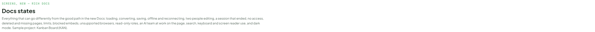

- Text in this part: "SCREENS, NEW — RICH DOCS" · "Docs states" · "Everything that can go differently from the good path in the new Docs: loading, converting, saving, offline and reconnecting, two people editing, a session that ended, no access, deleted and missing pages, limits, blocked embeds, unsupported browsers, read-only roles, an AI team at work on the page, search, keyboard and screen reader use, and dark mode. Sample project: Kanban Board (KAN)."

---

## Loading

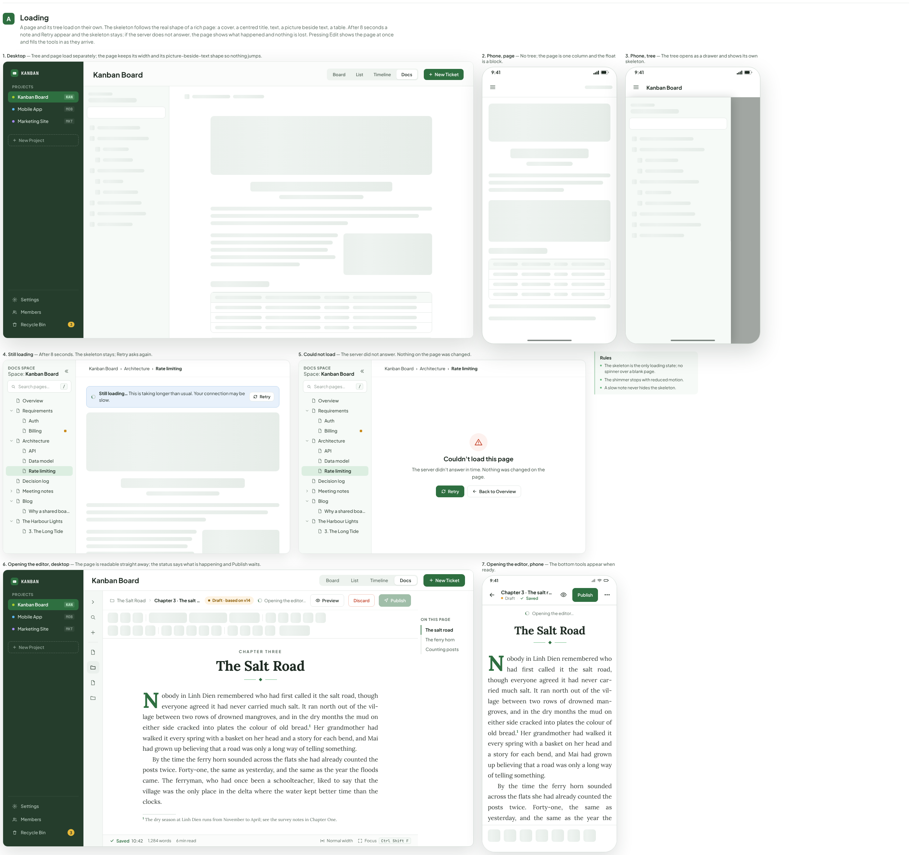

- Text in this part: "A" · "Loading" · "A page and its tree load on their own. The skeleton follows the real shape of a rich page: a cover, a centred title, text, a picture beside text, a table. After 8 seconds a note and Retry appear and the skeleton stays; if the server does not answer, the page shows what happened and nothing is lost. Pressing Edit shows the page at once and fills the tools in as they arrive." · "1. Desktop — Tree and page load separately; the page keeps its width and its picture-beside-text shape so nothing jumps." · "KANBAN" · "PROJECTS" · "Kanban Board" · "KAN" · "Mobile App" · "MOB" · "Marketing Site" · "MKT" · "New Project" · "Settings" · "Members" · "Recycle Bin" · "3" · "Board" · "List" · "Timeline" · "Docs" · "New Ticket" · "2. Phone, page — No tree; the page is one column and the float is a block." · "9:41" · "3. Phone, tree — The tree opens as a drawer and shows its own skeleton." · "4. Still loading — After 8 seconds. The skeleton stays; Retry asks again." · "DOCS SPACE" · "Space: Kanban Board" · "Search pages…" · "/" · "Overview" · "Requirements" · "Auth" · "Billing" · "Architecture" · "API" · "Data model" · "Rate limiting" · "Decision log" · "Meeting notes" · "Blog" · "Why a shared board" · "The Harbour Lights" · "3. The Long Tide" · "›" · "Still loading… This is taking longer than usual. Your connection may be slow." · "Retry" · "5. Could not load — The server did not answer. Nothing on the page was changed." · "Couldn't load this page" · "The server didn't answer in time. Nothing was changed on the page." · "Back to Overview" · "Rules" · "The skeleton is the only loading state; no spinner over a blank page." · "The shimmer stops with reduced motion." · "A slow note never hides the skeleton." · "6. Opening the editor, desktop — The page is readable straight away; the status says what is happening and Publish waits." · "The Salt Road" · "Chapter 3 · The salt road" · "Draft · based on v14" · "Opening the editor…" · "Preview" · "Discard" · "Publish" · "CHAPTER THREE" · "N" · "obody in Linh Dien remembered who had first called it the salt road, though everyone agreed it had never carried much salt. It ran north out of the village between two rows of drowned mangroves, and in the dry months the mud on either side cracked into plates the colour of old bread.1 Her grandmother had walked it every spring with a basket on her head and a story for each bend, and Mai had grown up believing that a road was only a long way of telling something." · "By the time the ferry horn sounded across the flats she had already counted the posts twice. Forty-one, the same as yesterday, and the same as the year the floods came. The ferryman, who had once been a schoolteacher, liked to say that the village was the only place in the delta where the water kept better time than the clocks." · "1 The dry season at Linh Dien runs from November to April; see the survey notes in Chapter One." · "Saved" · "10:42" · "1,284 words" · "6 min read" · "Normal width" · "Focus" · "Ctrl Shift F" · "ON THIS PAGE" · "The salt road" · "The ferry horn" · "Counting posts" · "7. Opening the editor, phone — The bottom tools appear when ready." · "Draft" · "·" · "Aa" · "B" · "I"

---

## A page being converted

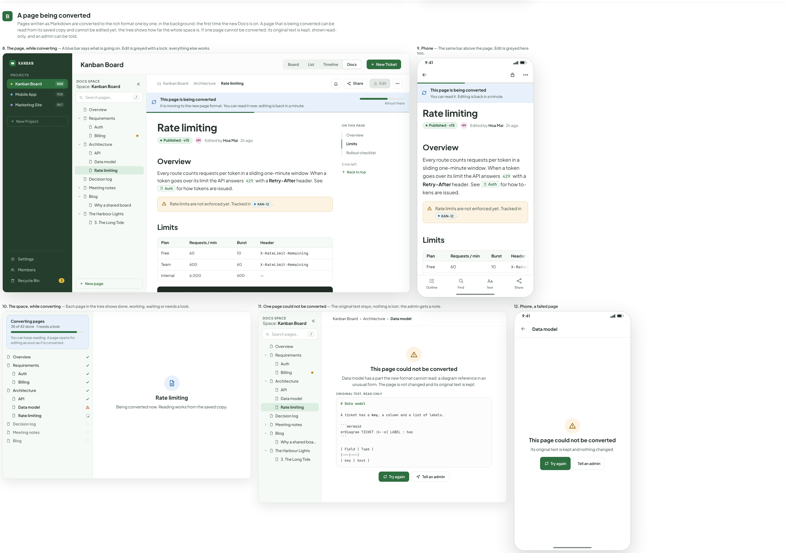

- Text in this part: "B" · "A page being converted" · "Pages written as Markdown are converted to the rich format one by one, in the background, the first time the new Docs is on. A page that is being converted can be read from its saved copy and cannot be edited yet; the tree shows how far the whole space is. If one page cannot be converted, its original text is kept, shown read-only, and an admin can be told." · "8. The page, while converting — A blue bar says what is going on. Edit is greyed with a lock; everything else works." · "KANBAN" · "PROJECTS" · "Kanban Board" · "KAN" · "Mobile App" · "MOB" · "Marketing Site" · "MKT" · "New Project" · "Settings" · "Members" · "Recycle Bin" · "3" · "Board" · "List" · "Timeline" · "Docs" · "New Ticket" · "DOCS SPACE" · "Space: Kanban Board" · "Search pages…" · "/" · "Overview" · "Requirements" · "Auth" · "Billing" · "Architecture" · "API" · "Data model" · "Rate limiting" · "Decision log" · "Meeting notes" · "Blog" · "Why a shared board" · "The Harbour Lights" · "3. The Long Tide" · "New page" · "›" · "Share" · "Edit" · "This page is being converted" · "It is moving to the new page format. You can read it now; editing is back in a minute." · "Almost there" · "Published · v15" · "HM" · "Edited by Hoa Mai · 2h ago" · "Every route counts requests per token in a sliding one-minute window. When a token goes over its limit the API answers 429 with a Retry-After header. See" · "Auth for how tokens are issued." · "Rate limits are not enforced yet. Tracked in" · "KAN-12." · "Limits" · "Plan	Requests / min	Burst	Header" · "Free	60	10	X-RateLimit-Remaining" · "Team	600	60	X-RateLimit-Remaining" · "Internal	6,000	600	—" · "# Over the limit the API answers 429" · "HTTP/1.1 429 Too Many Requests" · "Retry-After: 12" · "{ "error": "rate_limited", "retry_in": 12 }" · "Rollout checklist" · "Publish the OpenAPI spec" · "Count requests per token" · "KAN-9" · "Enforce on public endpoints" · "KAN-12" · "Webhook retries" · "KAN-31" · "ON THIS PAGE" · "5 min left" · "Back to top" · "9. Phone — The same bar above the page; Edit is greyed here too." · "9:41" · "You can read it. Editing is back in a minute." · "Outline" · "Find" · "Text" · "10. The space, while converting — Each page in the tree shows done, working, waiting or needs a look." · "Converting pages" · "38 of 42 done · 1 needs a look" · "You can keep reading. A page opens for editing as soon as it is converted." · "Being converted now. Reading works from the saved copy." · "11. One page could not be converted — The original text stays; nothing is lost; the admin gets a note." · "This page could not be converted" · "Data model has a part the new format cannot read: a diagram reference in an unusual form. The page is not changed and its original text is kept." · "ORIGINAL TEXT, READ ONLY" · "# Data model" · "A ticket has a key, a column and a list of labels." · "```mermaid" · "erDiagram TICKET ||--o{ LABEL : has" · "```" · "| Field | Type |" · "|---|---|" · "| key | text |" · "Try again" · "Tell an admin" · "12. Phone, a failed page" · "Its original text is kept and nothing changed."

---

## Saving and saved

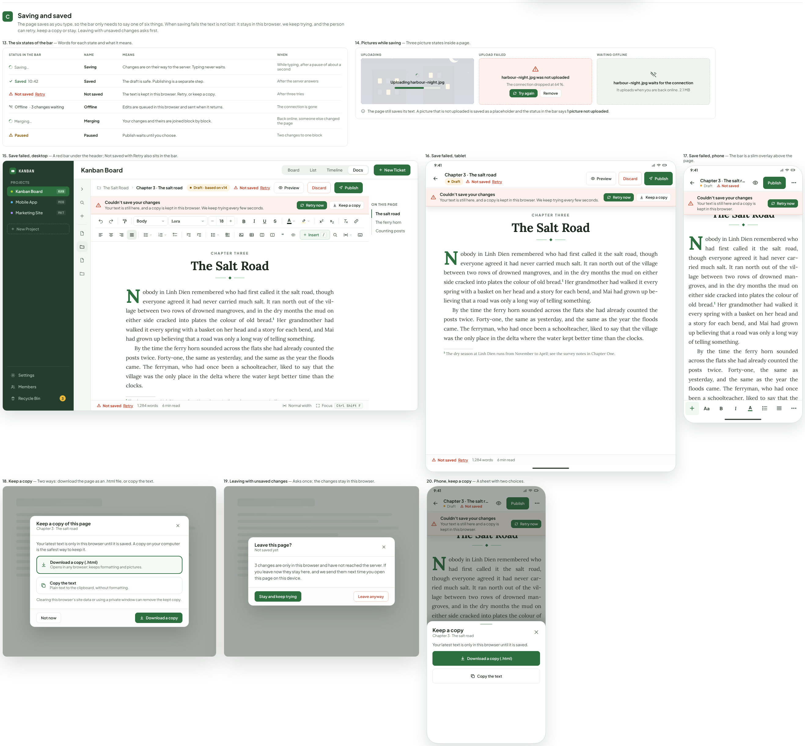

- Text in this part: "C" · "Saving and saved" · "The page saves as you type, so the bar only needs to say one of six things. When saving fails the text is not lost: it stays in this browser, we keep trying, and the person can retry, keep a copy or stay. Leaving with unsaved changes asks first." · "13. The six states of the bar — Words for each state and what it means." · "STATUS IN THE BAR" · "NAME" · "MEANS" · "WHEN" · "Saving…" · "Saving" · "Changes are on their way to the server. Typing never waits." · "While typing, after a pause of about a second" · "Saved" · "10:42" · "The draft is safe. Publishing is a separate step." · "After the server answers" · "Not saved" · "Retry" · "The text is kept in this browser. Retry, or keep a copy." · "After three tries" · "Offline" · "· 3 changes waiting" · "Edits are queued in this browser and sent when it returns." · "The connection is gone" · "Merging…" · "Merging" · "Your changes and theirs are joined block by block." · "Back online, someone else changed the page" · "Paused" · "Publish waits until you choose." · "Two changes to one block" · "14. Pictures while saving — Three picture states inside a page." · "UPLOADING" · "Uploading harbour-night.jpg" · "UPLOAD FAILED" · "harbour-night.jpg was not uploaded" · "The connection dropped at 64 %." · "Try again" · "Remove" · "WAITING OFFLINE" · "harbour-night.jpg waits for the connection" · "It uploads when you are back online. 2.1 MB" · "The page still saves its text. A picture that is not uploaded is saved as a placeholder and the status in the bar says 1 picture not uploaded." · "15. Save failed, desktop — A red bar under the header; Not saved with Retry also sits in the bar." · "KANBAN" · "PROJECTS" · "Kanban Board" · "KAN" · "Mobile App" · "MOB" · "Marketing Site" · "MKT" · "New Project" · "Settings" · "Members" · "Recycle Bin" · "3" · "Board" · "List" · "Timeline" · "Docs" · "New Ticket" · "The Salt Road" · "Chapter 3 · The salt road" · "Draft · based on v14" · "Preview" · "Discard" · "Publish" · "Couldn't save your changes" · "Your text is still here, and a copy is kept in this browser. We keep trying every few seconds." · "Retry now" · "Keep a copy" · "Body" · "Lora" · "18" · "B" · "I" · "U" · "S" · "A" · "x2" · "1" · "2" · "“" · "Insert" · "/" · "CHAPTER THREE" · "N" · "obody in Linh Dien remembered who had first called it the salt road, though everyone agreed it had never carried much salt. It ran north out of the village between two rows of drowned mangroves, and in the dry months the mud on either side cracked into plates the colour of old bread.1 Her grandmother had walked it every spring with a basket on her head and a story for each bend, and Mai had grown up believing that a road was only a long way of telling something." · "By the time the ferry horn sounded across the flats she had already counted the posts twice. Forty-one, the same as yesterday, and the same as the year the floods came. The ferryman, who had once been a schoolteacher, liked to say that the village was the only place in the delta where the water kept better time than the clocks." · "1 The dry season at Linh Dien runs from November to April; see the survey notes in Chapter One." · "1,284 words" · "6 min read" · "Normal width" · "Focus" · "Ctrl Shift F" · "ON THIS PAGE" · "The salt road" · "The ferry horn" · "Counting posts" · "16. Save failed, tablet" · "9:41" · "Draft" · "17. Save failed, phone — The bar is a slim overlay above the page." · "·" · "Aa" · "Your text is still here and a copy is kept in this browser." · "18. Keep a copy — Two ways: download the page as an .html file, or copy the text." · "Keep a copy of this page" · "Your latest text is only in this browser until it is saved. A copy on your computer is the safest way to keep it."

---

## Offline and back online

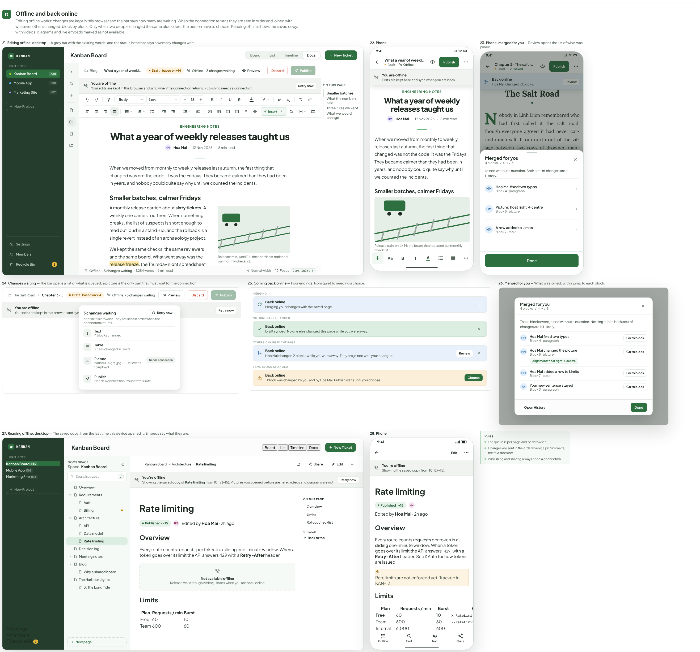

- Text in this part: "D" · "Offline and back online" · "Editing offline works: changes are kept in this browser and the bar says how many are waiting. When the connection returns they are sent in order and joined with whatever others changed, block by block. Only when two people changed the same block does the person have to choose. Reading offline shows the saved copy, with videos, diagrams and live embeds marked as not available." · "21. Editing offline, desktop — A grey bar with the existing words, and the status in the bar says how many changes wait." · "KANBAN" · "PROJECTS" · "Kanban Board" · "KAN" · "Mobile App" · "MOB" · "Marketing Site" · "MKT" · "New Project" · "Settings" · "Members" · "Recycle Bin" · "3" · "Board" · "List" · "Timeline" · "Docs" · "New Ticket" · "Blog" · "What a year of weekly releases taught us" · "Draft · based on v14" · "Offline" · "· 3 changes waiting" · "Preview" · "Discard" · "Publish" · "You are offline" · "Your edits are kept in this browser and sync when the connection returns. Publishing needs a connection." · "Retry now" · "Body" · "Lora" · "18" · "B" · "I" · "U" · "S" · "A" · "x2" · "1" · "2" · "“" · "Insert" · "/" · "ENGINEERING NOTES" · "HM" · "Hoa Mai" · "·" · "12 Nov 2026" · "8 min read" · "When we moved from monthly to weekly releases last autumn, the first thing that changed was not the code. It was the Fridays. They became calmer than they had been in years, and nobody could quite say why until we counted the incidents." · "Smaller batches, calmer Fridays" · "Release train, week 14: the board that replaced our monthly checklist." · "A monthly release carried about sixty tickets. A weekly one carries fourteen. When something breaks, the list of suspects is short enough to read out loud in a stand-up, and the rollback is a single revert instead of an archaeology project." · "We kept the same checks, the same reviewers and the same board. What went away was the release freeze, the Thursday night spreadsheet and the quiet dread." · "Nobody is afraid of a release that is only forty lines long." · "Tuan Vo, on the first Friday we shipped before lunch" · "What the numbers said" · "Over the year we shipped 51 releases. Rollbacks fell from nine to two, and the median time from merge to production dropped to under four hours." · "1,284 words" · "6 min read" · "Normal width" · "Focus" · "Ctrl Shift F" · "ON THIS PAGE" · "Smaller batches" · "Three rules we kept" · "What we would change" · "22. Phone" · "9:41" · "What a year of weekly releases…" · "Draft" · "Aa" · "Edits are kept here and sync when you are back." · "23. Phone, merged for you — Review opens the list of what was joined." · "Chapter 3 · The salt road" · "Saved" · "CHAPTER THREE" · "The Salt Road" · "N" · "obody in Linh Dien remembered who had first called it the salt road, though everyone agreed it had never carried much salt. It ran north out of the village between two rows of drowned mangroves, and in the dry months the mud on either side cracked into plates the colour of old bread.1 Her grandmother had walked it every spring with a basket on her head and a story for each bend, and Mai had grown up believing that a road was only a long way of telling something." · "By the time the ferry horn sounded across the flats she had already counted the posts twice. Forty-one, the same as yesterday, and the same as the year the floods came. The ferryman, who had once been a schoolteacher, liked to say that the village was the only place in the delta where the water kept better time than the clocks." · "1 The dry season at Linh Dien runs from November to April; see the survey notes in Chapter One." · "Back online" · "Hoa Mai changed 2 blocks." · "Review" · "Merged for you" · "4 blocks · v14 → v15" · "Joined without a question. Both sets of changes are in History." · "Hoa Mai fixed two typos" · "Block 4 · paragraph" · "Picture: float right → centre" · "Block 5 · picture" · "A row added to Limits" · "Block 7 · table" · "Done" · "24. Changes waiting — The bar opens a list of what is queued; a picture is the only part that must wait for the connection." · "3 changes waiting" · "Kept in this browser. They are sent in order when the connection returns." · "Text" · "4 blocks changed" · "Table" · "2 cells changed in Limits" · "Picture" · "harbour-night.jpg · 2.1 MB waits to upload" · "Needs connection" · "Needs a connection. Your draft is safe."

---

## Two people edit the same page

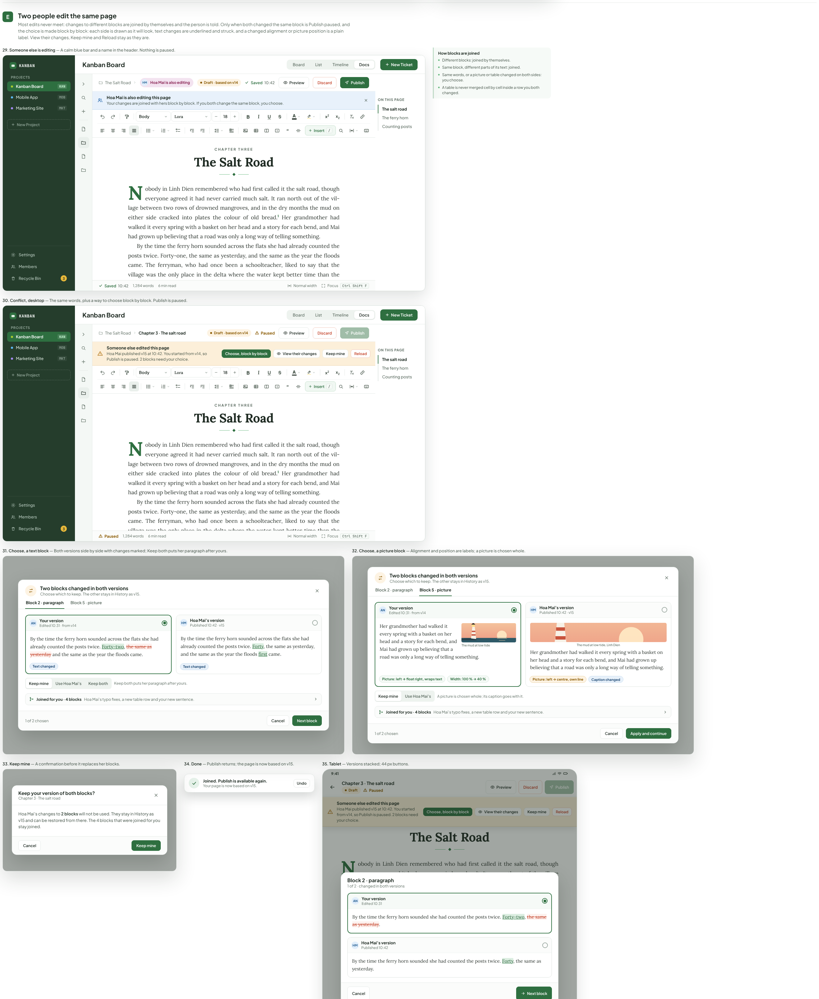

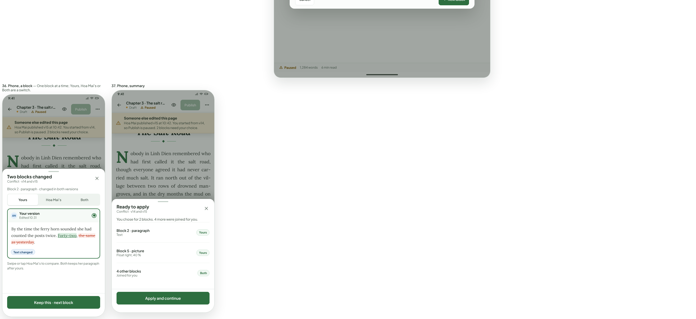

- Text in this part: "E" · "Two people edit the same page" · "Most edits never meet: changes to different blocks are joined by themselves and the person is told. Only when both changed the same block is Publish paused, and the choice is made block by block: each side is drawn as it will look, text changes are underlined and struck, and a changed alignment or picture position is a plain label. View their changes, Keep mine and Reload stay as they are." · "29. Someone else is editing — A calm blue bar and a name in the header. Nothing is paused." · "KANBAN" · "PROJECTS" · "Kanban Board" · "KAN" · "Mobile App" · "MOB" · "Marketing Site" · "MKT" · "New Project" · "Settings" · "Members" · "Recycle Bin" · "3" · "Board" · "List" · "Timeline" · "Docs" · "New Ticket" · "The Salt Road" · "Chapter 3 · The salt road" · "HM" · "Hoa Mai is also editing" · "Draft · based on v14" · "Saved" · "10:42" · "Preview" · "Discard" · "Publish" · "Hoa Mai is also editing this page" · "Your changes are joined with hers block by block. If you both change the same block, you choose." · "Body" · "Lora" · "18" · "B" · "I" · "U" · "S" · "A" · "x2" · "1" · "2" · "“" · "Insert" · "/" · "CHAPTER THREE" · "N" · "obody in Linh Dien remembered who had first called it the salt road, though everyone agreed it had never carried much salt. It ran north out of the village between two rows of drowned mangroves, and in the dry months the mud on either side cracked into plates the colour of old bread.1 Her grandmother had walked it every spring with a basket on her head and a story for each bend, and Mai had grown up believing that a road was only a long way of telling something." · "By the time the ferry horn sounded across the flats she had already counted the posts twice. Forty-one, the same as yesterday, and the same as the year the floods came. The ferryman, who had once been a schoolteacher, liked to say that the village was the only place in the delta where the water kept better time than the clocks." · "1 The dry season at Linh Dien runs from November to April; see the survey notes in Chapter One." · "1,284 words" · "6 min read" · "Normal width" · "Focus" · "Ctrl Shift F" · "ON THIS PAGE" · "The salt road" · "The ferry horn" · "Counting posts" · "How blocks are joined" · "Different blocks: joined by themselves." · "Same block, different parts of its text: joined." · "Same words, or a picture or table changed on both sides: you choose." · "A table is never merged cell by cell inside a row you both changed." · "30. Conflict, desktop — The same words, plus a way to choose block by block. Publish is paused." · "Paused" · "Someone else edited this page" · "Hoa Mai published v15 at 10:42. You started from v14, so Publish is paused. 2 blocks need your choice." · "Choose, block by block" · "View their changes" · "Keep mine" · "Reload" · "31. Choose, a text block — Both versions side by side with changes marked; Keep both puts her paragraph after yours." · "Two blocks changed in both versions" · "Choose which to keep. The other stays in History as v15." · "Block 2 · paragraph" · "Block 5 · picture" · "AN" · "Your version" · "Edited 10:31 · from v14" · "By the time the ferry horn sounded across the flats she had already counted the posts twice. Forty-two, the same as yesterday and the same as the year the floods came." · "Text changed" · "Hoa Mai’s version" · "Published 10:42 · v15" · "By the time the ferry horn sounded across the flats she had already counted the posts twice. Forty, the same as yesterday, and the same as the year the floods first came." · "Use Hoa Mai’s" · "Keep both" · "Keep both puts her paragraph after yours." · "Joined for you · 4 blocks" · "Hoa Mai’s typo fixes, a new table row and your new sentence." · "1 of 2 chosen" · "Cancel" · "Next block" · "32. Choose, a picture block — Alignment and position are labels; a picture is chosen whole." · "The mud at low tide" · "Her grandmother had walked it every spring with a basket on her head and a story for each bend, and Mai had grown up believing that a road was only a long way of telling something." · "Picture: left → float right, wraps text" · "Width: 100 % → 40 %" · "The mud at low tide, Linh Dien" · "Picture: left → centre, own line" · "Caption changed" · "A picture is chosen whole; its caption goes with it." · "Apply and continue" · "33. Keep mine — A confirmation before it replaces her blocks." · "Keep your version of both blocks?" · "Hoa Mai’s changes to 2 blocks will not be used. They stay in History as v15 and can be restored from there. The 4 blocks that were joined for you stay joined." · "34. Done — Publish returns; the page is now based on v15."

---

## Signed out, no access, deleted, missing

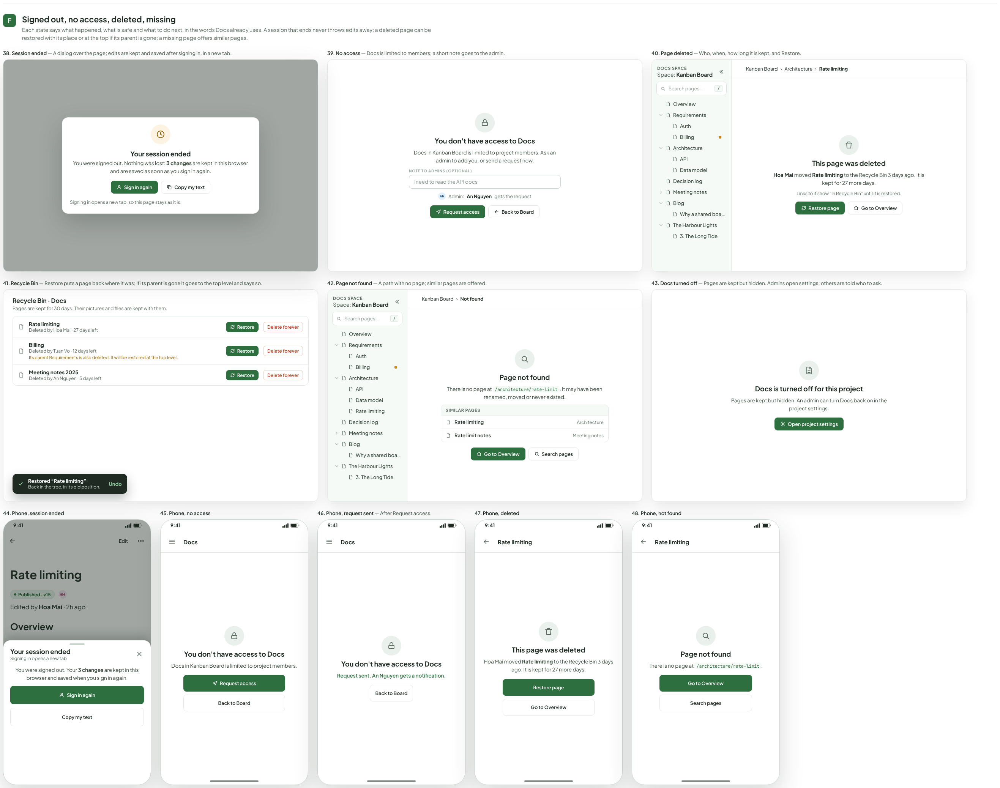

- Text in this part: "F" · "Signed out, no access, deleted, missing" · "Each state says what happened, what is safe and what to do next, in the words Docs already uses. A session that ends never throws edits away; a deleted page can be restored with its place or at the top if its parent is gone; a missing page offers similar pages." · "38. Session ended — A dialog over the page; edits are kept and saved after signing in, in a new tab." · "Your session ended" · "You were signed out. Nothing was lost: 3 changes are kept in this browser and are saved as soon as you sign in again." · "Sign in again" · "Copy my text" · "Signing in opens a new tab, so this page stays as it is." · "39. No access — Docs is limited to members; a short note goes to the admin." · "You don't have access to Docs" · "Docs in Kanban Board is limited to project members. Ask an admin to add you, or send a request now." · "NOTE TO ADMINS (OPTIONAL)" · "I need to read the API docs" · "AN" · "Admin:" · "An Nguyen" · "gets the request" · "Request access" · "Back to Board" · "40. Page deleted — Who, when, how long it is kept, and Restore." · "DOCS SPACE" · "Space: Kanban Board" · "Search pages…" · "/" · "Overview" · "Requirements" · "Auth" · "Billing" · "Architecture" · "API" · "Data model" · "Decision log" · "Meeting notes" · "Blog" · "Why a shared board" · "The Harbour Lights" · "3. The Long Tide" · "Kanban Board" · "›" · "Rate limiting" · "This page was deleted" · "Hoa Mai moved Rate limiting to the Recycle Bin 3 days ago. It is kept for 27 more days." · "Links to it show “In Recycle Bin” until it is restored." · "Restore page" · "Go to Overview" · "41. Recycle Bin — Restore puts a page back where it was; if its parent is gone it goes to the top level and says so." · "Recycle Bin · Docs" · "Pages are kept for 30 days. Their pictures and files are kept with them." · "Deleted by Hoa Mai · 27 days left" · "Restore" · "Delete forever" · "Deleted by Tuan Vo · 12 days left" · "Its parent Requirements is also deleted. It will be restored at the top level." · "Meeting notes 2025" · "Deleted by An Nguyen · 3 days left" · "Restored “Rate limiting”" · "Back in the tree, in its old position." · "Undo" · "42. Page not found — A path with no page; similar pages are offered." · "Not found" · "Page not found" · "There is no page at /architecture/rate-limit. It may have been renamed, moved or never existed." · "SIMILAR PAGES" · "Rate limit notes" · "Search pages" · "43. Docs turned off — Pages are kept but hidden. Admins open settings; others are told who to ask." · "Docs is turned off for this project" · "Pages are kept but hidden. An admin can turn Docs back on in the project settings." · "Open project settings" · "44. Phone, session ended" · "9:41" · "Edit" · "Published · v15" · "HM" · "Edited by Hoa Mai · 2h ago" · "Every route counts requests per token in a sliding one-minute window. When a token goes over its limit the API answers 429 with a Retry-After header. See Auth for how tokens are issued." · "Rate limits are not enforced yet. Tracked in KAN-12." · "Limits" · "Plan	Requests / min	Burst	Header" · "Free	60	10	X-RateLimit-Remaining" · "Team	600	60	X-RateLimit-Remaining" · "Internal	6,000	600	—" · "# Over the limit the API answers 429" · "HTTP/1.1 429 Too Many Requests" · "Retry-After: 12" · "{ "error": "rate_limited", "retry_in": 12 }" · "Rollout checklist" · "Publish the OpenAPI spec" · "Count requests per token KAN-9" · "Enforce on public endpoints KAN-12" · "Webhook retries KAN-31" · "Outline" · "Find" · "Text" · "Share" · "Signing in opens a new tab" · "You were signed out. Your 3 changes are kept in this browser and saved when you sign in again." · "45. Phone, no access" · "Docs" · "Docs in Kanban Board is limited to project members." · "46. Phone, request sent — After Request access." · "Request sent. An Nguyen gets a notification." · "47. Phone, deleted" · "48. Phone, not found" · "There is no page at /architecture/rate-limit."

---

## Limits, blocked embeds and browsers that cannot edit

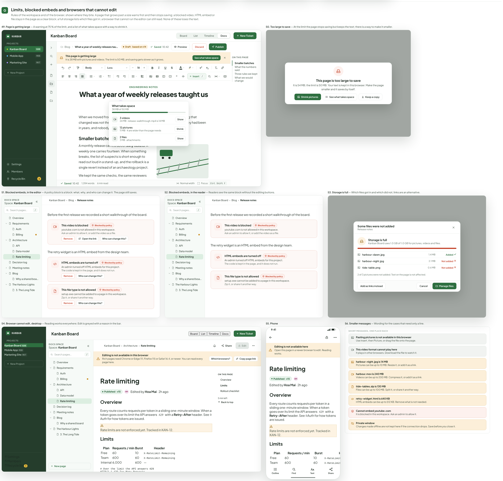

- Text in this part: "G" · "Limits, blocked embeds and browsers that cannot edit" · "Rules of the workspace and of the browser, shown where they bite. A page that grows past a size warns first and then stops saving; a blocked video, HTML embed or file stays in the page as a clear block; a full storage lists which files got in; a browser that cannot run the editor can still read. None of these loses the text." · "49. Page is getting large — A warning at 75 % of the limit, and a list of what takes space with a way to shrink it." · "KANBAN" · "PROJECTS" · "Kanban Board" · "KAN" · "Mobile App" · "MOB" · "Marketing Site" · "MKT" · "New Project" · "Settings" · "Members" · "Recycle Bin" · "3" · "Board" · "List" · "Timeline" · "Docs" · "New Ticket" · "Blog" · "What a year of weekly releases taught us" · "Draft · based on v14" · "Saved" · "10:42" · "Preview" · "Discard" · "Publish" · "This page is getting large" · "It is 38 MB with pictures and videos. The limit is 50 MB, and saving gets slower as it grows." · "See what takes space" · "Body" · "Lora" · "18" · "B" · "I" · "U" · "S" · "A" · "x2" · "1" · "2" · "“" · "Insert" · "/" · "ENGINEERING NOTES" · "HM" · "Hoa Mai" · "·" · "12 Nov 2026" · "8 min read" · "When we moved from monthly to weekly releases last autumn, the first thing that changed was not the code. It was the Fridays. They became calmer than they had been in years, and nobody could quite say why until we counted the incidents." · "Smaller batches, calmer Fridays" · "Release train, week 14: the board that replaced our monthly checklist." · "A monthly release carried about sixty tickets. A weekly one carries fourteen. When something breaks, the list of suspects is short enough to read out loud in a stand-up, and the rollback is a single revert instead of an archaeology project." · "We kept the same checks, the same reviewers and the same board. What went away was the release freeze, the Thursday night spreadsheet and the quiet dread." · "Nobody is afraid of a release that is only forty lines long." · "Tuan Vo, on the first Friday we shipped before lunch" · "What the numbers said" · "Over the year we shipped 51 releases. Rollbacks fell from nine to two, and the median time from merge to production dropped to under four hours." · "1,284 words" · "6 min read" · "Normal width" · "Focus" · "Ctrl Shift F" · "ON THIS PAGE" · "Smaller batches" · "Three rules we kept" · "What we would change" · "What takes space" · "38 MB of 50 MB" · "3 videos" · "24 MB · release-walkthrough.mp4 is 14 MB" · "Show" · "12 pictures" · "11 MB · 4 are wider than the page needs" · "Shrink" · "2 files" · "3 MB · attachments" · "50. Too large to save — At the limit the page stops saving but keeps the text; there is a way to make it smaller." · "This page is too large to save" · "It is 54 MB; the limit is 50 MB. Your text is kept in this browser. Make the page smaller and it saves by itself." · "Shrink pictures" · "Keep a copy" · "51. Blocked embeds, in the editor — A policy block is a block: what, why, and who can change it. The page still saves." · "DOCS SPACE" · "Space: Kanban Board" · "Search pages…" · "Overview" · "Requirements" · "Auth" · "Billing" · "Architecture" · "API" · "Data model" · "Rate limiting" · "Decision log" · "Meeting notes" · "Why a shared board" · "The Harbour Lights" · "3. The Long Tide" · "›" · "Release notes" · "Before the first release we recorded a short walkthrough of the board." · "This video is blocked" · "Blocked by policy" · "youtube.com is not allowed in this workspace." · "Ask an admin to allow it, or add the video as a file."

---

## Read-only and an AI team at work

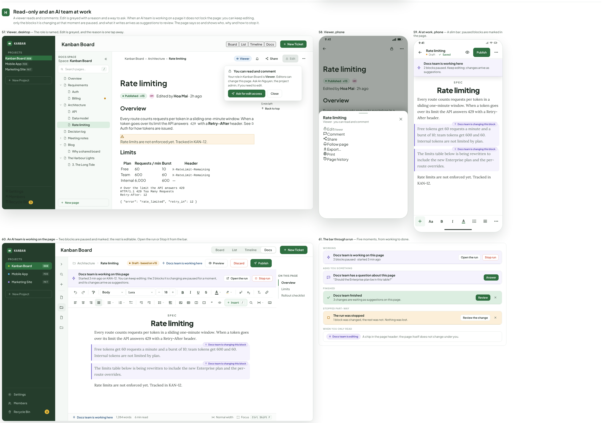

- Text in this part: "H" · "Read-only and an AI team at work" · "A viewer reads and comments; Edit is greyed with a reason and a way to ask. When an AI team is working on a page it does not lock the page: you can keep editing, only the blocks it is changing at that moment are paused, and what it writes arrives as suggestions to review. The page says so and shows who, why and how to stop it." · "57. Viewer, desktop — The role is named, Edit is greyed, and the reason is one tap away." · "KANBAN" · "PROJECTS" · "Kanban BoardKAN" · "Mobile AppMOB" · "Marketing SiteMKT" · "New Project" · "Settings" · "Members" · "Recycle Bin3" · "Kanban Board" · "Board" · "List" · "Timeline" · "Docs" · "New Ticket" · "DOCS SPACE" · "Space: Kanban Board" · "Search pages…" · "/" · "Overview" · "Requirements" · "Auth" · "Billing" · "Architecture" · "API" · "Data model" · "Rate limiting" · "Decision log" · "Meeting notes" · "Blog" · "Why a shared board" · "The Harbour Lights" · "3. The Long Tide" · "New page" · "›" · "Viewer" · "Share" · "Edit" · "Published · v15" · "HM" · "Edited by Hoa Mai · 2h ago" · "Every route counts requests per token in a sliding one-minute window. When a token goes over its limit the API answers 429 with a Retry-After header. See Auth for how tokens are issued." · "Rate limits are not enforced yet. Tracked in KAN-12." · "Limits" · "Plan	Requests / min	Burst	Header" · "Free	60	10	X-RateLimit-Remaining" · "Team	600	60	X-RateLimit-Remaining" · "Internal	6,000	600	—" · "# Over the limit the API answers 429" · "HTTP/1.1 429 Too Many Requests" · "Retry-After: 12" · "{ "error": "rate_limited", "retry_in": 12 }" · "Rollout checklist" · "Publish the OpenAPI spec" · "Count requests per token KAN-9" · "Enforce on public endpoints KAN-12" · "Webhook retries KAN-31" · "ON THIS PAGE" · "5 min left" · "Back to top" · "You can read and comment" · "Your role in Kanban Board is Viewer. Editors can change this page. Ask An Nguyen, the project admin, if you need to edit." · "Ask for edit access" · "Close" · "58. Viewer, phone" · "9:41" · "Outline" · "Find" · "Text" · "Viewer · you can read and comment" · "EditViewer" · "Comment" · "Follow page" · "Export…" · "Print" · "Page history" · "59. AI at work, phone — A slim bar; paused blocks are marked in the page." · "Draft" · "·" · "Saved" · "Publish" · "SPEC" · "Every route counts requests per token in a sliding one-minute window. When a token goes over its limit the API answers 429 with a Retry-After header." · "Docs team is changing this block" · "Free tokens get 60 requests a minute and a burst of 10; team tokens get 600 and 60. Internal tokens are not limited by plan." · "The limits table below is being rewritten to include the new Enterprise plan and the per-route overrides." · "Aa" · "B" · "I" · "A" · "Docs team is working here" · "2 blocks paused. Keep editing; changes arrive as suggestions." · "60. An AI team is working on the page — Two blocks are paused and marked; the rest is editable. Open the run or Stop it from the bar." · "KAN" · "Mobile App" · "MOB" · "Marketing Site" · "MKT" · "Recycle Bin" · "3" · "Draft · based on v15" · "Preview" · "Discard" · "Docs team is working on this page" · "Started 3 min ago on KAN-12. You can keep editing; the 2 blocks it is changing are paused for a moment, and its changes arrive as suggestions." · "Open the run"

---

## Search

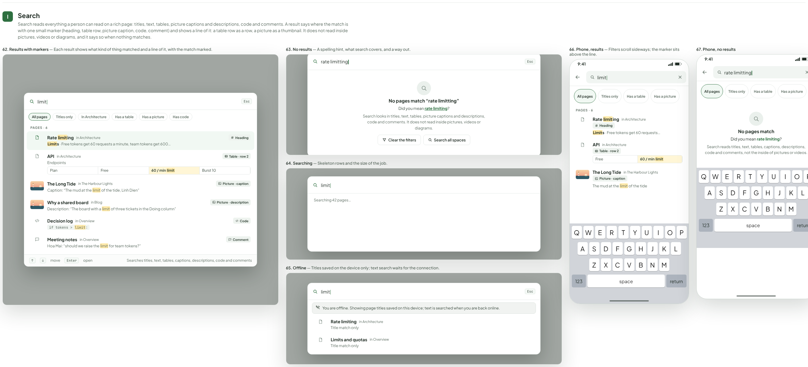

- Text in this part: "I" · "Search" · "Search reads everything a person can read on a rich page: titles, text, tables, picture captions and descriptions, code and comments. A result says where the match is with one small marker (heading, table row, picture caption, code, comment) and shows a line of it: a table row as a row, a picture as a thumbnail. It does not read inside pictures, videos or diagrams, and it says so when nothing matches." · "62. Results with markers — Each result shows what kind of thing matched and a line of it, with the match marked." · "limit" · "Esc" · "All pages" · "Titles only" · "In Architecture" · "Has a table" · "Has a picture" · "Has code" · "PAGES · 6" · "Rate limiting" · "in Architecture" · "Heading" · "Limits · Free tokens get 60 requests a minute, team tokens get 600…" · "API" · "Table · row 2" · "Endpoints" · "Plan" · "Free" · "60 / min limit" · "Burst 10" · "The Long Tide" · "in The Harbour Lights" · "Picture · caption" · "Caption: “The mud at the limit of the tide, Linh Dien”" · "Why a shared board" · "in Blog" · "Picture · description" · "Description: “The board with a limit of three tickets in the Doing column”" · "Decision log" · "in Overview" · "Code" · "if tokens > limit:" · "Meeting notes" · "Comment" · "Hoa Mai: “should we raise the limit for team tokens?”" · "↑" · "↓" · "move" · "Enter" · "open" · "Searches titles, text, tables, captions, descriptions, code and comments" · "63. No results — A spelling hint, what search covers, and a way out." · "rate limitting" · "No pages match “rate limitting”" · "Did you mean rate limiting?" · "Search looks in titles, text, tables, picture captions and descriptions, code and comments. It does not read inside pictures, videos or diagrams." · "Clear the filters" · "Search all spaces" · "64. Searching — Skeleton rows and the size of the job." · "Searching 42 pages…" · "65. Offline — Titles saved on the device only; text search waits for the connection." · "You are offline. Showing page titles saved on this device; text is searched when you are back online." · "Title match only" · "Limits and quotas" · "66. Phone, results — Filters scroll sideways; the marker sits above the line." · "9:41" · "Limits · Free tokens get 60 requests…" · "The mud at the limit of the tide" · "Q" · "W" · "E" · "R" · "T" · "Y" · "U" · "O" · "P" · "A" · "S" · "D" · "F" · "G" · "H" · "J" · "K" · "L" · "Z" · "X" · "C" · "V" · "B" · "N" · "M" · "123" · "space" · "return" · "67. Phone, no results" · "No pages match" · "Search reads titles, text, tables, captions, descriptions, code and comments, not the inside of pictures or videos."

---

## Keyboard, screen readers, contrast and motion

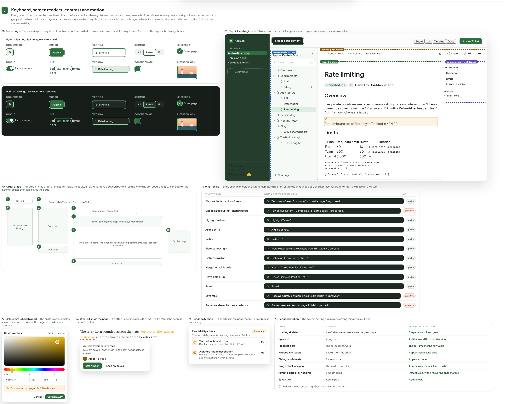

- Text in this part: "J" · "Keyboard, screen readers, contrast and motion" · "Every control can be reached and used from the keyboard, and every visible change is also said in words. A ring shows where you are; a skip link and named regions get past the tree; colour and layout changes announce what they did; hard-to-read colour is flagged where it is chosen and where it sits; and motion follows the system setting." · "68. Focus ring — The same ring on every kind of control, in light and in dark. It is never removed, and it is easy to see: 3 to 1 or better against both neighbours." · "Light · a 2 px ring, 2 px away, never removed" · "TOOL BUTTON" · "BUTTON" · "Publish" · "TEXT FIELD" · "Rate limiting" · "SEGMENT" · "A4" · "Letter" · "Fit" · "CHECKBOX" · "Cover page" · "TOGGLE" · "Page numbers" · "LINK" · "See" · "for the plans." · "TREE ROW" · "COLOUR SWATCH" · "PICTURE BLOCK" · "Dark · a 2 px ring, 2 px away, never removed" · "69. Skip link and regions — Tab once and the skip link appears; each region has a name for screen readers." · "KANBAN" · "PROJECTS" · "Kanban BoardKAN" · "Mobile AppMOB" · "Marketing SiteMKT" · "New Project" · "Settings" · "Members" · "Recycle Bin3" · "Kanban Board" · "Board" · "List" · "Timeline" · "Docs" · "New Ticket" · "DOCS SPACE" · "Space: Kanban Board" · "Search pages…" · "/" · "Overview" · "Requirements" · "Auth" · "Billing" · "Architecture" · "API" · "Data model" · "Decision log" · "Meeting notes" · "Blog" · "Why a shared board" · "The Harbour Lights" · "3. The Long Tide" · "New page" · "›" · "Share" · "Edit" · "Published · v15" · "HM" · "Edited by Hoa Mai · 2h ago" · "Every route counts requests per token in a sliding one-minute window. When a token goes over its limit the API answers 429 with a Retry-After header. See Auth for how tokens are issued." · "Rate limits are not enforced yet. Tracked in KAN-12." · "Limits" · "Plan	Requests / min	Burst	Header" · "Free	60	10	X-RateLimit-Remaining" · "Team	600	60	X-RateLimit-Remaining" · "Internal	6,000	600	—" · "# Over the limit the API answers 429" · "HTTP/1.1 429 Too Many Requests" · "Retry-After: 12" · "{ "error": "rate_limited", "retry_in": 12 }" · "Rollout checklist" · "Publish the OpenAPI spec" · "Count requests per token KAN-9" · "Enforce on public endpoints KAN-12" · "Webhook retries KAN-31" · "ON THIS PAGE" · "5 min left" · "Back to top" · "Skip to page content" · "navigation · Docs tree" · "banner · page header" · "main · the page" · "complementary · on this page" · "70. Order of Tab — Ten stops, in the order of the page. Inside the tools, arrow keys move between buttons, so the whole ribbon costs one Tab. In the editor Tab indents, so Esc then Tab leaves the page." · "Skip link" · "1" · "Projects and Settings" · "2" · "Board · List · Timeline · Docs · New Ticket" · "3" · "Docs tree" · "4" · "5" · "Breadcrumb · Share · Edit" · "6" · "Tools (editing): one stop, arrow keys move inside" · "7" · "The page. Reading: Tab goes link to link. Editing: Tab indents, Esc then Tab moves on" · "8" · "Status line" · "9" · "On this page" · "10" · "71. What is said — Every change of colour, alignment, picture position or table is announced as a short phrase; failures interrupt, the rest wait their turn."

---

## Dark mode (proposal)

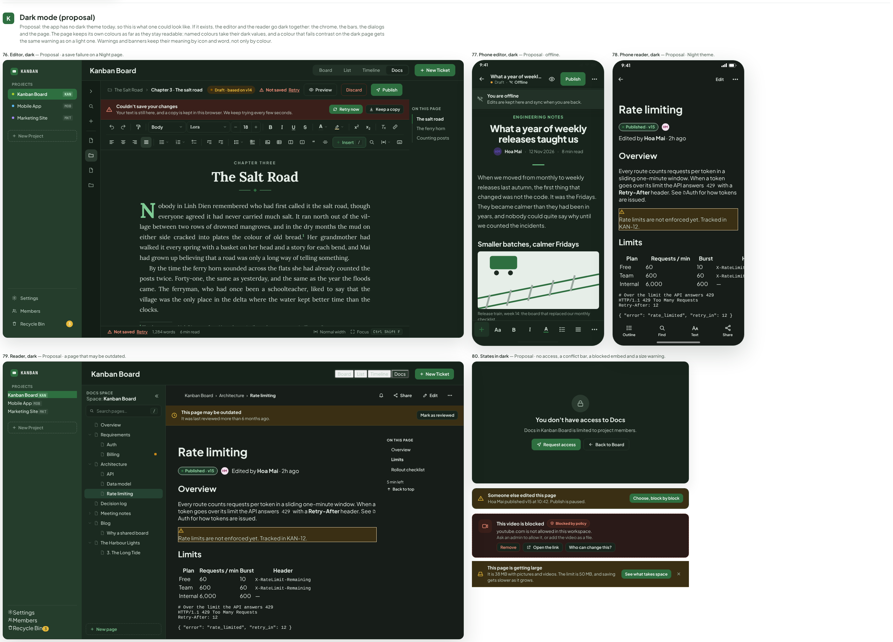

- Text in this part: "K" · "Dark mode (proposal)" · "Proposal: the app has no dark theme today, so this is what one could look like. If it exists, the editor and the reader go dark together: the chrome, the bars, the dialogs and the page. The page keeps its own colours as far as they stay readable; named colours take their dark values, and a colour that fails contrast on the dark page gets the same warning as on a light one. Warnings and banners keep their meaning by icon and word, not only by colour." · "76. Editor, dark — Proposal · a save failure on a Night page." · "KANBAN" · "PROJECTS" · "Kanban Board" · "KAN" · "Mobile App" · "MOB" · "Marketing Site" · "MKT" · "New Project" · "Settings" · "Members" · "Recycle Bin" · "3" · "Board" · "List" · "Timeline" · "Docs" · "New Ticket" · "The Salt Road" · "Chapter 3 · The salt road" · "Draft · based on v14" · "Not saved" · "Retry" · "Preview" · "Discard" · "Publish" · "Couldn't save your changes" · "Your text is still here, and a copy is kept in this browser. We keep trying every few seconds." · "Retry now" · "Keep a copy" · "Body" · "Lora" · "18" · "B" · "I" · "U" · "S" · "A" · "x2" · "1" · "2" · "“" · "Insert" · "/" · "CHAPTER THREE" · "N" · "obody in Linh Dien remembered who had first called it the salt road, though everyone agreed it had never carried much salt. It ran north out of the village between two rows of drowned mangroves, and in the dry months the mud on either side cracked into plates the colour of old bread.1 Her grandmother had walked it every spring with a basket on her head and a story for each bend, and Mai had grown up believing that a road was only a long way of telling something." · "By the time the ferry horn sounded across the flats she had already counted the posts twice. Forty-one, the same as yesterday, and the same as the year the floods came. The ferryman, who had once been a schoolteacher, liked to say that the village was the only place in the delta where the water kept better time than the clocks." · "1 The dry season at Linh Dien runs from November to April; see the survey notes in Chapter One." · "1,284 words" · "6 min read" · "Normal width" · "Focus" · "Ctrl Shift F" · "ON THIS PAGE" · "The salt road" · "The ferry horn" · "Counting posts" · "77. Phone editor, dark — Proposal · offline." · "9:41" · "What a year of weekly releases…" · "Draft" · "·" · "Offline" · "ENGINEERING NOTES" · "What a year of weekly releases taught us" · "HM" · "Hoa Mai" · "12 Nov 2026" · "8 min read" · "When we moved from monthly to weekly releases last autumn, the first thing that changed was not the code. It was the Fridays. They became calmer than they had been in years, and nobody could quite say why until we counted the incidents." · "Smaller batches, calmer Fridays" · "Release train, week 14: the board that replaced our monthly checklist." · "A monthly release carried about sixty tickets. A weekly one carries fourteen. When something breaks, the list of suspects is short enough to read out loud in a stand-up, and the rollback is a single revert instead of an archaeology project." · "We kept the same checks, the same reviewers and the same board. What went away was the release freeze, the Thursday night spreadsheet and the quiet dread." · "Nobody is afraid of a release that is only forty lines long." · "Tuan Vo, on the first Friday we shipped before lunch" · "What the numbers said" · "Over the year we shipped 51 releases. Rollbacks fell from nine to two, and the median time from merge to production dropped to under four hours." · "Aa" · "You are offline" · "Edits are kept here and sync when you are back." · "78. Phone reader, dark — Proposal · Night theme." · "Edit" · "Rate limiting" · "Published · v15" · "Edited by Hoa Mai · 2h ago" · "Overview" · "Every route counts requests per token in a sliding one-minute window. When a token goes over its limit the API answers 429 with a Retry-After header. See Auth for how tokens are issued." · "Rate limits are not enforced yet. Tracked in KAN-12." · "Limits" · "Plan	Requests / min	Burst	Header" · "Free	60	10	X-RateLimit-Remaining" · "Team	600	60	X-RateLimit-Remaining" · "Internal	6,000	600	—" · "# Over the limit the API answers 429" · "HTTP/1.1 429 Too Many Requests" · "Retry-After: 12" · "{ "error": "rate_limited", "retry_in": 12 }" · "Rollout checklist" · "Publish the OpenAPI spec" · "Count requests per token KAN-9" · "Enforce on public endpoints KAN-12" · "Webhook retries KAN-31" · "Outline" · "Find"

---

## Docs turned off, for people who cannot turn it on

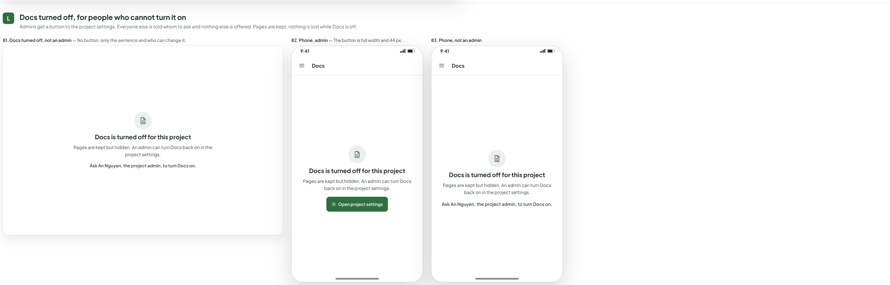

- Text in this part: "L" · "Docs turned off, for people who cannot turn it on" · "Admins get a button to the project settings. Everyone else is told whom to ask and nothing else is offered. Pages are kept; nothing is lost while Docs is off." · "81. Docs turned off, not an admin — No button: only the sentence and who can change it." · "Docs is turned off for this project" · "Pages are kept but hidden. An admin can turn Docs back on in the project settings." · "Ask An Nguyen, the project admin, to turn Docs on." · "82. Phone, admin — The button is full width and 44 px." · "9:41" · "Docs" · "Open project settings" · "83. Phone, not an admin"

---

## Frames, code that must change, and decisions for the owner

## RichDocsExport (2730 wide, finalH 14613, 55 frames)
A (1-5) Dialog: desktop PDF, tablet Word, phone sheet (top, scrolled), header menu. B (6-9) Options per format. C (10-13) Scope with child list, whole space, file name, phone. D (14-22) Progress, success, failure, too big, one-line note, four phones. E (23-29) Background export: running, ready, did not finish, bell Needs you and Updates, phone card and bell. F (30-33) History (with Cancelled), empty, row menu, phone. G (34-41) Book mode. H (42-49) Finished files (blog post and book chapter as Word, PDF, HTML, Markdown). I (50-55) Offline, empty page, cancelled, three phones.

## RichDocsStates (2730 wide, finalH 26487, 83 frames)
A (1-7) Loading. B (8-12) Converting. C (13-20) Saving. D (21-28) Offline. E (29-37) Two editors. F (38-48) Session ended, no access, deleted, Recycle Bin, not found, Docs off. G (49-56) Limits and browsers. H (57-61) Viewer and Docs team at work. I (62-67) Search. J (68-75) Accessibility. K (76-80) Dark mode (proposal). L (81-83) Docs off for a non-admin, with two phone frames.

## Code must change
- Export for four formats from the rich format; options per format; background whole-space job; files kept 7 days; history of the last 20; "Export again"; size limit; "Needs you" for a failed export.
- Book mode (order lives only in the export); page-tree multi-select "Export as a book".
- Block-level merge and a block-by-block conflict dialog replace the line-based ConflictBanner diff.
- Save-status chip with six states; offline queue including pictures; the offline banner string ("Editing is off until you reconnect" is replaced: offline editing is queued; the banner also carries the version).
- Conversion status per page; presence chip.
- Limits: image 10 MB, video 200 MB, file 100 MB, HTML 512 KB, page 50 MB (warning at 75 %).
- Blocked-embed block; storage quota dialog; browser capability check; viewer role UI; AI hold shown as paused blocks.
- Search markers for table, caption, alt text, code and comment.
- Readability check (never blocks Publish); reduced-motion handling.
- Restore toast with Undo.

## Decisions for the owner
- Dark mode is a proposal (the app has no dark theme).
- Offline editing is allowed (queued changes, merged on reconnect).
- Files kept 7 days, 20 in history; 200 MB export limit; whole-space export runs in the background, one at a time; failed export goes to Needs you, ready goes to Updates; editors can export the published version or the draft.
- The Docs team never locks the whole page, only the blocks it is changing; "also editing" presence chip.
- Search does not read inside pictures or videos.
- A failed page conversion keeps the original Markdown read-only.
- Palette: the names and values of the Editor board.
