# Rich Docs — page tree, gallery & Recycle Bin

> New screen (Rich Docs) · canvas `1794929703-2a72` · the board is split into 4 boards on the canvas because a browser cannot paint one board taller than about 8000 px; frame numbers run on across the parts. Sources: [`RichDocsTree1.dc.html`](../source/RichDocsTree1.dc.html) (sha256 `8dfb5acd68ef…`, full value in `MANIFEST.json`), [`RichDocsTree2.dc.html`](../source/RichDocsTree2.dc.html) (sha256 `1e36892dfe72…`, full value in `MANIFEST.json`), [`RichDocsTree3.dc.html`](../source/RichDocsTree3.dc.html) (sha256 `786d2a85d0a0…`, full value in `MANIFEST.json`), [`RichDocsTree4.dc.html`](../source/RichDocsTree4.dc.html) (sha256 `93a1271bcd25…`, full value in `MANIFEST.json`)

> A new board that lives next to the older Docs boards (it does not replace them). Where a screen already exists in the code, the words follow the code (`ui/src/components/docs/`); the rich-format parts (colours, float images, merged cells, embeds, suggestions, export, public links, highlights) are a design proposal and need the code changes listed at the end. Names, ids, costs and times in the mock-ups are sample data. Frames are numbered on the canvas; desktop is 1360 wide, tablet 820, phone 390.

## SCREENS, NEW — RICH DOCS

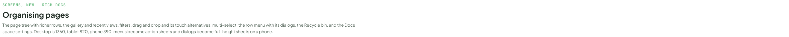

- Text in this part: "SCREENS, NEW — RICH DOCS" · "Organising pages" · "The page tree with richer rows, the gallery and recent views, filters, drag and drop and its touch alternatives, multi-select, the row menu with its dialogs, the Recycle bin, and the Docs space settings. Desktop is 1360, tablet 820, phone 390; menus become action sheets and dialogs become full-height sheets on a phone."

---

## The page tree

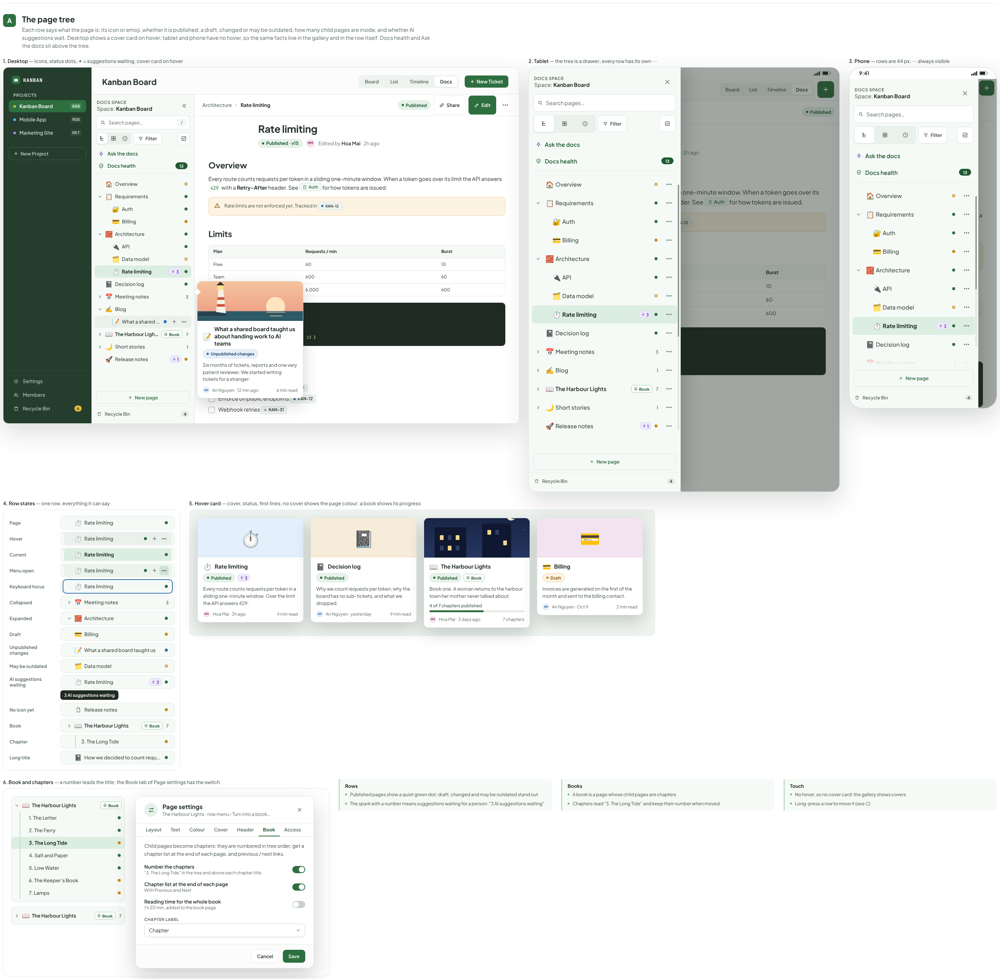

- Text in this part: "A" · "The page tree" · "Each row says what the page is: its icon or emoji, whether it is published, a draft, changed or may be outdated, how many child pages are inside, and whether AI suggestions wait. Desktop shows a cover card on hover; tablet and phone have no hover, so the same facts live in the gallery and in the row itself. Docs health and Ask the docs sit above the tree." · "1. Desktop — icons, status dots, ✦ = suggestions waiting, cover card on hover" · "KANBAN" · "PROJECTS" · "Kanban Board" · "KAN" · "Mobile App" · "MOB" · "Marketing Site" · "MKT" · "New Project" · "Settings" · "Members" · "Recycle Bin" · "6" · "Board" · "List" · "Timeline" · "Docs" · "New Ticket" · "DOCS SPACE" · "Space: Kanban Board" · "Search pages…" · "/" · "Filter" · "Ask the docs" · "Docs health" · "13" · "🏠" · "Overview" · "📋" · "Requirements" · "🔐" · "Auth" · "💳" · "Billing" · "🧱" · "Architecture" · "🔌" · "API" · "🗂️" · "Data model" · "⏱️" · "Rate limiting" · "3" · "📓" · "Decision log" · "📅" · "Meeting notes" · "✍️" · "Blog" · "📝" · "What a shared board taught us" · "📖" · "The Harbour Lights" · "Book" · "7" · "🌙" · "Short stories" · "1" · "🚀" · "Release notes" · "New page" · "4" · "Published" · "Share" · "Edit" · "Published · v15" · "HM" · "Edited by Hoa Mai · 2h ago" · "Every route counts requests per token in a sliding one-minute window. When a token goes over its limit the API answers 429 with a Retry-After header. See" · "Auth for how tokens are issued." · "Rate limits are not enforced yet. Tracked in" · "KAN-12." · "Limits" · "Plan	Requests / min	Burst" · "Free	60	10" · "Team	600	60" · "Business	6,000	600" · "# Over the limit the API answers 429" · "HTTP/1.1 429 Too Many Requests" · "Retry-After: 12" · "{ "error": "rate_limited", "retry_in": 12 }" · "Rollout checklist" · "Publish the OpenAPI spec" · "Count requests per token" · "KAN-9" · "Enforce on public endpoints" · "KAN-12" · "Webhook retries" · "KAN-31" · "What a shared board taught us about handing work to AI teams" · "Unpublished changes" · "Six months of tickets, reports and one very patient reviewer. We started writing tickets for a stranger." · "AN" · "An Nguyen · 12 min ago" · "6 min read" · "2. Tablet — the tree is a drawer; every row has its own ⋯" · "9:41" · "Pages" · "3. Phone — rows are 44 px, ⋯ always visible" · "Docs ▾" · "4. Row states — one row, everything it can say" · "Page" · "Hover" · "Current" · "Menu open" · "Keyboard focus"

---

## Tree, gallery and recent

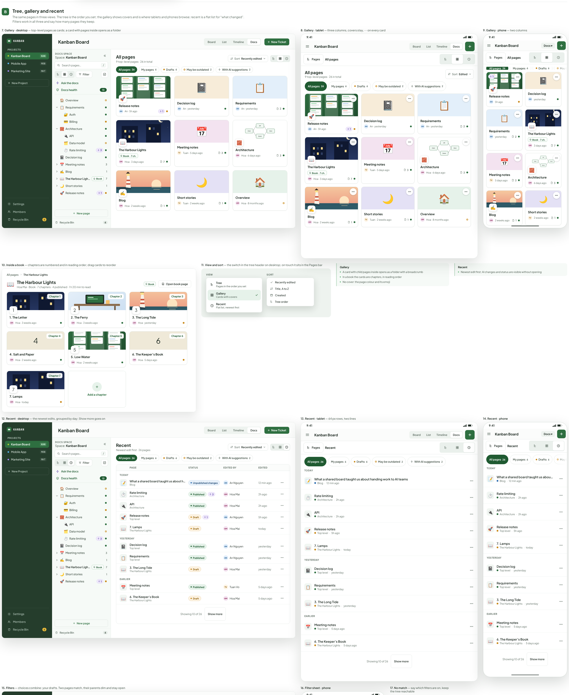

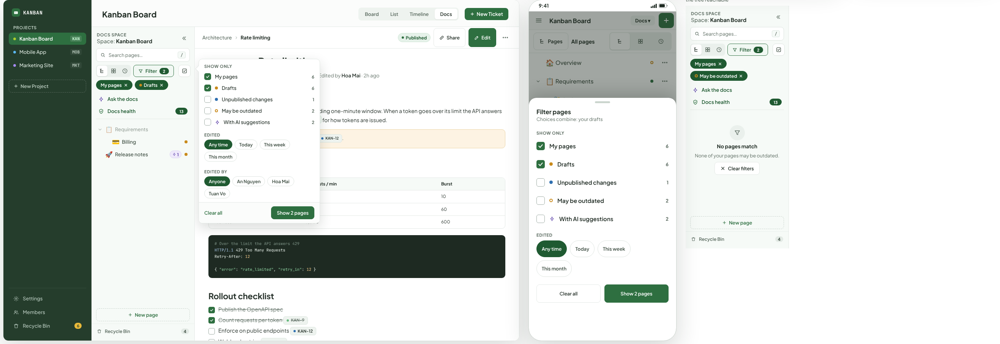

- Text in this part: "B" · "Tree, gallery and recent" · "The same pages in three views. The tree is the order you set; the gallery shows covers and is where tablets and phones browse; recent is a flat list for “what changed”. Filters work in all three and say how many pages they keep." · "7. Gallery · desktop — top-level pages as cards; a card with pages inside opens as a folder" · "KANBAN" · "PROJECTS" · "Kanban Board" · "KAN" · "Mobile App" · "MOB" · "Marketing Site" · "MKT" · "New Project" · "Settings" · "Members" · "Recycle Bin" · "6" · "Board" · "List" · "Timeline" · "Docs" · "New Ticket" · "DOCS SPACE" · "Space: Kanban Board" · "Search pages…" · "/" · "Filter" · "Ask the docs" · "Docs health" · "13" · "🏠" · "Overview" · "📋" · "Requirements" · "🔐" · "Auth" · "💳" · "Billing" · "🧱" · "Architecture" · "🔌" · "API" · "🗂️" · "Data model" · "⏱️" · "Rate limiting" · "3" · "📓" · "Decision log" · "📅" · "Meeting notes" · "✍️" · "Blog" · "1" · "📖" · "The Harbour Lights" · "Book" · "7" · "🌙" · "Short stories" · "🚀" · "Release notes" · "New page" · "4" · "All pages" · "9 top-level pages · 26 in total" · "Sort" · "Recently edited" · "26" · "My pages" · "Drafts" · "May be outdated" · "2" · "With AI suggestions" · "AN" · "An · 5h ago" · "An · yesterday" · "Book · 7 ch." · "HM" · "Hoa · 3 days ago" · "TV" · "Tuan · 5 days ago" · "Client" · "Queue" · "Store" · "Hoa · 6 days ago" · "Hoa · 2 weeks ago" · "Tuan · 2 weeks ago" · "Hoa · 8 months ago" · "8. Gallery · tablet — three columns, covers stay, ⋯ on every card" · "9:41" · "Pages" · "Edited" · "9. Gallery · phone — two columns" · "Docs ▾" · "5h ago" · "yesterday" · "3 days ago" · "5 days ago" · "6 days ago" · "2 weeks ago" · "10. Inside a book — chapters are numbered and in reading order; drag cards to reorder" · "Hoa Mai · Book · 7 chapters · 4 published · 1 h 20 min to read" · "Open book page" · "1. The Letter" · "Hoa · 3 weeks ago" · "Chapter 1" · "2. The Ferry" · "Chapter 2" · "3. The Long Tide"

---

## Moving pages: drag, touch and select

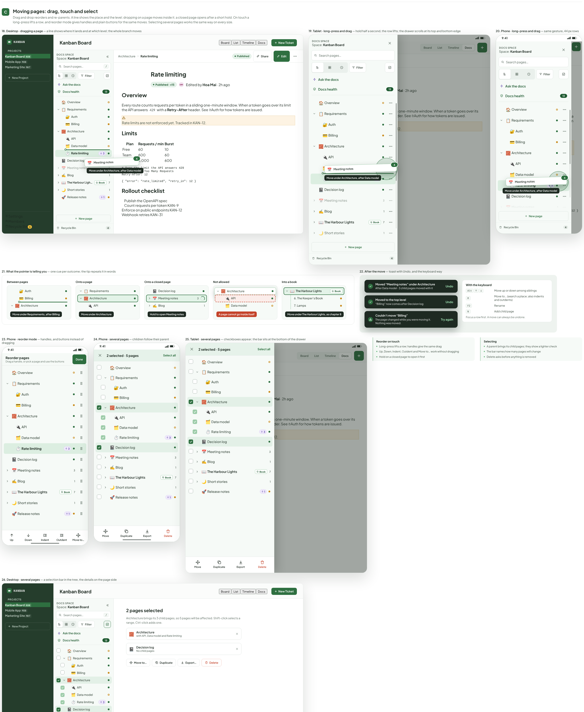

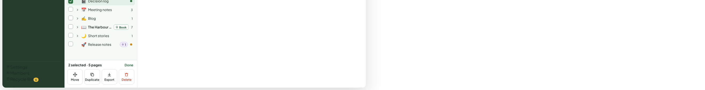

- Text in this part: "C" · "Moving pages: drag, touch and select" · "Drag and drop reorders and re-parents. A line shows the place and the level; dropping on a page moves inside it; a closed page opens after a short hold. On touch a long-press lifts a row, and reorder mode gives handles and plain buttons for the same moves. Selecting several pages works the same way on every size." · "18. Desktop · dragging a page — a line shows where it lands and at which level; the whole branch moves" · "KANBAN" · "PROJECTS" · "Kanban BoardKAN" · "Mobile AppMOB" · "Marketing SiteMKT" · "New Project" · "Settings" · "Members" · "Recycle Bin6" · "Kanban Board" · "Board" · "List" · "Timeline" · "Docs" · "New Ticket" · "DOCS SPACE" · "Space: Kanban Board" · "Search pages…" · "/" · "Filter" · "Ask the docs" · "Docs health" · "13" · "🏠" · "Overview" · "📋" · "Requirements" · "🔐" · "Auth" · "💳" · "Billing" · "🧱" · "Architecture" · "🔌" · "API" · "🗂️" · "Data model" · "⏱️" · "Rate limiting" · "3" · "📓" · "Decision log" · "📅" · "Meeting notes" · "✍️" · "Blog" · "1" · "📖" · "The Harbour Lights" · "Book" · "7" · "🌙" · "Short stories" · "🚀" · "Release notes" · "New page" · "Recycle Bin" · "4" · "Move under Architecture, after Data model" · "Published" · "Share" · "Edit" · "Published · v15" · "HM" · "Edited by Hoa Mai · 2h ago" · "Every route counts requests per token in a sliding one-minute window. When a token goes over its limit the API answers 429 with a Retry-After header. See Auth for how tokens are issued." · "Rate limits are not enforced yet. Tracked in KAN-12." · "Limits" · "Plan	Requests / min	Burst" · "Free	60	10" · "Team	600	60" · "Business	6,000	600" · "# Over the limit the API answers 429" · "HTTP/1.1 429 Too Many Requests" · "Retry-After: 12" · "{ "error": "rate_limited", "retry_in": 12 }" · "Rollout checklist" · "Publish the OpenAPI spec" · "Count requests per token KAN-9" · "Enforce on public endpoints KAN-12" · "Webhook retries KAN-31" · "19. Tablet · long-press and drag — hold half a second, the row lifts; the drawer scrolls at its top and bottom edge" · "9:41" · "Pages" · "20. Phone · long-press and drag — same gesture, 44 px rows" · "Docs ▾" · "21. What the pointer is telling you — one cue per outcome; the tip repeats it in words" · "Between pages" · "Move under Requirements, after Billing" · "Onto a page" · "Move under Architecture" · "Onto a closed page" · "Hold to open Meeting notes" · "Not allowed" · "A page cannot go inside itself" · "Into a book" · "6. The Keeper’s Book" · "7. Lamps" · "Move under The Harbour Lights, as chapter 8" · "22. After the move — toast with Undo, and the keyboard way" · "Moved “Meeting notes” under Architecture" · "After Data model · 3 child pages moved with it" · "Undo" · "Moved to the top level" · "“Billing” now comes after Decision log" · "Couldn’t move “Billing”"

---

## The row menu and its dialogs

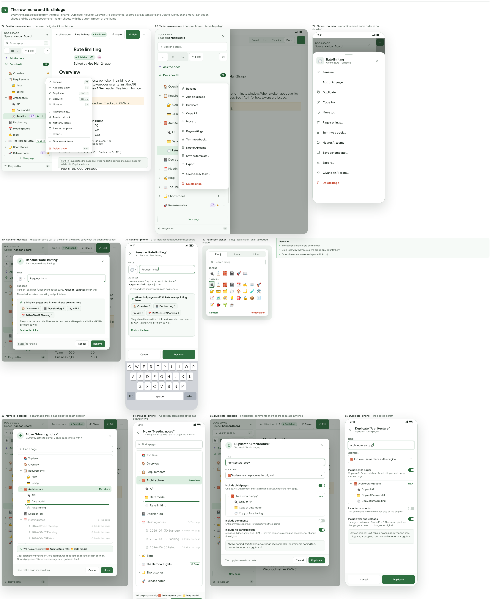

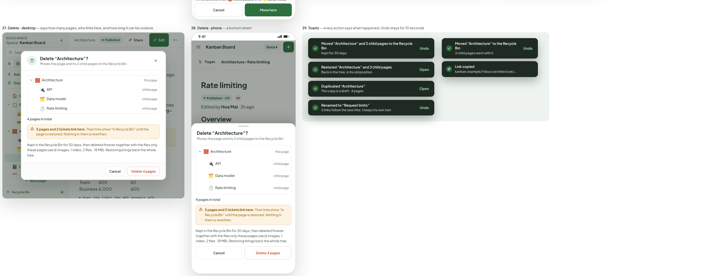

- Text in this part: "D" · "The row menu and its dialogs" · "Everything a page can do from the tree: Rename, Duplicate, Move to, Copy link, Page settings, Export, Save as template and Delete. On touch the menu is an action sheet, and the dialogs become full-height sheets with the button in reach of the thumb." · "27. Desktop · row menu — ⋯ on hover, or right-click on the row" · "DOCS SPACE" · "Space: Kanban Board" · "Search pages…" · "/" · "Filter" · "Ask the docs" · "Docs health" · "13" · "🏠" · "Overview" · "📋" · "Requirements" · "🔐" · "Auth" · "💳" · "Billing" · "🧱" · "Architecture" · "🔌" · "API" · "🗂️" · "Data model" · "⏱️" · "Rate limiting" · "3" · "📓" · "Decision log" · "📅" · "Meeting notes" · "✍️" · "Blog" · "1" · "📖" · "The Harbour Lights" · "Book" · "7" · "🌙" · "Short stories" · "🚀" · "Release notes" · "New page" · "Recycle Bin" · "4" · "Rename" · "F2" · "Add child page" · "N" · "Duplicate" · "Ctrl D" · "Copy link" · "Ctrl L" · "Move to…" · "M" · "Page settings…" · "Turn into a book…" · "Not for AI teams" · "Save as template…" · "Export…" · "Give to an AI team…" · "Delete page" · "Del" · "Published" · "Share" · "Edit" · "Published · v15" · "HM" · "Edited by Hoa Mai · 2h ago" · "Every route counts requests per token in a sliding one-minute window. When a token goes over its limit the API answers 429 with a Retry-After header. See Auth for how tokens are issued." · "Rate limits are not enforced yet. Tracked in KAN-12." · "Limits" · "Plan	Requests / min	Burst" · "Free	60	10" · "Team	600	60" · "Business	6,000	600" · "# Over the limit the API answers 429" · "HTTP/1.1 429 Too Many Requests" · "Retry-After: 12" · "{ "error": "rate_limited", "retry_in": 12 }" · "Rollout checklist" · "Publish the OpenAPI spec" · "Count requests per token KAN-9" · "Enforce on public endpoints KAN-12" · "Webhook retries KAN-31" · "Ctrl D duplicates the page only when no text is being edited, so it does not collide with Duplicate block." · "28. Tablet · row menu — a popover from ⋯, items 44 px high" · "9:41" · "Kanban Board" · "Board" · "List" · "Timeline" · "Docs" · "Pages" · "29. Phone · row menu — an action sheet; same order as on desktop" · "Docs ▾" · "Architecture · Published" · "30. Rename · desktop — the page icon is part of the name; the dialog says what the change touches" · "Rename 'Rate limiting'" · "Architecture › Rate limiting" · "TITLE" · "Request limits" · "ADDRESS" · "kanban.example/?docs=architecture/request-limits&proj=KAN" · "The old address keeps working and points here." · "6 links in 4 pages and 2 tickets keep pointing here" · "2026-10-02 Planning" · "They show the new title. 1 link has its own text and keeps it. KAN-12 and KAN-31 follow as well."

---

## Recycle Bin

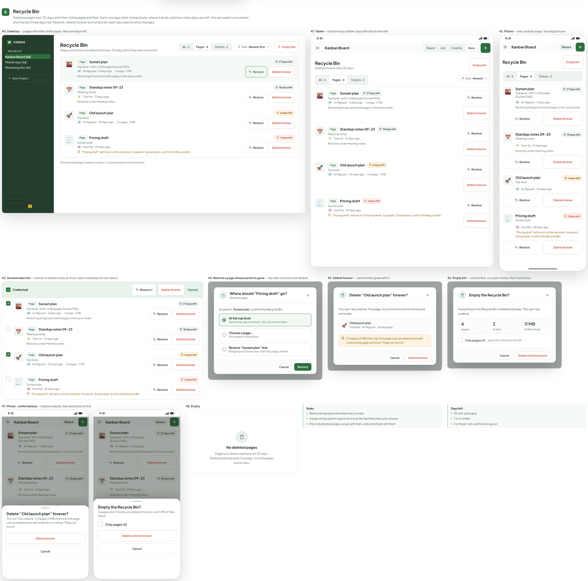

- Text in this part: "E" · "Recycle Bin" · "Deleted pages wait 30 days with their child pages and files. Each row says what comes back, where it lands, and how many days are left; the last week turns amber and the last three days red. Restore, delete forever and empty bin each say exactly what changes." · "40. Desktop — pages with their child pages, files and days left" · "KANBAN" · "PROJECTS" · "Kanban BoardKAN" · "Mobile AppMOB" · "Marketing SiteMKT" · "New Project" · "Settings" · "Members" · "Recycle Bin6" · "Pages and tickets are deleted forever 30 days after they were removed." · "All · 6" · "Pages · 4" · "Tickets · 2" · "Sort" · "Newest first" · "Empty bin" · "🌇" · "Page" · "Sunset plan" · "Top level · with 1 child page (Sunset FAQ)" · "AN" · "An Nguyen · 3 days ago" · "· 1 image · 2 MB" · "Restoring brings back both pages in the same order." · "27 days left" · "Restore" · "Delete forever" · "📅" · "Standup notes 09-23" · "Meeting notes" · "TV" · "Tuan Vo · 12 days ago" · "Restores under Meeting notes." · "18 days left" · "🚀" · "Old launch plan" · "Top level" · "An Nguyen · 24 days ago" · "· 2 images · 3 MB" · "6 days left" · "🧾" · "Pricing draft" · "HM" · "Hoa Mai · 28 days ago" · "“Pricing draft” will return at the top level. Its parent, Sunset plan, is still in the Recycle Bin." · "2 days left" · "If a restored page’s parent is gone, it comes back at the top level." · "41. Tablet — buttons stay visible; days left sits by the title" · "9:41" · "Kanban Board" · "Board" · "List" · "Timeline" · "Docs" · "Deleted forever after 30 days" · "Newest" · "42. Phone — one card per page, two big buttons" · "Docs ▾" · "43. Several selected — restore or delete many at once; each one keeps its own place" · "2 selected" · "Restore 2" · "Cancel" · "44. Restore a page whose parent is gone — the safe choice is the default" · "Where should “Pricing draft” go?" · "Restore page" · "Its parent, Sunset plan, is still in the Recycle Bin." · "At the top level" · "Same title, same content. You can move it later." · "Choose a page…" · "Pick where it should live." · "Restore “Sunset plan” first" · "Brings back Sunset plan, then this page under it." · "45. Delete forever — names what goes with it" · "Delete “Old launch plan” forever?" · "This can’t be undone. The page, its comments and its history are removed." · "Top level · An Nguyen · 24 days ago" · "2 images (3 MB) that only this page uses are deleted as well. Links to this page will show “Page not found”." · "46. Empty bin — counts first, a scope choice, then the button" · "Empty the Recycle Bin?" · "Everything in the Recycle Bin is deleted forever. This can’t be undone." · "4" · "pages" · "2" · "tickets" · "11 MB" · "of files freed" · "Only pages (4)" · "leave the 2 tickets in the bin" · "Delete 6 items forever" · "47. Phone · confirmations — bottom sheets; the red button is first" · "This can’t be undone. 2 images (3 MB) that only this page uses are deleted as well, and links to it show “Page not found”." · "4 pages and 2 tickets are deleted forever, and 11 MB of files freed." · "48. Empty" · "No deleted pages" · "Pages you delete wait here for 30 days. Restoring brings back the page, its child pages and its files." · "Rules" · "Restore brings back the whole tree, in order" · "A page whose parent is gone returns at the top level unless you choose" · "Files only deleted pages use go with them, and come back with them" · "Days left" · "30 to 8: quiet grey" · "7 to 4: amber" · "3 or fewer: red, and the row says so"

---

## Docs space settings

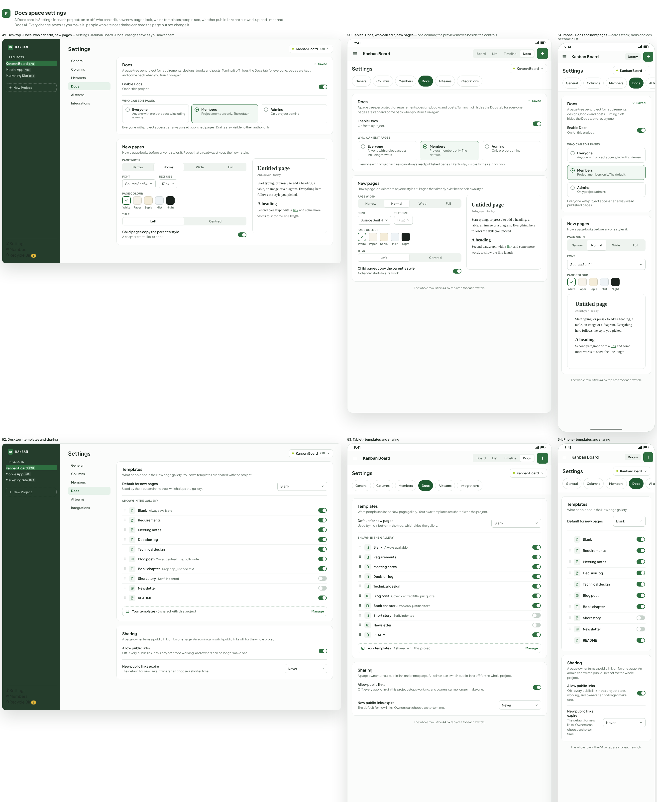

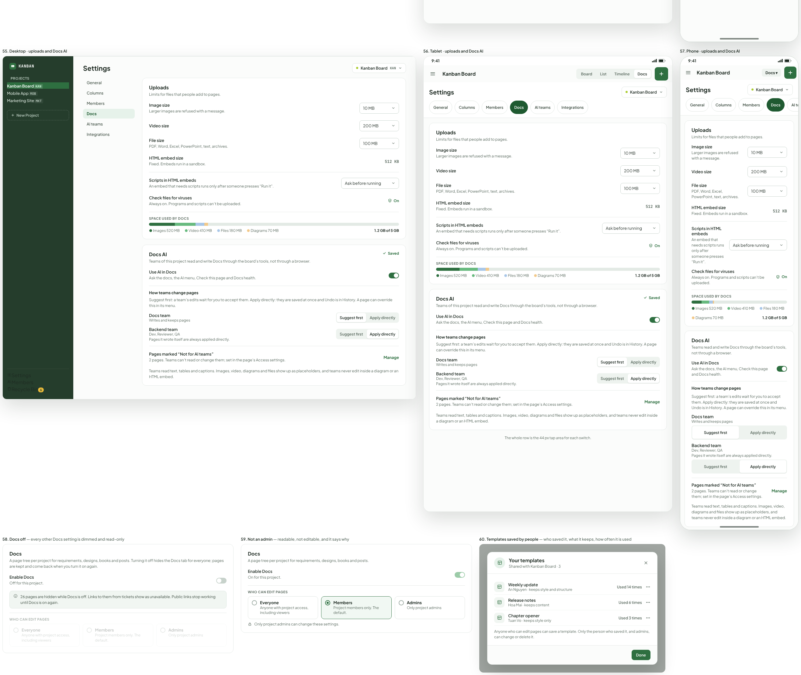

- Text in this part: "F" · "Docs space settings" · "A Docs card in Settings for each project: on or off, who can edit, how new pages look, which templates people see, whether public links are allowed, upload limits and Docs AI. Every change saves as you make it; people who are not admins can read the page but not change it." · "49. Desktop · Docs, who can edit, new pages — Settings › Kanban Board › Docs; changes save as you make them" · "KANBAN" · "PROJECTS" · "Kanban BoardKAN" · "Mobile AppMOB" · "Marketing SiteMKT" · "New Project" · "Settings" · "Members" · "Recycle Bin6" · "Kanban Board" · "KAN" · "General" · "Columns" · "Docs" · "AI teams" · "Integrations" · "A page tree per project for requirements, designs, books and posts. Turning it off hides the Docs tab for everyone; pages are kept and come back when you turn it on again." · "Saved" · "Enable Docs" · "On for this project." · "WHO CAN EDIT PAGES" · "Everyone" · "Anyone with project access, including viewers" · "Project members only. The default." · "Admins" · "Only project admins" · "Everyone with project access can always read published pages. Drafts stay visible to their author only." · "New pages" · "How a page looks before anyone styles it. Pages that already exist keep their own style." · "PAGE WIDTH" · "Narrow" · "Normal" · "Wide" · "Full" · "FONT" · "Source Serif 4" · "TEXT SIZE" · "17 px" · "PAGE COLOUR" · "White" · "Paper" · "Sepia" · "Mist" · "Night" · "TITLE" · "Left" · "Centred" · "Child pages copy the parent’s style" · "A chapter starts like its book." · "Untitled page" · "An Nguyen · today" · "Start typing, or press / to add a heading, a table, an image or a diagram. Everything here follows the style you picked." · "A heading" · "Second paragraph with a link and some more words to show the line length." · "50. Tablet · Docs, who can edit, new pages — one column; the preview moves beside the controls" · "9:41" · "Board" · "List" · "Timeline" · "The whole row is the 44 px tap area for each switch." · "51. Phone · Docs and new pages — cards stack; radio choices become a list" · "Docs ▾" · "A page tree per project for requirements, designs, books and posts. Turning it off hides the Docs tab for everyone." · "Everyone with project access can always read published pages." · "How a page looks before anyone styles it." · "52. Desktop · templates and sharing" · "Templates" · "What people see in the New page gallery. Your own templates are shared with the project." · "Default for new pages" · "Used by the + button in the tree, which skips the gallery." · "Blank" · "SHOWN IN THE GALLERY" · "Blank · Always available" · "Requirements" · "Meeting notes" · "Decision log" · "Technical design" · "Blog post · Cover, centred title, pull quote" · "Book chapter · Drop cap, justified text" · "Short story · Serif, indented" · "Newsletter" · "README" · "Your templates · 3 shared with this project" · "Manage" · "Sharing" · "A page owner turns a public link on for one page. An admin can switch public links off for the whole project." · "Allow public links" · "Off: every public link in this project stops working, and owners can no longer make one." · "New public links expire" · "The default for new links. Owners can choose a shorter time." · "Never" · "53. Tablet · templates and sharing" · "54. Phone · templates and sharing" · "What people see in the New page gallery." · "Blog post" · "Book chapter" · "Short story" · "55. Desktop · uploads and Docs AI" · "Uploads" · "Limits for files that people add to pages." · "Image size" · "Larger images are refused with a message." · "10 MB" · "Video size" · "200 MB" · "File size"

---

## States and the last settings

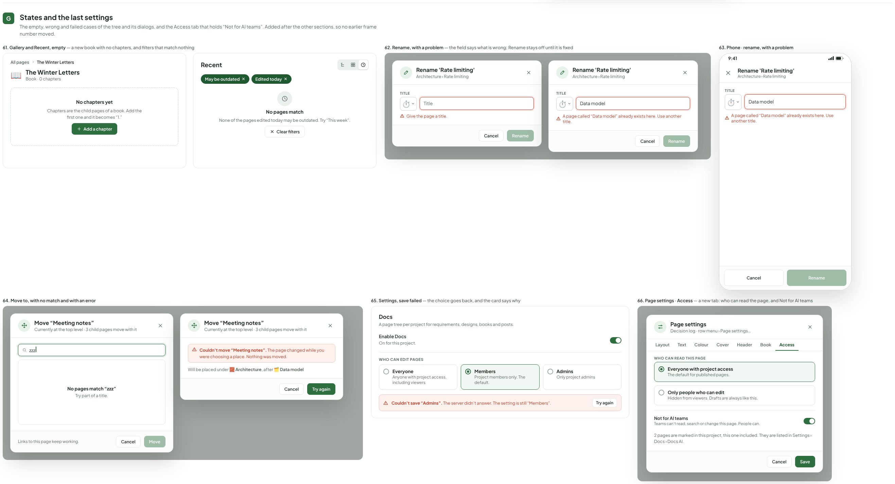

- Text in this part: "G" · "States and the last settings" · "The empty, wrong and failed cases of the tree and its dialogs, and the Access tab that holds “Not for AI teams”. Added after the other sections, so no earlier frame number moved." · "61. Gallery and Recent, empty — a new book with no chapters, and filters that match nothing" · "All pages" · "The Winter Letters" · "📖" · "Book · 0 chapters" · "No chapters yet" · "Chapters are the child pages of a book. Add the first one and it becomes “1.”" · "Add a chapter" · "Recent" · "May be outdated" · "Edited today" · "No pages match" · "None of the pages edited today may be outdated. Try “This week”." · "Clear filters" · "62. Rename, with a problem — the field says what is wrong; Rename stays off until it is fixed" · "Rename 'Rate limiting'" · "Architecture › Rate limiting" · "TITLE" · "⏱️" · "Title" · "Give the page a title." · "Cancel" · "Rename" · "Data model" · "A page called “Data model” already exists here. Use another title." · "63. Phone · rename, with a problem" · "9:41" · "64. Move to, with no match and with an error" · "Move “Meeting notes”" · "Currently at the top level · 3 child pages move with it" · "zzz" · "No pages match “zzz”" · "Try part of a title." · "Links to this page keep working." · "Move" · "Couldn’t move “Meeting notes”. The page changed while you were choosing a place. Nothing was moved." · "Will be placed under 🧱 Architecture, after 🗂️ Data model" · "Try again" · "65. Settings, save failed — the choice goes back, and the card says why" · "Docs" · "A page tree per project for requirements, designs, books and posts." · "Enable Docs" · "On for this project." · "WHO CAN EDIT PAGES" · "Everyone" · "Anyone with project access, including viewers" · "Members" · "Project members only. The default." · "Admins" · "Only project admins" · "Couldn’t save “Admins”. The server didn’t answer. The setting is still “Members”." · "66. Page settings · Access — a new tab: who can read the page, and Not for AI teams" · "Page settings" · "Decision log · row menu › Page settings…" · "Layout" · "Text" · "Colour" · "Cover" · "Header" · "Book" · "Access" · "WHO CAN READ THIS PAGE" · "Everyone with project access" · "The default for published pages." · "Only people who can edit" · "Hidden from viewers. Drafts are always like this." · "Not for AI teams" · "Teams can’t read, search or change this page. People can." · "2 pages are marked in this project, this one included. They are listed in Settings › Docs › Docs AI." · "Save"

---

## Frames, code that must change, and decisions for the owner

RichDocsTree 2730 wide, finalH 23782, 66 frames. RichDocsLinks 2730 wide, finalH 26601, 68 frames. A facts sheet (`c/rd6_tree/FACTS.md`: page tree, link graph, counts, sample book, people) drives every count in both boards.

## RichDocsTree (1-66)
A 1-6 tree on three sizes, row states, hover cards, book and chapters. B 7-17 gallery, inside a book, view and sort, recent, filters, no match. C 18-26 drag, drop cues, after-move toasts and keys, reorder mode, multi-select. D 27-39 row menu, rename, icon picker, move to, duplicate, delete, toasts. E 40-48 Recycle Bin. F 49-60 Docs space settings. G 61-66 empty views, rename problems, move states, save failed, Access tab.

## RichDocsLinks (1-68)
A 1-6 quick open. B 7-15 search. C 16-20 `[[` and `#` suggesters. D 21-26 heading and block links. E 27-30 hover cards and peek. F 31-36 Referenced by. G 37-43 broken links. H 44-46 rename. I 47-57 ticket side. J 58-62 Docs health. K 63-68 peek states, empty-page card, tap cards.

## Code must change
- Rich row data: icon, cover, status ("May be outdated"), the ✦ "AI suggestions waiting" count, book and chapter fields.
- Gallery and recent views, filters ("With AI suggestions" included), multi-select, reorder mode, hover cover card.
- Page settings gains Book and Access tabs; the row menu gains "Turn into a book…", "Not for AI teams" and "Give to an AI team…".
- Docs settings: Docs AI per team, "Ask before running" scripts in HTML embeds, public-link switch (owner turns on, admin can switch off per project), per-project new-page style, templates, upload limits.
- Rename counts the links and keeps them by id; Duplicate gains comments and files options; Delete counts files and linking tickets; Recycle Bin gets days-left colours, file sizes, scope choice on empty bin, restore-where choice.
- Search and quick open find tables, captions, alt text, code, draw.io labels and file names with a kind marker; Go to page with headings and tickets.
- Links: chips store page, heading or block ids; "#" ticket trigger; "Copy link to this block"; Referenced by with block anchors and the "6 references" button wording; link checker for headings and blocks; peek states (loading, error, in the bin); tap cards on touch.
- Ticket Docs cards become a card grid; board cards show a page count; "Write a page for KAN-12".
- Docs health reasons point at a block; "Docs health" and "Ask the docs" stay in the tree header.

## Decisions for the owner
- Chips store ids, so a rename never breaks a link.
- Unreadable pages are left out of counts and named in one line.
- Filters combine (AND).
- Ctrl D (page Duplicate) works only outside text editing, so it does not collide with block Duplicate.
- The limits and public-link defaults in the settings frames are proposals (expiry default Never).
- Docs health only reads text, tables, captions and alt text, never inside images, video, diagrams or files; search does not read file contents, only names.
- "Not for AI teams" is a per-page setting; a book numbers its chapters in the tree; Recycle Bin keeps files 30 days with the page.
- Invented shortcut keys (move page up / down etc.) and the link checker fixes (relink all, restore, use closest heading) are proposals.
