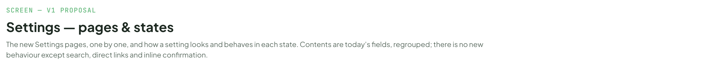
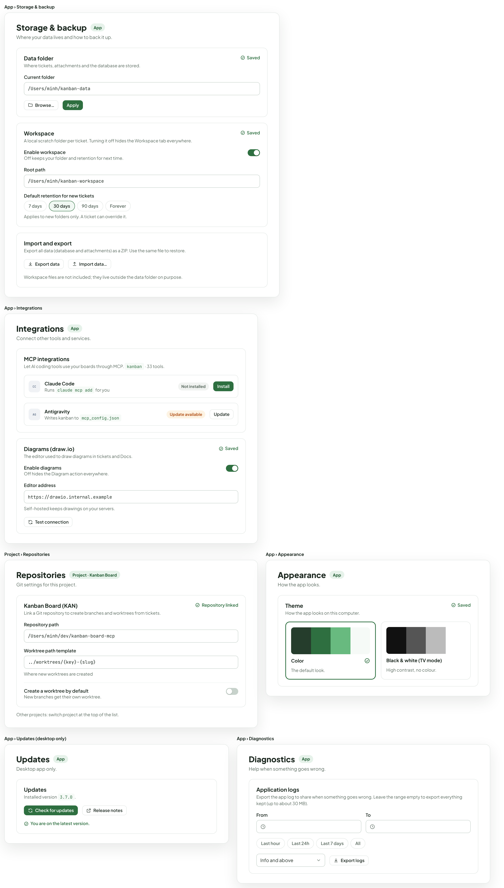
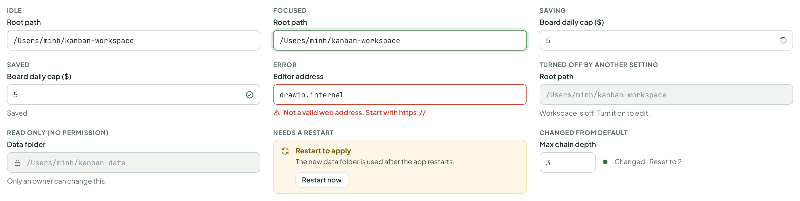
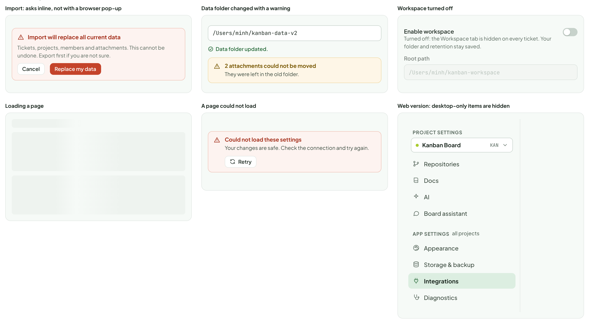
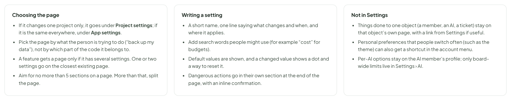

# Settings — pages & states

> SCREEN — V1 PROPOSAL · source: [`SettingsPages.dc.html`](../source/SettingsPages.dc.html) · canvas `1793277091-b441` · sha256 `6396cd03daef727acd0c385c297e16a3caf55a2e228e54656af349b6c4ba6911`

The new Settings pages, one by one, and how a setting looks and behaves in each state. Contents are today’s fields, regrouped; there is no new behaviour except search, direct links and inline confirmation.

Source: [SettingsPages.dc.html](../source/SettingsPages.dc.html) › header ("SCREEN — V1 PROPOSAL", "Settings — pages & states" and the intro)

---

## F. The pages

Every page has the same shape: title, who it applies to, then sections. Contents are today’s fields, regrouped. Shown without the surrounding app frame.

Source: [SettingsPages.dc.html](../source/SettingsPages.dc.html) › block "F. The pages"

- Text in the frames: "App › Storage & backup" · "Storage & backup" · "App" · "Where your data lives and how to back it up." · "Data folder" · "Where tickets, attachments and the database are stored." · "Saved" · "Current folder" · "/Users/minh/kanban-data" · "Browse…" · "Apply" · "Workspace" · "A local scratch folder per ticket. Turning it off hides the Workspace tab everywhere." · "Enable workspace" · "Off keeps your folder and retention for next time." · "Root path" · "/Users/minh/kanban-workspace" · "Default retention for new tickets" · "7 days" · "30 days" · "90 days" · "Forever" · "Applies to new folders only. A ticket can override it." · "Import and export" · "Export all data (database and attachments) as a ZIP. Use the same file to restore." · "Export data" · "Import data…" · "Workspace files are not included; they live outside the data folder on purpose." · "App › Integrations" · "Integrations" · "Connect other tools and services." · "MCP integrations" · "Let AI coding tools use your boards through MCP. kanban · 33 tools." · "CC" · "Claude Code" · "Runs claude mcp add for you" · "Not installed" · "Install" · "AG" · "Antigravity" · "Writes kanban to mcp_config.json" · "Update available" · "Update" · "Diagrams (draw.io)" · "The editor used to draw diagrams in tickets and Docs." · "Enable diagrams" · "Off hides the Diagram action everywhere." · "Editor address" · "https://drawio.internal.example" · "Self-hosted keeps drawings on your servers." · "Test connection" · "Project › Repositories" · "Repositories" · "Project · Kanban Board" · "Git settings for this project." · "Kanban Board (KAN)" · "Link a Git repository to create branches and worktrees from tickets." · "Repository linked" · "Repository path" · "/Users/minh/dev/kanban-board-mcp" · "Worktree path template" · "../worktrees/{key}-{slug}" · "Where new worktrees are created" · "Create a worktree by default" · "New branches get their own worktree." · "Other projects: switch project at the top of the list." · "App › Appearance" · "Appearance" · "How the app looks." · "Theme" · "How the app looks on this computer." · "Color" · "The default look." · "Black & white (TV mode)" · "High contrast, no colour." · "App › Updates (desktop only)" · "Updates" · "Desktop app only." · "Installed version 3.7.0." · "Check for updates" · "Release notes" · "You are on the latest version." · "App › Diagnostics" · "Diagnostics" · "Help when something goes wrong." · "Application logs" · "Export the app log to share when something goes wrong. Leave the range empty to export everything kept (up to about 30 MB)." · "From" · "To" · "Last hour" · "Last 24h" · "Last 7 days" · "All" · "Info and above" · "Export logs"

---

## G. A setting and its states

The same rules everywhere, so people learn them once.

Source: [SettingsPages.dc.html](../source/SettingsPages.dc.html) › block "G. A setting and its states"

- Text in the frames: "IDLE" · "Root path" · "/Users/minh/kanban-workspace" · "FOCUSED" · "SAVING" · "Board daily cap ($)" · "5" · "SAVED" · "Saved" · "ERROR" · "Editor address" · "drawio.internal" · "Not a valid web address. Start with https://" · "TURNED OFF BY ANOTHER SETTING" · "Workspace is off. Turn it on to edit." · "READ ONLY (NO PERMISSION)" · "Data folder" · "/Users/minh/kanban-data" · "Only an owner can change this." · "NEEDS A RESTART" · "Restart to apply" · "The new data folder is used after the app restarts." · "Restart now" · "CHANGED FROM DEFAULT" · "Max chain depth" · "3" · "Changed · Reset to 2"

---

## H. States and problems

Source: [SettingsPages.dc.html](../source/SettingsPages.dc.html) › block "H. States and problems"

- Text in the frames: "Import: asks inline, not with a browser pop-up" · "Import will replace all current data" · "Tickets, projects, members and attachments. This cannot be undone. Export first if you are not sure." · "Cancel" · "Replace my data" · "Data folder changed with a warning" · "/Users/minh/kanban-data-v2" · "Data folder updated." · "2 attachments could not be moved" · "They were left in the old folder." · "Workspace turned off" · "Enable workspace" · "Turned off: the Workspace tab is hidden on every ticket. Your folder and retention stay saved." · "Root path" · "/Users/minh/kanban-workspace" · "Loading a page" · "A page could not load" · "Could not load these settings" · "Your changes are safe. Check the connection and try again." · "Retry" · "Web version: desktop-only items are hidden" · "PROJECT SETTINGS" · "Kanban Board" · "KAN" · "Repositories" · "Docs" · "AI" · "Board assistant" · "APP SETTINGS" · "all projects" · "Appearance" · "Storage & backup" · "Integrations" · "Diagnostics"

---

## I. Where does a new setting go?

So the page does not grow into one long list again.

Source: [SettingsPages.dc.html](../source/SettingsPages.dc.html) › block "I. Where does a new setting go?"

- Text in the frames: "Choosing the page" · "If it changes one project only, it goes under Project settings; if it is the same everywhere, under App settings." · "Pick the page by what the person is trying to do (“back up my data”), not by which part of the code it belongs to." · "A feature gets a page only if it has several settings. One or two settings go on the closest existing page." · "Aim for no more than 5 sections on a page. More than that, split the page." · "Writing a setting" · "A short name, one line saying what changes and when, and where it applies." · "Add search words people might use (for example “cost” for budgets)." · "Default values are shown, and a changed value shows a dot and a way to reset it." · "Dangerous actions go in their own section at the end of the page, with an inline confirmation." · "Not in Settings" · "Things done to one object (a member, an AI, a ticket) stay on that object’s own page, with a link from Settings if useful." · "Personal preferences that people switch often (such as the theme) can also get a shortcut in the account menu." · "Per-AI options stay on the AI member’s profile; only board-wide limits live in Settings › AI."
