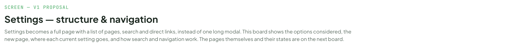
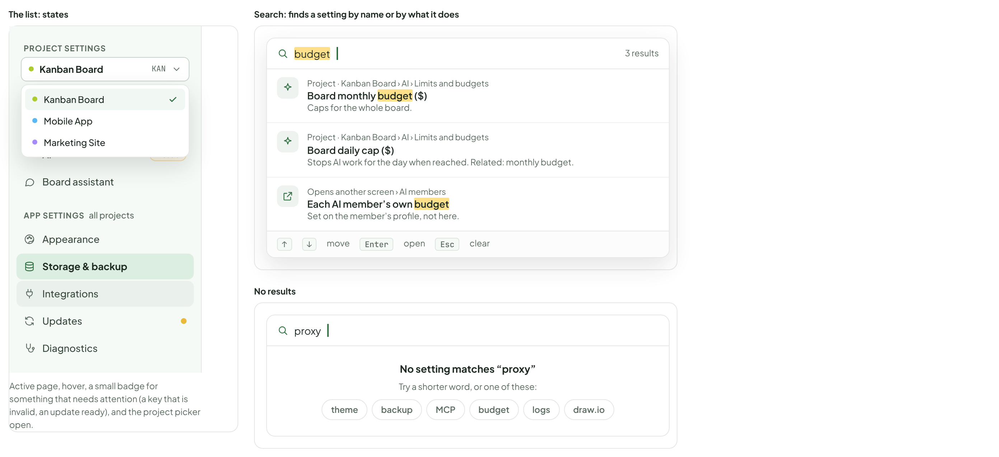
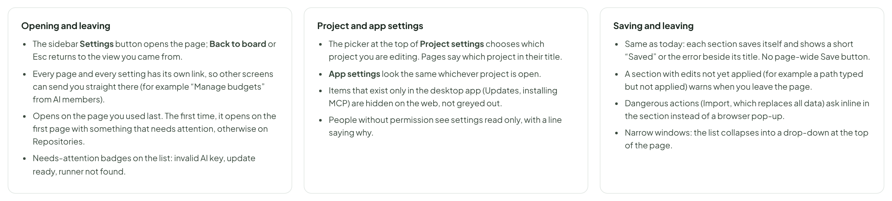

# Settings — structure & navigation

> SCREEN — V1 PROPOSAL · source: [`SettingsNav.dc.html`](../source/SettingsNav.dc.html) · canvas `1793277091-b441` · sha256 `c9e13b688590060debe423521f04370231e26fa69dede263c76994af418356e1`

Settings becomes a full page with a list of pages, search and direct links, instead of one long modal. This board shows the options considered, the new page, where each current setting goes, and how search and navigation work. The pages themselves and their states are on the next board.

Source: [SettingsNav.dc.html](../source/SettingsNav.dc.html) › header ("SCREEN — V1 PROPOSAL", "Settings — structure & navigation" and the intro)

---

## A. What is wrong today and the options

Settings opens as a modal with 11 sections in one scroll. They mix settings for one project (Git repositories, Docs, AI) with settings for the whole app (Theme, Data folder, Updates, Logs), and more keep being added. Finding one means scrolling and reading headings.

Source: [SettingsNav.dc.html](../source/SettingsNav.dc.html) › block "A. What is wrong today and the options"

- Text in the frames: "1. Keep the modal, add search" · "Smallest change" · "Quick to build" · "Familiar" · "Still one long scroll" · "No way to link straight to a setting" · "Gets worse with every new section" · "2. Bigger modal with a side list" · "Middle ground" · "Pages instead of one scroll" · "Search can be added" · "Still covers the board" · "No direct links; cramped in small windows" · "Hard to open from another screen and come back" · "3. A full Settings page with a side list and search" · "Recommended" · "Treat Settings like Docs" · "Every page short and focused" · "Project and app settings clearly apart" · "Search finds any setting; every setting has its own link" · "Room to grow without getting longer" · "More work: a new page and routes" · "Leaving the board to change a setting"

---

## B. The new Settings page

Opens in the main area like Docs, replacing the board view. A list of pages on the left, grouped as Project settings (for the project chosen at the top) and App settings (for this app, all projects). Search sits at the top. Each page is short and has its own link. Back to board returns to where you were.

Source: [SettingsNav.dc.html](../source/SettingsNav.dc.html) › block "B. The new Settings page"

- Text in the frames: "KANBAN" · "PROJECTS" · "Kanban Board" · "KAN" · "Mobile App" · "MOB" · "Marketing Site" · "MKT" · "Settings" · "Members" · "4 · 7 AI" · "Recycle Bin" · "3" · "Back to board" · "Search settings" · "/" · "PROJECT SETTINGS" · "Repositories" · "Docs" · "AI" · "1 issue" · "Board assistant" · "APP SETTINGS" · "all projects" · "Appearance" · "Storage & backup" · "Integrations" · "Updates" · "Diagnostics" · "Project · Kanban Board" · "Who answers for this project, and how far AI may go." · "Board AI" · "Answers board-wide requests: chat, ticket drafting and suggestions. Changing it never affects who is assigned to tickets." · "Saved" · "Reviewer (Claude API)" · "API key · online · answers the board chat" · "Change" · "Manage AI members" · "Safety" · "What AI members may do on this project." · "Safe mode" · "AI members may only read and comment; every other action is blocked." · "Limits and budgets" · "Caps for the whole board. Individual AI members have their own on their profile." · "Board daily cap ($)" · "No cap" · "Stops AI work for the day when reached" · "Board monthly budget ($)" · "40" · "Max chain depth" · "How many times an AI may hand work to another AI" · "Runs per ticket a day" · "5" · "Approvals expire after" · "1 day" · "3 days" · "7 days" · "Never" · "ON THIS PAGE"

---

## C. Where every current setting goes

Nothing is removed and no behaviour changes: the same fields, the same saving, regrouped into 9 pages. Project settings follow the project picked at the top of the list; app settings are the same whichever project is open.

Source: [SettingsNav.dc.html](../source/SettingsNav.dc.html) › block "C. Where every current setting goes"

- Text in the frames: "TODAY (MODAL)" · "NEW PAGE" · "SCOPE" · "NOTE" · "Git Repositories" · "Repositories" · "Project" · "Per project: repo path, worktree template, worktree by default" · "Docs" · "Docs on or off for the project" · "AI: Board AI, Safe mode, budgets, limits" · "AI" · "Same fields, grouped into Board AI, Safety, Limits" · "AI: assistant features, language, tone, instructions, privacy" · "Board assistant" · "Moved out of AI so each page stays short" · "Theme" · "Appearance" · "App" · "Color or black & white" · "Data Folder" · "Storage & backup" · "With Workspace and Import / Export" · "Workspace" · "Folder root, retention" · "Import / Export" · "Import asks inline, not with a browser pop-up" · "MCP integrations" · "Integrations" · "Claude Code, Antigravity" · "Diagrams (draw.io)" · "Editor address and on/off" · "Updates" · "Desktop app only; hidden on the web" · "Application Logs" · "Diagnostics" · "Export range, level"

---

## D. The list and search

Search looks through every setting on every page, in names and descriptions, and jumps straight to it with the setting highlighted. Project and app results show where they live.

Source: [SettingsNav.dc.html](../source/SettingsNav.dc.html) › block "D. The list and search"

- Text in the frames: "The list: states" · "PROJECT SETTINGS" · "Kanban Board" · "KAN" · "Mobile App" · "Marketing Site" · "Repositories" · "Docs" · "AI" · "1 issue" · "Board assistant" · "APP SETTINGS" · "all projects" · "Appearance" · "Storage & backup" · "Integrations" · "Updates" · "Diagnostics" · "Active page, hover, a small badge for something that needs attention (a key that is invalid, an update ready), and the project picker open." · "Search: finds a setting by name or by what it does" · "budget" · "3 results" · "Project · Kanban Board › AI › Limits and budgets" · "Board monthly budget ($)" · "Caps for the whole board." · "Board daily cap ($)" · "Stops AI work for the day when reached. Related: monthly budget." · "Opens another screen › AI members" · "Each AI member’s own budget" · "Set on the member’s profile, not here." · "↑" · "↓" · "move" · "Enter" · "open" · "Esc" · "clear" · "No results" · "proxy" · "No setting matches “proxy”" · "Try a shorter word, or one of these:" · "theme" · "backup" · "MCP" · "logs" · "draw.io"

---

## E. How it behaves

Proposed.

Source: [SettingsNav.dc.html](../source/SettingsNav.dc.html) › block "E. How it behaves"

- Text in the frames: "Opening and leaving" · "The sidebar Settings button opens the page; Back to board or Esc returns to the view you came from." · "Every page and every setting has its own link, so other screens can send you straight there (for example “Manage budgets” from AI members)." · "Opens on the page you used last. The first time, it opens on the first page with something that needs attention, otherwise on Repositories." · "Needs-attention badges on the list: invalid AI key, update ready, runner not found." · "Project and app settings" · "The picker at the top of Project settings chooses which project you are editing. Pages say which project in their title." · "App settings look the same whichever project is open." · "Items that exist only in the desktop app (Updates, installing MCP) are hidden on the web, not greyed out." · "People without permission see settings read only, with a line saying why." · "Saving and leaving" · "Same as today: each section saves itself and shows a short “Saved” or the error beside its title. No page-wide Save button." · "A section with edits not yet applied (for example a path typed but not applied) warns when you leave the page." · "Dangerous actions (Import, which replaces all data) ask inline in the section instead of a browser pop-up." · "Narrow windows: the list collapses into a drop-down at the top of the page."
