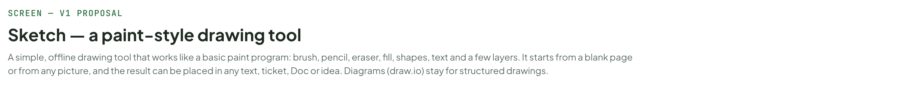
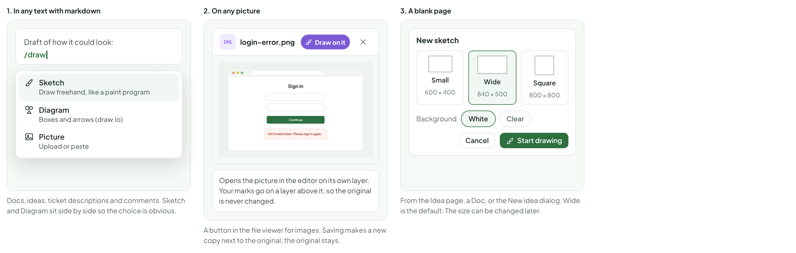
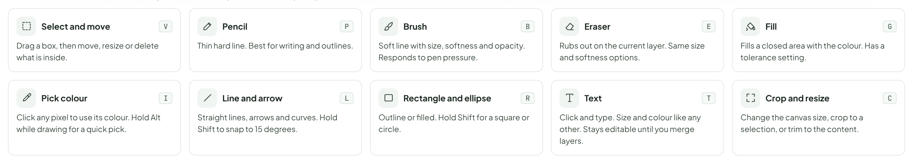
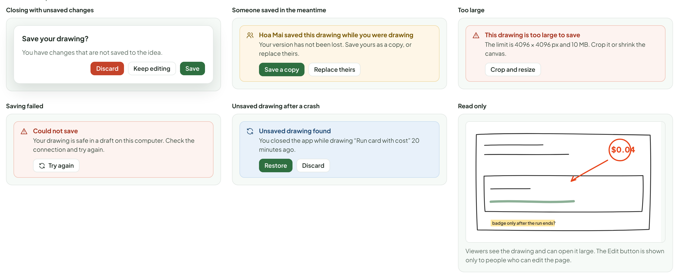
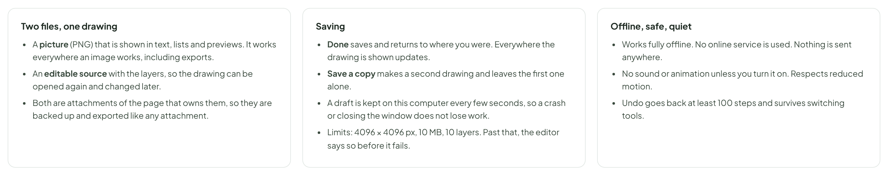
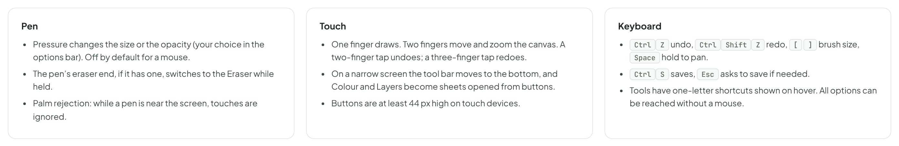
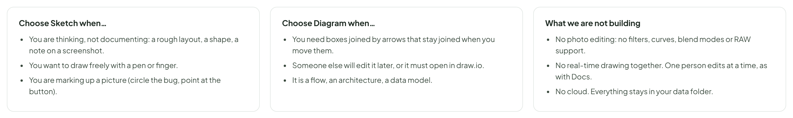

# Sketch — a paint-style drawing tool

> SCREEN — V1 PROPOSAL · source: [`Sketch.dc.html`](../source/Sketch.dc.html) · canvas `1793295530-5588` · sha256 `7e8ed32a94a424cfa9729dcbe7da6eb9585a9303418af4992a5e88f84a76be4f`

A simple, offline drawing tool that works like a basic paint program: brush, pencil, eraser, fill, shapes, text and a few layers. It starts from a blank page or from any picture, and the result can be placed in any text, ticket, Doc or idea. Diagrams (draw.io) stay for structured drawings. A third object, [Canvas](canvas.md), puts boards (pages, pictures, sketches, diagrams) side by side on one plane and appears in the same places.

Source: [Sketch.dc.html](../source/Sketch.dc.html) › header ("SCREEN — V1 PROPOSAL", "Sketch — a paint-style drawing tool" and the intro)

---

## A. Where you start a drawing

A drawing is one object that works everywhere pictures work: in text, on a ticket, in a Doc, on an idea. It always starts from an obvious place and always comes back to where you were.

Source: [Sketch.dc.html](../source/Sketch.dc.html) › block "A. Where you start a drawing"

- Text in the frames: "1. In any text with markdown" · "Draft of how it could look:" · "/draw" · "Sketch" · "Draw freehand, like a paint program" · "Diagram" · "Boxes and arrows (draw.io)" · "Picture" · "Upload or paste" · "Docs, ideas, ticket descriptions and comments. Sketch and Diagram sit side by side so the choice is obvious." · "2. On any picture" · "IMG" · "login-error.png" · "Draw on it" · "Sign in" · "Continue" · "401 Invalid token. Please sign in again." · "Opens the picture in the editor on its own layer. Your marks go on a layer above it, so the original is never changed." · "A button in the file viewer for images. Saving makes a new copy next to the original; the original stays." · "3. A blank page" · "New sketch" · "Small" · "600 × 400" · "Wide" · "840 × 500" · "Square" · "800 × 800" · "Background" · "White" · "Clear" · "Cancel" · "Start drawing" · "From the Idea page, a Doc, or the New idea dialog. Wide is the default. The size can be changed later."

---

## B. The editor

Opens full screen over the page, like the file viewer. It is a drawing tool in the style of a simple paint program: you draw with a brush or pencil, rub out, fill, add shapes and text, and work in a few layers. It does not try to replace a photo editor.

Source: [Sketch.dc.html](../source/Sketch.dc.html) › block "B. The editor"

- Text in the frames: "Run card with cost" · "SKETCH" · "in idea “Show cost on every AI run card”" · "100%" · "Save a copy" · "Done" · "Brush" · "Size" · "12 px" · "Softness" · "40%" · "Opacity" · "Pen pressure" · "Smoothing" · "30%" · "$0.04" · "badge only after the run ends?" · "COLOUR" · "#E8441A" · "Recent" · "LAYERS" · "Notes" · "Sketch" · "Background" · "840 × 500 px" · "x 412, y 236" · "Draft saved on this computer" · "Not yet saved to the idea"

---

## C. The tools

Ten tools, the ones a simple paint program has. One-key shortcuts. Everything else (blend modes, filters, curves) is left out on purpose.

Source: [Sketch.dc.html](../source/Sketch.dc.html) › block "C. The tools"

- Text in the frames: "Select and move" · "V" · "Drag a box, then move, resize or delete what is inside." · "Pencil" · "P" · "Thin hard line. Best for writing and outlines." · "Brush" · "B" · "Soft line with size, softness and opacity. Responds to pen pressure." · "Eraser" · "E" · "Rubs out on the current layer. Same size and softness options." · "Fill" · "G" · "Fills a closed area with the colour. Has a tolerance setting." · "Pick colour" · "I" · "Click any pixel to use its colour. Hold Alt while drawing for a quick pick." · "Line and arrow" · "L" · "Straight lines, arrows and curves. Hold Shift to snap to 15 degrees." · "Rectangle and ellipse" · "R" · "Outline or filled. Hold Shift for a square or circle." · "Text" · "T" · "Click and type. Size and colour like any other. Stays editable until you merge layers." · "Crop and resize" · "C" · "Change the canvas size, crop to a selection, or trim to the content."

---

## D. States and problems

Source: [Sketch.dc.html](../source/Sketch.dc.html) › block "D. States and problems"

- Text in the frames: "Closing with unsaved changes" · "Save your drawing?" · "You have changes that are not saved to the idea." · "Discard" · "Keep editing" · "Save" · "Someone saved in the meantime" · "Hoa Mai saved this drawing while you were drawing" · "Your version has not been lost. Save yours as a copy, or replace theirs." · "Save a copy" · "Replace theirs" · "Too large" · "This drawing is too large to save" · "The limit is 4096 × 4096 px and 10 MB. Crop it or shrink the canvas." · "Crop and resize" · "Saving failed" · "Could not save" · "Your drawing is safe in a draft on this computer. Check the connection and try again." · "Try again" · "Unsaved drawing after a crash" · "Unsaved drawing found" · "You closed the app while drawing “Run card with cost” 20 minutes ago." · "Restore" · "Read only" · "$0.04" · "badge only after the run ends?" · "Viewers see the drawing and can open it large. The Edit button is shown only to people who can edit the page."

---

## E. What is stored and how it behaves

Proposed.

Source: [Sketch.dc.html](../source/Sketch.dc.html) › block "E. What is stored and how it behaves"

- Text in the frames: "Two files, one drawing" · "A picture (PNG) that is shown in text, lists and previews. It works everywhere an image works, including exports." · "An editable source with the layers, so the drawing can be opened again and changed later." · "Both are attachments of the page that owns them, so they are backed up and exported like any attachment." · "Saving" · "Done saves and returns to where you were. Everywhere the drawing is shown updates." · "Save a copy makes a second drawing and leaves the first one alone." · "A draft is kept on this computer every few seconds, so a crash or closing the window does not lose work." · "Limits: 4096 × 4096 px, 10 MB, 10 layers. Past that, the editor says so before it fails." · "Offline, safe, quiet" · "Works fully offline. No online service is used. Nothing is sent anywhere." · "No sound or animation unless you turn it on. Respects reduced motion." · "Undo goes back at least 100 steps and survives switching tools."

---

## F. Pen, touch and keyboard

The tool must work with a mouse, a pen tablet and a touch screen.

Source: [Sketch.dc.html](../source/Sketch.dc.html) › block "F. Pen, touch and keyboard"

- Text in the frames: "Pen" · "Pressure changes the size or the opacity (your choice in the options bar). Off by default for a mouse." · "The pen’s eraser end, if it has one, switches to the Eraser while held." · "Palm rejection: while a pen is near the screen, touches are ignored." · "Touch" · "One finger draws. Two fingers move and zoom the canvas. A two-finger tap undoes; a three-finger tap redoes." · "On a narrow screen the tool bar moves to the bottom, and Colour and Layers become sheets opened from buttons." · "Buttons are at least 44 px high on touch devices." · "Keyboard" · "CtrlZ undo, CtrlShiftZ redo, [ ] brush size, Space hold to pan." · "CtrlS saves, Esc asks to save if needed." · "Tools have one-letter shortcuts shown on hover. All options can be reached without a mouse."

---

## G. Sketch or Diagram?

Both stay. They solve different problems, so the menu names them plainly and says what each is for.

Source: [Sketch.dc.html](../source/Sketch.dc.html) › block "G. Sketch or Diagram?"

- Text in the frames: "Choose Sketch when…" · "You are thinking, not documenting: a rough layout, a shape, a note on a screenshot." · "You want to draw freely with a pen or finger." · "You are marking up a picture (circle the bug, point at the button)." · "Choose Diagram when…" · "You need boxes joined by arrows that stay joined when you move them." · "Someone else will edit it later, or it must open in draw.io." · "It is a flow, an architecture, a data model." · "What we are not building" · "No photo editing: no filters, curves, blend modes or RAW support." · "No real-time drawing together. One person edits at a time, as with Docs." · "No cloud. Everything stays in your data folder."

---

### As shipped

Details where the design leaves a choice, or where the build differs. The full write-up (library decision, data format,
API) is in [`docs/specs/sketch-tool.md`](../../docs/specs/sketch-tool.md).

- Built with plain Canvas 2D, no library. A drawing is `uploads/sketches/<id>.png` plus `<id>.sketch.json`; text stays editable until its layer is merged down.
- In text a sketch is the image line ``; the Docs export writes it as a plain image of its PNG.
- The line tool draws straight lines and arrows only; **curves are not built**.
- Saving keeps one version of the drawing (PNG and source overwritten); the "Someone saved in the meantime" card uses a version number, and "Replace theirs" overwrites it. Docs page history shows the latest drawing.
- "Draw on it" saves the marked-up copy as a new sketch of the page or ticket the picture belongs to and adds it to the ticket's description; the original file is never touched.
- The undo history lives in the open editor only; a restored draft starts with an empty history.
