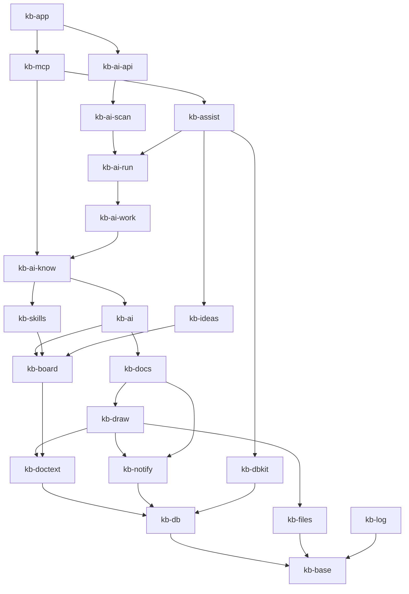

# Backend Architecture

The backend served a React UI and AI agents from one Python process until 4.0.x. Since 5.0.0 it is a Rust program, in
`server/`. This page describes it as it is now. The plan and the checklist of the move are in
`docs/specs/rust-migration.md`; the crates' rules are in `server/PORTING.md`.

## 1. Overview & Goals
- One native program, `kanban-server`, that serves BOTH a React UI (REST, plus the `/events` stream) AND AI agents (MCP, over HTTP and over stdio).
- Same process, same database, two interfaces. No runtime to install: the desktop app ships the program as it is.
- The UI stays stateless: everything it shows comes from the REST API and the event stream.
- Behavior did not change with the language. Paths, status codes, JSON shapes, error texts, event payloads, MCP tool names and schemas, and what is stored in the database are the same as in 4.0.x (the files in `server/contract/` record them).

## 2. Architecture Decisions
**MCP-first, not REST-first.** The MCP tools are written by hand, with descriptions meant for AI agents. Generating them from the REST routes would give names like `post_projects_project_id_tickets`, which a language model cannot use well. REST and MCP serve different models (resources and actions), so they share the service code and nothing else.

**One crate per area.** An area (board, Docs, drawings, ideas, the AI team...) owns its services, its REST routes and its MCP operations, so it builds and tests on its own. The crates form a layered graph (section 4).

**An MCP layer of our own.** `kb-mcp` speaks JSON-RPC itself (`initialize`, `ping`, `tools/list`, `tools/call`) over stdio and over stateless HTTP. The replies are part of the contract down to the framing, and the surface is small, so an SDK would add little. The tool list is served from a recorded snapshot (section 8).

**A router that matches like Starlette.** The first registered route that matches the path and the method serves the request, because the 4.x server answered that way and the UI relies on it (section 5).

## 3. Tech Stack

| Component | Technology |
|----------|-----------|
| Language | Rust 2024 (`rust-version` in `server/Cargo.toml`) |
| HTTP, SSE, WebSocket | `axum` 0.8 on `tokio`, `tower-http` |
| Databases | `sea-orm` 2.0 on `sqlx`: SQLite (default), PostgreSQL, MySQL/MariaDB, chosen at run time; hand-written SQL for the SQLite FTS5 search |
| MCP | JSON-RPC layer of our own (`kb-mcp`) |
| Migrations | Our own runner (`kb-db`), same revision ids and `alembic_version` table as before |
| AI | The Claude Code command line, started by the server or by the runner process |
| Tests | `cargo test`, with the `testkit` crate starting the built server |

## 4. Workspace

```
server/
  Cargo.toml          workspace, version 5.0.0
  crates/kb-*         one crate per area (list below)
  crates/testkit      test harness: starts the built server on temporary folders
  crates/fake-claude  stand-in for the Claude Code command line, for tests
  bins/kanban-server        the program (HTTP server, --runner, mcp-stdio, db, --routes)
  bins/kanban-mcp-stdio     launcher that hands over to `kanban-server mcp-stdio`
  contract/           recorded answers of the 4.0.1 server: the expected values of the tests
  e2e/                Playwright check of the real UI against the server
  scripts/            dev-databases.sh: a local PostgreSQL and MariaDB for the tests
```

A crate depends only on crates below it in this graph (an arrow reads "depends on"; transitive arrows are left out):



`kb-fuzzy` (the fuzzy-search scores, used by `kb-board`, `kb-docs` and `kb-assist`) has no dependency of its own.
What each crate holds is in `server/README.md`.

**A call that goes up is a hook.** The old Python code sometimes imported an upper area late, inside a function (a
ticket move that stops an AI run, a comment that notifies, a database copy that rebuilds the Docs search index). A
lower crate cannot name an upper one, so it declares a trait and a `static` slot (`kb_board::hooks`, `kb_docs::hooks`,
`kb_mcp::hooks`, `kb_dbkit::hooks`...) and calls through it, doing nothing when the slot is empty. `kb-app` is the one
crate that sees every area, and `kb-app/src/hooks.rs` (`install()`) fills the slots once, at the start of every
process: the server, the runner and the stdio MCP server.

**The service layer.** Business rules live in an area's services (`kb_board::tickets`, `kb_docs::docs`...), called by
both the REST routers (`src/api/`) and the MCP operations (`kb-mcp/src/operations/`). Request and response models are
`serde` structs next to the code that uses them (`schemas.rs`). Rules that must hold for every caller, such as the
parent rules of a ticket, an atomic ticket number (`kb_db::sql::bump_counter`) or the activity log written on a
change, are in the service and not in a router.

## 5. The Request Path

`kb_app::app()` builds one `axum` router out of every area's routes and wraps it in six middlewares, outermost first:

| # | Middleware | What it does |
|---|---|---|
| 1 | `log_requests` | Logs a 4xx at warning level and a 5xx at error level, with the time taken |
| 2 | `record_activity_actor` | Names who acts: the board's user, or the name in `X-Actor`. Each request runs in a context of its own (`kb_base::ctx`), so the activity log attributes a change to the right actor. It also notes the local address the request came in on (where a run's CLI reaches the board, and the draw.io origin) |
| 3 | `require_the_apps_secret` | When the desktop app gave the server a secret on its standard input, a POST, PUT, PATCH or DELETE needs it in `X-Kanban-Secret` (except `/mcp`, `/logs/client`, `/ai/hooks`, `/internal/ai/`). Without the app nothing is checked |
| 4 | `database_unreachable` | While a PostgreSQL or MySQL database does not answer, a request that needs it gets one quick 503 with `code: database_unreachable`, which the UI shows as its reconnect screen (not for `/database`, `/version`, `/settings`, `/events`, `/logs`, `/mcp-clients`, `/assets`, `/drawio` and the UI's files) |
| 5 | `cors` | Starlette's CORS as before: every origin, no credentials. Safe because the server binds to `127.0.0.1` only |
| 6 | `starlette_methods` | Answers HEAD with 405 and names no `HEAD` in an `Allow` header, and gives a 204 its `content-type`, as FastAPI did |

The router is `kb_base::routes::Routes`. An area exposes `routes()`; `kb_app::routes()` merges them in a fixed order
(the MCP endpoint, the draw.io editor, board, skills and settings, notifications, database, ideas, Docs, drawings, the
AI routes, the assistants, `/health`, `/version`, uploads, `/events`, and the static UI last). A request goes to the
first route whose path and method both match; a route that matches only the path answers 405 when no later route
matches fully, and nothing at all answers 404. So the order of registration is part of the contract: two routes that
overlap (`/things/{id}` and `/things/counts`) give the same outcome they gave in 4.x. `kanban-server --routes` prints the table, and
`cargo test -p kb-app --test route_coverage` compares it with `contract/openapi.json`.

A handler reads its input through `kb_base::error::{Body, Query, Path}`, which answer 422 in the shape the UI
expects, and returns `ApiResult<T>`; an `ApiError` is `{"detail": ...}` with its status. It opens a session with
`kb_db::session()` (next section), commits where the old code committed, and publishes an event (section 7).

## 6. The Database Layer (`kb-db`)

- **Targets.** `targets` names the database in use (the `KANBAN_DATABASE_URL` variable, else the choice saved in
  `~/.kanban-board/config.json`, else the SQLite file `kanban.db` in the data folder) and opens a pool for it:
  SQLite in WAL mode, or PostgreSQL or MySQL/MariaDB. The board can switch databases while it runs (`use_target`); the
  process follows a switch made by another one (`follow_settings`, every 2 seconds).
- **Sessions.** `kb_db::session()` gives a `Session` that works like the SQLAlchemy session of 4.x: a read runs without a
  transaction, the first write opens one, `commit()` makes it permanent, and dropping a session without a commit rolls
  back. There is no unit of work: to change a row, write the UPDATE (`row.into_active_model()`, set the columns,
  `.update(&session)`). On PostgreSQL and MySQL a commit that wrote also appends a row to `kanban_change` in the same
  transaction (section 7).
- **Entities.** `entities/` holds one module per table (77), each with `Model`, `Entity`, `Column`, `ActiveModel` and
  `new()`, an `ActiveModel` with the defaults a new row gets. They were generated once from the 4.0.1 tables and are
  edited by hand, together with the migrations. `entities::META` lists the columns and what points at what. Columns
  hold what they held before: times are ISO strings (microseconds, `+00:00`), lists and objects are JSON text written
  by `kb_base::pyjson`, which writes it as Python's `json.dumps` did.
- **Schema and migrations.** `schema/{sqlite,postgres,mysql}.sql` is the schema at the newest revision, used to make an
  empty database. `migrations/` has one module per revision (80), applied in the order Alembic applied them, in one
  transaction, and stamped in `alembic_version` with the same ids. So a database from 4.0.x opens in 5.0.0, and one
  from 5.0.0 opens in 4.0.x. A database made by a newer version is refused and left alone. On SQLite and PostgreSQL a
  failed upgrade rolls back whole; MySQL commits at each schema change, so its revisions check what is already there.
- **Rules the code relies on.** Foreign keys are not enforced on any engine. Queries run on all three engines: use the
  query builder, or `kb_db::sql::statement` for a hand-written one, and branch on `session.dialect()` only where a
  difference is needed (the SQLite FTS5 search is the main one).

The commands that move a board between databases are in `kb-dbkit` (`kanban-server db ...`); see
`docs/guideline/databases.md`.

## 7. The Event Stream

`kb_base::events` is the bus behind `GET /events`. A change publishes an announcement: `"invalidate"` (anything may have
changed), `{"type": "invalidate", "topics": [...]}` (refetch only what depends on the topics), or a typed event
(`ai.step`, `ai.run`, ...) that carries the change itself. `kb_app::sse` turns the bus into Server-Sent Events: a
`: connected` line, one `data:` block per event, and a `: ping` comment after 30 seconds of silence. Each listener has
a queue of 100; when it is full the oldest event is dropped, so a slow window never stops the others.

A change made by another process (the stdio MCP server an editor started, a second board on the same database) does not
pass through this process's `publish`. `database::watch_database` (started by the lifespan) notices it: on SQLite it
reads `PRAGMA data_version`, on PostgreSQL and MySQL the newest row of `kanban_change` written by another process, and
publishes an `invalidate`.

## 8. The MCP Layer (`kb-mcp`)

- **Transports.** `protocol::http` serves MCP at `/mcp/` (the trailing slash is part of the path), stateless, with the
  refusals the MCP SDK gave (content type, `Accept`, local `Host` and `Origin`). `protocol::stdio` serves it on standard
  input and output for `kanban-server mcp-stdio`; that process sets up its own database connection, follows a database
  switch as the server does, and writes its log to a file of its own, because standard output carries the protocol.
  `kanban-mcp-stdio` is a launcher beside `kanban-server` that hands over to it, so the MCP entries that earlier
  versions wrote into editors keep working. `mcp-stdio --bridge` forwards stdio to the board's HTTP endpoint with a
  run's token (`bridge`).
- **The tool list.** What an agent reads about a tool (name, description, input and output schema, annotations) and the
  server's `instructions` are served from `contract/mcp-tools.json` and `mcp-tools-ideas.json`, which the crate embeds,
  and not built from the code. `registry` pairs each name in the snapshot with a function in `tools/` (13 tools; the 5
  Idea Space tools only when `KANBAN_MCP_IDEA_TOOLS` is on), and a test fails when the snapshot and the table disagree.
  Changing a tool's description is a change to the snapshot.
- **A call.** `validation` checks the arguments against the tool's input schema and words a refusal as the SDK did; the
  tool routes its `action` to an operation in `operations/` (one function per verb), which calls the area's services; a
  failure becomes a result with `isError` and a message that says how to fix the call.
- **Who is calling.** A run of the AI team reaches MCP with its own bearer token. `kb-ai::guard` resolves it to the
  run, so the change is attributed to the AI and a write the run already made before a resume is skipped (`kb-mcp`
  reaches it through a hook).

## 9. AI Runs and the Runner Process

The AI team's code is in the `kb-ai*` crates: the store, limits, guard and audit (`kb-ai`); packs, skills, memory and
the knowledge base (`kb-ai-know`); worktrees, pull requests and the timeline (`kb-ai-work`); the Claude Code CLI, its
stream, accounts, launch, teams, runs and schedules (`kb-ai-run`); the repository scan (`kb-ai-scan`); and the routes
(`kb-ai-api`).

A run is a row. The API queues it and a scheduler starts the Claude Code CLI for it, reads its stream into step rows,
and publishes typed events. By default `kanban-server` starts the CLIs in a second process, `kanban-server --runner`
(`KANBAN_RUNNER=process`, which the program sets unless the variable is set), so that the API never shares its time with a
run's stream:

- The API writes commands (cancel, message, answer, wake) to the `ai_run_command` table; the runner reads the table every
  half second.
- The runner writes steps to the database and sends every board event back with `POST /internal/ai/events`, so the
  people's windows hear it.
- The runner looks at the API process every 3 seconds; when it is gone it stops its CLIs and exits. The API starts a new
  runner if it dies (at most 5 starts in 10 minutes), and logs to `<data folder>/ai-v2/runner.log`.
- The runner does not migrate the database; the API did before it started the runner.

With `KANBAN_RUNNER` unset in a library test of a crate, the runs go on in the test's own process ("in process").
`fake-claude` stands in for the CLI in every test, so no test needs a Claude sign-in.

## 10. What Runs for the Lifetime of the App (`kb-app/src/lifespan.rs`)

`kb_app::serve` binds a port on `127.0.0.1` first, then `lifespan::startup()` runs in this order, and `READY port=N` is
printed only after it finished:

1. Register the hooks, set up the database pool, bring the schema up to date (`init_db_or_wait`: a server database that
   does not answer leaves the app up in its "cannot reach the database" state, retrying, instead of failing to start).
2. Follow the database setting every 2 seconds (`follow_settings`).
3. Sweep expired ticket workspaces every hour (`kb_board::workspace::sweep_loop`).
4. Watch for changes made by other processes (`watch_database`).
5. The AI runs: recover what the last start left, then start the run scheduler, or the runner process (section 9).
6. Recover the Docs AI jobs and the Board AI chats that a stop interrupted (a failure here stops the start).
7. Start the schedule loop (AI teams that work on a ticket at a set time).
8. Start the notification loop (closes rows, writes each person's card of the day, prunes).
9. Start the watcher of the pull requests the board opened.
10. Scan project repositories again every 30 minutes, to propose a changed CI or package setup (a person applies it).

On Ctrl-C or SIGTERM the server stops accepting requests, and `lifespan::shutdown()` stops the work in the reverse order:
the pull request watcher, the repository rescan, the notification loop, the schedule loop, the run scheduler (the runs
end as `board_closed` and their CLI process trees are killed), the sign-in terminals, then the three loops of steps 2 to 4. No CLI process outlives the board.

## 11. Testing Convention

- **Developer self-tests first**: every backend task includes tests before it is handed off, in the crate of the area (`crates/<crate>/tests/`). Unit tests of a module sit in the module.
- **Black-box through the real server**: tests that go through HTTP or MCP use `testkit`, which starts the built `kanban-server` on temporary folders with its own `KANBAN_CONFIG_DIR` and `KANBAN_DB_PATH`, and clients for REST, MCP and the event stream. Build the server first: `cargo build -p kanban-server -p kanban-mcp-stdio -p fake-claude`.
- **The recorded answers** in `contract/golden/` are the expected values, taken from the 4.0.1 server. They are the regression baseline: do not record them again to make a test pass.
- **QC is black-box**: QC tests REST endpoints and UI behavior only, from the API contract (`contract/openapi.json`) and the UI, not from the source. `e2e/` is the automatic version of the UI part.
- Run only the crates you changed (see the repository's `CLAUDE.md`).

## 12. Important Gotchas

1. **Route order is behavior.** Register a router's routes in the order the contract lists them; the first match wins.
2. **Stored formats must not drift.** Times come from `kb_base::time::now_iso()`; JSON in TEXT columns is written by `kb_base::pyjson`; build objects in the key order the old code used. Text the user or an AI reads (errors, descriptions, prompts) is copied as it was.
3. **Commit where the old code committed.** A session that is dropped without `commit()` rolls back. There is no after-commit hook: call the reaction (an event, a notification) right after `commit()`.
4. **SQLite concurrency.** WAL mode and a 30-second busy timeout let the board and the stdio MCP process share one file; a writer waits for the other.
5. **Never change the process environment after start-up.** `std::env::set_var` is unsafe with threads; `main` does it before the runtime starts, and a value that changes later lives in a `static` with a setter.
6. **A task that must inherit the actor** (who is acting, which run) is started with `kb_base::ctx::spawn`, not `tokio::spawn`.
7. **MCP over HTTP is stateless** and lives at `/mcp/` with the trailing slash. Do not add a session.
8. **Schema sync rule.** A change to a REST model, or to an entity in `kb-db`, must be reflected in the matching file of `ui/src/types/` in the same commit.
