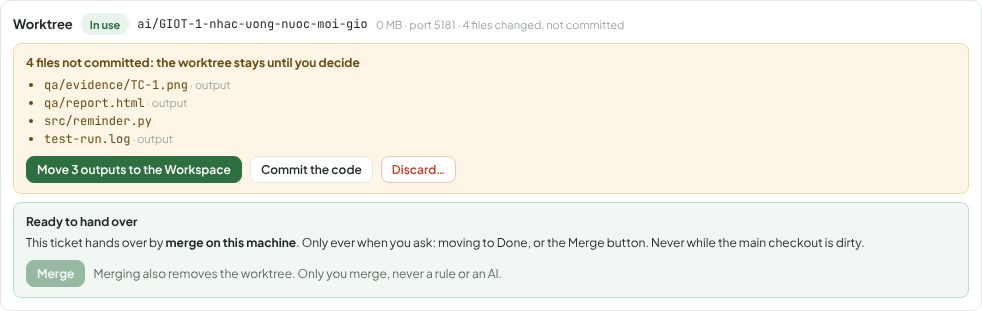
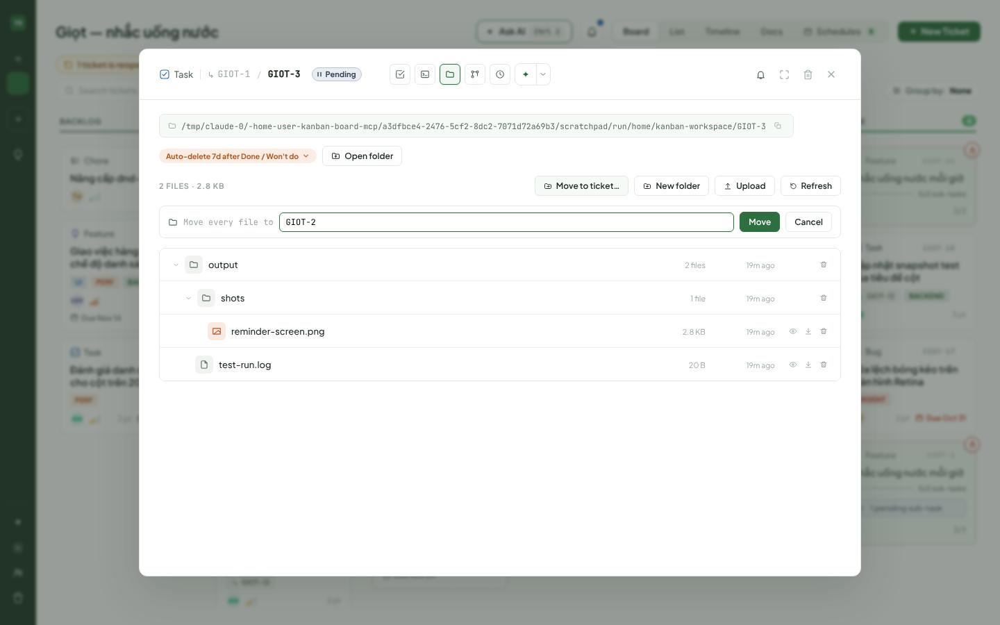

# Issue #269: tickets for AIs, the Workspace and the worktree

What an AI had to guess to use a ticket, what was not true in the QA → PM case and why, and the Workspace screen and
API against `design/source/Workspace.dc.html`. The ticket screens' 1:1 tables are in [`detail.md`](detail.md) and
[`board.md`](board.md).

## 1. An outside agent's full ticket life over MCP

A script that uses only the board's MCP server (streamable HTTP, `/mcp/`), the way Claude Code or another agent
outside the board does: read the guides, create a ticket with criteria, split it (two sub-tickets, two sub-tasks),
block it on another, link it, log work (as a Dev and as a reviewer), add a branch, add test cases and pass one with its
output, attach a screenshot and a log, write a Docs page and link it, get the Workspace, tick the criteria and close it
with a comment. Run before the change (GIOT-1) and after (GIOT-21) on the same server.

| Step | Before | After |
|---|---|---|
| What a good ticket is | no guide: `docs_read(guides)` covers how to work, not the parts of a ticket | `docs_read(ticket_guide)` (also the `working-with-tickets` skill) |
| Create with criteria | `manage_ticket(create)` takes none: a second call, and with the AI team's intake on, the team could take the ticket before it had any | `acceptance_criteria=[...]` on create, written with the ticket |
| Work log as a reviewer | `role='Reviewer'` refused; nothing says which of PM, Developer, BA, Tester, Designer, Other to use | the field says it: QA → Tester; reviewer, security, writer → Other |
| Attach a file | no action; a comment with the absolute path kept the local path, so the picture was broken on the board | `ticket_items(item='attachment', path=<absolute path>, text=…)` posts it in a comment and returns `attached.markdown`; a picture or document named by its absolute path in a comment, work log, proof or Docs page is copied too (keys, `.env` and dot folders are never copied) |
| Everything else (split, block, link, branch, test cases, link a doc, close) | worked from the tool descriptions | same |

Guesses: **5 before, 0 after.** Still true and written in the guide rather than changed: moving a blocked ticket to
Done is not refused by the board (a person may), so the guide says not to.

## 2. The QA → PM case

A QA run made output files in its worktree. The PM then said they were in the ticket's Workspace. The owner opened the
Workspace: nothing there, the Workspace had never been created. The PM also said the worktree was "not cleaned".
No live AI run was made for this PR (live runs need the scenarios agreed with the owner first); the case was rebuilt
from the code, with a QA run of the test CLI that leaves files in its worktree
(`tests/test_tickets_269.py::test_a_runs_outputs_go_to_the_workspace_and_the_work_log_says_where`) and by hand on the
running board (GIOT-1).

| # | What happened / what an AI said | True? | Why | Fix |
|---|---|---|---|---|
| 1 | The QA saved its screenshots and report in its working folder | — | Nothing told it about the Workspace: no persona, workflow step or run prompt named it, only one line in `manage_ticket`'s docs. The QA skill said "a path in your folder" | Every run's prompt says where files go: code in the worktree, committed; outputs in the ticket's Workspace, with its path (made when the run starts, when Workspace is on). The QA and user-tester skills and their workflow steps say so too |
| 2 | (Even told, it could not have written there) | — | Claude Code runs in `dontAsk` mode, which writes only inside its working folder | `--add-dir <Workspace>` on every work run of a ticket; a file there can be named in a proof or comment like one in the worktree |
| 3 | PM: "the files are in the ticket's Workspace" | **No** | `get_ticket` returned `workspace_path` whether or not the folder existed, and nothing about what was in it | `get_ticket` returns `workspace: {path, exists, file_count, files, note}` read from disk ("Not created yet: nothing is in it"), and `workspace_path` only when the folder exists |
| 4 | PM: "the worktree was not cleaned" | Vague | The worktree is never removed while something is uncommitted; the QA's untracked files were that something. Nobody was told which files, nor what to do | `get_ticket` returns `worktree: {path, branch, state, uncommitted, outputs, note}`; the ticket's AI view lists the files (outputs marked) with **Move N outputs to the Workspace**, **Commit the code** and **Discard…** (asks first) |
| 5 | (Not said by anyone, worse) | — | At Review and Done the hand-over ran `git add -A`: the QA's screenshots and logs were committed into the product's branch, pushed in the pull request and merged | Outputs are moved to the Workspace before any hand-over commit, and left out of it when the Workspace is off |
| 6 | — | — | — | When a run ends, the board moves the outputs it finds in the worktree to `Workspace/from-worktree/<date-time>/` and writes in the work log what moved and where, so the PM reads the exact place. A run waiting for an answer keeps its files |
| 7 | — | — | — | "Never claim without checking" is a rule in every run's prompt and the MCP instructions (before saying a file, branch or page exists or where it is, look and name the place), and the PM's line in its prompt repeats it |

What counts as an output: an untracked file under a folder such as `qa/`, `evidence/`, `screenshots/`, `test-results/`,
`playwright-report/`, `reports/`, `output/`, `artifacts/`, `*_work/`; a log, trace or recording anywhere; a document or
picture at the top of the worktree. A changed tracked file, or a new file anywhere else (`src/`, `tests/`), is code.

What the PM now reads for GIOT-1 (a worktree with a QA's three outputs and one new source file):

```json
"worktree": {"branch": "ai/GIOT-1-nhac-uong-nuoc-moi-gio", "state": "active",
  "uncommitted": ["qa/evidence/TC-1.png", "qa/report.html", "src/reminder.py", "test-run.log"],
  "outputs": ["qa/evidence/TC-1.png", "qa/report.html", "test-run.log"],
  "note": "4 files not committed, 3 of them outputs (screenshots, logs, reports): the worktree is not removed until a person commits, moves or discards them."}
```



Before, the same block showed only "4 files changed, not committed" and offered nothing.

## 3. Where each kind of file goes (written in the ticket guide)

| What | Where |
|---|---|
| Code, tests, docs that ship | the worktree (or the repository), committed on the ticket's branch |
| Outputs a person should see: reports, screenshots, logs, exports, recordings | the ticket's Workspace; the ones that prove a result also attached to the ticket |
| Scratch nobody needs | deleted before the run ends |

## 4. Workspace screen and API vs `Workspace.dc.html`

| Section | Design | Code today | Gap | Fix |
|---|---|---|---|---|
| Enabled, with files | path chip, auto-delete chip, Open folder, "6 items · 12.4 MB", Refresh, a tree of folders and files, "read-only listing" footer | the same, plus New folder, Upload, drag and drop, preview, download, delete | the code does more (CHANGELOG 3.0: "a real file manager") | kept code |
| Not enabled | "Workspace isn't set up yet", Open Settings | `WorkspaceNotSetUp` in the ticket, same copy | none | none: matches |
| Enabled, empty | "Empty — the folder exists, nothing's been written to it yet." | "No files yet. The folder exists, nothing has been written to it yet." and a drop hint | wording | kept code (same meaning, plus how to add files) |
| Folder not made yet | (not drawn) | "This ticket has no workspace folder yet." + Create folder | — | kept code |
| Retention control | menu: 7 / 14 / 30 days, Keep forever, hint | menu with "Use the workspace default" too (wave 3) | the code does more | kept code |
| Settings preview | enable, root folder, default retention | Settings › Workspace | none | none: matches |
| A deleted ticket's folder | "left as-is until its own retention expires" | deleted with the ticket | decided otherwise in CHANGELOG 3.0 ("Deleting a ticket cleans up after itself") | kept code |
| Open folder | opens the folder | made the folder first and then failed when the machine has no file manager, leaving an empty folder behind | bug | the opener is checked first |
| Move to another ticket | (not drawn; the issue asks for it) | only an idea's folder followed it to its ticket | missing | `POST /tickets/{id}/workspace/move` (move or copy, same project, recorded in both tickets' activity) and **Move to ticket…** in the panel |
| AI and the Workspace | "AI tools … can dump input files, intermediate output, logs" | no run knew the path, nor could write there | see section 2 | see section 2 |

Checked against the running API: create, a folder, upload into it, a path escaping the folder (refused), the listing,
a text and an image preview, retention (7 days, then the default), open folder without a file manager, move to
another ticket (and refused for the same ticket, another project, or no folder).



## 5. What each role writes on a ticket

In the guide's table, and the line for the member's own role in its run's prompt:

| Role | Leaves on the ticket |
|---|---|
| Triage | the type, labels, workflow and review depth, and one comment saying why |
| PM | the split (sub-tickets with their criteria, blocks between them), the plan in a comment, its rulings; before telling a person where something is, it opens it and names the exact place |
| BA | acceptance criteria a tester can check, a spec page linked when design, build or test work from it, the open questions |
| Designer | the canvas line, a spec per screen, a picture of each screen |
| Dev | the work log (plan, root cause, tries), the branch, the red then green test run, each criterion ticked with how, a note for the reviewer |
| Reviewer | findings, one per comment (must fix or suggestion, file:line, a case), the VERDICT line |
| QA | test cases from the criteria, each run with status and proof, a failure anyone can repeat; outputs in the Workspace |
| User tester | one comment with the person's story, the steps and screenshots in it |
| Technical writer, DevOps, Security reviewer, Data analyst | see `server/services/ticket_guide.py` |
